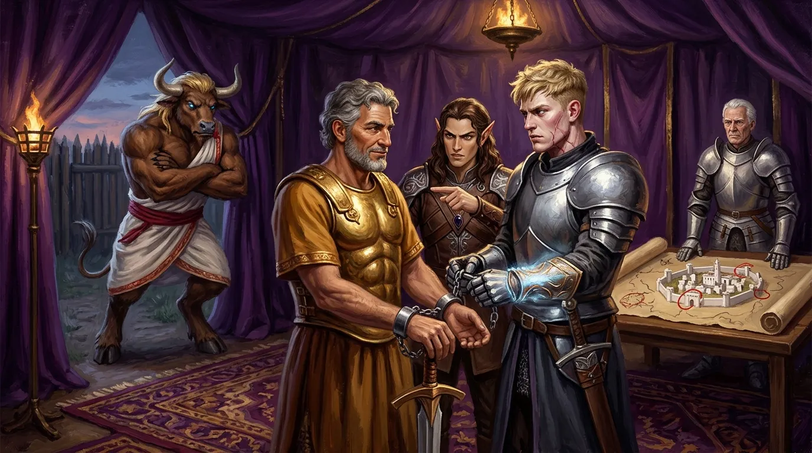
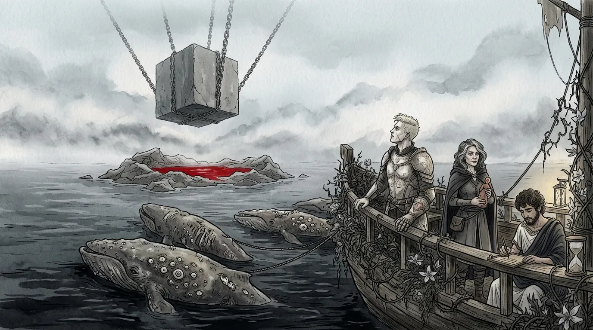
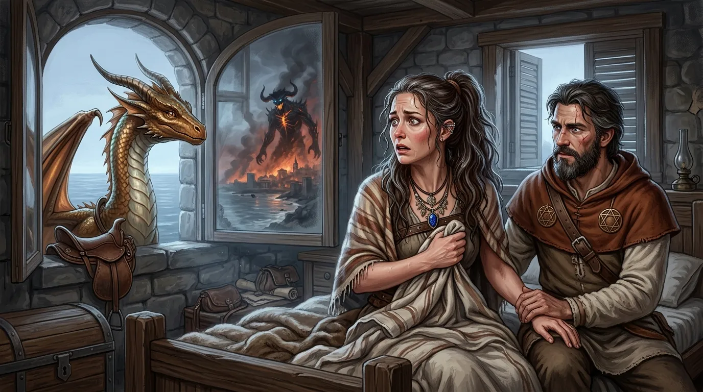
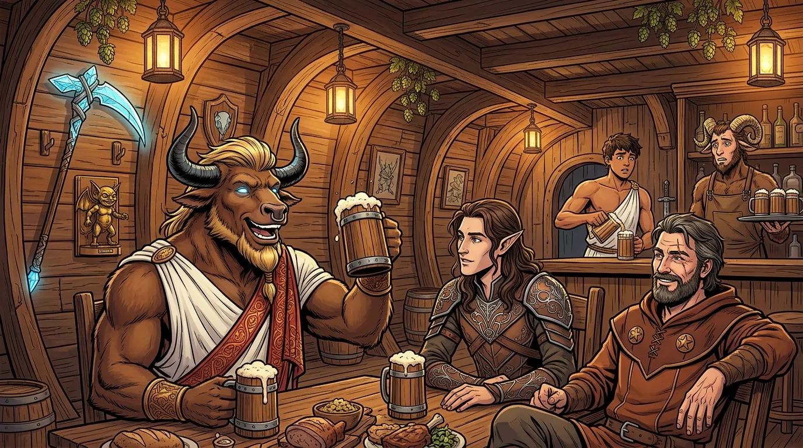
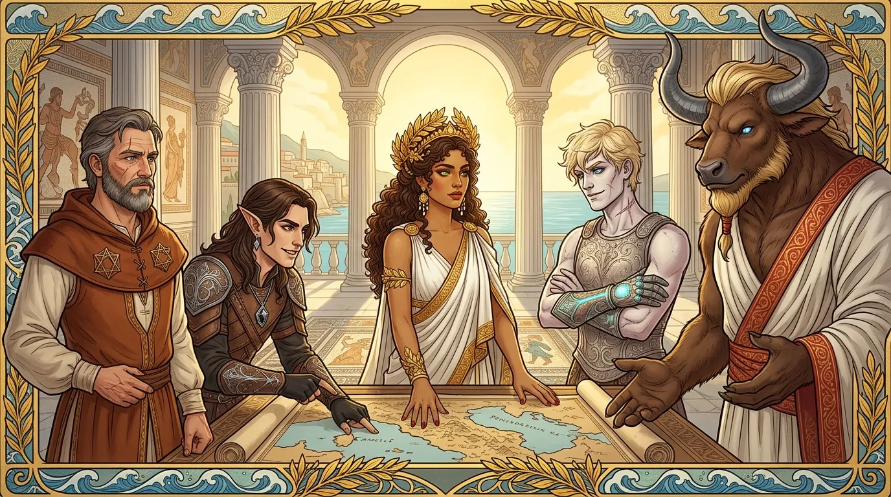
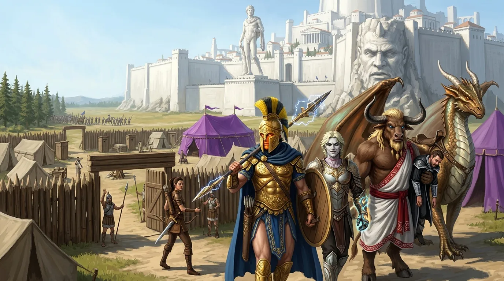
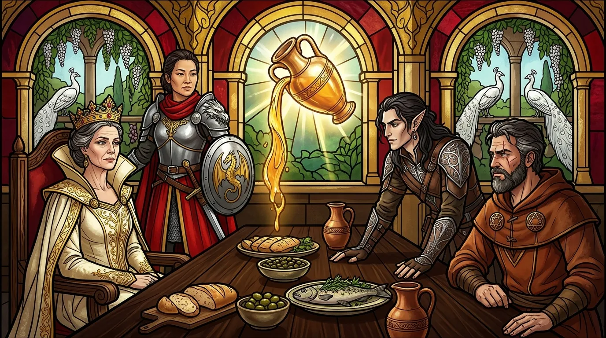

**Data**: 02.11.2026

## Podsumowanie

[Prompt](../assets/sessions/085/085_theme_arrest_in_the_purple_tent.txt)

### Thylea Piętnaście Lat po Wojnie

[Prompt](../assets/sessions/085/085_sec1_the_barge_and_the_prison_cube.txt)

Piętnaście lat po wojnie z [[Tytani|Tytanami]] w odbudowanym **[[Mytros]]** sale **[[Akademia Mytros|Akademii Mytros]]** na wzgórzu pałacowym ledwo mieściły rekrutów. **[[Vallus]]** rządziła miastem wraz z radą, której z roku na rok oddawała coraz więcej kompetencji. Zasiadający w radzie **[[Taran Neurdagon]]**, główny fundator odbudowy stolicy, coraz głośniej domagał się dla miasta „wiecznego bezpieczeństwa”. **[[Świątynia Pięciu]]** nosiła imię **[[Mytros (Bogini)|Bogini Mytros]]** i służyła jako kaplica pamięci, a przy rozstajach dróg stały kapliczki **[[Bohaterowie Przepowiedni|Bohaterów Przepowiedni]]**. Puste domeny po dawnych bogach i poległych Tytanach pozostawały nietknięte. Na **[[Wyspa Yonder|Wyspie Yonder]]** **[[Felicjan Janus Twardowski]]** odbudował **[[Zakon Smoczych Lordów]]**, a w **[[Estoria|Estorii]]** rządziła królowa **[[Anora]]**, odkąd jej ojciec **[[Pythor]]** oddał tron i ruszył w drogę z **[[Orion Xul|Orionem Xulem]]**.

W **[[Orestessos Zythikē]]**, dawnym Rosos, dymiły warzelnie, do których **[[Volkan]]** projektował kadzie. Tamtejsze piwo wypierało wino z winnic **[[Arezja|Arezji]]** i Mytros, lecz w arezyjskim porcie celnicy otwierali beczki do kontroli i trunek nieraz kwaśniał, zanim trafił do szynków. Oba miasta licytowały się o udziały w jedynej kopalni żelaza na **[[Wyspa Indygo|Wyspie Indygo]]**, strzeżonej przez krasnoludy z **[[Plemię Wieloryba|Plemienia Wieloryba]]**, przez co ceny rudy rosły co sezon. Na północy **[[Półwysep Arezyjski|Półwyspu Arezyjskiego]]** minotaur [[Zakroth]], zbiegły z Mytros w [[Sesja 20 - Noc Długich Rogów|Noc Długich Rogów]], zebrał kilkuset minotaurów, fey, satyrów, centaurów i gigantów. Przez lata łupił majątki oligarchów z Mytros, według plotek początkowo za pieniądze Arezji, ale od kilku miesięcy palił też arezyjskie folwarki i spichlerze.

Na **[[Morze Otchłani|Morzu Otchłani]]** barka **[[Hypnos]]**, ciągnięta przez przegniłe wielookie wieloryby i wciąż porośnięta ogrodami **[[Lutheria|Lutherii]]**, zbliżyła się do skalistej wysepki z jeziorem czerwonym od krwi bazyliszków. **[[Versir]]**, z **[[Hand of Kentiname]]** na dłoni, przyglądał się wiszącemu na pięciu adamantowych łańcuchach **[[Sześcian Więzienny|Sześcianowi Więziennemu]]**. Siedzący przy relingu **[[Edran]]** przeliczył na woskowej tabliczce piasek w klepsydrze i ocenił, że zostało stabilne dwieście osiemdziesiąt pięć lat, o rok mniej niż podczas poprzedniej wizyty. Stojąca na dziobie **[[Astra]]**, w której włosach widać już było srebrne nitki, pokazała Versirowi gliniany posążek z nowej kapliczki na nabrzeżu Mytros. Powiedziała, że nie zawsze będzie przy nim i że to on jest najbardziej godny, by sięgnąć po puste domeny, albo przynajmniej powinien zwolnić i odpocząć od poszukiwań **[[Goloron Pierwszy|Golorona Pierwszego]]** oraz nowych **[[Mojry|Mojr]]**. Versir odparł, że jako relikt minionej ery nie sięgnie po żadną domenę i nie zatrzyma się, póki nie znajdzie Golorona. Edran wyczytał jeszcze w zwojach, że **[[Królestwo Syren]]** wskazywał dawniej nieznany dziś gwiazdozbiór syren, więc postanowili zapytać o to **[[Arevon Elorrenthi|Arevona Elorrenthi]]**.

> [!quote] Astra
> Ja nie zawsze będę przy tobie. Domeny stoją puste.

> [!quote] Versir
> Słyszę twoje słowa, Astra, ale nie mogę się zatrzymać. Muszę znaleźć Golorona.

W Orestessos Zythikē trwało święto browaru pod złotymi flagami z rogatym kuflem. Syn **[[Orestes|Orestesa]]**, **[[Zythion]]**, odbywał w tym czasie praktyki u **[[Brax|Braxa]]** w Mytros, dokąd wybrał się też osiemnastoletni **[[Krithon]]**. **[[Silenos]]** wyszedł minotaurowi naprzeciw z dwoma kuflami, Volkan stukał młotem w zawory kadzi, **[[Pholon]]** pilnował stołów i swojego udziału w wysokości dwunastu i pół procent utargu, a z kuchni dobiegały krzyki **[[Ramsus|Ramsusa]]**. Po przemowie ku czci wuja, dziadka, syna i piętnastu lat pokoju Orestes otworzył reprezentacyjną beczkę ciemnego piwa Krithona leżakowanego po winie, lecz trunek okazał się skwaszony winnym octem, co minotaur uznał za sabotaż winiarzy z Arezji. Wieczorem młody pracownik, Marcinek Trzeci, poprosił o „święcenia barmańskie”. Rytuał wymagał wypicia z Orestesem piwa z półlitrowego kufla jednym ciągiem bez uronienia kropli; chłopak zakrztusił się przy drugiej połowie i ulał piwo, więc Orestes wyznaczył mu poprawkę za tydzień.

> [!quote] Orestes
> Znaczy, ja nie potrzebuję dowodu, żeby znać winnych.

### Koszmary, Żelazo i Dezerter

[Prompt](../assets/sessions/085/085_sec2_nightmare_at_dawn.txt)

Na Wyspie Yonder o świcie **[[Melania Twardowska]]** obudziła się z krzykiem, ściskając prześcieradło. Opowiedziała [[Felicjan Janus Twardowski|Felicjanowi]] sen o płonącym Mytros i kipiącej zatoce, z której wyszła czarna postać wyższa niż latarnia, z baranimi rogami, żarem w pęknięciach ciała i niebieskim światłem z oczu, od którego znikały mury i ludzie. Felicjan rozpoznał w tym co do szczegółu wizję od **[[Wiedźma Lotosu|Wiedźmy Lotosu]]**, lecz zachował kamienną twarz i uspokoił żonę. Przez okno zajrzał brązowy smok **[[Kairos]]**, pytając o krzyk, po czym ostrzegł, że **[[Aleksander Twardowski]]** wstał przed słońcem. Na dziedzińcu, gdzie lądowała **[[Ataraksja]]** z **[[Corinna|Corinną]]**, Aleksander siedział na grzbiecie wyrośniętego niebieskiego smoka **[[Paradoks|Paradoksa]]** i na głos czytał list swojej siostry **[[Triya Twardowska|Triyi Twardowskiej]]** do pracownika z **[[Ultros|Ultrosa]]**, który sam wnosi z nabrzeża pełne beczki. Felicjan uciszył rodzeństwo.

Po śniadaniu **[[Klonicjan]]** przyprowadził posłańca od [[Taran Neurdagon|Tarana Neurdagona]]. Kupiec, obiecując dalsze finansowanie skrzydła biblioteki, prosił o smoka z jeźdźcem do ochrony lądowych konwojów na [[Półwysep Arezyjski|Półwyspie Arezyjskim]]; wypytany przez czarodzieja posłaniec przyznał jednak, że Taranowi zależy na demonstracji siły pod samymi murami Arezji. Felicjan zapowiedział, że poleci tam osobiście i zatrzyma się w filii Zakonu.

Przy plaży Wyspy Indygo, niedaleko zakotwiczonego **[[Tranquility]]**, cumowały dwie galery Neurdagonów i płaskodenny statek z Arezji. [[Arevon Elorrenthi|Arevon]] i towarzysząca mu od czterech dni **[[Kyrah]]** przysłuchiwali się negocjacjom przed wodzem **[[Delg|Delgiem]]** i starszyzną Plemienia Wieloryba. Wysłannicy Neurdagonów wyłożyli skrzynię srebra za wyłączność na pięć lat z góry, a kupcy z Arezji oferowali wyższą sumę płatną w ratach, lecz Delg odrzucił wyłączność i utrzymał podział urobku między oba miasta. Kyrah zauważyła, że spory z każdym rokiem przybierają na sile, a Arevon ostrzegł, że Taran może posunąć się do prowokacji i upozorować napaść Arezji na kupców z Mytros, by zdobyć głosy w radzie. Wieczorem przy ogniskach **[[Plemię Delfina|Plemienia Delfina]]** przywódczyni **[[Delfin]]** poczęstowała druida winem i zapytała, czy nie kusi go powrót do ojczystego świata. Arevon odparł, że ma tu jeszcze niedokończone sprawy. Spoglądając w niebo z **[[Antikythera|Antikytherą]]** pod ręką, Arevon dostrzegł dwie nieruchome, nieznane gwiazdy, które zamrugały i zniknęły, zanim Delfin zdążyła je zauważyć.

> [!quote] Arevon
> Nie śpieszy mi się bardzo, jestem młody jeszcze, mam na chwilę 140 lat dopiero.

W lesie [[Orion Xul|Orion]] obudził się zlany potem z powracającego od miesięcy snu, w którym stał w czarnej wodzie za przemoczoną dziewczyną w szarej sukience; tej nocy woda sięgnęła mu do twarzy, a dziewczyna odwróciła się i zobaczył, że ma jego oczy. Siedzący przy ognisku [[Pythor]] nie potrafił wyjaśnić snu i poradził zapytać **[[Versi|Wyrocznię]]**, jeśli ją spotkają, albo [[Vallus]], po czym opowiedział, jak odwiedził w pałacu matkę Oriona, **[[Ophea|Opheę]]**: przez godzinę łuskał z nią bób pod cypresami, słuchając narzekań na wiatr niszczący róże i przesolone jedzenie, aż w końcu zaprosiła ich obu na kolację. Rozmowę przerwał siedemnastoletni piechur z Mytros, który wypadł z krzaków, ścigany przez czterech żołnierzy z włóczniami. Chłopak tłumaczył, że zaciągnął się do obrony murów stolicy, a wczoraj oficer wyjawił, iż oddział maszeruje pod Arezję, gdzie mieszkają jego matka i dziadkowie. Dowódca patrolu zaprzeczył, twierdząc, że pilnują jedynie szlaków handlowych; Orion przypomniał młodzikowi, że za dezercję grozi więzienie lub śmierć, i pozwolił żołnierzom go zabrać, choć sam nabrał podejrzeń.

> [!quote] Pythor
> To może znaczyć wszystko.

> [!quote] Orion
> Tyle to i ja wiem.

### Wezwanie i Noc na Ultrosie

[Prompt](../assets/sessions/085/085_sec3_night_on_the_ultros.txt)

Wkrótce cała piątka usłyszała w głowach zaklęcie *Sending* od [[Vallus]], która wzywała ich pilnie do pałacu w Mytros w sprawie Arezji. [[Felicjan Janus Twardowski|Felicjan]] teleportował się z kubkiem kawy w dłoni, [[Orestes]] ruszył do stolicy na osiołku, a na miejsce spotkania wybrali [[Ultros|Ultrosa]] w suchym doku. Dawny okręt stał na granitowych zrębach obwieszony lampionami i gałązkami chmielu, służąc za bar i muzeum, w którym wśród pamiątek z dawnych wypraw wisiały repliki mosiężnego diabełka oraz **[[Kryształowa Kosa Lutherii|Kryształowej Kosy Lutherii]]**.

Późną nocą [[Bohaterowie Przepowiedni]] zeszli się pod pokład **[[Ultros|Ultrosa]]**, oczekując na poranną audiencję u **[[Vallus]]**. Razem z nimi przybyli ich towarzysze: **[[Versir]]** przyprowadził **[[Astra|Astrę]]** i młodego uczonego **[[Edran|Edrana]]**, **[[Orion Xul|Orion]]** zjawił się z **[[Pythor|Pythorem]]**, a **[[Arevon Elorrenthi|Arevon]]**, który przypłynął do portu na **[[Tranquility]]**, wszedł do baru z **[[Kyrah]]**. Za szynkiem stał dwunastoletni syn **[[Orestes|Orestesa]]**, **[[Zythion]]**, pod opieką **[[Brax|Braxa]]**, który na widok minotaura poprawił fartuch i zakrzyknął: „Kapitan na pokładzie!”.

Orestes od razu zauważył, że obaj mają zmartwione miny, a w lokalu brakuje **[[Krithon|Krithona]]**. Zythion wyjaśnił, że poprzedniej nocy, już po zamknięciu, czterech podejrzanych typów próbowało włamać się do kajuty kapitańskiej. Przeszkodził im pijany syn Pythora, **[[Kalistor]]**, który zasnął na ławie, a obudziwszy się za potrzebą na rufie, nakrył włamywaczy. Napastnicy dźgnęli go sztyletami i uciekli, gdy narobił hałasu; Kalistor przeżył tylko dzięki kapłanom, a za swój czyn dostał od Orestesa picie na koszt kapitana. Z kajuty, w której wisiały jedynie dwa stare obrazy, nic nie zginęło. **[[Felicjan Janus Twardowski|Felicjan]]** zaproponował, że dla bezpieczeństwa zabierze **[[Portret Karpathosa]]** na własną pustą ścianę, a Orestes postanowił przenieść swój obraz do głównej sali, dał Braxowi złoto na wynajęcie ochrony i polecił rozpuścić wici za sprawcami.

Przy piwie i jedzeniu rozmowa zeszła na rodzinę oraz interesy Orestesa. Minotaur opowiedział, że matką pozbawionego rogów Zythiona jest Amazonka **[[Alkippe]]**, z którą zszedł się podczas walk o **[[Mytros]]**. Kobieta po wykarmieniu syna wróciła na **[[Themis]]**, gdzie prowadzi lokalny **[[Super Bar]]**, i utrzymuje z Orestesem przyjazny kontakt listowny, a silny po ojcu chłopiec dźwiga już piętnastolitrowe beczki. Sam Orestes dorobił się ogromnego majątku na sieci barów rozsianych po miastach kontynentu oraz na **[[Wyspa Wygnańców|Wyspie Wygnańców]]**, **[[Wyspa Yonder|Wyspie Yonder]]** i u centaurów, choć po dawnej eksplozji kadzi w **[[Orestessos Zythikē]]** przystopował z **[[Volkan|Volkanem]]** eksperymenty piwowarskie. Wciąż pracował dla niego koźlak **[[Ramsus]]**, a rozwój nowego, wielkiego basenu warzelnego hamowały jedynie trudności z dostawami żelaza z **[[Wyspa Indygo|Wyspy Indygo]]**, które minotaur załatwiał przez agresywne dojścia **[[Taran Neurdagon|Tarana Neurdagona]]**. Wypytywany o życie prywatne Orion przyznał, że jego drogi z partnerką się rozeszły i wiedzie kawalerski żywot, podróżując z ojcem od miasta do miasta. Gdy Orestes zapytał Versira o potomstwo, zamilkł pod świdrującym wzrokiem Astry, a paladyn potwierdził tylko, że w tej kwestii nic się nie zmieniło i nie odnalazł też **[[Goloron Pierwszy|Golorona Pierwszego]]**.

> [!quote] Orestes
> Raz po pijaku chciałem go umyć w beczce piwa zamiast w wannie, ale no wujaszek mnie powstrzymał tam. Umoczyłem go całego poza piętą i wyciągnąłem. Dzieciak się cieszył, jak dziecko.

Versir przedstawił bliżej Edrana jako historyka badającego Erę Tytanów, który chciał porozmawiać z Arevonem. Uczony podzielił się zapiskami o dawnym żeglowaniu do **[[Królestwo Syren|Królestwa Syren]]** pod gwiazdozbiorem złożonym z czterech gwiazd i opisał jego położenie między innymi konstelacjami. Arevon porównał ten opis z własnymi obserwacjami i stwierdził, że dwie nowe gwiazdy, które widział przedwczoraj i które zaraz potem zniknęły, znajdowały się w tym samym miejscu na niebie. Druid uznał, że konstelacja wciąż tam jest, lecz przykrywa ją słabnąca pierwotna magia lub magia Tytanów, i postanowił uważnie obserwować niebo.

> [!quote] Felicjan
> Mówią, że codziennie uczy się czegoś nowego. Chyba, że jesteś historykiem, to się uczysz czegoś starego.

Korzystając ze spotkania całej drużyny, Orestes poprosił towarzyszy o pomoc w rozwiązaniu problemu na szlaku między Mytros a **[[Arezja|Arezją]]**, gdzie jakiś watażka utrudnia transporty, oraz o wspólną rozmowę z wrogim mu przedstawicielem arezyjskiej gildii winiarzy, który psuje beczki na kontroli celnej i podmienił reprezentacyjną beczkę na ocet winny. Felicjan odparł, że nazajutrz wybiera się do Arezji, ale najpierw powinni wysłuchać Vallus. Czarodziej zapytał też Versira o **[[Sześcian Więzienny]]**, wspominając, że **[[Melania Twardowska]]** miała w tym tygodniu proroczy sen pokrywający się z jego dawną wizją. Versir i Edran zapewnili, że podczas ich ostatniej wizyty upływ czasu w klepsydrach nie przyspieszył.

Drużyna przyznała również, że przez piętnaście lat nikomu nie udało się ustalić, po co **[[Mistrz Cieni|Mistrzowi Cieni]]** były odłamki **[[Kryształowa Kosa Lutherii|Kryształowej Kosy Lutherii]]**; siatka szpiegowska Felicjana w Arezji radziła sobie słabo po odmowie pomocy ze strony **[[Moxena|Moxeny]]**, a informatorzy Kyrah nie zdołali przeniknąć do **[[Świątynia Cieni|Świątyni Cieni]]**. Sama Kyrah wyznała, że spisuje pieśni z różnych wysp, choć muzyka nie przychodzi jej już z dawną łatwością, i nie zamierza szukać bohaterów nowej epoki.

Przed wyjściem Orestes zapytał jeszcze o swojego dalekiego krewnego od **[[Silenos|Silenosa]]**, satyra Krithona, którego przyuczał do warzenia piwa, grania na lirze korbowej i walki toporem; Brax wzruszył tylko ramionami, lecz po minie Zythiona było widać, że chłopiec coś ukrywa. Orestes dodał, że Krithon wpadł na pomysł leżakowania piwa w beczkach przejętych z upadających winnic, a **[[Volkan]]** zrobił mu własną lirę korbową. Przyciśnięty do muru **[[Zythion]]** wyznał w końcu, co stało się z satyrem. Przez pierwsze dwa tygodnie na **[[Ultros|Ultrosie]]** wszystko układało się dobrze, lecz później Krithon zaczął chodzić sfrustrowany. Narzekał na **[[Taran Neurdagon|Tarana Neurdagona]]** i wygadywał, że w **[[Kontynent Thylea|Thylei]]** satyr nalewa, minotaur dźwiga, a ludzie ciągną zyski, podczas gdy rasy fey żyją z ludzkiej łaski. Wspominał też o kimś na półwyspie na wschodzie, kto wziął sprawy w swoje ręce, by naprostować historyczne krzywdy. Zythion obawiał się, że satyr tam właśnie wyruszył, a Orestes zapowiedział, że nawróci gówniarza kopami w tyłek, i kazał synowi dalej polewać piwo.

### Audiencja u Królowej Vallus

[Prompt](../assets/sessions/085/085_sec4_audience_with_queen_vallus.txt)

Po nocnej pijatyce i odpoczynku bohaterowie ruszyli z samego rana do **[[Pałac Królewski w Mytros|Pałacu Królewskiego w Mytros]]**. Przemarsz przez ulice stolicy zwracał powszechną uwagę: mieszkańcy schodzili im z drogi, kłaniali się, wznosili okrzyki, a niektórzy padali na kolana, błagając o łaskę. W pałacu powitała ich sekretarz **[[Makhaila]]** i zaprowadziła do prywatnych komnat królowej **[[Vallus]]**, która przeszła od razu do problemów pod **[[Arezja|Arezją]]**. **[[Orestes]]** wtrącił, że niejaki **[[Zakroth]]** utrudnia tam transporty, a pod **[[Ultros|Ultrosem]]** czterech napastników próbowało zadźgać **[[Kalistor|Kalistora]]**, o co minotaur podejrzewał gildię winiarzy i ludzi z Arezji. Królowa wyjaśniła jednak, że chodzi o dwie poważniejsze sprawy. Jedenaście dni wcześniej **[[Taran Neurdagon]]** po cichu opuścił **[[Mytros]]** na czele opłaconych najemników oraz żołnierzy, którzy wzięli urlopy i przepustki. Siły te wychodziły z miasta małymi grupami przypominającymi patrole, po czym rozbiły duży obóz pod murami Arezji, a statki Tarana stanęły u ujścia rzeki **[[Rzeka Thrake|Thrake]]**, blokując ruch morski. Jako pretekst kupiec wykorzystał atak minotaura **[[Zakroth|Zakrotha]]**, którego ludzie kilka tygodni wcześniej spalili jego przygraniczny folwark; u pojmanych napastników znaleziono żelazne uzbrojenie, co Taran przedstawił na mniejszym spotkaniu rady jako dowód na to, że Arezja zbroi bandytów.

Gdy **[[Vallus]]** wysłała do **[[Taran Neurdagon|Tarana Neurdagona]]** magiczną wiadomość z żądaniem wycofania wojsk, kupiec odpowiedział, że prowadzi ćwiczenia i specjalną operację militarną. Jego córka **[[Ismene Neurdagon]]** została w **[[Mytros]]** i odcięła się od działań ojca, a **[[Felicjan Janus Twardowski]]** dodał, że wysłannik Tarana prosił **[[Zakon Smoczych Lordów]]** o pokaz siły pod **[[Arezja|Arezją]]** pod pretekstem ochrony transportów. **[[Arevon Elorrenthi]]** od razu zaproponował pozbycie się kupca za samowolkę i bunt, lecz królowa wolała uniknąć drastycznych kroków i rozlewu krwi, prosząc o utemperowanie Tarana, zachowanie neutralności oraz zawrócenie zbłądzonych żołnierzy do domu.

> [!quote] Orion
> To może tak, 50 tych z Mytros i 50 z Arezji po prostu spalimy i będziemy jakby tak pośrodku, tak? Pokażemy, że trzeba się z nami liczyć, a jednocześnie nie stajemy po jakiejkolwiek stronie jakoś tak wyraźnie.

Drugi problem dotyczył samej **[[Arezja|Arezji]]**: informator doniósł, że Arezyjczycy odkryli sposób na przejęcie pustych boskich domen i pracują nad przywróceniem boskości **[[Narsus|Narsusowi]]**. **[[Vallus]]** obawiała się, że monopol na boskość zachwieje trwającym od piętnastu lat balansem sił i popchnie radę **[[Mytros]]** do wojny, zwłaszcza że w rękach Arezji znalazły się już **[[Kryształowa Kosa Lutherii]]** oraz [[Traktat o Prawach i Zobowiązaniach Krwi|dziwny traktat]]. **[[Versir]]** zauważył, że trudno karać sąsiadów za samo rozwiązanie zagadki domen, ale zgodził się z **[[Felicjan Janus Twardowski|Felicjanem]]**, iż powstrzymanie Tarana pozwoli zyskać przychylność królowej **[[Królowa Helena|Heleny]]** i zbadać pogłoski na miejscu.

**[[Felicjan Janus Twardowski|Felicjan]]** powiązał niedawne włamanie na **[[Ultros|Ultrosa]]** z poszukiwaniem artefaktów przez **[[Arezja|Arezję]]** i postanowił ukryć **[[Portret Karpathosa]]**. Za pomocą zaklęcia *Sequester*, kosztującego pięć tysięcy sztuk złota, uczynił obraz niewidzialnym i niewykrywalnym dla magii wieszczącej, po czym zabrał go na **[[Wyspa Yonder|Wyspę Yonder]]**, by schować go tam i zabezpieczyć hasłem. W tym samym czasie **[[Orestes]]** dla niepoznaki przestawił swój własny portret do głównej sali baru i przyglądał się z dumą, jak szczupło kiedyś wyglądał; pozostali zauważyli na płótnie pierścień w nosie i rogi częściowo schowane pod czapką.

Przed wyruszeniem pod **[[Arezja|Arezję]]** **[[Felicjan Janus Twardowski|Felicjan]]** skontaktował się z człowiekiem z lokalnej filii **[[Zakon Smoczych Lordów|Zakonu Smoczych Lordów]]**, polecając mu uprzedzić władze miasta, że bohaterowie przybywają w pokojowych zamiarach, by deeskalować konflikt z **[[Taran Neurdagon|Taranem Neurdagonem]]**. Przedstawiciel zakonu obiecał przekazać wiadomość, lecz ostrzegł, że sytuacja w mieście jest napięta i widok smoków na horyzoncie może wzbudzić emocje. Drużyna zdecydowała więc, że po godzinnym odpoczynku czarodzieja teleportuje się pod mury Arezji, poza zasięg blokującego magię pola. Z bohaterami ruszyli **[[Kyrah]]**, ciekawy rozprawy z Taranem **[[Pythor]]** oraz **[[Astra]]**, a **[[Edran]]** został na **[[Wyspa Yonder|Wyspie Yonder]]**, by skorzystać z biblioteki **[[Zakon Smoczych Lordów|Zakonu Smoczych Lordów]]**. Felicjan odstawił tam również Melanię, a w zamian zabrał pod Arezję swojego wyrośniętego brązowego smoka, **[[Kairos|Kairosa]]**.

### Obóz pod Arezją i Aresztowanie Tarana

[Prompt](../assets/sessions/085/085_sec5_camp_under_the_white_walls.txt)

Po rzuceniu czaru *Teleport* grupa pojawiła się bez przeszkód na przedpolu **[[Arezja|Arezji]]**. Na horyzoncie wznosiły się trzydziestometrowe mury z białego wapienia z wielkim posągiem [[Narsus|Narsusa]] i kamienną twarzą [[Sydon|Sydona]] na jednej z wież. Bliżej, poza zasięgiem machin oblężniczych, rozciągał się rozbudowywany **[[Obóz pod Arezją|Obóz wojskowy Mytros]]** z palisadą, pospiesznie wykopanymi latrynami i dużym fioletowym namiotem dowódcy, do którego z lasu właśnie ściągał kolejny oddział. Bohaterowie ruszyli prosto do obozu; strażnicy przy bramie zareagowali nerwowo i posłali gońca w stronę fioletowego namiotu, ale wpuścili drużynę wraz ze smokiem do środka.

Wewnątrz obozu wyszła im naprzeciw [[Lyra]], odziana w skórzaną zbroję, z krótkim mieczem i łukiem przy pasie. Przywitała [[Orion Xul|Oriona]], a zapytana o miejsce zamieszkania odparła z przekąsem, że mieszka w **[[Mytros]]**, lecz po wojnie przyjęła dobrze płatną służbę u Tarana. Chwilę później z namiotu dowódcy wybiegł mężczyzna w czarnym płaszczu ze srebrnym haftem, który przedstawił się jako [[Dolios]] i zaoferował przybyszom odpoczynek oraz piwo z **[[Orestessos Zythikē]]**. [[Versir]] zażądał jednak natychmiastowego spotkania z Neurdagonem, a gdy śpieszący przodem Dolios zaczął dyszeć, [[Orestes]] zarzucił go sobie na ramię i zaniósł pod wejście namiotu, przed którym został [[Kairos]].

Wnętrze namiotu, wyłożone dywanami tłumiącymi kroki i oświetlone lampami z polerowanego brązu, pachniało perfumowanym olejem oraz mokrym suknem. Nad stołem z mapą **[[Arezja|Arezji]]**, na której cztery bramy miasta otoczono czerwonymi kółkami i oznaczono strzałkami, pochylał się posiwiały [[Taran Neurdagon]] w pozłacanym kirysie, a u jego boku stał siwowłosy generał [[Flavius]] w zbroi płytowej. Taran powitał bohaterów z uśmiechem, licząc na ich pomoc w „parszywym biznesie” z Arezyjczykami, których oskarżył o opłacanie ludzi [[Zakroth|Zakrotha]] napadających na transporty piwa i o kupowanie żelaza dla bandytów.

Versir i [[Arevon Elorrenthi|Arevon]] natychmiast przerwali mu, pytając, czy zdaje sobie sprawę z rozkazu odwrotu wydanego przez królową [[Vallus]]. Taran odparł, że rola królowej została w ostatnich latach zredukowana na rzecz rady, a bez jej uchwały rozkaz nie jest wiążący. W odpowiedzi Arevon dał mu dwie godziny na zwinięcie obozu, grożąc rzezią. Mimo prób Orestesa, który proponował trójstronne rozmowy pokojowe i wręczenie stronom „szyszki chmielu pokoju” w obawie o utratę klientów browaru, Versir wyjął kajdany blokujące magię wymiarową i kazał kupcowi wybierać między dobrowolnym poddaniem się a użyciem siły.

> [!quote] Arevon
> Jesteś oskarżony o zdradę stanu. Zdrada stanu kończy się śmiercią.

> [!quote] Versir
> Co wybierasz Taranie? Z godnością czy bez godności w kajdanach?

Widząc nieustępliwość paladyna i druida, Taran stwierdził: „Dobrze, zróbmy im przedstawienie” i wyciągnął ręce, na które Versir zatrzasnął kajdany. Kupiec ostrzegł, że żołnierze wierzący w plotki o sięganiu przez **[[Arezja|Arezję]]** po boskość odbiorą zwinięcie obozu jako kapitulację, a spoglądając wymownie na [[Felicjan Janus Twardowski|Felicjana]], zapowiedział ograniczenie swojej działalności charytatywnej. Gdy niechętnie zbierał się do wyjścia, by zrobić z aresztowania widowisko przed wojskiem, Felicjan zaczął rysować w namiocie krąg teleportacyjny. Versir zdecydował, że sam odprowadzi więźnia przed sąd w **[[Mytros]]**, podczas gdy Orestes obiecał Taranowi odwiedziny w areszcie i został na miejscu z resztą drużyny, by uspokoić żołnierzy oraz dopilnować beczek piwa.

Gdy **[[Felicjan Janus Twardowski]]** rysował w namiocie krąg teleportacyjny, **[[Orestes]]** martwił się o przyszłość swoich interesów po zatrzymaniu największego wspólnika. **[[Arevon Elorrenthi]]** zauważył, że minotaur jest już wystarczająco bogaty i mówi jak miliarderzy chcący wyłącznie więcej pieniędzy, a **[[Versir]]** uznał, że z pragmatyczną **[[Ismene Neurdagon]]** będzie można się dogadać. Gdy Felicjan skończył zaklęcie, posłał Versira, **[[Kyrah]]** oraz zakutego **[[Taran Neurdagon|Tarana Neurdagona]]** do kręgu w **[[Akademia Mytros|Akademii Mytros]]**, położonej najbliżej pałacu. Versir poprowadził kupca ulicami do **[[Pałac Królewski w Mytros|Pałacu Królewskiego w Mytros]]** bez robienia widowiska, choć przechodnie i strażnicy przyglądali im się z zaciekawieniem, a jeden ze strażników rzucił do drugiego: „Kto mi będzie teraz płacił?”. **[[Vallus]]**, zaskoczona tak szybkim powrotem po zaledwie godzinie lub dwóch, postawiła kupca w stan oskarżenia i zarządziła areszt do czasu zebrania się rady. Taran poddał się bez protestu; na prośbę Versira strażnicy zmienili więźniowi kajdany na własne, oddając paladynowi jego parę. Versir poprosił jeszcze królową o przekazanie Felicjanowi wiadomości o bezpiecznym dostarczeniu więźnia, po czym dosiadł Kyrah i wyruszył w dziesięciogodzinny lot powrotny pod **[[Arezja|Arezję]]**.

Tymczasem w **[[Obóz pod Arezją|obozie wojskowym Mytros]]** generał **[[Flavius]]** zwołał oficerów i ogłosił zwijanie obozu oraz ograniczenie żołdu do faktycznie odsłużonego czasu, co wywołało jęki niezadowolenia. Korzystając z okazji, Orestes rozmówił się z dyplomatą Tarana, **[[Dolios|Doliosem]]**, i zaproponował wynajęcie najlepszego oddziału do ochrony szlaków handlowych na północy przed bandytami. Zastrzegł przy tym, że płaci więcej za żywych niż za martwych, co skłoniło jego rozmówcę do wspomnień o dawnej pracy dla **[[Maximus|Maximusa]]**, który przed laty przepadł bez wieści. Po dobiciu targu Orestes ostrzegł najemników, że osobiście wygarbuje im skórę, jeśli tkną zwykłe transporty lub spróbują wymuszać pieniądze od kupców. Gdy Flavius formował oddział do wymarszu na północ przeciw minotaurom, gigantom i satyrom, a reszta żołnierzy wraz z niezadowoloną z utraty zarobku **[[Lyra|Lyrą]]** pakowała obóz, Arevon poradził narzekającym na obcięte wypłaty, by domagali się od swoich mocodawców zwrotu za czas podróży. Orestes dorzucił coś na pocieszenie.

> [!quote] Orestes
> Ogólnie dla pacyfistycznych żołnierzy, którzy wracają, znajdzie się tam powiedzmy miesięczna zniżka 5% na barze na hasło Make Beer Not War.

### Arezja i Królowa Helena

[Prompt](../assets/sessions/085/085_sec6_the_queen_of_arezja.txt)

Pozostała część drużyny wraz z **[[Pythor|Pythorem]]**, **[[Astra|Astrą]]** i smokiem **[[Kairos|Kairosem]]** podeszła pod mury Arezji i zapukała do bramy. Podczas gdy łucznicy na blankach mierzyli do nich z łuków, w głównej bramie uchyliła się mniejsza furtka, z której wyjechała na białym koniu syrena znana bohaterom z dawnej wizyty. Gdy zapytała o zamieszanie w obozie, [[Arevon Elorrenthi|Arevon]] i [[Felicjan Janus Twardowski|Felicjan]] wyjaśnili, że zlikwidowali nielegalną samowolkę z ramienia władz **[[Mytros]]** i przybywają z pozdrowieniami. Syrena oznajmiła, że **[[Królowa Helena]]** już wie o ich obecności, i zaprosiła gości do środka, każąc szerzej otworzyć wrota dla Kairosa.

Za bramą powitał ich posunięty w latach **[[Leandros]]** na czele niewielkiego oddziału żołnierzy i poprowadził przybyszów w górę miasta, w stronę **[[Wiszące Ogrody|Wiszących Ogrodów]]** i **[[Pałac Królewski w Arezji|Pałacu Królewskiego w Arezji]]**, przekazując zaproszenie królowej na posiłek. Idąc ulicami, na których mieszkańcy gapili się na smoka i bohaterów, Arevon uważnie rozglądał się po okolicy. Wypatrzył, że dawne legowisko **[[Narsus|Narsusa]]** w ogrodach, niegdyś pełne darów, stoi całkowicie puste, a z okolic **[[Galeria Sztuki|Galerii Sztuki]]** dobiegają okrzyki protestujących ludzi: „Gdzie jest Narsus? Chcemy zobaczyć Narsusa!”. Druid nie dostrzegł w mieście żadnych przygotowań do walki zbrojnej, zauważył jednak, że ktoś kryjący się w cieniu bacznie obserwuje drużynę.

Leandros poprowadził bohaterów schodami w górę do niedużej bocznej sali w **[[Pałac Królewski w Arezji|Pałacu Królewskim w Arezji]]**, gdzie przy długim stole z ciemnego drewna czekała na nich **[[Królowa Helena]]** w towarzystwie [[Halcyon]], mistrzyni **[[Świątynia Tarczy|Świątyni Tarczy]]**. Za oknem po ogrodach przechadzały się białe pawie, a na blacie rozstawiono chleb, oliwki, rybę w ziołach i gliniany dzban wina. Władczyni zaprosiła gości do posiłku i poprosiła o wyjaśnienie wydarzeń sprzed murów miasta. Felicjan przedstawił wyprawę [[Taran Neurdagon|Tarana Neurdagona]] jako samowolę sprzeczną z rozkazami królowej Vallus i rady, a przybycie drużyny jako gest dobrej woli mający powstrzymać oligarchę. Dodał, że część niezadowolonych żołnierzy odesłano na północ półwyspu do ochrony transportów i polowania na bandytów. Słysząc to, Helena szepnęła polecenie Leandrosowi, który opuścił salę, po czym wyjaśniła, że na północy stacjonują już arezyjscy żołnierze.

Helena przypomniała, że w obronie interesów **[[Mytros]]** piętnaście lat wcześniej zginęło tysiąc dwustu jej ludzi, po wojnie półwysep nękały centaury z minotaurami, a obecność obcej armii pod murami wywoła niezadowolenie mieszkańców. Gdy Felicjan i Arevon zapytali, jak załagodzić nastroje, władczyni wymieniła spór o dostawy żelaza. Arevon zrelacjonował ostatnie rozmowy handlowe z krasnoludami, zapewniając, że chcą one dzielić surowiec po równo między oba miasta, a presję wywierał na nie właśnie Taran Neurdagon, odesłany już w kajdanach do stolicy. Druid ostrzegł jednak, że ze względu na wpływy kupca kara może okazać się łagodna.

Drugą sprawą, w której pomoc Bohaterów Przepowiedni mogła zjednać im Arezyjczyków, był minotaur [[Zakroth]]. Helena wyjaśniła, że zbieg z Nocy Długich Rogów zbudował w gęstym lesie na północnych ziemiach przygranicznych drewniano-ziemny fort, a pod jego rozkazami stało co najmniej pięciuset gotowych do boju ludzi, fey i minotaurów. Zakroth odparł wcześniejsze próby podejścia partyzanckimi zasadzkami, a w bezpośrednim starciu ciężko ranił Wielkiego Mistrza Miecza, [[Hiero]], i odebrał mu jego słynny miecz. Zapytana przez Arevona o plotki dotyczące żelaznego uzbrojenia bandytów, królowa zaprzeczyła, by pochodziło ono z **[[Arezja|Arezji]]**, i uznała pogłoski za kłamstwa Tarana lub próbę wywołania chaosu.

Po chwili wahania Helena przyznała, że Zakroth posiada artefakt przypominający [[Amfora Zakrotha|amforę]], która wytwarza gęsty, miodowy płyn i zapewnia minotaurowi nadzwyczajną charyzmę przy rekrutowaniu bojowników. Przyciśnięta pytaniami Arevona i Felicjana o przeznaczenie przedmiotu, królowa wyznała, że [[Narsus]] doznał objawienia.

> [!quote] Królowa Helena
> Widzicie, Narsus stracił domenę, ale dla nas, dla Arezyjczyków, nadal jest bogiem. Arezja modli się do niego od 500 lat, a moi ludzie wciąż stawiają mu kwiaty na schodach. Powiem szczerze, że ten artefakt jest jedną z części wymaganych do zaczerpnięcia mocy boskich domen.

Felicjan zauważył, że Mytros obawia się przejęcia domen przez Arezję tak samo, jak Arezja boi się monopolu na żelazo. Helena zgodziła się, że monopol na boskość nie przyniósłby niczego dobrego, i zaproponowała współpracę przy przywróceniu boskości **[[Kontynent Thylea|Thylei]]**. Umówiła bohaterów na spotkanie z Narsusem następnego dnia o jedenastej pod Świątynią Tarczy, po czym drużyna przyjęła zlecenie na Zakrotha i udała się na nocleg do gospody **[[Czerwony Lotos]]**, prowadzonej przez elfkę [[Jocasta|Jocastę]].

## Kluczowe wydarzenia
* Piętnaście lat po wojnie z [[Tytani|Tytanami]] królowa [[Vallus]] wzywa [[Bohaterowie Przepowiedni|Bohaterów Przepowiedni]] do [[Mytros]] w obliczu narastających napięć politycznych z [[Arezja|Arezją]].
* Bohaterowie spotykają się na pokładzie [[Ultros|Ultrosa]], gdzie dowiadują się o udaremnionej próbie włamania oraz o ucieczce [[Krithon|Krithona]] na północ.
* [[Felicjan Janus Twardowski|Felicjan]] zabezpiecza [[Portret Karpathosa]] za pomocą czaru Sequester i ukrywa go na [[Wyspa Yonder|Wyspie Yonder]].
* Drużyna dociera do [[Obóz pod Arezją|obozu wojskowego]] pod murami [[Arezja|Arezji]], gdzie [[Versir]] i [[Arevon Elorrenthi|Arevon]] zmuszają [[Taran Neurdagon|Tarana Neurdagona]] do kapitulacji i aresztują go za samowolę militarną.
* [[Versir]] teleportuje uwięzionego [[Taran Neurdagon|Tarana]] do [[Mytros]] i oddaje go w ręce królowej [[Vallus]], po czym rusza w drogę powrotną.
* [[Orestes]] dobija targu z [[Dolios|Doliosem]], przekierowując zwijany oddział najemników do ochrony szlaków handlowych na [[Półwysep Arezyjski|Półwyspie Arezyjskim]].
* Drużyna wkracza do [[Arezja|Arezji]] na audiencję u [[Królowa Helena|królowej Heleny]], dowiadując się o rebelii minotaura [[Zakroth|Zakrotha]] oraz o tajemniczej [[Amfora Zakrotha|amforze]] powiązanej z boskimi domenami [[Narsus|Narsusa]].

## Filmy

