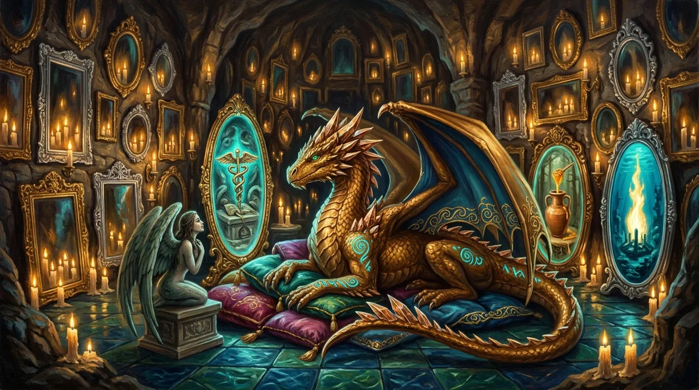
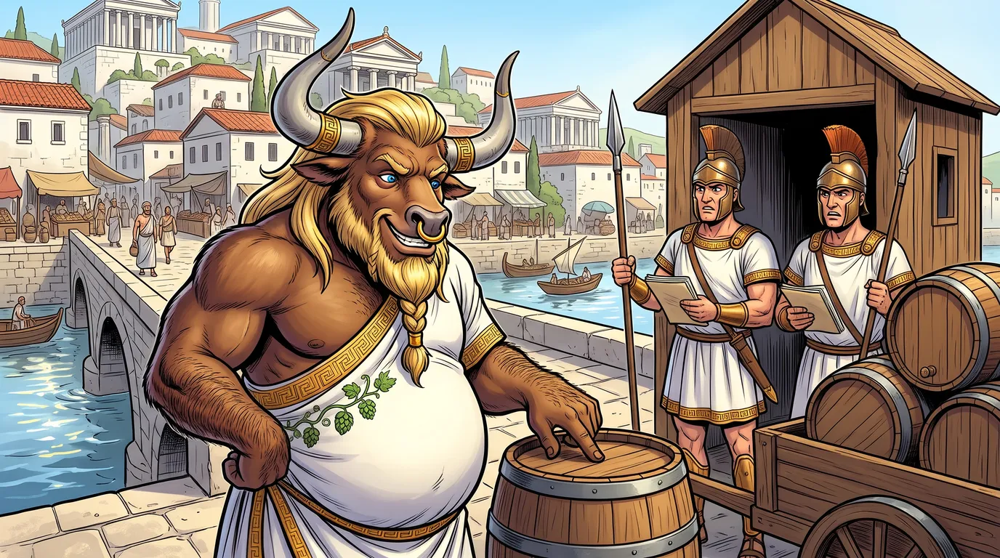
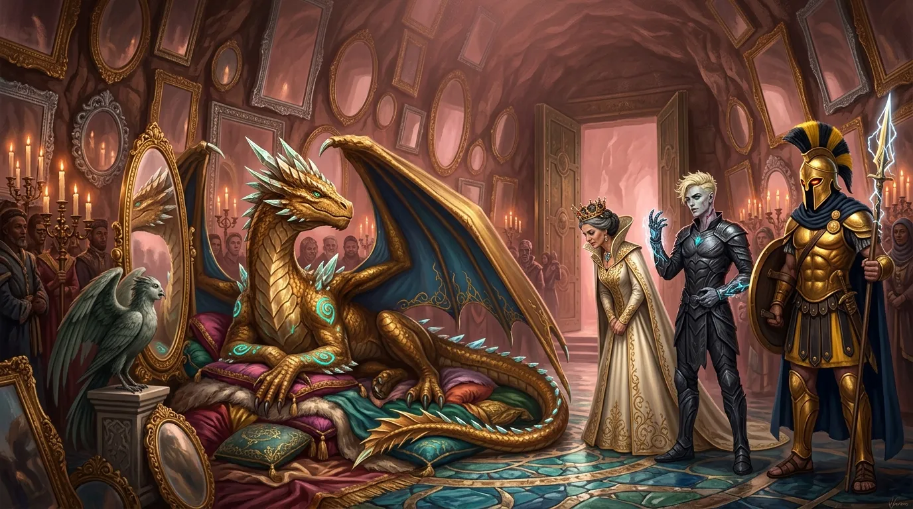
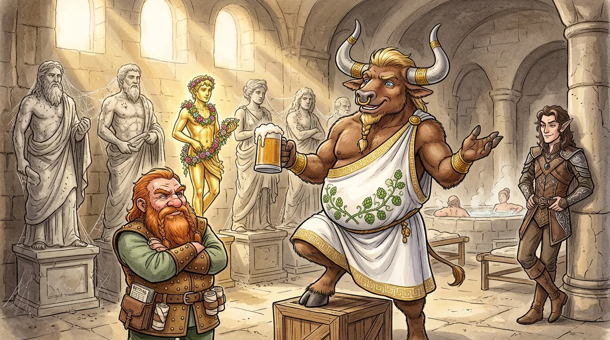
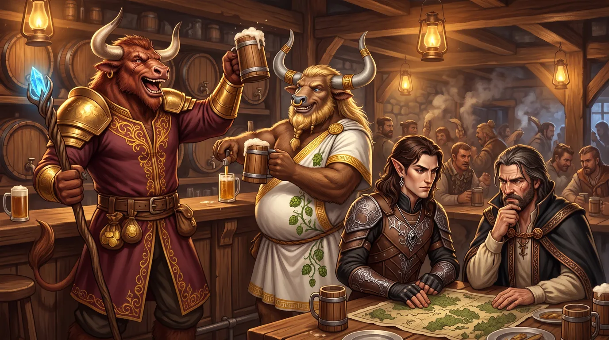
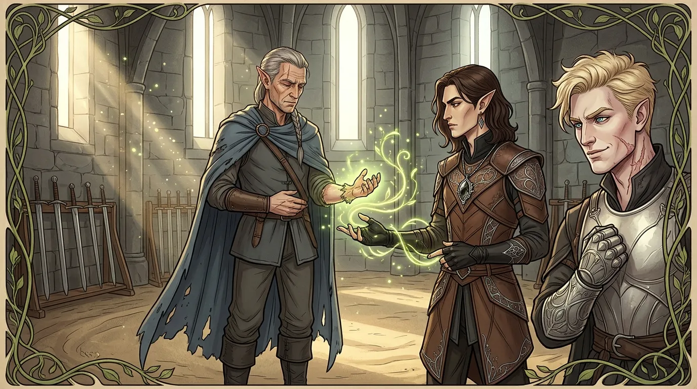
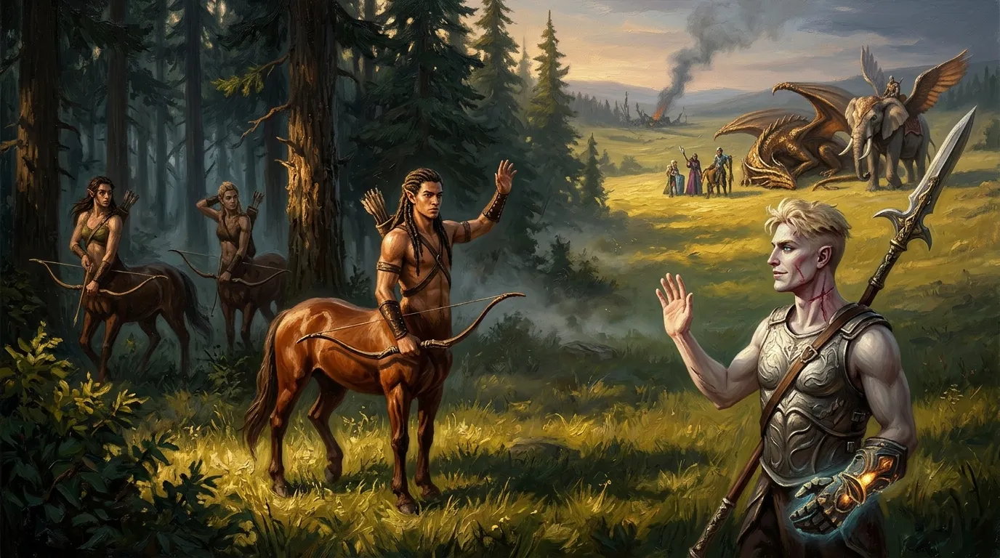
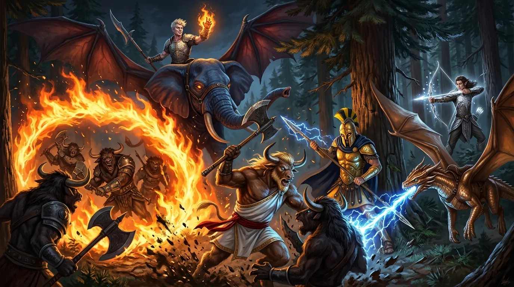

**Data**: 09.11.2026

[Prompt](../assets/sessions/086/086_theme_three_keys_of_theogenesis.txt)

## Podsumowanie

### Poranek w Arezji i Sprawa Celników

[Prompt](../assets/sessions/086/086_sec1_the_customs_booth.txt)

Rano w gospodzie **[[Czerwony Lotos]]** w **[[Arezja|Arezji]]** elfka **[[Jocasta]]** podała drużynie śniadanie. Gdy gospodyni nie mogła podsłuchiwać, towarzysze zrelacjonowali **[[Versir|Versirowi]]** wieczorną rozmowę z **[[Królowa Helena|Królową Heleną]]** o planach sięgnięcia po boskie domeny. Versir zdziwił się, że przy tak ważnej rozmowie zabrakło **[[Mistrz Cieni|Mistrza Cieni]]**, po czym bohaterowie ustalili, że o jedenastej pójdą na umówione spotkanie z **[[Narsus|Narsusem]]**, a **[[Orestes]]** załatwi wcześniej sprawy swojego browaru w mieście.

[[Orestes]] odwiedził swoją tawernę na drugim brzegu rzeki, w sąsiedztwie mało popularnej filii **[[Zakon Smoczych Lordów|Zakonu Smoczych Lordów]]**. Barman Andrzej Trzeci zameldował, że lokal wychodzi na lekki plus, a klienci chętnie piją piwo, jednak zyski zjadają straty w dostawach zatrzymywanych przez celników. Minotaur polecił przygotować obok kanciapkę, bo zamierza przysłać ludzi ze sprzętem zamiast gotowych beczek, i ruszył do koalicji kupieckiej. Zarządzająca nią **[[Aketa]]** wyjaśniła, że za kłopotami stoi szef Gildii Winiarzy, który opłaca celników, ale sama odmówiła pośrednictwa, żeby nie psuć sobie interesów z winiarzami.

Przy budce celnej Orestes zaproponował strażnikom układ z podwójnym dnem: w beczkach pod pierwszym wiekiem znalazłoby się trochę piwa i złota dla nich, dzięki czemu wywiązaliby się z kontroli przed ludźmi winiarzy, a właściwy trunek pod drugim dnem jechałby prosto do baru. Celnicy oburzyli się na propozycję korupcji, pouczyli minotaura o rzetelności przepisów Arezji i zapowiedzieli jedynie, że nigdzie tego nie zgłoszą. Orestes odpuścił i wrócił do towarzyszy, odkładając naradę z **[[Felicjan Janus Twardowski|Felicjanem]]** nad obejściem blokady na kolejny poranek.

> [!quote] Celnik
> Czy pan nam sugeruje korupcję?

> [!quote] Orestes
> Ja wam sugeruję, panowie, dochodowy interes.

### Audiencja u Narsusa

[Prompt](../assets/sessions/086/086_sec2_audience_with_narsus.txt)

Przed jedenastą drużyna stawiła się pod **[[Świątynia Tarczy|Świątynią Tarczy]]** w towarzystwie **[[Astra|Astry]]**, smoka **[[Kairos|Kairosa]]** oraz **[[Kyrah]]** i **[[Pythor|Pythora]]**, którzy niechętnie zgodzili się odwiedzić niewidzianego od pięciuset lat brata. [[Królowa Helena]] poprowadziła gości krętymi schodami głęboko w trzewia wzgórza i pchnęła wrota z brązu. W wykutej w skale **[[Komnata Piękna|Komnacie Piękna]]**, pachnącej woskiem i różanym olejkiem, światło setek świec odbijało się w tysiącach luster w złotych i srebrnych ramach. Na postumencie śpiewała bez słów skrzydlata syrena, a pośrodku na stosie jedwabnych poduszek leżał dorosły brązowy smok **[[Arystonar]]**, czyli Narsus w swojej prawdziwej postaci.

Były bóg piękna przez dłuższą chwilę wpatrywał się w owalne zwierciadło, narzekając, że już cztery jego łuski straciły blask, i z żalem zerknął na zbroję **[[Orion Xul|Oriona]]**, jeden ze swoich dawnych darów, który niegdyś w podzięce oddał bohaterom. Dopiero gdy Helena odchrząknęła, powitał **[[Raspytrion|Raspytriona]]** i **[[Arkyrania|Arkyranię]]** uwagą, że skłamałby, mówiąc, że dobrze wyglądają, na co rodzeństwo odpowiedziało mu jedynie chłodnym skinieniem głowy. Zapytany przez Versira o sposób na odzyskanie domen, Narsus oznajmił, że we śnie odwiedziła go sama **[[Balmytria]]** i zesłała mu wizję rytuału zwanego [[Magia Thylei#Theogenesis (Apoteoza)|Teogenezą]] oraz trzech potrzebnych do niego przedmiotów. Obiecał, że jeśli bohaterowie mu je dostarczą, przekaże im przebieg obrzędu słowo w słowo, ponieważ artefakty się nie zużywają, a pustych domen wystarczy dla każdego i jemu zależy wyłącznie na pięknie.

Narsus wyliczył trzy składniki rytuału. Pierwszym był **[[Kaduceusz Damona]]**, laska pozwalająca odrzucić śmiertelność, złożona w [[Kurhany Karpathosa|kurhanach]] **[[Karpathos|Karpathosa]]** wraz z samym Wilczym Lordem. Helena wyjaśniła, że gdy Lutheria przeklęła Karpathosa wampiryzmem i dawny jeździec czerwonego smoka **[[Zarmulax|Zarmulaxa]]** zaczął przemieniać rodzinę oraz strażników w sługi, jego córka **[[Calliope]]** zwabiła ojca do kurhanów i zapieczętowała jedyne wejście magicznymi runami. Na pytanie Felicjana o **[[Portret Karpathosa]]** królowa odparła, że obraz sprzedano z arezyjskiej galerii nielegalnie, a plotki o zaklętej w nim duszy traktowano dotąd jako legendę. Drugim składnikiem była zatrzymująca starzenie **[[Amfora Zakrotha|Ambrozja]]**, którą posiadał zbierający armię na północy minotaur **[[Zakroth]]**, a trzecim **[[Ogień Prometejski]]**, spoczywający w otchłani pod zatopionym przez **[[Sydon|Sydona]]** **[[Królestwo Syren|Królestwem Syren]]** gdzieś w okolicach **[[Zatoka Cerulańska|Zatoki Cerulańskiej]]**, którego położenia śpiewająca dla smoka syrena nie potrafiła wskazać.

Versir zaczął dopytywać smoka o wygląd i głos matki ze snu. Narsus odparł mętnie, że było to jedynie odczucie i obrazy, po czym zaczął teatralnie ziewać. Zarówno Felicjan, jak i **[[Arevon Elorrenthi|Arevon]]** nabrali przekonania, że smok zataja część prawdy. Arevon zaproponował, by najpierw rozprawić się z Zakrothem, który stanowi bieżące zagrożenie, a kurhany zostawić na później. Przed wyjściem zapytał jeszcze Helenę o poszlaki prowadzące do Królestwa Syren i zasugerował wprost pomoc Mistrza Cieni, lecz królowa odparła, że Arezja nic dotąd nie znalazła.

> [!quote] Narsus
> Przez długi czas byłem bogiem, chyba potrafię poznać, jak wygląda proroczy sen.

Po wyjściu na powierzchnię Kyrah przyznała Felicjanowi, że jej brat zawsze był zapatrzony w siebie, a boska domena jeszcze to pogłębiła. Przy bramie Helena wręczyła drużynie zapieczętowany list dla dowódcy strażników kurhanów na południu, zapowiadając, że po zdjęciu pieczęci Calliope fizyczne wrota zostaną za bohaterami zamknięte, a arezyjscy magowie będą czekać w pogotowiu. Przyciśnięta przez Versira, królowa przyznała otwarcie, że angażuje obcych również po to, by w razie katastrofy po otwarciu grobowca odpowiedzialność spadła na drużynę.

Na koniec Felicjan zapytał Helenę, czy wie o jakiejkolwiek grupie, która mogłaby próbować wykraść portret. Królowa spojrzała na maga podejrzliwie, stwierdziła, że powinna była się domyślić, kto był tajemniczym kupcem obrazu, i zapowiedziała, że porozmawia z pewnymi osobami. O trzeciej stronie nic jej nie było wiadomo, po czym pożegnała się i odeszła. Bohaterowie zauważyli między sobą, że portret wisiał przez piętnaście lat zamknięty na klucz w kajucie kapitana na **[[Ultros|Ultrosie]]**, ale wiedziała o nim praktycznie cała stara załoga statku.

Na ulicy drużyna przeszła do narady nad źródłem rzekomego snu [[Narsus|Narsusa]]. Versir, Arevon i Orestes rozważali, kto mógł zesłać wizję, i wymieniali kolejno Mistrza Cieni, **[[Mojry]]** (Orestes dorzucił do nich nieślubne dziecko Oriona z jedną z Mojr) oraz **[[Lutheria|Lutherię]]**, która za życia zwykła nawiedzać śmiertelników w snach. Ostatecznie zgodzili się zostawić na razie kurhany i zająć się Zakrothem. Versir zapytał jeszcze, czy ktoś potrafi wypatrzyć szpiega Mistrza Cieni, a Orestes głośno rzucił w przestrzeń zaproszenie dla Mistrza Cieni na wieczorną kolację w swoim barze.

### Rekonesans w Mieście i Rozmowa z Hiero

[Prompt](../assets/sessions/086/086_sec3_the_forgotten_sanctuary.txt)

Poszukując informacji o kurhanach, Versir zebrał miejskie plotki: ludzie gadali, że pod ziemią zamiast **[[Karpathos|Karpathosa]]** kryje się tajna siedziba **[[Sydon|Sydona]]** podarowana w zamian za jego gadającą statuę, a zwierzęta omijają tamtejsze pastwiska na południu. Arevon i Orestes zajrzeli natomiast do zakurzonego **[[Sanktuarium]]**, gdzie wciąż stały zapomniane posągi **[[Thylea|Thylei]]**, Sydona, **[[Lutheria|Lutherii]]** oraz **[[Mytros (Bogini)|Mytros]]**. Pilnujący przybytku krasnolud **[[Lennicus]]** wyjaśnił, że w **[[Arezja|Arezji]]** liczy się już właściwie tylko Narsus, a choć przestał on być bogiem, jego kapłani, podobnie jak dawni kapłani pozostałych bóstw, z nieznanego powodu nadal dysponują magią. Orestes próbował namówić krasnoluda na nową wiarę, którą nazwał „browaryzmem” lub „kraftosławiem”, a Lennicus przyznał, że nowy, tańszy trunek powoli podbija miasto.

Następnie bohaterowie odwiedzili **[[Hiero]]**, Wielkiego Mistrza Miecza, który w starciu z **[[Zakroth|Zakrothem]]** stracił swoją lepszą rękę oraz broń. Elf opowiedział, że w lesie natknął się z niewielkim oddziałem na spory zastęp minotaurów i centaurów, a sam Zakroth zasypał go nieludzką siłą i szybkością, szarżując rogami i wydając ryk, który pobudzał jego pobratymców, a żołnierzy Arezji paraliżował strachem. Skradziony przez minotaura miecz był bardzo ciężki oraz ostry i potrafił jednym cięciem roztrzaskać zwykłą tarczę, a magiczną wytrącić z dłoni. Łuku ani włóczni Zakroth przy sobie nie nosił.

Gdy Hiero przyznał, że bez ręki nie przyda się w walce o odzyskanie broni, Arevon zaproponował mu rzucenie następnego dnia zaklęcia *Regenerate*, a Versir potwierdził z własnego doświadczenia, że dłoń odrośnie jak nowa. Zaskoczony mistrz chętnie przystał na propozycję i umówił się z druidem na poranek, podczas gdy Felicjan i Orestes namawiali go, by przyszedł na zabieg do **[[Super Bar|Super Baru]]** i siedziby **[[Zakon Smoczych Lordów|Zakonu Smoczych Lordów]]**, co przy okazji posłuży za reklamę lokalu.

### Narada w Barze i Wizyta Taureusa

[Prompt](../assets/sessions/086/086_sec4_taureus_in_the_bar.txt)

Pod koniec dnia drużyna zaczęła omawiać sposób podejścia pod drewniano-ziemny fort **[[Zakroth|Zakrotha]]** w gęstym lesie, rozważając zasadzkę z fałszywym transportem oliwy na trakcie lub nalot z powietrza. Bohaterowie odrzucili pomysł sprowadzenia **[[Latająca Forteca Smoczych Lordów|Latającej Fortecy Smoczych Lordów]]** nad **[[Arezja|Arezję]]**, uznając, że wywołałoby to zgrzyty polityczne i zawczasu ostrzegło obóz wroga. Felicjan zaproponował, że może wejść z planu eterycznego do obozu Zakrotha i podmienić **[[Amfora Zakrotha|Ambrozję]]**, a gdy Orestes przypomniał sobie, że dwa dni wcześniej wysłał na szlaki kilku najemników spod murów miasta, czarodziej skwitował, że przy charyzmie minotaura pewnie tylko dostarczyli mu nowych rekrutów.

Drużyna spierała się o dalsze działania: Versir i Orestes chcieli najpierw porozmawiać z Zakrothem i sprawdzić, czy ktoś nie podjudza go do napadów na karawany, podczas gdy Arevon przekonywał, że wchodzenie w środek wrogiego obozu na negocjacje jest niepotrzebnym ryzykiem, skoro minotaury nie latają i łatwiej uderzyć z powietrza.

W trakcie tych narad do baru Orestesa wszedł **[[Taureus]]**, Wielki Mistrz Żywiołów. Poprosił drużynę, aby podczas wyprawy na północ powstrzymała się od rzezi wśród podążających za Zakrothem minotaurów, satyrów i centaurów. Zauważył, że podczas napadów na wozy z piwem i spichlerze ludzie Zakrotha zazwyczaj darowali życie napadanym, i choć sam przywódca raczej nie ustąpi bez rozlewu krwi, jego podwładni zasługują na drugą szansę. Zapytany przez Orestesa o bliskich w obozie, Taureus wyjaśnił, że nie ma tam rodziny, lecz do buntownika dołączyło kilku członków jego gildii przybyłych z **[[Mytros]]** piętnaście lat temu po Nocy Długich Rogów. Choć w Arezji mieli równe prawa, czuli się rozczarowani, a Zakroth obiecywał im budowę własnego miasta bez ludzi, mimo że nigdzie nie widziano śladów takiej budowy. Przed wyjściem Taureus pochwalił nowe piwo Orestesa leżakowane w beczkach po winie, które sprowadził własnymi kanałami wbrew utrudnieniom celników, i zgodził się określać mianem „browarzysty”, na co uradowany gospodarz pożegnał go słowami: „Browar z tobą, bracie”. Po jego odejściu bohaterowie ustalili, że wyruszą następnego ranka po uzdrowieniu ręki Hiero, znajdą obóz z powietrza, a potem wylądują i podejdą pieszo na rozmowę.

Później tego samego dnia Versir wziął Felicjana na bok, z dala od reszty towarzyszy, i zapytał, czy udało mu się odnaleźć **[[Nephele (Smok)|Nephele]]**, po czym szybko poprawił się na **[[Despina|Despinę]]**. Czarodziej przyznał, że słał do prababki wiadomości, ale nigdy nie odpowiedziała. Gdy Versir zapytał o jej ewentualne powiązania z **[[Karpathos|Karpathosem]]** oraz o to, czy mogłaby zesłać Narsusowi wizję, Felicjan odparł, że Despina i Wilczy Lord zapewne się znali, a za życia była czarodziejką, więc jeśli jej moce przetrwały w ciele smoczycy, mogła zesłać sen Narsusowi. Wspomniał o jej związkach z **[[Lutheria|Lutherią]]** i przypomniał, że **[[Mistrz Cieni]]** kazał kiedyś pozdrowić Despinę, gdy siedziała jeszcze zamknięta w amulecie, a Felicjan nie mówił jeszcze towarzyszom, kim jest jego prababka. Ponieważ znała też Narsusa, czarodziej podejrzewał, że mogła ukrywać się gdzieś w pobliżu, a nawet w samej Arezji.

> [!quote] Felicjan
> Szukałem jej. Szukałem jej przez kilka miesięcy, ale najwyraźniej nie chciała być odnaleziona.

Wieczorem Felicjan wyszedł na rynek, by wygłosić wykład i zjednać nowych rekrutów dla **[[Zakon Smoczych Lordów|Zakonu Smoczych Lordów]]**. Versir udał się za bramę miasta, gdzie przyzwał **[[Trąba|Trąbę]]**, a Arevon odnalazł w okolicy stary cyprys i zapoznał się z drzewem na potrzeby przyszłej teleportacji. Patrząc w wieczorne niebo, druid znów dostrzegł dziwne, migoczące gwiazdy, które tym razem świeciły nieco dłużej niż poprzednio. Dokładnie określił ich położenie względem znanych konstelacji i naniósł je na swoją mapę nieba, po czym uznał, że po powrocie zleci wydziałowi artyficerów w **[[Akademia Mytros|Akademii Mytros]]** wykonanie teleskopu.

### Uzdrawiający Poranek i Spalony Folwark

[Prompt](../assets/sessions/086/086_sec5_regrowing_the_hand.txt)

Następnego ranka, po nocy zakłócanej jedynie głośnym chrapaniem **[[Orestes|Orestesa]]**, drużyna udała się do **[[Świątynia Miecza|Świątyni Miecza]]**. **[[Hiero]]** przywitał ich z lekką niepewnością, a Arevon uprzedził go, że proces będzie wyglądał osobliwie, ale nie sprawi bólu. Druid rzucił zaklęcie *Regenerate*: z kikuta mistrza wyrosła najpierw groteskowa, miniaturowa dłoń, która w ciągu dwóch minut osiągnęła normalne rozmiary. Hiero spojrzał z podziwem na odzyskaną rękę, skłonił się głęboko i od razu chwycił miecz treningowy, by wypróbować chwyt. Obiecał, że jeśli bohaterowie będą kiedyś czegoś potrzebować, wystarczy słowo, na co Arevon odparł, że był to po prostu wspólny dobry uczynek przybyszów z Mytros.

Późnym rankiem bohaterowie dosiedli smoków oraz Trąby i ruszyli na północny wschód w stronę lasów na końcu półwyspu, oddalonych o około sto trzydzieści mil. Po kilku godzinach lotu, po południu, zauważyli nad doliną słup dymu. Przy drodze leżał spalony folwark z zapadniętym dachem spichlerza, a wokół sterczały pnie całkowicie wyrąbanych drzewek owocowych. Na błotnistym podwórzu stała umorusana chłopka z sierpem w dłoni, a na pobliskiej polanie obozowali najemnicy wynajęci przez Orestesa pod wodzą **[[Flavius|Flaviusa]]**.

Drużyna wylądowała przy pogorzelisku. Flavius zameldował, że idąc tropem napastników z dwóch innych zaatakowanych wcześniej folwarków, dostrzegli dym i wpadli na bandytów w trakcie plądrowania. Większość napastników uciekła, dwóch zginęło w walce, a pięciu udało się ująć żywcem: na wozie siedziało w kajdanach dwóch satyrów oraz trzech minotaurów, z których jeden miał rozbity łeb i ukruszony róg. Orestes zabronił samosądów i polecił odprowadzić jeńców na sąd do Arezji, proponując poszkodowanej kobiecie, by wystąpiła jako świadek.

> [!quote] Orestes
> Kurka, dobre chłopaki. Zrobili robotę, za którą im płacę.

Zanim wóz ruszył, Arevon rozejrzał się uważnie po okolicy, a Versir podszedł do związanych jeńców i zapytał o drogę do obozu **[[Zakroth|Zakrotha]]**. Gdy odpowiedziało mu milczenie, uaktywnił klejnot **[[Yala|Yali]]** w swojej **[[Hand of Kentiname|Rękawicy]]** i spróbował zdominować umysł jednego z minotaurów zaklęciem *Dominate Monster*. Wojownik oparł się magii, lecz siedzący obok satyr uległ czarowi. Przedstawił się jako **[[Tityros]]** i wyjaśnił, że sam Zakroth rzadko opuszcza swój fort w głębi puszczy. Ponieważ zaklęcie miało działać tylko przez godzinę, bohaterowie podsunęli satyrowi mapę, na której dokładnie wskazał kryjówkę minotaura nieco bliżej rzeki, podczas gdy pozostali więźniowie krzyczeli na niego, by milczał. Na polecenie Versira Tityros odpowiedział też na pytania Orestesa i potwierdził, że **[[Krithon]]** z lirą korbową i toporem znajduje się w obozie Zakrotha, ale sam niewiele o nim wie, bo pracuje w kuchni. Orestes kazał odwiązać Tityrosa i zabrać go na sznurku, zapewniając najemników, że za tego jeńca również otrzymają pełną zapłatę.

Arevon i Felicjan odciągnęli zdominowanego Tityrosa na bok i wypytali go o obronę fortu. Satyr wyjawił, że Zakroth ostatnio częściej niż po topór sięga po miecz, a w zbrojowni założono pułapkę. Obóz nie ma umocnień, bo osłaniają go drzewa i rozstawieni w lasach ludzie, natomiast w samym forcie na co dzień stacjonują głównie elitarne jednostki oraz kilka wielkich, plujących jadem wiedźm od **Gigantes**, chyba że Zakroth zapowie płomienną przemowę, na którą schodzą się pozostali. Zapytany o cel najazdów, Tityros przyznał, że dawniej mścili się na oligarchach z Mytros, ale teraz minotaur każe napadać też na Arezję, by na krwi ciemiężców zbudować własne państwo. Dodał, że w obozie za swojego uchodzi każdy, kto ma rogi, cztery nogi albo wzrost giganta.

### Rozmowa z Cheironisem i Noc pod Gwiazdami

[Prompt](../assets/sessions/086/086_sec6_centaurs_at_the_forest_edge.txt)

Arevon wskazał towarzyszom skraj gęstego lasu, skąd z oddali obserwowało ich kilku **[[Centaur z Thylei|centaurów]]**. Versir z **[[Glewia Sydona|Glewią Sydona]]** na plecach uniósł otwartą dłoń w pokojowym geście i ruszył w ich stronę. Dwaj zwiadowcy zaczęli się cofać między drzewa, lecz trzeci powstrzymał ich gestem ręki i zaczekał. Gdy paladyn podszedł bliżej i poprosił o zapowiedzenie ich u Zakrotha, centaur przedstawił się jako **[[Cheironis]]**, syn lorda **[[Agrius|Agriusa]]** z północnych stepów, i odparł, że nie służy minotaurowi. Wyjaśnił, że Zakroth wymusił na plemionach sojusz, przetrzymując w forcie jako zakładników dzieci wodzów. Wśród nich byli brat Cheironisa, Perimedes, który częściowo przystał do buntowników z własnej woli, oraz jego siostra, wysłana niedawno przez ojca na audiencję, z której już nie wróciła.

Gdy reszta drużyny podeszła bliżej, Cheironis ostrzegł w imieniu plemion, że śmierć synów i córek wodzów z rąk bohaterów przysporzy im nowych wrogów, choć na lojalnych ludziach Zakrotha nie muszą się oszczędzać, a sam najchętniej rozprawiłby się z minotaurem. Dodał, że zakładnicy mają ograniczoną swobodę, ale trzymani są w bezpiecznym miejscu, i zaoferował dywersję, jeśli drużyna jej potrzebuje. Zapytany przez Felicjana o to, jak Zakroth zebrał tylu stronników, odparł, że minotaur mówi rdzennym mieszkańcom o świecie skradzionym przez ludzi, choć wielu centaurów pamięta klęskę u boku **[[Sydon|Sydona]]** i nie popiera drastycznych metod. Arevon i Versir zapewnili, że najpierw idą porozmawiać i zwrócą uwagę na zakładników. Po odejściu centaurów Versir puścił Tityrosa wolno w las.

> [!quote] Cheironis
> Mówi w sumie też, jakby nie patrzeć, prawdę. To niegdyś był nasz świat.

Bohaterowie polecieli dalej na północ i przed zmrokiem rozbili obóz na nocny odpoczynek. Arevon wspiął się na drzewo, by obserwować niebo w tym samym miejscu co poprzedniej nocy. Po dłuższym wypatrywaniu dostrzegł w konstelacji już trzy migoczące gwiazdy z czterech, o których mówił **[[Edran]]**, i zapamiętał ten punkt na niebie. Noc minęła spokojnie, a o świcie drużyna przygotowała się do ostatniego odcinka drogi przed fortem Zakrotha.

### Starcie z Minotaurami w Borze Thrake

[Prompt](../assets/sessions/086/086_sec7_ring_of_fire_in_the_forest.txt)

O poranku drużyna wylądowała w **[[Bór Thrake|Borze Thrake]]** niedaleko fortu **[[Zakroth|Zakrotha]]** i ruszyła pieszo leśną ścieżką, a smoki zostały w powietrzu z wyjątkiem **[[Kairos|Kairosa]]** oraz skrzydlatego słonia **[[Trąba|Trąby]]**. Wkrótce bohaterowie usłyszeli ciężkie kroki i natknęli się na ośmiu wielkich, uzbrojonych w topory minotaurów, większych nawet od **[[Orestes|Orestesa]]**. **[[Versir]]** schował broń, uniósł dłoń i odezwał się do nich w języku sylvan, zapewniając, że przybywają w pokoju na rozmowę z Zakrothem. Minotaury mocniej ścisnęły topory i ruszyły do szarży.

> [!quote] Versir
> Zakroth będzie chciał z nami porozmawiać. To jest jego szczęśliwy dzień.

**[[Arevon Elorrenthi|Arevon]]** otworzył starcie zaklęciem *Guiding Bolt*, trafiając pierwszego z szarżujących wojowników za 14 obrażeń. Minotaur dopadł Versira, chybił rogami, lecz sięgnął go toporem, zadając 21 obrażeń. W odpowiedzi Kairos zionął błyskawicą przez szereg napastników, rażąc pięciu z nich. Wtedy do Versira podleciał Trąba; paladyn wskoczył na jego grzbiet, teleportował się na wierzchowcu na bezpieczny dystans i wzniósł między drużyną a wrogami zaklęcie *Wall of Fire*.

Ognisty krąg *Wall of Fire* objął czterech minotaurów i od razu spalił jednego na miejscu. Versir dobił kolejnego zaklęciem *Sorcerous Burst*. Stojący pod drzewem **[[Orion Xul|Orion]]** ruszył na dwóch napastników przed sobą: czterema pchnięciami powalił obu, przy czym pierwszy z nich utrzymał się na nogach mimo uderzenia z mocą wzgórzowego giganta (*Strike of the Hill Giant*), nim padł od ostatniego ciosu.

Orestes wpadł w szał bojowy i rzucił się na kolejnego z ocalałych, dwukrotnie raniąc go toporem. **[[Felicjan Janus Twardowski|Felicjan]]** posłał w zgrupowanych wrogów kulę ognia (*Fireball*), lecz wszyscy czterej przetrwali wybuch. Arevon objął dwóch z nich nekrotycznym uwiądem zaklęcia *Wither and Bloom*, po czym przybrał gwiezdną formę i wystrzelił świetlisty pocisk, który jednak chybił minotaura wystającego z ognistej ściany. Gdy nadeszła kolej napastników, wojownik stojący na skraju płomieni wybiegł z kręgu bez szwanku, dopadł do Orestesa z okrzykiem „zdrajco rasy!” i dwukrotnie ciął go wielkim toporem.

Dwaj minotaurowie uwięzieni w ognistej ścianie spłonęli na miejscu, natomiast trzeci rzucił się z toporem na Oriona i dwukrotnie go trafił, w tym jednym ciosem krytycznym. Kairos skoczył na jednego z ocalałych wojowników i po pierwszym chybieniu rozszarpał go dwoma kolejnymi uderzeniami pazurów. Ostatniego napastnika wykończył Versir: podleciał z boku i przebił minotaura **[[Glewia Sydona|Glewią Sydona]]**, kończąc starcie.

Po walce Arevon uleczył Oriona zaklęciem *Cure Wounds* i kazał Versirowi wygasić ścianę ognia, a sam zaczął deptać płonącą trawę, żeby nie dopuścić do pożaru lasu. Bohaterowie zostawili osiem ciał bez pochówku i bez przeszukiwania kieszeni, choć Orestes ściągnął z jednego z poległych najmniej zakrwawioną togę, żeby machać nią po drodze jak białą flagą. Idąc dalej w głąb boru, Versir zauważył, że w walce Orestes wciąż budzi się jak dawniej, na co minotaur wciągnął brzuch i napiął mięśnie ukryte pod warstwą tłuszczu.

Drzewa w końcu się rozstąpiły, odsłaniając porośnięte mchem i trawą wzgórze, w które wbudowano drewniany **[[Fort Zakrotha]]**. Przed otwartą bramą ciągnął się rząd krzyży z przybitymi żołnierzami w arezyjskich zbrojach. Jeden z nich, krasnolud, wciąż się poruszał i żył. Z dachu unosił się dym, a przez wąskie szczeliny w ścianach przeświecało czerwone światło. Przed fortem nie było widać żadnego minotaura.

## Kluczowe wydarzenia
* [[Narsus]] wyjawia w [[Komnata Piękna|Komnacie Piękna]], że [[Balmytria]] zesłała mu we śnie wizję rytuału [[Magia Thylei#Theogenesis (Apoteoza)|Teogenezy]] i trzech potrzebnych do niego przedmiotów: [[Kaduceusz Damona|Kaduceusza Damona]] z [[Kurhany Karpathosa|kurhanów Karpathosa]], [[Amfora Zakrotha|Ambrozji]] minotaura [[Zakroth|Zakrotha]] i [[Ogień Prometejski|Ognia Prometejskiego]] spod zatopionego [[Królestwo Syren|Królestwa Syren]].
* [[Królowa Helena]] wręcza drużynie list do dowódcy strażników kurhanów i przyznaje, że w razie katastrofy po otwarciu grobowca odpowiedzialność spadnie na bohaterów.
* [[Taureus]], Wielki Mistrz Żywiołów, prosi bohaterów, by oszczędzili minotaurów, satyrów i centaurów podążających za Zakrothem.
* [[Arevon Elorrenthi|Arevon]] przywraca zaklęciem Regenerate rękę [[Hiero]], Wielkiemu Mistrzowi Miecza, który stracił ją w starciu z Zakrothem.
* Zdominowany przez [[Versir|Versira]] satyr [[Tityros]] wskazuje na mapie [[Fort Zakrotha|fort Zakrotha]] i potwierdza, że [[Krithon]] przebywa w obozie minotaura.
* Centaur [[Cheironis]] wyjawia, że Zakroth wymusił sojusz plemion, przetrzymując w forcie dzieci ich wodzów jako zakładników.
* Drużyna rozbija w [[Bór Thrake|Borze Thrake]] oddział ośmiu minotaurów i staje przed [[Fort Zakrotha|Fortem Zakrotha]], przed którym wiszą na krzyżach arezyjscy żołnierze.

## Filmy

