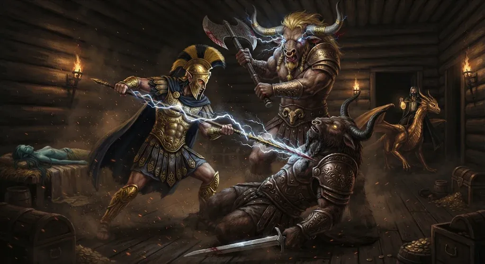
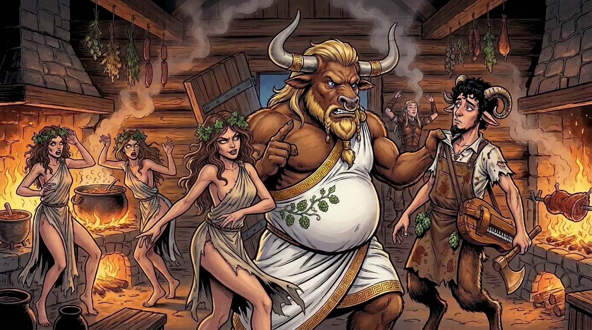
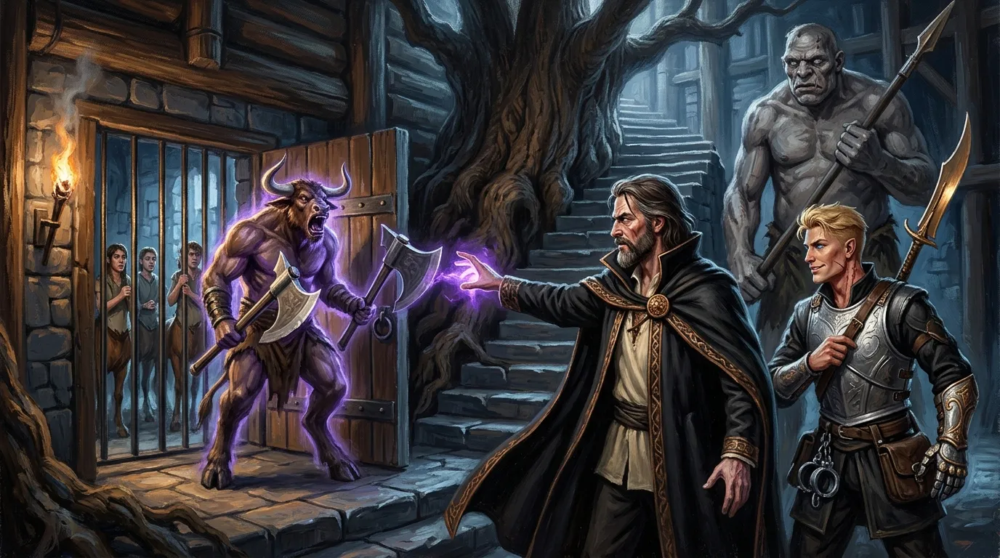
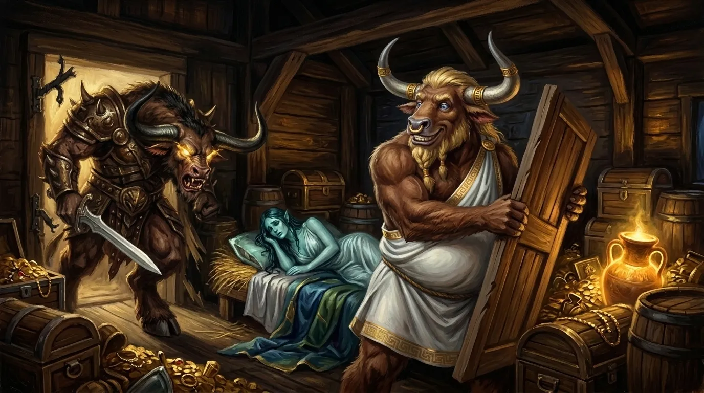
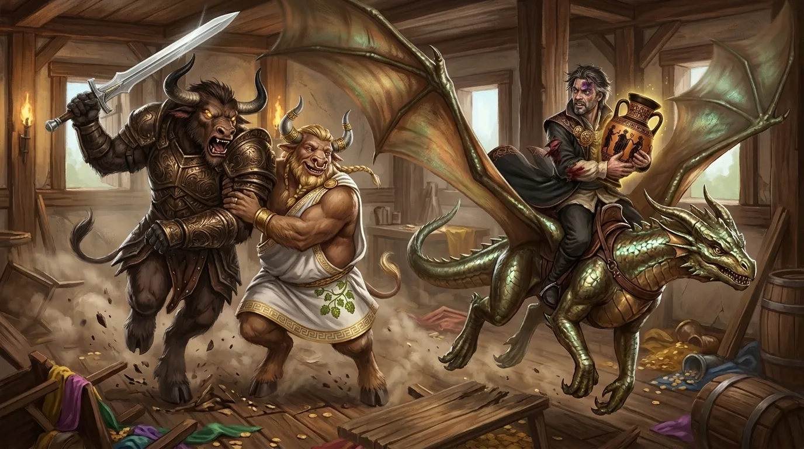
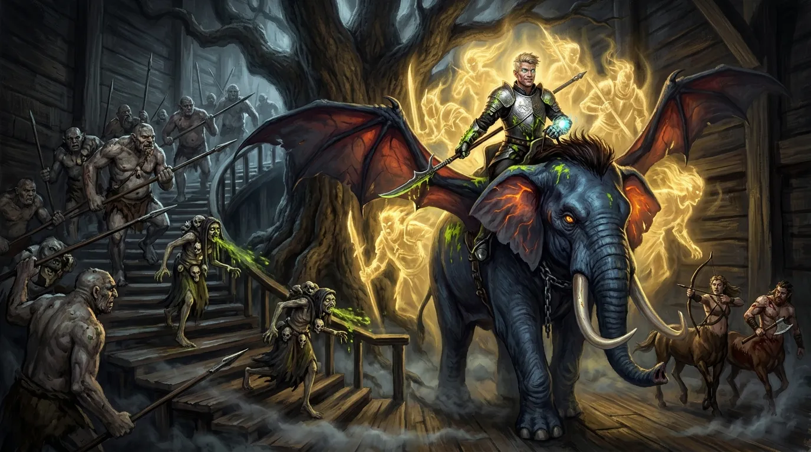

**Data**: 16.11.2026

[Prompt](../assets/sessions/087/087_theme_fall_of_zakroth.txt)

## Podsumowanie

### Fort Zakrotha i Konfrontacja z Krithonem

[Prompt](../assets/sessions/087/087_sec1_brewer_in_the_kitchen.txt)

Przed otwartą bramą **[[Fort Zakrotha|Fortu Zakrotha]]** **[[Versir]]** podleciał na **[[Trąba|Trąbie]]** do jedynego żywego spośród sześciu ukrzyżowanych żołnierzy **[[Arezja|Arezji]]**. Paladyn uleczył krasnoluda nakładaniem rąk, powyciągał gwoździe i pomógł mu zejść na ziemię. Uratowany zwiadowca przedstawił się jako [[Ugulat]], rozpoznał bohaterów i wyjaśnił, że jego oddział wpadł w zasadzkę podczas patrolu. Ostrzegł, że w okolicznym lesie zazwyczaj krąży wielu zwiadowców wroga, a wewnątrz umocnień przebywa najwyżej dwudziestu obrońców, w tym niezwykle silni **[[Gigantes]]**. Osłabiony i pozbawiony zapasów Ugulat zdecydował się wejść do środka razem z drużyną.

Za progiem rozciągało się ciemne pomieszczenie z klepiskiem z ubitego błota i trojgiem drzwi: z lewych śmierdziało oborą, ze środkowych nie dochodził wyraźny zapach, a z prawych czuć było krew. Versir otworzył drzwi po prawej, odsłaniając rzeźnię, w której na zardzewiałych łańcuchach wisiało kilkanaście obdartych ze skóry tusz. Krew kapała z nich do kamiennego koryta, nad którym kłębiło się pięć rojów spijających posokę styrg. Drużyna przemknęła pod ścianą, nie zwracając na siebie uwagi bestii. Przy bocznych drzwiach po lewej **[[Arevon Elorrenthi]]** nasłuchiwał i wychwycił ciężki oddech pojedynczego dużego stworzenia, a zza północnych drzwi, spod których padało światło, dobiegały śmiechy i dźwięki znajomego instrumentu. **[[Orestes]]** rozpoznał grę i nie zważając na styrgi, wyważył drzwi kopniakiem z okrzykiem: „**[[Krithon]]**, kurwa!”.

W zadymionej kuchni, gdzie w kotłach na paleniskach bulgotała polewka i piekło się mięso, trzy skąpo odziane **[[Menaidy|menady]]** towarzyszyły przygrywającemu satyrowi. Na widok minotaura muzyka urwała się w pół tonu. Orestes ruszył prosto na Krithona, chwycił go i zaczął ostro strofować za porzucenie pracy za barem na **[[Ultros|Ultrosie]]**, przypominając, że wujaszek powierzył mu nad nim opiekę. Młody satyr bronił się, że działa dla takich jak oni, i zarzucił Orestesowi współpracę z **[[Taran Neurdagon|Taranem Neurdagonem]]**, który dawniej dorabiał się na niewolnictwie minotaurów i nadal czerpie zyski z ich handlu. Orestes odparł, że wspólny interes zaciera granice między rasami, a plan zbudowania miasta bez ludzi i krzyżowanie jeńców przed bramą czynią buntowników gorszymi od samego Neurdagona.

Krithon spuścił wzrok i unikał patrzenia na stojącego z drużyną Ugulata. Zerknął podejrzliwie na menady, po czym oznajmił Orestesowi, że dowiedział się czegoś ważnego, i zaproponował wyjście z kuchni. Gdy minotaur ujął go pod ramię, by wyprowadzić go na korytarz, jedna z menad zaprotestowała przeciwko zabieraniu im grajka, stanęła tuż przed Orestesem i zaczęła wykonywać przed nim kuszący, magiczny taniec. Magia **[[Pierścień Orestesa|Pierścienia Orestesa]]** uchroniła minotaura oraz stojącego blisko **[[Felicjan Janus Twardowski|Felicjana]]** przed urokiem, lecz znajdujący się dalej Arevon poddał się jej rytmowi i zaczął tańczyć w miejscu.

Versir przeprosił menady za przerwanie biesiady, po czym dotknął jednej z nich **Rękawicą [[Kentimane|Kentimane'a]]** i zdominował jej umysł. Kobieta wyjawiła, że **[[Zakroth]]** przebywa na najwyższym piętrze z [[Belladona|Belladoną]], a więzione centaury trzymane są kondygnację niżej. Dodała, że w sąsiedniej rzeźni zabija się zwierzęta hodowlane, a jedynych schodów na górę pilnuje strażnik imieniem [[Murgrat]]. Versir zakazał jej podnoszenia alarmu.

Krithon zapytał Orestesa o zamiary wobec Zakrotha, tłumacząc, że minotaur ma ciężkie metody, ale walczy za ich lud. Orestes wypomniał mu mieszkańców **[[Orestessos Zythikē]]** zarąbanych w drodze do Arezji. Satyr skrzywił się i przyznał, że oddziały nie mają rozkazu zabijać wszystkich, lecz rozprawiają się z tymi, którzy stawiają opór, gdyż „rewolucja wymaga ofiar”.

> [!quote] Orestes
> Rewolucja zjada własne dzieci.

Orestes kazał satyrowi grzecznie zaczekać w kuchni na ich powrót. Zanim drużyna ruszyła dalej, zza drzwi rzeźni dobiegł odgłos tasaka uderzającego w mięso.

### Murgrat i Uwolnienie Centaurów

[Prompt](../assets/sessions/087/087_sec2_the_prison_door.txt)

Bohaterowie przeszli do centralnej części fortu, wzniesionej wokół pnia starego dębu. Otaczały go schody o metrowych stopniach, a wysoki na sześć metrów strop pozwalał **[[Kairos|Kairosowi]]** na swobodny ruch; Felicjan i Orestes wskoczyli na grzbiet smoka. Drogę zagrodził im wielki strażnik Murgrat, który dzierżył pikę i zapytał podejrzliwie, czy idą do króla. Należał do rasy Gigantes, niedokończonych, okrutnych olbrzymów stworzonych niegdyś przez **[[Hergeron Pierwszy|Hergerona Pierwszego]]**, których kobiety często parają się czarami. Versir przedstawił się i wyciągnął do niego dłoń, a gdy strażnik mocniej chwycił broń, paladyn dotknął go rękawicą i przejął nad nim kontrolę, tracąc władzę nad menadą w kuchni. Zdominowany Murgrat potwierdził drogę na górę i zgodnie z rozkazem został na dole, by pilnować, żeby nikt im nie przeszkadzał.

Na niższej kondygnacji drużyna minęła drzwi, zza których dobiegały odgłosy biesiady i rozmów w języku gigantów, a od północy chrapanie. Na piętrze z więźniami po lewej stronie znów słychać było rozmowy w języku gigantów, a za prawymi drzwiami Arevon wychwycił ciężki oddech dużej istoty i dźwięk ostrzenia broni osełką. Versir przekonał towarzyszy, że przed rozmową z Zakrothem warto po cichu uwolnić centaury, aby zyskać lepszą pozycję negocjacyjną, po czym z pomocą Felicjana przygotował się do wejścia.

Drzwi okazały się zamknięte, a gdy Versir nacisnął klamkę, ze środka padło w języku sylvan żądanie hasła. Paladyn telepatycznie wezwał Murgrata na górę, by ten podał mu hasło, a sam naśladował głos strażnika i zawołał przez drzwi, że zaraz je sobie przypomni. Zwiedziony głosem rozmówca zapytał poirytowany, czego Murgrat tu szuka, skoro miał pilnować wejścia. Versir odparł, że musi go zobaczyć i o coś zapytać, ale gdy prawdziwy Murgrat dotarł ciężkim krokiem na piętro, oznajmił wprost: „Ja nie znam hasła”.

Versir zapytał w myślach Murgrata, kto pilnuje drzwi od środka, i dowiedział się, że to minotaur imieniem Patrobas. Na rozkaz paladyna zdominowany strażnik zawołał do Patrobasa, że na dole coś się stało z menadami i nie wie, co ma robić. Zza drzwi dobiegło ciężkie westchnienie, przekleństwo w języku sylvan i zbliżające się kroki. W otwartych drzwiach stanął potężnie zbudowany minotaur berserker z dwoma dwuręcznymi toporami, zaskoczony widokiem stojących obok Murgrata intruzów.

Zanim strażnik zdążył podnieść alarm, Felicjan rzucił *Hold Monster* i sparaliżował go z otwartym pyskiem, po czym wszedł do więziennej sali i gestem nakazał zamkniętym za kratami centaurom zachować ciszę. Orestes zrezygnował z szału i wyprowadził w unieruchomionego minotaura trzy ciosy toporem, ciężko go raniąc. Versir, który po zaklęciu czarodzieja sięgał już do torby po kajdany, dobył **[[Glewia Sydona|Glewii Sydona]]**. Pierwsze uderzenie chybiło, a drugim, z boskim rozbłyskiem, paladyn zabił berserkera bez hałasu. Versir polecił wciągnąć ciało do środka i zamknąć drzwi, a Murgrata odesłał z powrotem na posterunek przy schodach z rozkazem, by ostrzegł go telepatycznie, jeśli ktoś będzie wchodził na górę.

W chłodnej komorze rozświetlonej dymiącą pochodnią, za kratami z brązu stało czterech młodych centaurów w dobrej formie, synów wodzów z różnych plemion. Jeden z nich, [[Perimedes]], zapytał przybyszów, kim są i czy przyszli obalić Zakrotha. Versir oznajmił, że spotkali ich pobratymców i postanowili ich oswobodzić.

> [!quote] Versir
> My pójdziemy porozmawiać z Zakrothem. Zależnie od rezultatu tej rozmowy możliwe, że tak powiem przerodzi się to w jakąś walkę.

Paladyn otworzył celę kluczem znalezionym przy zabitym strażniku. Perimedes podniósł z podłogi topór martwego minotaura i zadeklarował, że razem z towarzyszami zabezpieczy zbrojownię piętro niżej. Arevon nabrał podejrzeń, że w całej sytuacji coś się nie zgadza, ale Versir pozwolił centaurom działać na własną rękę. Uprzedził ich tylko, by nie atakowali stojącego na dole giganta, któremu z kolei rozkazał przepuścić więźniów i traktować ich jak swoich.

### Alarm i Śmierć Belladony

[Prompt](../assets/sessions/087/087_sec3_bella.txt)

Gdy centaury zeszły po schodach, a drużyna ruszyła na wyższe piętro, z dołu rozległ się krzyk Perimedesa: „Intruzi w forcie, do broni wszyscy!”. Na dźwięk alarmu Orestes wpadł w szał, wyważył z zawiasów zamknięte drzwi na czwartym piętrze i wpadł do bogato urządzonej komnaty. W środku, wśród skrzyń, baryłek i skarbów, na słomianym posłaniu z jedwabnymi kołdrami leżała wodna nimfa [[Belladona]], a po prawej stronie świeciła **[[Amfora Zakrotha]]**. Najada pisnęła z przerażenia, gdy minotaur rzucił się w jej stronę, a Orestes krzyknął jeszcze do Versira, by na dole nie zarąbali mu pociotka.

Za Orestesem na górę wbiegł **[[Orion Xul]]** i uznawszy Belladonę za wroga, trzykrotnie trafił ją włócznią i zabił na miejscu. Arevon wleciał po schodach i zobaczył martwą kobietę.

> [!quote] Arevon
> Co się kurwa dzieje? Czemu kobietę ktoś zajebał?

> [!quote] Versir
> Nie jesteśmy lepsi od nich, Arevonie. Jesteśmy pierdolonymi mordercami.

Versir zszedł piętro niżej, do idących na końcu **[[Felicjan Janus Twardowski|Felicjana Janusa Twardowskiego]]** i Kairosa, i otoczył się aurą *Spirit Guardians*, bo kolejne drzwi na tym poziomie zaczynały się uchylać. Smok wniósł czarodzieja na czwarte piętro. Gdy herosi rozmawiali o tym, że najada zginęła przez pomyłkę, a Arevon rzucił, że mógłby ją wskrzesić, z lewej strony dobiegło wołanie: „Bella?”. Do komnaty wbiegł [[Zakroth]], odziany w zdobioną zbroję i dzierżący miecz z mithralu. Widząc Orestesa z wyważonymi drzwiami w rękach nad ciałem Belladony, krzyknął: „Ty!”, staranował go rogami i dwukrotnie ciął mieczem, lecz Orestes rzucił, że „raczej nie” zamierza upaść, i utrzymał się na nogach.

### Kradzież Amfory

[Prompt](../assets/sessions/087/087_sec4_stealing_the_amphora.txt)

Felicjan ocenił, że świecąca **[[Amfora Zakrotha]]** jest łatwiejsza do ukradzenia niż jej właściciel do zabicia. Przeteleportował się zaklęciem *Misty Step* obok naczynia, chwycił je i poraził umysł Zakrotha *Mind Sliverem*, a minotaur przebiegł przez komnatę, przebił go rogami i powalił na podłogę. Kairos porwał leżącego czarodzieja razem z amforą na grzbiet i odleciał w głąb sali. Zakroth ruszył w pościg, krytycznym cięciem ciężko zranił Felicjana i ze świecącymi na złoto oczami rozkazał mu oddać amforę, lecz czarodziej oparł się przymusowi i znów uciekł mu *Misty Stepem*. Minotaur, rycząc za nim: „Wracaj tu, tchórzu!”, nadział po drodze na rogi Orestesa, a gdy ten odkrzyknął, że cały czas tu stoi, Zakroth nazwał go zdrajcą rasy. Orestes i Orion na zmianę rąbali i dźgali Zakrotha, a ostrze miecza przywódcy raniło ich obu. Arevon ubolewał nad rozwojem sytuacji, wspomniał, że przyszli porozmawiać, po czym przywołał ducha fey i uderzył w Zakrotha.

Rzucenie *Spirit Guardians* przerwało Versirowi panowanie nad Murgratem. Na trzecim piętrze stanęła przed paladynem wychudzona wiedźma Gigantes obwieszona czaszkami i kłami. Splunęła w niego zieloną flegmą i nałożyła przekleństwo, które nie pozwalało mu wycofać się z walki, dopóki widział żywych wrogów. Z niższych pięter nadciągali kolejni obrońcy fortu, a wśród nich centaur Perimedes, którego aura tak poraniła, że wycofał się na drugie piętro. Gdy Arevon zszedł na pomoc i spróbował rzucić *Erupting Earth*, inna wiedźma oblepiła go flegmą *Counter Curse*, zaklęcie przepadło, a klątwa zmuszała go odtąd do płacenia mocą magiczną za utrzymanie koncentracji. Otoczony w rogu Versir krzyknął do napastników: „Ja wam dobrze radzę, spierdalajcie póki możecie” i przyspieszonym *Command* zmusił do ucieczki olbrzyma i dwie wiedźmy. Na schodach zrobił się zator, bo część obrońców zbiegała w dół, a reszta pchała się na górę.

Na czwartym piętrze ciężko ranny Zakroth, odcięty przez Kairosa od Felicjana, spojrzał na Orestesa.

> [!quote] Zakroth
> Zabiłeś moją Bellę. Zarżnę cię jak świnię.

Barbarzyńca odparł, że wolałby być stekiem. Zakroth ciął go trzykrotnie i spróbował jeszcze rozkazać Felicjanowi „przynieś”, lecz czarodziej strząsnął urok i odpowiedział kwasową kulą *Chromatic Orb*. Zerknąwszy do amfory, Felicjan dostrzegł, że na dnie została tylko odrobina gęstego, złocistego płynu, za mało, by cokolwiek zdziałała.

### Versir na Schodach i Śmierć Zakrotha

[Prompt](../assets/sessions/087/087_sec5_holding_the_stairs.txt)

Versir mimo nawoływań Arevona nie wycofał się na górę i w pojedynkę odpierał na trzecim piętrze stłoczonych przy schodach obrońców. Arevon zrozumiał, że na paladynie również ciąży klątwa wiedźm Gigantes.

Orestes uderzył Zakrotha z siłą wzgórzowego giganta i krytycznym ciosem zadał mu blisko sześćdziesiąt obrażeń. Zakroth padł na kolana, lecz dźwignął się i wydał ogłuszający ryk *Roar of the Unchained*. Felicjan stał poza zasięgiem, a Arevon osłonił magią Oriona, ale huk z pełną mocą uderzył w Kairosa i Orestesa. Barbarzyńca utrzymał się na nogach dzięki bojowemu szałowi, z krwią cieknącą z uszu, i rąbnął jeszcze dwukrotnie, a wódz odpowiedział młynkiem miecza, raniąc Oriona, Orestesa i Kairosa. Orion wbił włócznię prosto w pysk Zakrotha, patrząc mu w oczy.

> [!quote] Orion
> To ja ją zabiłem.

Światło w oczach minotaura zgasło i wódz padł martwy obok ciała Belladony. Walka trwała dalej: Orion, Kairos i Felicjan starli się na górze z wielką wiedźmą Gigantes i centaurem, Arevon uleczył Orestesa, a Versir spowił trzecie piętro mgłą *Marine Layer*, w której klątwa wciąż trzymała go przy wrogach. Murgrat odnalazł go w mgle i zranił piką. Zaalarmowani obrońcy fortu, nie wiedząc o śmierci wodza, wciąż napierali z niższych poziomów.

## Kluczowe wydarzenia
* Versir ratuje krasnoludzkiego zwiadowcę Ugulata, ostatniego żywego z ukrzyżowanych przed bramą Fortu Zakrotha żołnierzy Arezji.
* Orestes odnajduje w kuchni fortu Krithona i beszta go za przyłączenie się do buntowników Zakrotha.
* Versir dominuje strażnika Murgrata, drużyna zabija minotaura Patrobasa i uwalnia czterech uwięzionych centaurów, a Perimedes podnosi alarm w forcie.
* Orion zabija najadę Belladonę w komnacie Zakrotha.
* Felicjan kradnie Amforę Zakrotha, na dnie której zostało już niewiele złocistego płynu.
* Przeklęty przez wiedźmę Gigantes Versir sam powstrzymuje na schodach obrońców fortu nadciągających z niższych pięter.
* Orion zabija Zakrotha włócznią, lecz zaalarmowani obrońcy fortu wciąż napierają z dołu.
