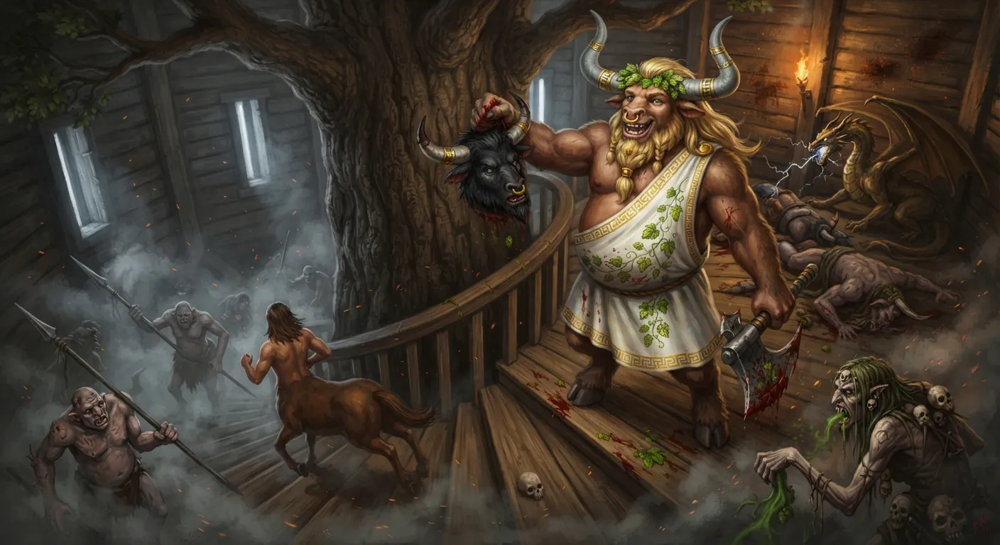
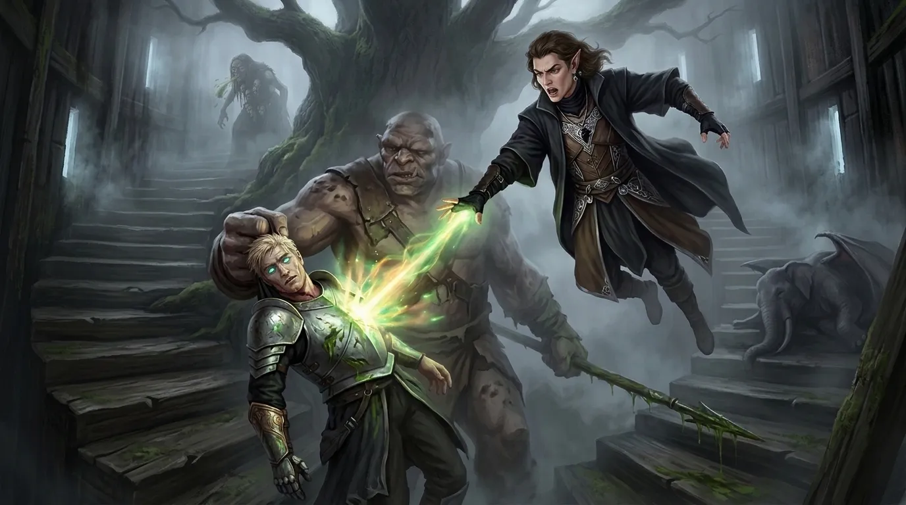
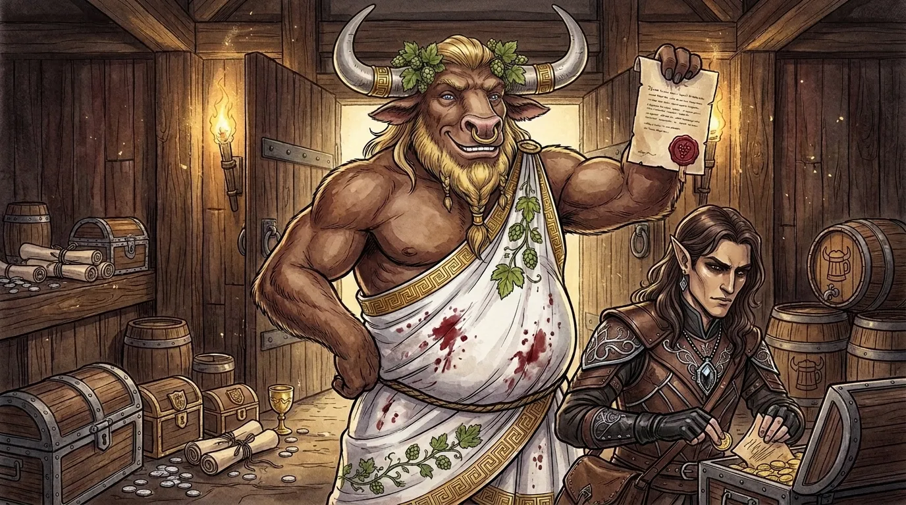
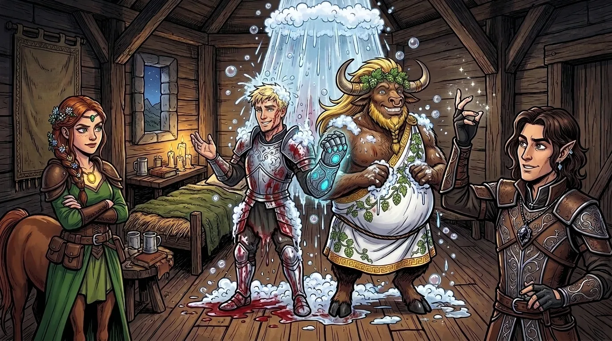
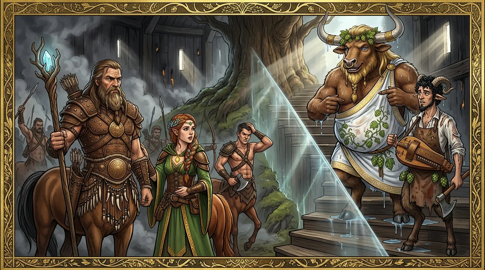
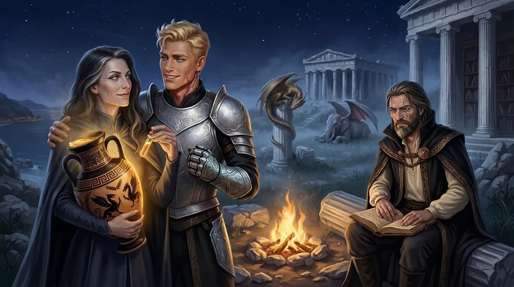

**Data**: 23.11.2026

[Prompt](../assets/sessions/088/088_theme_head_on_the_stairs.txt)

## Podsumowanie

### Walka na Schodach Fortu Zakrotha

[Prompt](../assets/sessions/088/088_sec1_get_up_in_the_fog.txt)

Walka w **[[Fort Zakrotha|Forcie Zakrotha]]** toczyła się jednocześnie na dwóch piętrach wieży. Na czwartym piętrze **[[Orestes]]** stał nad ciałami **[[Zakroth|Zakrotha]]** i **[[Belladona|Belladony]]**, obok mocno rannego **[[Felicjan Janus Twardowski|Felicjana]]** oraz smoka **[[Kairos|Kairosa]]**. Kondygnację niżej **[[Versir]]**, któremu klątwa nie pozwalała się wycofać, walczył w spowijającej go mgle z **[[Murgrat|Murgratem]]** i wiedźmą **[[Gigantes]]**, a jego świetlista aura raniła każdego, kto podszedł bliżej. Chcąc powstrzymać napierających ze schodów obrońców, minotaur odrąbał Zakrothowi głowę, podszedł do klatki schodowej i krzyknął do zebranych, że wódz nie żyje i wszyscy mają wracać do domów. Głowa potoczyła się w dół, a z niższych pięter fortu dobiegł okrzyk: „Zakroth nie żyje!”.

Dwóch [[Centaur z Thylei|centaurów]] straciło wtedy wolę walki. **[[Orion Xul|Orion]]** oszczędził bliższego z nich i zawołał, że wciąż mogą się poddać i przeżyć; pierwszy zbiegł po schodach przez aurę Versira, drugiego zaś, uciekającego chwilę później, Orion ciął na odchodnym, po czym ranny wojownik padł w aurze paladyna i stoczył się po stopniach. Przyczajony niżej **[[Hoobert]]** przekazał Felicjanowi, że jeden z Gigantes również wycofał się na parter, pozostali olbrzymi walczyli jednak dalej. Na czwartym piętrze wiedźma Gigantes splunęła jadem w Orestesa, lecz bitewny szał uchronił go przed trucizną. Jej klątwa, przez którą nie można było się wycofać, dopóki widziało się wrogów, dosięgła Oriona. Kairos zionął błyskawicą, a Felicjan zaklęciem *Lightning Bolt* poraził trzech przeciwników w jednej linii, wypalając dziurę w drewnianej ścianie, i rzucił do smoka: „Widzisz młody? Tak to się robi.” Orestes jednym uderzeniem powalił wiedźmę martwą na drewnianą podłogę, po czym zawrócił do stojącego obok Gigantesa, wołając: „Nie wycofam się, póki się nie poddacie albo umrzecie!”, i zabił go na miejscu. Oblany krwią oraz jadem minotaur wrzasnął jeszcze do pozostałych wrogów: „Uspokójcie się!”, a w oczach najbliższego olbrzyma widać było trwogę.

Tymczasem na trzecim piętrze Murgrat nacierał na Versira z pretensją o to, co ten wcześniej zrobił z jego umysłem, aż inny Gigantes przebił piką jego obronę, powalił paladyna nieprzytomnego, przerywając jego czar, i pochwycił go bezwładnego. Z dołu rozległ się głos wiedźmy: „Mamy jednego z waszych! Poddajcie się, albo on straci głowę!”. Orestes i Orion odmówili złożenia broni. Murgrat zwrócił wtedy zatrutą pikę przeciw **[[Trąba|Trąbie]]**, który próbował osłonić paladyna, i zabił skrzydlatego słonia; przed śmiercią zdążył jedynie smutno zatrąbić. Wiedźma krzyknęła w górę schodów: „Mieliście szansę”, i rzuciła się z pazurami na nieprzytomnego Versira, nie zdołała go jednak zranić. Na górze olbrzymi dotkliwie poranili Orestesa i Oriona; przed ciosem, który powaliłby wojownika na deski, osłoniła go **[[Kyrah]]** w smoczej postaci i odsunęła za [[Arevon Elorrenthi|Arevona]]. Słysząc z dołu groźby pod adresem Versira, Felicjan rzucił *Etherealness*, przeszedł na plan eteryczny i przeniknął przez strop piętro niżej, by wyciągnąć towarzysza z rąk olbrzymów. Ciężko ranny Orestes przeszedł wtedy na schodach czwartego piętra swoją przeklętą przemianę w kozobyka, a Orion dwoma rzutami broni położył najbliższego z rannych przeciwników i wycofał się ze zwarcia. Arevon zleciał spiralną klatką w gęstą mgłę ograniczającą widoczność do kilku kroków, zawisł tuż nad Gigantesem ściskającym nieprzytomnego Versira i rzucił na towarzysza *Healing Word*.

> [!quote] Arevon
> Wstawaj, kurwa, i spierdalamy stąd!

Olbrzym nie wypuścił ockniętego paladyna i zatruł go pchnięciem piki; Versir uzdrowił się zaklęciem *Cure Wounds* oraz nakładaniem rąk, opierając się próbie przerwania czaru przez wiedźmę, lecz chwyt Gigantesa nie pozwolił mu wstać. Felicjan, wciąż na planie eterycznym, rzucił na siebie *Greater Invisibility*, by niewidzialnie wrócić na plan materialny, a Hooberta wysłał na parter, skąd dobiegały odgłosy poruszenia, choć nikt nie ruszył w górę schodów. We mgle trzeciego piętra Murgrat i wiedźma, która pobudziła siebie oraz drugiego olbrzyma do bitewnego szału, doprowadzili Versira na skraj utraty przytomności. Na czwartym piętrze przemieniony Orestes staranował i dobił ostatniego olbrzyma na tym piętrze, po czym razem z Orionem zbiegł na dół, a Arevon rzucił *Wither and Bloom*, wysysając siły z całej trójki wrogów i podtrzymując słabnącego paladyna. Wciąż uwięziony w uścisku olbrzyma Versir rzucił *Command* na wszystkich trzech przeciwników, każąc im „spierdalać stąd”, i wypił miksturę leczącą. Wiedźma oparła się rozkazowi, lecz Murgrat i drugi Gigantes ulegli magii.

Ukryty pod ścianą Felicjan telepatycznie pchnął wiedźmę w dół schodów. Posłuszny rozkazowi Versira Murgrat rzucił się do ucieczki, wystawiając się na ciosy: Kairos rozorał go pazurami, a paladyn dobił olbrzyma na stopniach. W gęstej mgle utrzymywanej przez Versira towarzysze nie widzieli ani siebie nawzajem, ani wiedźmy, która przeszła do kontrataku: zatrutymi pazurami pozbawiła paladyna przytomności, a jadem powaliła także Kairosa. Arevon zbliżył się do obu i rzucił *Mass Cure Wounds*, przywracając im przytomność i lecząc rany całej drużyny. Gdy ostatni Gigantes rzucił się do ucieczki w dół schodów, dosięgły go pazury Kairosa, a Orestes zahaczył go rogami pod pachami i zatrzymał na stopniu; Versir rozwiał wtedy mgłę, przeniósł się zaklęciem *Misty Step* na dogodną pozycję i dobił przeciwnika. Kairos zionął błyskawicą w wiedźmę, a niewidzialny Felicjan posłał w nią promień *Disintegrate*; Arevon zakłócił jej próbę uniku i zaklęcie czarodzieja obróciło wiedźmę w popiół, kończąc starcie na schodach.

### Skarbiec Zakrotha

[Prompt](../assets/sessions/088/088_sec2_the_treasury.txt)

Po zakończeniu walki [[Versir]], [[Kairos]] i [[Orion Xul|Orion]] wciąż byli pod wpływem klątwy wiedźmy, która w razie kolejnego starcia nie pozwalała im się wycofać; paladyn otwarcie domagał się, by wybić wszystkich pozostałych w forcie wrogów. [[Arevon Elorrenthi|Arevon]] skierował jednak towarzyszy na górę. Ugasił wodą ze swojego zapasu tlące się po błyskawicach drewniane ściany na schodach i piętrze. Rzuciwszy *Detect Magic*, przeszukał ciało [[Zakroth|Zakrotha]] i zabrał jego wielki magiczny miecz oraz klucze do skarbca. Poza mieczem magiczną aurą lśniła już tylko niesiona przez [[Felicjan Janus Twardowski|Felicjana]] **[[Amfora Zakrotha]]**.

Za ciężkimi wrotami kryła się chłodna komora pachnąca starym dębem, woskiem i metalem. Pod ścianami stały okute żelazem skrzynie i baryłki ze zrabowanym dobytkiem, z których połyskiwały srebrne monety, złocone puchary z arezyjskich dworów, związane sznurkiem pliki zwojów oraz kasetki z pieczęciami szlacheckich rodów. Między łupami znajdowało się też kilka beczek piwa [[Orestes|Orestesa]]. Arevon zgarnął złoto na zakup diamentowego pyłu oraz dokumenty i zrabowane dobra z **[[Arezja|Arezji]]**; resztę papierów bohaterowie postanowili przeczytać dopiero po opuszczeniu fortu. Orestes, już w swojej naturalnej postaci minotaura, wypatrzył jednak wśród nich pismo ze znakiem [[Gildia Winiarzy|Gildii Winiarzy]] z Arezji: nieformalną umowę, według której Zakroth otrzymywał dwieście sztuk złota za każdy wóz z piwem z **[[Orestessos Zythikē]]**, który nie dotarł na miejsce.

> [!quote] Orestes
> O! Biorę ten dokument. Rekwiruję to jako dowód w sprawie. Ktoś tu będzie miał przerąbane.

Przed odejściem drużyna musiała jeszcze zabrać z niższych pięter **[[Krithon|Krithona]]** i znaleźć drogę odwrotu. Felicjan uprzedził towarzyszy, że teleportacja do Arezji jest zablokowana, a zaklęcia *Teleportation Circle* nie ma tego dnia przygotowanego, więc żeby przenieść ich gdzie indziej, potrzebuje najpierw krótkiego odpoczynku. Orestes upierał się, by wyjść frontowymi drzwiami po satyra, choćby miał wywalić wrota, ale Arevon przypomniał mu o jego ranach i około dwudziestu obrońcach czekających na dole. Kiedy Versir znów chciał rozprawić się z całą załogą, Arevon kategorycznie sprzeciwił się wysyłaniu go na parter. Felicjan zaproponował wtedy, że sam zejdzie pod osłoną *Greater Invisibility*, chwyci Krithona i wróci z nim zaklęciem *Dimension Door* na czwarte piętro, choć Arevon zwrócił uwagę, że cała drużyna i tak będzie musiała jakoś minąć wrogów.

Narada przerodziła się w spór, gdy Orestes, mimo ciężkich ran, postanowił sam zejść na dół po Krithona. Arevon próbował złapać minotaura za ubranie i zatrzymać go siłą, lecz ten z łatwością się wyrwał. Orestes ostygł dopiero na propozycję napicia się odzyskanego piwa i chwili odpoczynku. Felicjan wyprzedził jednak towarzysza, zagrodził schody zaklęciem *Wall of Force*, by minotaur nie zbiegł za nim na parter, i sam ruszył na niższe piętra.

Pozostali na górze ranni bohaterowie zajęli się dochodzeniem do siebie. Orion wypił kilka mikstur leczących, a Orestes zdjął wieka z dwóch piętnastolitrowych beczek swojego piwa zrabowanego z transportu, postawił jedną przed Versirem, stuknął się z nim beczką i w kilka minut opróżnił pięć litrów. Versir, wciąż pod wpływem klątwy wiedźmy, nalegał, by po zejściu wykończyć niedobitków w forcie. Zirytowany Arevon rzucił na paladyna *Greater Restoration* i zdjął z niego urok. Versir zdziwił się, dlaczego druid nie odczarował Orestesa, na co Arevon odparł, że minotaur nie jest pod wpływem żadnej klątwy. Po odzyskaniu jasności umysłu Versir przyznał, że ogarnęła go dziwna żądza krwi, i przypomniał Orestesowi o prośbie [[Taureus|Taureusa]], aby oszczędzić podwładnych Zakrotha. Czekając na powrót czarodzieja, Arevon z pomocą popijającego piwo Orestesa przejrzał zabrane ze skarbca dokumenty. Z zapisków wynikało, że oprócz pieniędzy minotaury otrzymywały w ostatnim czasie także żelazo od [[Zanner|Zannera]]. Współpraca z nim była świeża, jednak inne papiery wskazywały, że dostawy żelaza trafiały do fortu już wcześniej, z innego, na razie nieustalonego źródła.

### Zwiad Felicjana i Spotkanie z Lesią

[Prompt](../assets/sessions/088/088_sec3_lesia_and_the_wash.txt)

Tymczasem [[Felicjan Janus Twardowski|Felicjan]] pod osłoną *Greater Invisibility* zszedł na parter fortu. Większość obrońców opuściła już budynek, a przy samym wejściu czaiły się tylko [[Menaidy|menady]] oraz [[Krithon]], wyglądając na zewnątrz. Na skraju lasu zebrała się spora grupa [[Centaur z Thylei|centaurów]] rozmawiających z uwolnionymi wcześniej synami wodzów. Felicjan podkradł się bliżej i odczytał z ruchu warg w języku sylvan rozmowę dwóch z nich. Młodzieniec opowiadał starszemu centaurowi, że do fortu wpadli [[Bohaterowie Przepowiedni|Wybrańcy Wyroczni]], prawdopodobnie zabili [[Zakroth|Zakrotha]], wypuścili jeńców, a potem wszczęli rzeź bez względu na ofiary i przypalili go jakąś magiczną aurą, gdy uciekał; przestrzegał też, że nie można im ufać. Rozmówca ze zdumieniem zapytał o **[[Lesia|Lesię]]**, a usłyszawszy, że młodzieniec jej nie widział, spojrzał na fort i uznał, że przybysze trzymają ją jako zakładniczkę, którą trzeba odbić. Około dziesięciu centaurów z uniesioną bronią zaczęło ostrożnie zbliżać się do wejścia, groźbami odganiając napotkanych [[Gigantes]]. Felicjan przemknął niezauważony obok menad do Krithona i szepnął mu do ucha:

> [!quote] Felicjan
> Chodź ze mną, jeżeli chcesz żyć.

Wystraszony satyr cicho wycofał się z czarodziejem na schody. W drodze na górę wyjaśnił, że Lesia jest wysłanniczką jednego z plemion centaurów, która niedawno przybyła na rozmowy z Zakrothem i nie opuściła fortu; z pracy w kuchni pamiętał, że noszono jej jedzenie do izby gościnnej na drugim piętrze. Felicjan natychmiast wezwał resztę drużyny na dół, ostrzegając o zbliżającym się natarciu. Bariera *Wall of Force* zdążyła zniknąć, więc bohaterowie zabrali wszystkie dokumenty oraz miecz Zakrotha i zeszli na drugie piętro. Z parteru dobiegały już głosy w sylvan: wojownicy wydawali rozkazy przeszukania dolnej kondygnacji przed ruszeniem na górę.

Na drugim piętrze Krithon podbiegł do [[Orestes|Orestesa]], nazywając go kuzynem i pytając, co się tu wydarzyło, bo przed przybyciem drużyny panował spokój. Orestes odparł, że było „spokojnie jak na wojnie”, i wyliczył napaści na górze oraz uwolnionych jeńców nawołujących do zabicia ratowników, a [[Versir]] przypomniał satyrowi, że zanim tu przyszli, wieszano ludzi na krzyżach. Felicjan szybko streścił towarzyszom podsłuchaną rozmowę, po czym [[Arevon Elorrenthi|Arevon]] otworzył zamknięte drzwi do izby gościnnej pękiem kluczy zabranych Zakrothowi. W środku bohaterowie zastali centaurzycę, która na widok uzbrojonych i zakrwawionych przybyszów cofnęła się w kąt pokoju. Versir, z krwią na zbroi i we włosach, przemówił do niej pewnie: „Przychodzimy w pokoju! Nie musisz się nas obawiać! Przyszliśmy ci zwrócić wolność!”. Orestes mruknął tylko, że tak powiedziałby każdy, kogo trzeba by się obawiać.

Arevon obserwował klatkę schodową i przygotował zaklęcie *Wall of Force*, by zagrodzić schody, gdy centaury zaczną wchodzić na górę. W izbie centaurzyca przedstawiła się jako Lesia i spytała Versira, kim są i dlaczego jest cały we krwi. Paladyn odparł: „Dyplomacja zawiodła, Lesio”, i wyjaśnił, że przyszli porozmawiać z Zakrothem, lecz ten rzucił się na nich. Lesia przyznała, że kilka dni wcześniej przybyła tu w tym samym celu. Na pytanie Versira, czy jest więźniem, odparła twierdząco.

Zaraz potem spytała bohaterów, czy widzieli jej brata. Arevon upewnił się, o którego z nich chodzi, a Versir wyjaśnił, że po wcześniejszym spotkaniu z grupą centaurów uwolnili **[[Perimedes|Perimedesa]]**, lecz ten stanął po stronie Zakrotha. Arevon dodał, że po wyjściu z celi Perimedes zabrał broń, podniósł alarm i rzucił się na nich, a Felicjan uprzedził ją, że brat stoi teraz na dole i wmawia ojcu, iż przybysze przyszli wszystkich zabić, a ją samą trzymają jako zakładniczkę. Lesia zakryła twarz dłonią i przyznała, że takie zachowanie pasuje do brata. Zapytana, czy zdoła przekonać rodzinę, odparła, że spróbuje, choć z zewnątrz wszystko może wyglądać podejrzanie. Versir chciał zapewnić, że stoją po dobrej stronie, ale to słowo nie przeszło mu przez gardło; przekonywał więc, że Zakroth był oszustem pracującym dla ludzkich pieniędzy, na co mają dowody. Lesia przyjęła to bez większego wrażenia, zgodziła się jednak rozmówić z ojcem i bratem. Zanim ruszyli, Arevon polecił towarzyszom schować broń i stanąć na środku izby, po czym oblał ich przywołaną wodą i zmył z nich krew mydlinami z zaklęcia *Druidcraft*. Orestes ucieszył się z prysznica, a Lesia przytaknęła, że to pomoże.

### Rokowania z Agriusem i Opuszczenie Fortu

[Prompt](../assets/sessions/088/088_sec4_parley_through_the_barrier.txt)

Z dołu dobiegły głosy [[Centaur z Thylei|centaurów]], które natknęły się na barierę *Wall of Force*. [[Arevon Elorrenthi|Arevon]] wyjaśnił Lesi, że ustawili ją na schodach, by uniknąć dalszej walki, i zaproponował, że przerzucą ją magią na drugą stronę, aby nie wyglądała na zakładniczkę. Za jej zgodą [[Versir]] rzucił *Vortex Warp* i przeniósł centaurzycę na niższy poziom, wprost do jej ojca, brodatego wodza **[[Agrius|Agriusa]]** w ćwiekowanej zbroi, otoczonego przez wojowników i [[Perimedes|Perimedesa]]. [[Lesia]] opowiedziała ojcu, że przybyła jako posłanka, a [[Zakroth]] ją uwięził. Choć Perimedes wciąż nalegał, by rozprawić się z [[Bohaterowie Przepowiedni|Wybrańcami Wyroczni]], Lesia oceniła, że przybysze nie wydają się żądni krwi. Agrius wysłuchał obojga dzieci, po czym zwrócił się przez barierę do drużyny i zażądał trzeciej wersji wydarzeń.

Arevon wspomniał o spotkaniu z drugim synem wodza, **[[Cheironis|Cheironisem]]**, który mówił o przetrzymywanych centaurach. Opowiedział o wejściu do fortu, uwolnieniu więźniów po zabiciu strażnika oraz wybuchu walk, gdy Perimedes z towarzyszami podniósł alarm; na te słowa Agrius wymierzył synowi uderzenie w tył głowy. Druid zapewniał, że bohaterowie nie próbowali zabić żadnego centaura, a z Zakrothem zamierzali rozmawiać, co skończyło się jego śmiercią i starciem z częścią [[Gigantes]], którzy woleli zginąć niż się poddać. Agrius przyjął wieść o śmierci minotaura spokojnie, uznając, że ostatnie posunięcia Zakrotha budziły niepokój, zwłaszcza gdy Arevon dodał, że mają dokumenty potwierdzające branie od ludzi pieniędzy za napady na innych ludzi.

Kiedy wódz zapytał, co stanie się po powrocie bohaterów do swoich, do rozmowy wtrącił się wciąż mokry [[Orestes]]. Wskazał na siebie oraz stojącego obok [[Krithon|Krithona]] i zaproponował założenie w okolicy filii swojego browaru wraz z barem, co miałoby dać centaurom jego protekcję.

> [!quote] Orestes
> W sumie po co walczyć, po co się bić o wszystko, skoro można wejść tutaj w jakiś interes.

Agrius uciął tę propozycję, domagając się twardych gwarancji, że północne ziemie pozostaną w rękach centaurów, a **[[Mytros]]** i [[Arezja]] zaprzestaną ekspansji. [[Felicjan Janus Twardowski|Felicjan]] w imieniu **[[Zakon Smoczych Lordów|Zakonu Smoczych Lordów]]** zaprosił go do rozmów i obiecał wstawiennictwo oraz wyznaczenie granicy respektowanej przez obie strony. Versir przyrzekł im miejsce przy stole rokowań. Arevon dodał, że choć drużyna nie jest stroną w konflikcie, w rozmowach poprze pokój i racje plemion, a część stronnictw w Mytros i Arezji próbuje obecnie wywołać wojnę między oboma miastami, zamiast występować przeciw centaurom. Agrius stwierdził, że jego dzieci żyją, a sojusz z Zakrothem dobiegł końca, więc nie muszą być wrogami, choć otwarcie przyznał, że ma niewielkie nadzieje na skutek tych obietnic. Pozwolił bohaterom odejść, a zapytany o miejsce dla poselstwa, wskazał step, po którym wędrują. Mimo głośnych protestów Perimedesa centaury opuściły fort, a Arevon zdjął barierę.

Krithon ostrzegł drużynę, że w forcie panuje duży ruch i wkrótce wrócą patrole, dlatego odradził postój w murach. Przed odejściem bohaterowie zajrzeli jeszcze do zbrojowni, gdzie znaleźli wyłączoną wcześniej przez centaury magnetyczną pułapkę, wielką magiczną maczugę oraz zapas cennych sztab żelaza, które zabrali; Orestes uznał, że przydadzą się na kadzie browarnicze. Versir szukał **[[Gwiezdny Metal|Gwiezdnego Metalu]]**, lecz bez skutku. W tym czasie Felicjan dokładnie przejrzał dokumenty ze skarbca i ustalił, że jeszcze przed układem z [[Zanner|Zannerem]] Zakroth otrzymywał żelazo z Arezji. W papierach nie było dowodów na powiązania z **[[Taran Neurdagon|Taranem Neurdagonem]]**, a jedynie zapiski wskazujące jego pozamiejskie posiadłości jako potencjalne cele napadów. Arevon skwitował, że w Arezji czeka kogoś nieprzyjemna rozmowa.

Na koniec bohaterowie wystawili przed bramą bezgłowe ciało Zakrotha na krzyżu, z którego wcześniej zdjęli **[[Ugulat|Ugulata]]**, zostawiając tabliczkę z wiadomością o jego śmierci, a głowę zabrali jako dowód dla **[[Królowa Helena|Królowej Heleny]]**. Następnie odlecieli z fortu na południe, poza gęsty las.

### Powrót na Wyspę Yonder

[Prompt](../assets/sessions/088/088_sec5_the_amphora_on_yonder.txt)

Na krótkim postoju poza lasem [[Versir]] przywołał na nowo swojego wierzchowca, [[Trąba|Trąbę]], zaklęciem *Find Steed*, a [[Felicjan Janus Twardowski|Felicjan]] pilnował [[Kairos|Kairosa]] i zabezpieczył go czarem *Alarm*, aby smok nie odleciał sam na polowanie, ponieważ nadal był dotknięty klątwą żądzy krwi. Podczas odpoczynku czarodziej przygotował *Teleportation Circle* w miejsce jednego ze swoich zaklęć i przeniósł wszystkich na **[[Wyspa Yonder|Wyspę Yonder]]**. Razem z bohaterami udał się tam ocalony arezyjski zwiadowca [[Ugulat]]. Krasnolud nie chciał wracać piechotą do [[Arezja|Arezji]] i przyznał, że nigdy dotąd nie był na wyspie, więc chętnie ją zwiedzi, a Versir liczył, że Ugulat pomoże później ustalić, kto w mieście zajmuje się handlem żelazem.

Na miejscu Felicjan zidentyfikował zdobyte przedmioty: wielką magiczną maczugę, której nikt z drużyny nie zamierzał używać, i **[[Amfora Zakrotha|Amforę Zakrotha]]**, powstrzymującą starzenie się oraz pozwalającą rzucać *Heroes' Feast* i *Suggestion*. Kiedy [[Orestes]] zgłosił się do przechowania naczynia, twierdząc, że znajdzie dla niego zastosowanie i że u niego nic mu nie grozi, Felicjan stanowczo odmówił. Przekonywał za to Versira, aby sam przyjął amforę dla dobra wspólnej sprawy, zaznaczając, że jej dzierżenie nie oznacza przyjęcia boskości. Paladyn odrzucił tę propozycję jako krok za daleko i zapytał swoją partnerkę **[[Astra|Astrę]]**, czy nie chciałaby związać się z przedmiotem. Astra przystała na to i powiedziała Versirowi, że zanim go poznała, nie myślała o wieczności, ale wieczność z nim brzmi „zajebiście”. Versir zastrzegł, że traktuje to rozwiązanie jako tymczasowe, i zapewnił Felicjana, że w rękach Astry amfora pozostanie bezpieczna.

Przed nocnym spoczynkiem drużyna uzgodniła dalsze kroki. Nazajutrz bohaterowie zamierzali udać się do Arezji na spotkanie z [[Królowa Helena|Królową Heleną]], aby zamknąć sprawę [[Zakroth|Zakrotha]] i zażądać wyjaśnień co do wcześniejszych dostaw żelaza dla jego buntowników. [[Arevon Elorrenthi|Arevon]] podejrzewał, że władczyni wiedziała o tych transakcjach, ponieważ sam był wcześniej świadkiem zakupów żelaza na [[Wyspa Indygo|wyspie Indygo]], a Versir stwierdził, że po takiej rozmowie ich relacje z Arezją staną się bardzo napięte. Dopiero po załatwieniu tej kwestii na dworze Heleny drużyna planowała wyruszyć do **[[Kurhany Karpathosa|Kurhanów Karpathosa]]** po **[[Kaduceusz Damona]]**, którym szczególnie interesował się Felicjan.

> [!quote] Arevon
> Na 90% ona o tym wiedziała. Ona pewnie nie podpisała się swoją ręką, ale na pewno o tym wiedziała.

## Kluczowe wydarzenia
* Orestes odrąbał głowę Zakrotha i strącił ją ze schodów, co odebrało wolę walki części obrońców, lecz Gigantes walczyli dalej.
* Gigantes powalili Versira i zabili Trąbę; Arevon zaklęciem Mass Cure Wounds postawił na nogi paladyna i Kairosa, a Felicjan obrócił ostatnią wiedźmę w popiół zaklęciem Disintegrate.
* W skarbcu Zakrotha drużyna znalazła umowę z Gildią Winiarzy z Arezji, płacącą za napady na transporty piwa Orestesa, oraz zapiski o dostawach żelaza od Zannera i wcześniej z Arezji.
* Felicjan wyprowadził z parteru Krithona, a bohaterowie uwolnili z izby gościnnej centaurzycę Lesię.
* Wódz Agrius po rozmowie przez barierę uznał sojusz z Zakrothem za zakończony, pozwolił drużynie odejść i wyprowadził centaury z fortu.
* Bohaterowie wystawili bezgłowe ciało Zakrotha na krzyżu przed bramą i razem z Ugulatem przenieśli się na Wyspę Yonder.
* Amfora Zakrotha trafiła do Astry, a drużyna postanowiła nazajutrz zażądać od Królowej Heleny wyjaśnień w sprawie dostaw żelaza.

## Filmy

