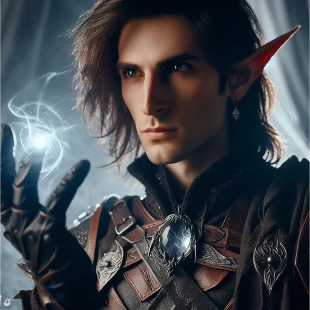

_Elf Druid, [[Epickie Ścieżki#The Seeking One (Poszukujący)|The Seeking One]]_
_**Poszukujący**, który przybył z odległych krain i odnalazał ukryte tajemnice [[Thylea|Thylei]]._

## Historia

Arevon Elorrenthi, elficki druid z domu Phiarlan w Eberron, wychował się pośród wojennych intryg i sztuki, lecz odnalazł powołanie wśród Strażników Lasu i gwiazd. Jako nawigator na statku "The Tranquility" badał granice magicznej mgły Mournlandu, gdy potężny sztorm przeniósł go do innego wymiaru. Rozbił się u wybrzeży mitycznej krainy Thylea, tracąc załogę i wszystko co znał.

Ocalały z katastrofy, Arevon szybko zaadaptował się do nowej rzeczywistości, wykorzystując swoje ocalałe zasoby, by przetrwać w obcym mieście Mytros. Zgłębiając historię i kulturę Thylei, otrzymał niespodziewane wezwanie od Wyroczni, która obiecała odpowiedzi na dręczące go pytania o los jego świata i przyczynę przybycia. Wyruszył więc w podróż, wierząc, że gwiazdy i przeznaczenie wskażą mu drogę powrotną lub nowy cel w tym dziwnym świecie.

Podczas pobytu w [[Estoria|Estorii]], Arevon wykazał się sporą naiwnością wynikającą z nieznajomości lokalnych praw i klątw. Na [[Agora w Estorii|Agorze]] natknął się na [[Claus|Clausa]], rabusia grobów, i o mały włos nie dał się namówić na kupno przeklętego naszyjnika, co mogło sprowadzić na niego gniew bogów.

W [[Sesja 9 - W Głębi Grobowca Xandera]] otrzymał od [[Damon|Damona]] [[Eye of the Galactic Dragon|Oko Galaktycznego Smoka]] i za jego sprawą doświadczył wizji związanej z [[Zakład Smoczego Lorda|Zakładem Smoczego Lorda]]. W [[Sesja 14 - Burza nad Mytros]] dowiedział się, że biblioteka na Yonder może mu pomóc w odnalezieniu drogi do domu, a w [[Sesja 18 - Cienie Mytros]] usłyszał o rozbitkach, którzy pojawili się kilka dni wcześniej i prawdopodobnie nie pochodzą z jego świata.

W [[Sesja 20 - Noc Długich Rogów]] został zaatakowany przez cyborga, a jego kruk śledził kobiety prowadzące minotaury aż do Kolosa Pythora. W [[Sesja 21 - Ukryte pragnienia Ismene]] znalazł w bibliotece książkę Volkana "Golemy i Automatony", z której dowiedział się o [[Keledone]]. W [[Sesja 22 - Taniec z Meduzą]] znalazł w kajucie kapitana złoty płaszcz, sakiewkę złota i mapy gwiazd, ale nie Antikytherę.

W [[Sesja 24 - Ultros]], w poszukiwaniu statku [[Ultros]] przy [[Martwe Wodospady|Martwych Wodospadach]], stanął do walki z kapitanem widmo [[Estor Arkelander|Estorem Arkelanderem]], który skupił się na nim i na Astrze, zabijając ich oboje. Gdy [[Kyrah]], poświęcając część swojej boskiej mocy, otoczyła wszystkich jasnym światłem, które przywróciło Arevona i Astrę do życia i wyleczyło rany pozostałych, Estor został osłabiony i ostatecznie pokonany przez drużynę.

W [[Sesja 29 - Rydwany i Jeden z Dziesięciu]] próbował powstrzymać Felicjana, teleportując się na jego rydwan, ale mu się nie udało. W [[Sesja 30 - Zakończenie Igrzysk]] wygrał Wielki Młyn, ostatnią walkę Igrzysk, choć drużyna ponoć dała mu fory.

W [[Sesja 32 - Kieł]] kupił na targu miksturę leczącą petryfikację, a jako delfin zwiadował podwodne wejścia do więzienia Kieł. W [[Sesja 34 - Ivello i Drapaczka do Pleców]] odnalazł posąg [[Ivello Ostren|Ivella Ostrena]] i ożywił go za pomocą Oil of Softening, zaklęciami pomógł przenieść cyklopa [[Bront|Bronta]] przez ciasne korytarze fortecy, a Ivellowi obiecał szukać sposobu na powrót do swojego świata i odnalezienie Baltii.

W [[Sesja 36 - Królowa, Dziedzic i Generał]] nawigując z pomocą [[Antikythera|Antikytery]] miał sen-wizję, w której wcielił się w Estora Arkelandera, a po przebudzeniu zobaczył w kajucie nie do końca materialnego Estora. Dostrzegł też na horyzoncie wrak statku z rozbitkami; Baltia Rhuli okazała się dawną członkinią jego załogi. W [[Sesja 37 - Próba Ognia]] zwołał naradę w sprawie propozycji Estora i zgodził się z odrzuceniem oferty ducha. W [[Sesja 38 - Bitwa w Kalderze]] przywołał pnącza, które pochwyciły Jankora, uleczył Orestesa i przeszukał pole bitwy.

W [[Sesja 39 - Tajemnice Wyspy Złotego Serca]] z niezwykłą precyzją sterował [[Ultros|Ultrosem]] podczas sztormu zesłanego przez [[Sydon|Sydona]], ratując statek przed zniszczeniem. W [[Sesja 40 - Uciechy na Wyspie Skorpiona]] mechaniczny konstrukt dostarczył mu zamówioną zbroję.

W [[Sesja 41 - Wiedźma Lotosu]] w wieży [[Wiedźma Lotosu|Wiedźmy Lotosu]] rozpoznał zaginionego członka swojej załogi, [[Garrick Vanalan|Garricka Vanalana]]. Zapytał o drogę do Eberronu i dowiedział się od Wiedźmy, że Thylea jest kieszonkowym planem. Zakręcił magicznym Kołem Fortuny, zyskując zdolność przemiany w drzewca.

W [[Sesja 42 - Plemię Węgorza]] napisał zwój zaklęcia jako dar dla Felicjana, unieruchomił smoczycę [[Ventis]] magicznymi pnączami i uleczył Orestesa po walce. W [[Sesja 43 - Kopalnia Żelaza]], obdarzony darem dyplomacji, został rzecznikiem drużyny wobec elfów i opowiedział im o proroctwie o [[Mojry|Mojrach]], smokach i Sydonie. W [[Sesja 44 - Ventis]] zaklęciem uziemiającym wykorzystał wszystkie trzy legendarne odporności Ventis, otwierając drogę do zwycięstwa, i uleczył Orestesa podczas pojedynku z Goracem.

W [[Sesja 45 - Tajemnica Wyspy Wygnańców]] rozpoznał woń Nightshade Whisper wokół ciała Mariusa, a w [[Sesja 46 - Morderca z Wyspy Wygnańców]] dzięki rozmowie z drzewami figowymi naprowadził drużynę na Keelana, którego unieruchomił zaklęciem Uwięzienie Osoby, i wyrwał trujące kwiaty z ogrodu Idylli.

W [[Sesja 47 - Wyspa Mojr]] ujrzał wizję własnego statku giniącego w sztormie na Eberronie i własnego ciała w paszczy mosiężnego smoka, sterował Ultrosem przez sztorm i odrzucił ofertę [[Mojry|Mojr]], które proponowały mu potężne zaklęcia w zamian za jego szybkość.

W [[Sesja 48 - Pakty z Mojrami i Zew Chimery]] ostatecznie ugiął się i poświęcił swoją szybkość, nie chcąc oddać wspomnień o zaginionej załodze, w zamian za dodanie potężnych zaklęć do swojego artefaktu. Proponował też wojnę podjazdową przeciw Zakonowi Sydona.

W [[Sesja 49 - Wielkie Gęsie Powstanie]] podejrzewał [[Althaia|Althaię]] od samego początku, snując teorie, że współpracuje z Chimerą lub jest nią. Został zamieniony w gęś, na chwilę uśpiony podczas walki z Gęguzą, a po odzyskaniu postaci zmienił się w gigantycznego orła, by odzyskać ekwipunek drużyny ze szczytu góry.

W [[Sesja 50 - Nawałnica Tytanów i Szepty Yonder]] jako kapitan Ultrosa prowadził statek przez burzę. W [[Sesja 51 - Desant na Yonder]] i [[Sesja 52 - Infiltracja Yonder]] w postaciach kruka, wrony, sowy, żołnierza i piekarza zwiadował obóz na Yonder, zebrał plotki, sparaliżował strażnika i zamienił [[Tars d’Lyrandar|Tarsa]] w mysz, obiecując mu wolność. W [[Sesja 53 - Koniec Yonder]] rzucił się w przepaść, by uleczyć spadającego Versira, odnosząc ciężkie rany.

W [[Sesja 54 - Wyznanie Chondrusa]] odnalazł [[Tars d’Lyrandar|Tarsa d’Lyrandara]], kapitana swojego zaginionego statku, i wytłumaczył mu, że powrót do Eberronu jest niemal niemożliwy. Sprzeciwiał się otwieraniu drugiego frontu z Lutherią w trakcie wojny z Sydonem; w głosowaniu drużyna zgodziła się podjąć negocjacje z duchem Estora, który ponowił ofertę podczas druidycznej medytacji Arevona. W [[Sesja 55 - Egida Mytros]] otrzymał od [[Volkan|Volkana]] naprawioną i ulepszoną [[Antikythera|Antikyterę]], podglądał Hergerona zaklęciem Scrying i zobaczył, że tytan przejął władzę nad Zakonem Sydona.

W [[Sesja 56 - Dedal i Ikar]], skupiając wolę na [[Eye of the Galactic Dragon|Oku Galaktycznego Smoka]], doświadczył wizji oczami [[Hexia|Hexii]] o jej więzi z jeźdźcem [[Ochos Arkelander|Ochosem]] i jego śmierci; przyzwał żywiołaka wody i uratował Ikara V2 przed zatonięciem. W [[Sesja 57 - Ogród Heliosa]] w postaci gigantycznego orła i z przyzwanym widmowym smokiem walczył z Heliosem, a czarem paraliżu powstrzymał Orestesa przed skokiem do morza. W [[Sesja 58 - Wyspa Czasu]] zobaczył w wizji z teleskopu, jak jego praca badawcza staje się planem inwazji na Thyleę. W [[Sesja 59 - Koniec Imprezy]] padł ofiarą uroku menad i nimf i bezwładnie tańczył w powietrzu pod sufitem latającej fortecy.

W [[Sesja 60 - Typhon Symfonia Potępienia i Brama do Hadesu]] w postaci gigantycznego orła przetransportował drużynę na Typhon. W [[Sesja 61 - Yala, Arezja i Żółw]] zauważył błędy iluzji: cienie padające pod złym kątem i migoczące słońce. W [[Sesja 62 - Arezyjska Dyplomacja]] z Felicjanem dostrzegł w lesie ślady stóp Talosa, a w [[Sesja 63 - Werdykt Arezji]] wysłał magicznego kruka na zwiad do Świątyni Cieni i z Versirem przedstawił Radzie plany wojenne Tytanów.

W [[Sesja 64 - Pieśń dla Smoczycy]], gdy zbliżali się do Wyspy Smoka, jego umysł stał się naczyniem dla wspomnień samej [[Hexia|Hexii]]. Zobaczył świat jej oczami - miłość do [[Ochos Arkelander|Ochosa]], pieśń, i moment, w którym [[Zguba Tytanów|Titansbane]] zawiódł, nie mogąc zabić Sydona. Ta wizja pozwoliła drużynie zrozumieć ból smoczycy.

W [[Sesja 65 - Wyprawa w Otchłań]] popisał się mistrzowską nawigacją, przeprowadzając [[Ultros|Ultrosa]] przez wir [[Charybda]] na [[Morze Otchłani]]. Zaproponował skucie Chondrusa kajdanami, a wewnątrz [[Sześcian Więzienny|Sześcianu Więziennego]] odczytał starożytne runy w języku Primordial, odkrywając przerażającą prawdę o uśpionym wewnątrz [[Tarrasque]]. W [[Sesja 66 - Przebudzenie Bestii i Cienie Otchłani]] przywołał księżycowe światło, dobijając wrogów w Sześcianie, a Estor twierdził, że łączy ich specjalna więź. W [[Sesja 67 - Zguba Estora]], dręczony wątpliwościami co do sojuszu z nieumarłym, skonfrontował je z Kyrah; przywrócił Versirowi fizyczną formę zaklęciem rozpraszającym magię i magiczną interwencją uratował Orestesa przed krytycznym ciosem w walce z Estorem.

W [[Sesja 69 - Ogród Lutherii]] przekonywał, że za wszelką cenę należy odwieść [[Lutheria|Lutherię]] od wspierania Sydona. W [[Sesja 70 - Audiencja u Pani Snów]] doznał wizji upadku Praxys, wcielając się w Telamoka Arkelandera.

W [[Sesja 71 - Infiltracja Praxys]] jako eteryczna chmura (Wind Walk) przeprowadził brawurowy samotny zwiad majestatycznej fortecy Pana Burz na morzu, ustalając optymalną ścieżkę ataku przez kanały odpływowe po ominięciu Ścian Mocy. To jego złodziejskie umiejętności otworzyły następnie wrota do komnaty spętanej [[Królowa Myrmeków|Królowej Myrmeków]].

W [[Sesja 72 - Śniadanie u Tytana Bochenek Przeznaczenia]] w potyczce wspierał kompanię swoimi potężnymi zaklęciami, uzdrawiając ranionego minotaura czy taktycznie dzieląc pole bitwy potężną *Ścianą Ognia*, z której niestety zregenerował się, podrzucony tam przez Orestesa, Żelazny Golem z kuźni tytanów.

W [[Sesja 73 - Praxys - Skarbiec Sydona]] otworzył drzwi skarbca Sydona umiejętnościami złodziejskimi i magią, wyłączył alarm Praxys złotą monetą z czerwonym okiem, odnalazł w więzieniu Lię Amakiir, z którą kiedyś pływał w załodze w Eberronie, i wyczuł, że czerwona gwiazda jest żywym stworzeniem, odczuwającym smutek i desperację. W [[Sesja 74 - Matka Smoków]] przywołał Elementala piątego poziomu.

W [[Sesja 75 - Koniec Przysięgi]] przez teleskop Furii na ułamek sekundy zobaczył swój rodzinny świat Eberron; Furia Megara ostrzegła go przed powrotem do niego. Awansował na trzynasty poziom doświadczenia.

W [[Sesja 76 - Bitwa o Mytros: Pierwsza Fala]] rzucił serię zaklęć Scrying (na Hergerona, Doki Mytros i Yalę), przywrócił Versirowi dłoń, rzucił Gust of Wind w żagle Ultrosa i potężnym zaklęciem leczącym przywrócił każdemu w aurze blisko 50 punktów wytrzymałości.

W [[Sesja 77 - Bitwa o Mytros: Upadek Icarusa]] zabił [[Hergeron|Hergerona]], wzywając za pomocą Conjure Fey fey'a, który wbił mu dwa widmowe sztylety w pośladki, po czym wyłuskał z jego szat złotą monetę - klucz do drzwi w Praxys. Następnie zadał ostateczny cios [[Icarus|Icarusowi]] radiantnym ostrzem po użyciu Wrath of the Dragon Gods i przeprowadził maraton uzdrowień, ratując smoki, Felicjana i Orestesa.

W [[Sesja 78 - Bitwa o Mytros: Przebudzenie Kolosa]] przyjął gwiezdną formę druida gwiazd i zsyłał magiczne pociski, przekonując przy tym [[Acastus|Acastusa]], że bez berła miasto czeka zagłada. W [[Sesja 79 - Bitwa o Mytros: Gniew Pana Burz]] okazało się, że nosi epicką ścieżkę Poszukującego (The Seeking One), a w [[Sesja 80 - Bitwa o Mytros: Śmierć Pana Burz]] jeździł na smoczycy [[Arkyrania|Arkyranii]] i leczył całą drużynę, ciskając pociski światła w Sydona.

W [[Sesja 81 - Bitwa o Mytros: Koszmar na Targu Minotaurów]] zużył diamenty na Revivify dla [[Nephele (Smok)|Nephele]] i zażartował, że prababka jest mu winna trzysta sztuk złota. W walce z [[Lutheria|Lutherią]] został wyssany z sił przez Blight, przyzwał z Feywildu tęczową pixie z kosą, wezwał bombardowanie Latającej Fortecy Smoczych Lordów, a później został pogrążony w szaleństwie nałożonym przez boginię.

W [[Sesja 82 - Bitwa o Mytros: Śmierć Pani Snów]] walczył z [[Lutheria|Lutherią]] w gwiaździstej postaci łucznika i wielokrotnie leczył drużynę. Gdy wyczerpała mu się magia, drużyna spaliła wszystkie pozostałe **Punkty Cudów** - dar bogini [[Mytros (Bogini)|Mytros]] - by w środku bitwy odzyskał pełnię sił. Zamknął następnie siebie i towarzyszy w niewidzialnej ścianie mocy, lecz bogini przerwała koncentrację na labiryncie i ściągnęła [[Versir|Versira]] z powrotem poza barierę, zmuszając druida do zniesienia własnej ochrony, by ratować towarzysza.

W [[Sesja 83 - Zmierzch Ery Tytanów]] przed bitwą zaleczył rany [[Orion Xul|Oriona]], a w samym starciu z [[Kentimane|Kentimane'em]] raz za razem wyrywał towarzyszy z progu śmierci słowem uzdrowienia i utrzymał w powietrzu ranną [[Arkyrania|Arkyranię]]. Sam został pochwycony i połknięty jako trzeci z drużyny. Z wnętrza [[Tytani|Tytana]], przemieniony smoczą mocą, uwolnił falę czystej siły, od której zagotował się żołądek [[Kentimane|Sturękiego]] - [[Tytani|Tytan]] zwymiotował i wyrzucił druida z powrotem na pola. Po bitwie oddał [[Mistrz Cieni|Mistrzowi Cieni]] [[Traktat o Prawach i Zobowiązaniach Krwi]] bez sprzeciwu, choć nie dowiedział się, co czyni tę księgę wartą tak wysokiej ceny.

W [[Sesja 84 - Świt Nowej Ery]] odkrył, że przerobiony przez [[Sydon|Sydona]] żywiołak [[Tranquility]] słucha także jego, choć nie nosi Znamienia Burzy - dzięki temu drużyna popłynęła do [[Morze Otchłani|Morza Otchłani]] bez wciągania w to [[Tars d’Lyrandar|Tarsa]]. To on czekał na murze [[Świątynia Cieni|Świątyni Cieni]], aż [[Orestes]] wyjdzie z rytuału żywy, i sprawdził to sztyletem, po czym uleczył ranę i podał minotaurowi piwo.

Głównym celem następnych piętnastu lat stało się dla niego [[Królestwo Syren|Zatopione Królestwo Syren]] - wyprawa za wyprawą, bez rezultatu; zapał przygasł, ale poszukiwań nigdy nie porzucił całkowicie. Rozważał dołączenie do odbudowanego [[Smoczy Lordowie|Zakonu Smoczych Lordów]] (skłaniał się ku „tak", ale najpierw chciał przeczytać wszystkie szczegóły umowy), zaprzyjaźnił się z [[Plemię Delfina|Plemieniem Delfina]] na [[Wyspa Indygo|Wyspie Indygo]] i postanowił spisać wszystkie dzieje, których był świadkiem. Gdy [[Antikythera]] ożyła sama z siebie, rozpoznał w jej wskazaniu kurs do [[Eberron|Eberronu]]. Przekonywał [[Tars d’Lyrandar|Tarsa]] i [[Garrick Vanalan|Garricka Vanalana]], by nie wracali do domu, i ostatecznie zbudował niepozorny wiosłowy statek, którym odesłał do Eberronu [[Ivello Ostren|Ivella Ostrena]] i [[Lia Amakiir|Lię Amakiir]], po wykładach o tym, o czym nie wolno im mówić, i po najostrzejszej przestrodze, na jaką było go stać.
