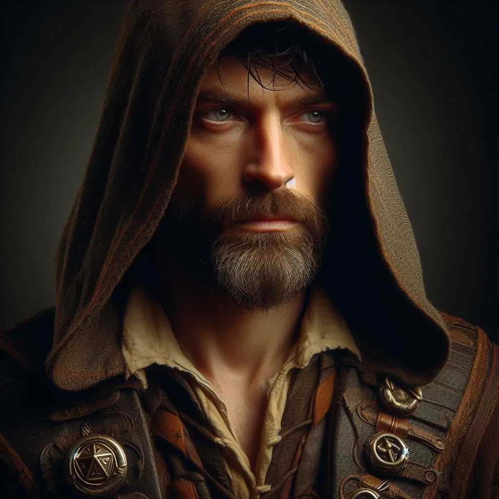
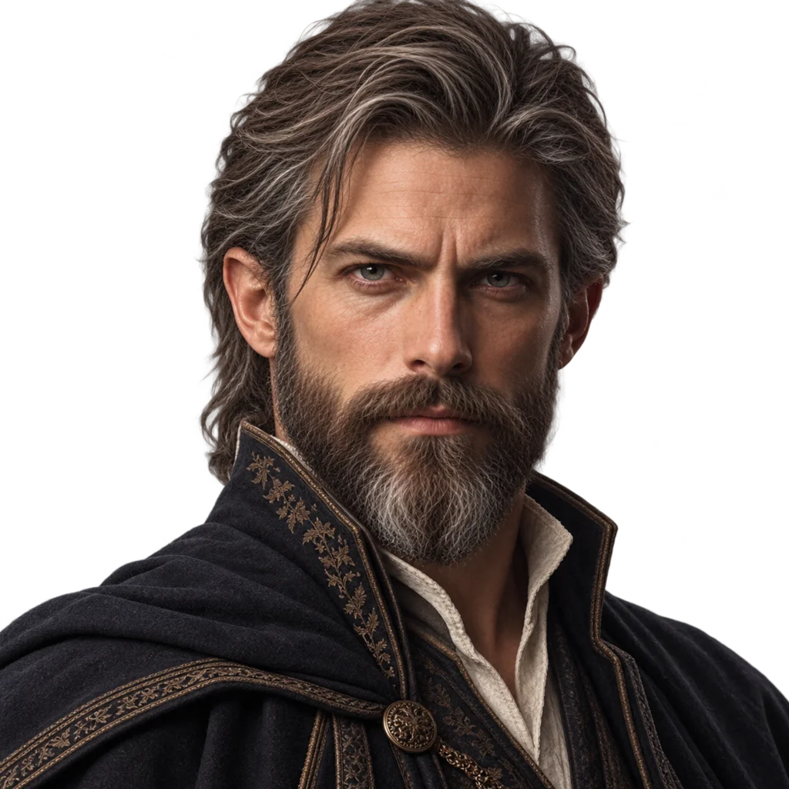
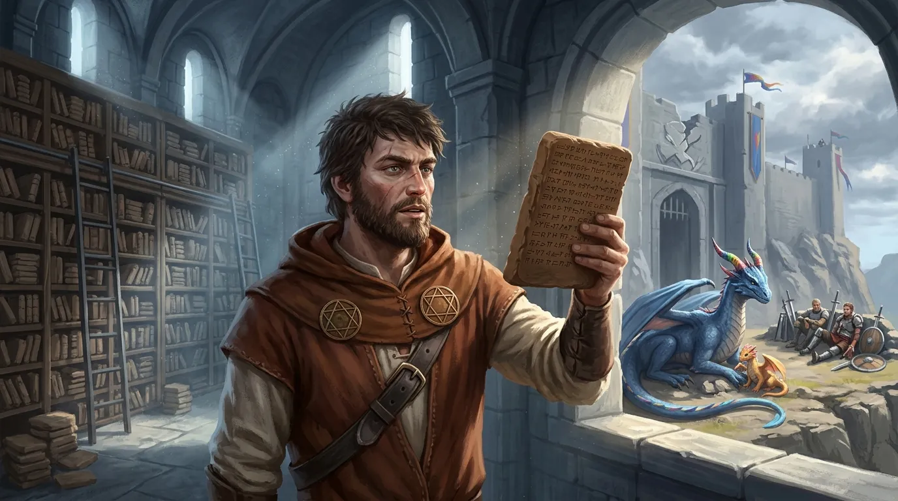
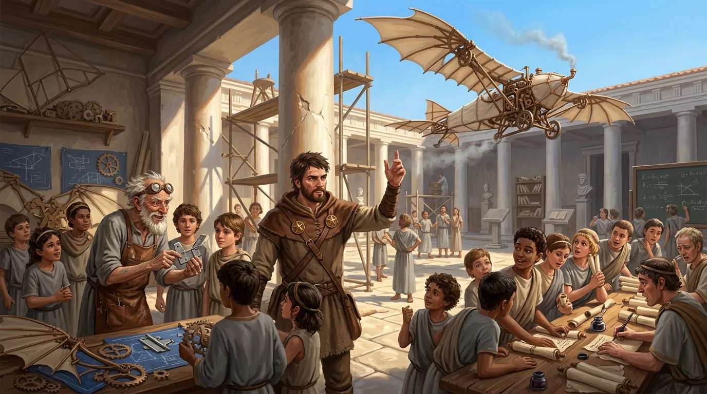

_Human Wizard, [[Epickie Ścieżki#The Gifted One (Utalentowany)|The Gifted One]]_
_**Utalentowany**, który odkrył źródło swoich zdolności i doprowadził do odrodzenia Zakonu._

## Historia

Felicjan Janus Twardowski, urodzony w Mytros syn kowala, od najmłodszych lat wykazywał niezwykły talent do nauki i filozofii, co zaprowadziło go do Akademii pod skrzydła samego Epikura. Mimo ukończenia studiów jako najlepszy uczeń, presja i strach przed porażką sprawiły, że porzucił karierę naukową, wracając do rodzinnego warsztatu i marnując swój potencjał na proste życie.

Dopiero po dziesięciu latach, w obliczu nadciągającej wojny i poczucia zmarnowanego losu, Felicjan postanowił przełamać swój strach. Wspierany przez żonę, kapłankę Mytros, oraz pamięć o dawnych ambicjach, zdecydował się w końcu zaryzykować i wykorzystać swój magiczny dar, by stać się bohaterem, jakim zawsze miał być, stawiając czoła przeznaczeniu jako "Obdarowany".

W [[Sesja 7 - Uratować Księżniczkę]] [[Versir]] domyślił się magicznej natury amuletu, który nosił Felicjan.

W [[Sesja 9 - W Głębi Grobowca Xandera]] otworzył drzwi grobowca Xandera, kładąc rękę na [[Tarcza Xandera|tarczy Xandera]] i przedstawiając się.

W [[Sesja 13 - Wezwani przez Króla]] wysłał list do swojej rodziny i do Akademii w Mytros.

W [[Sesja 15 - W kanałach Mytros]] dowiedział się od Mistrza [[Chalcodon|Chalcodona]] o swojej prababce [[Despina|Despinie]], tajemniczej kobiecie z Wybrzeża Mieczy.

W [[Sesja 18 - Cienie Mytros]] odwiedził mędrca [[Vitalis|Vitalisa]], który zdradził mu, że aby znaleźć Fortecę Smoczych Lordów, musi odszukać tytana [[Talieus|Talieusa]]; usłyszał też, że Smocze Jaja strzeże potomek Arkelandera.

W [[Sesja 19 - Pojedynek z Rozpruwaczem]] miał zasugerować Maximusowi zaklęciem Suggestion zejście do kanałów.

W [[Sesja 21 - Ukryte pragnienia Ismene]] znalazł w Akademii zwój o Tytanach z drzewem genealogicznym, wypożyczył Xanderiadę oraz przeprowadził zwiad w piwnicy [[Posiadłość Neurdagonów|Posiadłości Neurdagonów]].

W [[Sesja 22 - Taniec z Meduzą]] użył Alter Self i Fireballa, aby unieruchomić statek [[Varkon|Varkona]] i wywołać popłoch wśród marynarzy.

W [[Sesja 24 - Ultros]] to właśnie Felicjan zadał ostateczny cios [[Estor Arkelander|Estorowi Arkelanderowi]], który wydawał się nieśmiertelny, uwalniając załogę statku [[Ultros]] od tyranii ich przeklętego kapitana.

W [[Sesja 26 - Triumfy na Igrzyskach]] podczas walk na Igrzyskach Hoobert poświęcił się, aby ratować Felicjana. W [[Sesja 29 - Rydwany i Jeden z Dziesięciu]] po awarii własnego rydwanu wskoczył na rydwan [[Democedes|Democedesa]], wyrzucił go telekinezą i wygrał wyścig tuż przed metą, a także wygrał konkurs wiedzy Enas apo Deka. W [[Sesja 30 - Zakończenie Igrzysk]] zatańczył na uczcie z [[Melania Twardowska|Melanią Twardowską]].

W [[Sesja 32 - Kieł]] zidentyfikował magiczną tarczę z symbolem Lutherii, wykutą przez Bronta.

W [[Sesja 34 - Ivello i Drapaczka do Pleców]] użył zaklęcia fly, by przenieść posąg Ivello na statek.

W [[Sesja 35 - W Wężowym Uścisku]] Fireballem wyeliminował większość gryfów i Amazonek w powietrzu, a następnie to jego cios pokonał [[Leah]].

W [[Sesja 36 - Królowa, Dziedzic i Generał]] otrzymał od [[Kyrah]] w prezencie smocze jajo i ukrył je; zidentyfikował też magiczny hełm Meduzy, pozwalający ukrywać prawdziwą tożsamość.

W [[Sesja 37 - Próba Ognia]], zawsze ostrożny, nie ufał duchowi Estora.

W [[Sesja 38 - Bitwa w Kalderze]] rzucił ognistą kulę w dwóch jaszczuroludzi, zepchnął szamana w przepaść, a błyskawicą zabił jaszczuroluda i węża; po bitwie zastanawiał się nad oswojeniem smoka.

W [[Sesja 41 - Wiedźma Lotosu]] zobaczył w [[Korytarz Światów|Korytarzu Światów]] wizję swojej śmierci oraz śmierci żony [[Melania Twardowska|Melanii]] w płonącym Mytros, u stóp zapłakanej [[Kyrah]]. Zaintrygowany wizją Behemota zapytał o potwora, a po zakręceniu Kołem Fortuny stał się wytrzymalszy i inteligentniejszy.

W [[Sesja 42 - Plemię Węgorza]] zgromadził zapas przysmaków dla Chh'Krtaka, planując opowiadać mu o Balmytrii, by zaskarbić sobie jego przychylność; rzucał Fireballe w niebo przeciw mantikorom i próbował przemówić do rozsądku Ventis, kwestionując jej związek ze Smoczymi Lordami.

W [[Sesja 43 - Kopalnia Żelaza]] przeleciał na drugą stronę przepaści zawalonego mostu i przywiązał liny dla reszty drużyny; przez swojego chowańca wysłał też list do przywódczyń plemion.

W [[Sesja 44 - Ventis]] przeniósł Brennę zaklęciem Dimension Door na szczyt góry, po czym sam skoczył w przepaść, spowalniając upadek zaklęciem Feather Fall.

W [[Sesja 45 - Tajemnica Wyspy Wygnańców]] z pomocą maski pozwalającej na rozmowę ze zmarłymi przesłuchał Petrosa i Mariusa. W [[Sesja 46 - Morderca z Wyspy Wygnańców]] używał Wykrycia Myśli na przesłuchiwanych (odczytał umysł Keelana) i rzucił kulę ognia w statek morskich wiedźm.

W [[Sesja 47 - Wyspa Mojr]] odczytał kronikę wojny Smoczych Lordów z Imperium Gyganów, spisaną w mowie gigantów z perspektywy Gyganów, uwięził jednego z potworów w magicznej sferze i dobił ostatniego magicznym pociskiem. Odrzucił ofertę [[Mojry|Mojr]], które chciały wzmocnić jego koronę w zamian za jego szczęście. Korzystając z daru jasnowidzenia Versi, zapytał, czy układ z Mojrami w sprawie smoków wyjdzie im na dobre, i usłyszał, że tak.

W [[Sesja 48 - Pakty z Mojrami i Zew Chimery]] zawarł pakt z [[Mojry|Mojrami]], oddając im swoje zdrowie (każde leczenie daje mu odtąd tylko połowę zwykłej ulgi) w zamian za ulepszenie korony. Jego magiczna różdżka ze smoczego rogu została poświęcona Mojrom i obrócona w pył. Morta ujawniła, że jego prababka [[Despina]] była siostrą [[Adonis Neurdagon|Adonisa Neurdagona]] i zdradziła Smoczych Lordów. Po opuszczeniu wyspy był świadkiem wyklucia się smoka z jaja brązowego smoka, które nosił przy sobie; nazwał go [[Kairos|Kairosem]] i przystąpił do rytuału więzi, **wypowiadając słowa starożytnej przysięgi [[Smoczy Lordowie|Smoczych Lordów]]**. Na [[Wyspa Forlorn|Wyspie Forlorn]] opróżnił Worek Bez Dna, z którego wysypały się cztery płonące czaszki, i padł trafiony nieprzytomny.

W [[Sesja 49 - Wielkie Gęsie Powstanie]] rzucił czar wykrywania magii, ciskał kulami chromatycznej energii w Chimerę i postawił magiczny alarm u wejścia do jaskini. Na wraku statku "Ostatnia Nadzieja" znalazł brązowy amulet w kształcie ośmiornicy, który skojarzył mu się z Krakenem. Nie uwierzył opowieści Althai, uznając ją za bajkę mającą odstraszyć gości. Po przemianie w gęś napisał dziobem na ziemi "Wiedźma Klątwa", a następnie "Pomocy", zwracając uwagę ludzi [[Taran Neurdagon|Tarana]], co pozwoliło nawiązać z nimi sojusz.

W [[Sesja 50 - Nawałnica Tytanów i Szepty Yonder]] przepisywał magiczne zwoje, zaglądał swym magicznym darem w myśli jeńców i rzucił Identify na sferę wokół Wyspy Myrmeków; młodego smoka Kairosa przyjął pod swe skrzydła.

W [[Sesja 51 - Desant na Yonder]] użył Mage Hand, by niepostrzeżenie zabrać księgę z wozu jadącego do biblioteki, a Arcane Eye, by zajrzeć do świątyni Sydona; w postaci [[Marius|Mariusa]], przybranej dzięki magicznej Masce, brał udział w infiltracji, a sowa Hubert zwiadowała okolicę. W [[Sesja 52 - Infiltracja Yonder]] wsparł [[Orestes|Orestesa]] zaklęciem przyspieszenia, rzucił na całą grupę zaklęcia latania, a jego sowa ostrzegła o powrocie [[Gaius|Gaiusa]].

W [[Sesja 53 - Koniec Yonder]] obezwładnił Gaiusa czarem i dobił go chromatycznym pociskiem. Zbadał mosiężną misę i nawiązał kontakt z Kustoszem, po czym roztropnie odrzucił jego pakt: „Jesteśmy w kontakcie. Odzwonimy na pana.” Na piasku Yonder zostawił wielki magiczny napis „Bliźniacy upadną. Chwała Piątce.”, płonący po zmroku błękitnym ogniem.

W [[Sesja 54 - Wyznanie Chondrusa]] z grimuaru Chondrusa przepisał zaklęcia Polimorfia i Wygnanie. Był już Smoczym Lordem i bohaterem, a jego młody brązowy smok [[Kairos]] integrował się z załogą. Żona Melania prosiła go o ostrożność i wspólny powrót do domu po wojnie.

W [[Sesja 55 - Egida Mytros]] rozkazał, by smoki pozostały na górnym pokładzie jako demonstracja siły i niezależności wobec króla, i wysłał sowę z wiadomością do [[Vallus]], która poradziła mu znaleźć jeźdźców dla smoków. Z godnością odrzucił ofertę [[Acastus|Acastusa]] objęcia stanowiska generała w królewskim zakonie, odwiedził rodzinę w Mytros, a od [[Volkan|Volkana]] otrzymał nową różdżkę wykutą ze smoczego rogu.

W [[Sesja 56 - Dedal i Ikar]] rzucił Wygnanie na dorosłego Roka, odsyłając go na minutę do innego wymiaru.

W [[Sesja 57 - Ogród Heliosa]] wyczuł magię przywołania i rozpoznał w statuetce Pożeracza Nadziei; telekinezą wyrwał ją Orestesowi i wyrzucił za burtę. Gdy Helios zionął ogniem, chronił się magicznym znikaniem.

W [[Sesja 58 - Wyspa Czasu]] aktywował Smoczy Talizman i poczuł odległą odpowiedź latającej fortecy. U kruka Mateusza wymienił pistolet Glock 17 na potężny wojenny róg. W wizji z teleskopu ujrzał siebie jako sędziwego arcymaga wspominającego żonę Melanię, która nie przetrwała wojny.

W [[Sesja 59 - Koniec Imprezy]] rzucił ognistą kulę na Nolanda i Grella oraz czar wiążący Nolanda przeznaczeniem: jego atak na bohaterów raniłby także jego samego. Zdecydował się zabrać na [[Ultros]] smocze jajo [[Paradoks|Paradoksa]].

W [[Sesja 60 - Typhon Symfonia Potępienia i Brama do Hadesu]] jako pierwszy od lat zdołał poruszyć latającą fortecę i sterował nią; w żartach kazał jej zrobić beczkę, wywołując panikę wśród imprezowiczów. Ukrywał się w Planie Eterycznym, gdzie zaatakowali go dyrygent i Orestes.

W [[Sesja 61 - Yala, Arezja i Żółw]] odkrył w iluzji potężny grymuar pełen niemożliwych zaklęć i zapytał Gaiusa, kto obiecał mu wskrzeszenie. W [[Sesja 62 - Arezyjska Dyplomacja]] wraz z Arevonem dostrzegł w lesie gigantyczne ślady stóp Talosa.

W [[Sesja 63 - Werdykt Arezji]] [[Mistrz Cieni]] znał Felicjana i kazał mu pozdrowić Despinę; zaklęciem identyfikacji Felicjan odkrył, że portret Karpathosa jest filakterium. W [[Sesja 64 - Pieśń dla Smoczycy]] rzucił czytanie myśli na [[Arevon Elorrenthi|Arevona]] i dzielił z nim wizję przeszłości Hexii.

W [[Sesja 65 - Wyprawa w Otchłań]] Melania zaalarmowała go o pękającym jaju w kajucie; wyklutego smoka powitał w roku 499, a gdy rozważał swoją misję odrodzenia Zakonu Smoczych Lordów, zapytał [[Chh'Krtak|Chh'Krtaka]], czy chciałby znaleźć partnera do walki o lepszą przyszłość - tak narodził się [[Paradoks]]. Otworzył też drzwi, za którymi lewitowała czarna kula (Sfera Annihilacji), pochłaniająca światło.

W [[Sesja 66 - Przebudzenie Bestii i Cienie Otchłani]] nawiązał mentalną więź ze Sferą Anihilacji i sterował nią, niszcząc czerwie. Wysłał magiczne oko w odpływ zbiornika z kwasową trucizną i odkrył, że prowadzi do komory Tarrasque, a telekinezą pociągnął dźwignię, która zrzuciła młode czerwie do jej leża. Magiczne oko zostawił na schodach Sześcianu i zobaczył, jak The Keeper wita nowo przybyłą postać. Zapytał: „Kto trzyma taką bestię gdziekolwiek?”

W [[Sesja 67 - Zguba Estora]] telekinezą pochwycił i unieruchomił szkieletową formę Hezzebala, wyrwał Xiphos z rąk Estora i obrócił samego Estora do góry nogami, po czym wypowiedział nad nim: odchodzi pierwszy i ostatni tego imienia, niech pamięć o nim zaginie.

W [[Sesja 68 - Arena Krzywoprzysięstwa]] wspierał magią walkę z pierwszą falą i rzucił Wall of Fire, w którą Versir teleportował wrogów.

W [[Sesja 69 - Ogród Lutherii]] chciał poznać intencje i plany Lutherii, twierdząc, że ma przygotowaną strategię wyjścia. Zidentyfikował złotą monetę z czerwonym okiem jako rodzaj klucza, w Sali Wróżenia poprosił o pokazanie Armii Sydona i zobaczył flotę setek okrętów, cyklopów i gyganów, a Kalisto zapytał o Karpathosa, powołując się na obraz z sypialni Lutherii. Porównał Hypnos do Wyspy Epsteina.

W [[Sesja 70 - Audiencja u Pani Snów]] dowiedział się, że dusza jego prababki Despiny jest uwięziona w amulecie, a od [[Volkan|Volkana]] otrzymał ekstrawagancką figurkę do zaklęcia Contingency.

W [[Sesja 71 - Infiltracja Praxys]] pozyskał od Volkana magiczny nawóz i zdecydował się zabrać na szturm Praxys młodego smoka [[Kairos|Kairosa]], z którym związała go przysięga Smoczych Lordów. Wraz z [[Orion Xul|Orionem]] przed Krokiem dopełnił szaradę potężną iluzją dźwiękową niekontrolowanej biegunki, by pozbyć się cyklopa sprzątacza i swobodnie zinfiltrować dalej wieżę. Później użył Ściany Ognia, by odgrodzić i spalić rój Myrmeków.

W [[Sesja 72 - Śniadanie u Tytana Bochenek Przeznaczenia]] poświęcił krótki odpoczynek na identyfikację zdobytych artefaktów magicznych. W walce przywołał Widmowego Smoka ziejącego mrozem, użył Chromatic Orb i przekierował Chain Lightning [[Chalcia|Chalci]] z powrotem w nią.

W [[Sesja 73 - Praxys - Skarbiec Sydona]] zabił Cerbera rzuconym na ślepo Ray of Frost (wcześniej trafił golema krytycznym Ray of Frost) i użył Fireballa na grupie harpii. W biurku Sydona znalazł księgę zaklęć swojej prababki [[Despina|Despiny]], zawierającą czary ósmego poziomu; na bieżąco wymieniał z nią myśli. Rytuałem Identify zbadał scroll case zabezpieczony Arcane Lockiem, narysował Prestidigitation obsceniczny rysunek na posągu Sydona, a o gwieździe powiedział: „To mi wygląda na... Jakby to miało pierdolnąć." Nosił magiczny róg, który pasuje do ubytku w czaszce Balmytrii.

W [[Sesja 74 - Matka Smoków]] rzucił Scatter, teleportując drużynę z areny na widownię przy tronie Golorona, oraz użył telekinezy i Fireballa. Posługiwał się magicznymi skrzypcami aktywowanymi hasłem 'capriccio'. Amulet Despiny, który nosił, ożył i przekazał mu informację o klonie [[Nephele (Smok)|Nephele]]; wahał się przed uwolnieniem bezdusznego klona, ale uznał, że jej los powinien być decyzją ich wszystkich.

W [[Sesja 75 - Koniec Przysięgi]] użył Heart of the Gale, by rzucić na siebie i Versira zaklęcie latania, i wlecieli kominem na piętro Sydona; obwiązał Versira liną i wyciągnął go z portalowego basenu. Od tygodni składał w notatkach elementy układanki i wiedział, że bogowie to smoki - ujawnienie ich smoczej natury potwierdziło jego obsesyjne dociekania. Na prośbę Volkana odczytał na głos Zwój Przysięgi Pokoju. Pod koniec sesji awansował na trzynasty poziom doświadczenia.

W [[Sesja 76 - Bitwa o Mytros: Pierwsza Fala]] ślęczał nad księgami i finalizował zaklęcia przed bitwą, wyjawił stworzone jeszcze na statku Simulacrum, wprowadzając klona do walki, i rzucił Tasha's Mind Whip na Hergerona, który zdał rzut obronny. Poszedł do bitwy z [[Centurioni z Mytros|Centurionami]]; róg, który zdobył, opisał jako najlepszy deal życia w zamian za Glocka.

W [[Sesja 77 - Bitwa o Mytros: Upadek Icarusa]] zrezygnował z Disintegrate na Hergeronie, oszczędzając zasoby, i przekierował Hold Monster rzucony przez [[Icarus|Icarusa]] z powrotem na niego, tak że Icarus sparaliżował się własnym czarem. Osobiście dołączył do magów jako ich dowódca, a specjalnym rogiem udzielił całej drużynie błogosławieństwa (bless). Towarzyszył mu familiar, ptaszek Hubert.

W [[Sesja 78 - Bitwa o Mytros: Przebudzenie Kolosa]] rzucił Draconic Transformation, zyskał skrzydła i dmuchał smoczym oddechem. W [[Sesja 79 - Bitwa o Mytros: Gniew Pana Burz]] rzucił Ścianę Ognia wokół cyklopa rzucającego głazami; nosił epicką ścieżkę Utalentowanego (The Gifted One) i miał magicznego duplikata, zwanego Klonicjanem.

W [[Sesja 80 - Bitwa o Mytros: Śmierć Pana Burz]] odwrócił grawitację magicznym zwojem, unosząc Lewiatana, a potem zdezintegrował burzowego żywiołaka; rzucił chromatyczną kulę energii w Sydona i analizował możliwości uleczenia zwłok Nephele.

W [[Sesja 81 - Bitwa o Mytros: Koszmar na Targu Minotaurów]] jego amulet pękł, gdy dusza Despiny wstąpiła w smoczycę. Przeprosił prababkę za swój brak zaufania i chorobliwą ostrożność. Rzucił Blink, Dispel Magic na Klonicjana, Draconic Transformation i Chromatic Orb w Lutherię.

W [[Sesja 82 - Bitwa o Mytros: Śmierć Pani Snów]] odegrał rolę kluczową dla zwycięstwa. Pojął strukturę czaru w locie i przekierował zaklęcie [[Lutheria|Lutherii]] wymierzone w [[Klonicjan|Klonicjana]] na przypadkową świnię, a Versira zamknął ze zwoju w ochronnej sferze, by chronić drużynę przed jego szaleństwem i spojrzeniem Lutherii. Serią kul żywiołowej energii wygasił kolejne fantazmaty bogini, aż odnalazł wśród jej odbić **prawdziwą** Lutherię. Gdy psioniczny krzyk sparaliżował [[Orestes|Orestesa]], [[Arevon Elorrenthi|Arevona]] i [[Orion Xul|Oriona]], został jedynym w pełni władnym członkiem drużyny i magią rozpraszającą uwolnił Orestesa. Przywołał też słup palącego, oczyszczającego światła, który wygaszał odbicia bogini; dwukrotnie przenikał w Świecie Snów na plan eteryczny, m.in. by ukryć się przed jej kosą.

W [[Sesja 83 - Zmierzch Ery Tytanów]] to on zebrał obrońców: gdy [[Orestes]] odmówił wystąpienia przed ludźmi, sam stanął przed garstką ocalałych i wezwał ich, by nie uciekali, a ochotnicy i rozproszone oddziały zebrali się w [[Latająca Forteca Smoczych Lordów|Latającej Fortecy Smoczych Lordów]] - jej salwy wspierały drużynę przez całą bitwę. W starciu z [[Kentimane|Kentimane'em]] osłaniał się chmarą iluzorycznych sobowtórów, zawiesił nad nim widmowy miecz losu z wykrzyczanym zakazem, a następnie cisnął zaklęciem wygnania, które nie zadziałało.

W [[Sesja 84 - Świt Nowej Ery]] zajął się polityką i instytucjami. Popierał rozbicie [[Kryształowa Kosa Lutherii|Kryształowej Kosy]], ale nie chciał oddawać samego artefaktu [[Mistrz Cieni|Mistrzowi Cieni]], widząc w [[Arezja|Arezji]] kogoś, kto systematycznie zbiera relikwie po dawnych bogach i mógłby sięgnąć po opuszczone domeny; ustąpił dopiero wobec kompromisu drużyny (najpierw kosa idzie w drzazgi, potem rozmowa o odłamkach), choć wciąż powtarzał, że oddając odłamki, wzmacniają potencjalnego wroga. Chciał obejrzeć rytuał Mistrza Cieni, by zrozumieć, co robią zakapturzeni, ale magiczne podglądanie okazało się niemożliwe. Odmówił ceremonialnego uznania go za lidera Zakonu Smoczych Lordów, uważając, że mieszkańcy Mytros wiedzą, komu zawdzięczają życie; za sugestią Versira miał być jednak oficjalnie uznany przez Acastusa za prawowitego lidera i odnowiciela Zakonu. Ustępującemu [[Acastus|Acastusowi]] powiedział, że wykazał się rozsądkiem i schował dumę do kieszeni. Upierał się, by zbuntowani fanatycy ponieśli karę, ale nie śmierć. Rosnącą potęgę [[Taran Neurdagon|Tarana Neurdagona]] oglądał podejrzliwie: zasugerował zaostrzenie podatków dla najbogatszych, by sprawdzić jego reakcję (zaznaczył, że to burza mózgów), i przypomniał, że rodzina Neurdagonów zajmowała się bioautomatonami i fuzją brązu z ludzkim ciałem, z której narodziła się [[Egida Mytros]]. Zaproponował też, by czaszkę [[Balmytria|Balmytrii]] złożyć w [[Nekropolia w Telamok|Nekropolii w Telamok]] obok szczątków Xandera. Wśród jego powiedzeń z tej sesji: „Pomalujemy cię.”, „Po prostu nie chcę mieć zaraz Trumpa w Mytros.” i „Zdecydowanie w regulaminie Rady Mytros jest zabroniona wszelka korupcja, o której mi nie wiadomo.”

## Po wojnie

|  |  |  |
|:---:|:---:|:---:|
| Po piętnastu latach | Biblioteka na Yonder | Akademia się odbudowuje |

Po wojnie zajął się tym, czego nie da się wygrać zaklęciem: ludźmi, polityką i instytucjami. Najpierw ruszył na pomoc ocalałym z [[Mytros]]. Gdy sytuacja była w miarę opanowana, wrócił do rodziny, a szczątki poległych smoków pochował w grobowcu Smoczych Lordów. We wszystkim pomaga mu simulacrum [[Klonicjan]].

- **Zakon Smoczych Lordów.** Odbudował [[Smoczy Lordowie|Zakon]] naprawdę — smoki były, potężni ludzie byli, brakowało tylko siedziby. Odbił na nią [[Wyspa Yonder|Wyspę Yonder]], dawną warownię [[Zakon Sydona|Zakonu Sydona]], a prawdziwym łupem okazała się tamtejsza biblioteka wypalanych glinianych tabliczek w językach, których nikt już nie zna; dzieli ją z [[Akademia Mytros|Akademią]]. Ceremonialnego uznania odmówił, ale za sugestią [[Versir|Versira]] [[Acastus]] miał oficjalnie uznać go za prawowitego lidera i odnowiciela Zakonu. Zakonem kieruje rada, której Felicjan przewodniczy. Zakon ma strzec pokoju i rozwoju: ludy [[Kontynent Thylea|Thylei]] mają żyć w zgodzie i razem stawić czoła zagrożeniom z zewnątrz. Mimo więzów z Mytros Felicjan stara się, żeby Zakon był neutralny. Filie powstają w kolejnych miastach, a usługi Zakonu — magię, doradztwo, ochronę, dyplomację i transport [[Latająca Forteca Smoczych Lordów|latającą fortecą]] — na początku świadczył osobiście.
- **Smoki.** Ze smokami łączy go przyjaźń, wręcz więź rodzinna. Młode smoki traktuje trochę jak własne dzieci. [[Kairos]] wykluł się z jaja, które było darem [[Vallus]], a które [[Kyrah]] wręczyła mu we właściwym momencie; Felicjan wychowuje go najpierw jako nauczyciel i ojciec, a gdy Kairos dorośnie, chce traktować go jak partnera. [[Paradoks]] dorównuje już niemal Kairosowi, a dla mosiężnego [[Chh'Krtak|Chh'Krtaka]] i wyklutej po wojnie smoczycy [[Ataraksja|Ataraksji]] trzeba będzie znaleźć jeźdźców. Byli bogowie — [[Kyrah]], [[Pythor]], [[Volkan]] i [[Vallus]] — są na Yonder zawsze mile widziani.
- **Akademia Mytros.** Odbudowuje [[Akademia Mytros|Akademię]], wykłada na niej (także przez *Programmed Illusion*) i ściąga nowych uczniów. Wystarał się dla [[Dedal|Dedala]] o warsztat w zamian za uczenie studentów artificerstwa. Kult [[Bohaterowie Przepowiedni|Bohaterów Przepowiedni]] trochę mu schlebiał, więc wymyślił, by przy kapliczkach uczyć zwykłych ludzi niegroźnych sztuczek, a wysłannicy Akademii wyławiali wśród nich talenty.
- **Polityka.** Uważa, że zbuntowani fanatycy mają ponieść karę, ale nie śmierć. Rosnącą potęgę [[Taran Neurdagon|Tarana Neurdagona]] obserwuje podejrzliwie. Chciałby pośredniczyć w sporze o żelazo z [[Wyspa Indygo|Indygo]], choć nie wie, czy miasta przyjmą pośrednika związanego z Mytros. Z [[Orestes|Orestesem]] umówił się tak, że gdzie się da, filia Zakonu i bar WCSB stoją pod jednym dachem, a mury stawia sam zaklęciem *Wall of Stone*; Zakon wozi za to piwo Orestesa fortecą.
- **Ludzie dla Zakonu.** Chciałby pozyskać byłego króla [[Acastus|Acastusa]] na dyplomatę, [[Brenna|Brennę]] z Indygo na pierwszą adeptkę z wyspy, maga [[Garrick Vanalan|Garricka Vanalana]] i elfiego filozofa [[Chalcodon|Chalcodona]], który przeżyje go o stulecia. [[Moxena]] odmówiła: została na [[Themis]], ale z Zakonem łączą ją przyjacielskie stosunki.
- **Rodzina.** Z [[Melania Twardowska|Melanią]] ma dwoje dzieci: córkę [[Triya Twardowska|Triyę]] i syna [[Aleksander Twardowski|Aleksandra]]. Mieszkają z nim na Yonder, gdzie Melania założyła świątynię Mytros. Na wyspę przenieśli się też rodzice i rodzeństwo Felicjana; kuźnia ojca bardzo przydaje się Zakonowi. Dla [[Versir|Versira]] Felicjan jest rodziną — to do niego i do [[Yala|Yali]] półtytan wraca, gdy pozwalają mu podróże. Z Yalą łączy go przyjaźń i wzajemny szacunek.
- **[[Despina]].** Szukał prababki, ale wyraźnie nie chciała zostać odnaleziona, więc zostawił ją w spokoju. Nie żywi do niej urazy, chciałby tylko usłyszeć, dlaczego odeszła. Nie daje mu też spokoju [[Mistrz Cieni]]: w [[Arezja|Arezji]] widzi kogoś, kto systematycznie zbiera relikwie po dawnych bogach i może sięgnąć po opuszczone domeny, a w [[Sesja 63 - Werdykt Arezji|Sesji 63]] kazał mu pozdrowić Despinę, gdy jej dusza była jeszcze zamknięta w amulecie.
- **Boskość.** Nie chce być bogiem. Boskość to dla niego poświęcenie, a nieśmiertelność bez Melanii to samotność. Zgodziłby się tylko wtedy, gdyby na szali stanęły losy świata albo jego bliskich.
