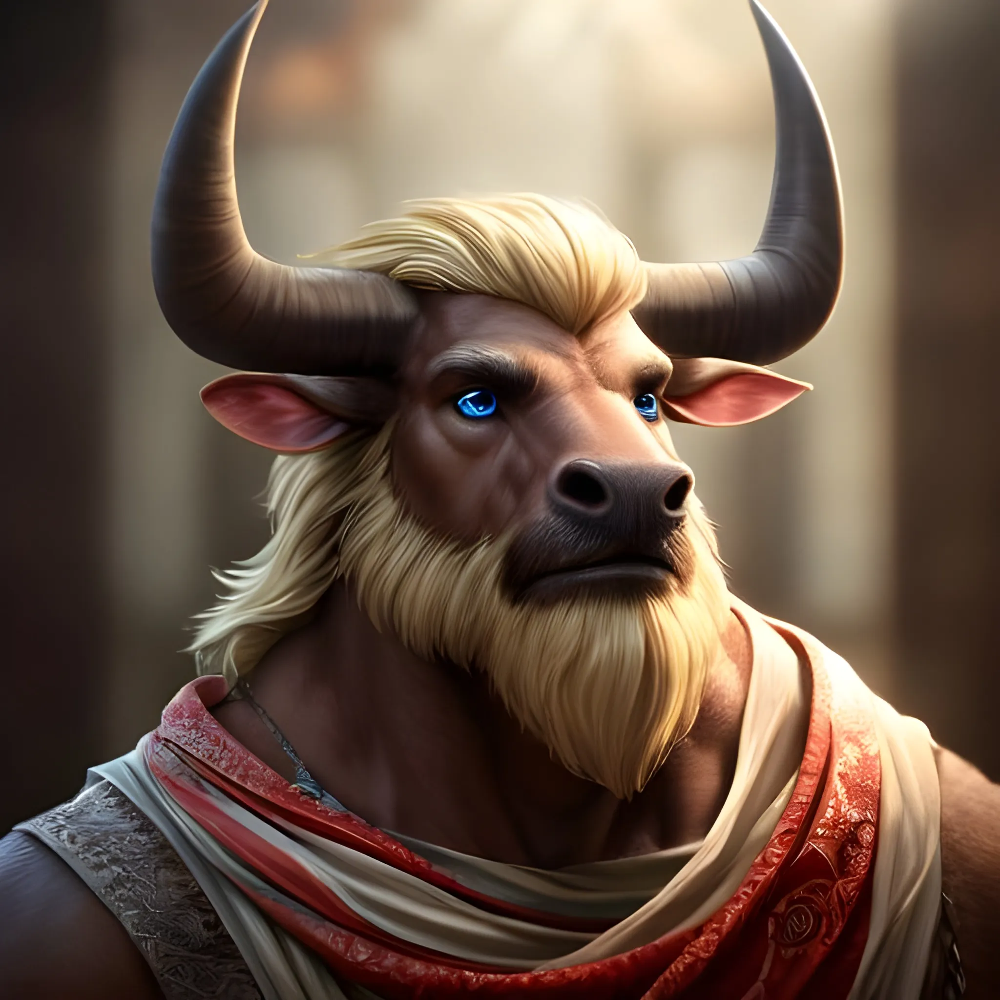

_Minotaur Barbarian, [[Epickie Ścieżki#The Doomed One (Zgubiony)|The Doomed One]]_
_**Zgubiony**, który trzykrotnie przeciwstawił się śmierci i stawił jej czoła jak równy z równym._

## Historia

Orestes, minotaur barbarzyńca, po śmierci rodziców został przygarnięty przez rodzinę satyrów prowadzących browar w pobliżu Estorii. Choć wychowywał się wśród kadzi i chmielu, jego niezdarna natura często prowadziła do wypadków, w tym zmarnowania całej warki piwa, co zdegradowało go do prostych prac fizycznych. Mimo ciągłego pecha, nie opuszczała go nadzieja na odmianę losu.

Punktem zwrotnym stało się wydarzenie, gdy jedna z przenoszonych skrzyń okazała się zabójczym mimikiem. Orestes, dobywając starego młota swojego ojca, zdołał uratować towarzysza przed potworem. Teraz, jako "Skazany", wierzy, że poprzez bohaterskie czyny zdoła w końcu przełamać ciążącą nad nim klątwę nieszczęścia i uczynić w świecie coś dobrego.

Jego kuzynem jest [[Brax]] ([[Sesja 40 - Uciechy na Wyspie Skorpiona]]), późniejszy właściciel [[Super Bar|Super Baru]] ([[Sesja 83 - Zmierzch Ery Tytanów]]), a jego rodzina prowadzi browar ([[Sesja 62 - Arezyjska Dyplomacja]]); wujaszek [[Silenos]] również ma browar ([[Sesja 55 - Egida Mytros]], [[Sesja 75 - Koniec Przysięgi]]). Wielki Dzik z pierwszej sesji niegdyś zabił Orestesa ([[Sesja 68 - Arena Krzywoprzysięstwa]]), a jego rodziców uwięziła w swojej kosie [[Lutheria]] ([[Sesja 70 - Audiencja u Pani Snów]]).

W [[Sesja 6 - Problemy w Woodhike]] przegrał zawody z [[Pholon|Pholonem]] i nie został jego jeźdźcem. W [[Sesja 10 - Świątynia Heliosa i Jaskinie Troglodytów]], zauroczony w walce z [[Euria|Eurią]], prawie zabił [[Versir|Versira]].

W [[Sesja 13 - Wezwani przez Króla]] przyśniła mu się wyprawa statkiem na [[Wyspa Mojr|Wyspę Mojr]]; zaczęto podejrzewać, że za jego klątwę mogą odpowiadać [[Mojry]]. W [[Sesja 17 - Targ Minotaurów]] znów śnił o wezwaniu na wyspę Mojr, a potem na prośbę [[Bullbug]] stoczył z nią walkę i wygrał, odmawiając jej zabicia. W [[Sesja 18 - Cienie Mytros]] wygrał walkę z dwoma minotaurami jednocześnie, dzięki czemu drużyna wygrała Gnotora.

W [[Sesja 19 - Pojedynek z Rozpruwaczem]] otrzymał od [[Volkan|Volkana]] ulepszony [[Topór Xandera]]; powalony przez [[Rakas Rozpruwacz|Rakasa]], nagle się przebudził i w ostatniej chwili go dobił. W [[Sesja 21 - Ukryte pragnienia Ismene]] zebrał liczne plotki o Arezji, Amazonkach i [[Stavros|Stavrosie]] podczas imprezy w Akademii. W [[Sesja 22 - Taniec z Meduzą]] znalazł na statku [[Varkon|Varkona]] cztery posągi (w tym córkę [[Maximus|Maximusa]]), po czym wyrąbał dziurę w dnie statku i uciekł.

W [[Sesja 24 - Ultros]], po śmierci [[Estor Arkelander|Estora]], został mianowany nowym kapitanem [[Ultros|Ultrosa]]. [[Delphia]] dała mu wybór między ścieżką żywych a ścieżką umarłych; wybrał ścieżkę żywych, wskutek czego cała nieumarła załoga opuściła statek. Kapitanem pozostał do końca wojny z Tytanami.

W [[Sesja 25 - Inauguracja Wielkich Igrzysk]] usłyszał z wnętrza kosy [[Lutheria|Lutherii]] głosy swoich rodziców, których nie słyszał od lat. W [[Sesja 30 - Zakończenie Igrzysk]] zatańczył z [[Vallus]] na uczcie, a po niej męczył go koszmar o Wyspie Mojr i trzech postaciach.

W [[Sesja 33 - W Szponach Bazyliszków]] torturował [[Iphis]], grając na dudach, a w walce z Amazonkami i bazyliszkami został ciężko ranny. W [[Sesja 34 - Ivello i Drapaczka do Pleców]] nadludzką siłą chwycił jednego marmurowego golema i rzucił nim w drugiego, po czym postanowił zabrać rękę i nogę golema na drapaczkę do pleców. W [[Sesja 35 - W Wężowym Uścisku]], wściekły na widok kolejnej rudej Amazonki, zaatakował ją z łuku, a potem dosiadł [[Lyra|Lyry]] przemienionej w konia i ruszył na amazońską czarodziejkę. W [[Sesja 36 - Królowa, Dziedzic i Generał]] z pomocą [[Arevon Elorrenthi|Arevona]] i za przyzwoleniem [[Moxena|Moxeny]] odciął głowę [[Leah|Lei]], dał koncert z [[Kyrah]] po uczcie na Themis i wysłał wujowi na wyspę Wolkan sadzonkę jagody przez [[Keledone|Keledone]].

W [[Sesja 37 - Próba Ognia]] uważał, że skarby Smoczych Lordów są warte ryzyka, a miecz [[Estor Arkelander|Estora]] może się przydać. W [[Sesja 38 - Bitwa w Kalderze]] został schwytany przez salamandrę, uwolnił się, przeobrażając w dzikiego zwierza, i ją zabił; wymachiwał przy tym toporem, który zdawał się wibrować żądzą krwi.

W [[Sesja 39 - Tajemnice Wyspy Złotego Serca]] nawigował w sztormie, znalazł w truchle wieloryba [[Aegis|Aegisa]] i obezwładnił go w swojej kajucie, a piwem i urokiem przekonał do siebie pegaza i dosiadł go podczas krótkiego lotu. W [[Sesja 40 - Uciechy na Wyspie Skorpiona]] dał koncert na dudach i próbował oswoić hipokampy alkoholem (dwa zostały oswojone), poczęstował Arezyjczyków piwem, pchnął Nessę w stronę kuzyna [[Brax|Braxa]] i dołączył do dzikich orgii centaurów; dostał też list od [[Volkan|Volkana]], że bóg kowali chętnie zatrudni cyklopów Jankanów w swojej kuźni. W [[Sesja 41 - Wiedźma Lotosu]] opowiadał suchary w Familiadzie, a w Kole Fortuny zyskał umiejętność dowcipkowania; dręczyła go klątwa pecha rzucona przez [[Lutheria|Lutherię]].

W [[Sesja 42 - Plemię Węgorza]] rzucił kością i wyrzucił dwudziestkę, po czym na horyzoncie pojawiła się nieznana wyspa; złapał mantikorę przeteleportowaną przez [[Versir|Versira]], a potem został przez niego przeteleportowany na grzbiet [[Ventis]], ranił ją toporem i cudem przeżył upadek ze skrzydeł smoczycy. W [[Sesja 43 - Kopalnia Żelaza]] przybrał dzięki magicznej masce od [[Volkan|Volkana]] postać Karola Strasburgera, grał na dudach ku rozpaczy towarzyszy, zabił kamieniem wiewiórkę i ozdobił dudy jej kitą. W [[Sesja 44 - Ventis]] magicznym toporem powalił [[Ventis]] na ziemię, wyzwał Goraca na pojedynek i przegrał (Arevon uleczył go przed ciosem ostatecznym), a potem siłował się na rękę z przywódczynią plemienia Węgorza.

W [[Sesja 46 - Morderca z Wyspy Wygnańców]] zgłosił się na ochotnika do wykonania wyroku i ściął Keelana toporem, obezwładnił Tadda, uratował Andrzeja Drugiego z morza na swoim morskim koniu, wysłał ptakiem list do wujaszka z prośbą o informacje o liściach koki i sprawdził beczkę [[Stavros|Stavrosa]], wyczuwając tylko kwaśne wino, bez woni Nightshade Whisper.

W [[Sesja 47 - Wyspa Mojr]], nękany fatum, rozpoznał wyspę z proroczych wizji. Jako kapitan [[Ultros|Ultrosa]] i przywódca drużyny desantowej zaoferował [[Mojry|Mojrom]] swoje najlepsze piwo; [[Decima]] wypomniała mu bierność podczas igrzysk, kiedy usłyszał głos rodziców. Gdy [[Morta]] zapytała, czy wyrzekłby się piwa na zawsze, zaoferował to, lecz Mojry dodały warunek w postaci jednego z jego trzech żyć, i tę ofertę odrzucił. W walce został oślepiony kwasem Bloodskitter Horrora i, przemieniony w dzikiego kozła, szarżował.

W [[Sesja 48 - Pakty z Mojrami i Zew Chimery]] odrzucił ofertę Mojr (ulepszenie artefaktu i pomoc w zdjęciu klątwy [[Lutheria|Lutherii]] za jedno z jego żyć) i zostawił im beczułkę piwa; Mojry obiecały nawiedzać go w snach. W ruinach wieży na morzu znalazł magiczny Worek Bez Dna, z którego, ku jego radości, mógł wyciągać piwo, a w barbarzyńskim szale roztrzaskał toporem jedną z płonących czaszek.

W [[Sesja 49 - Wielkie Gęsie Powstanie]] grał na dudach, za co jedna z gęsi dziobała go w nogę; potem wraz z drużyną został przemieniony w gęś. [[Arevon Elorrenthi|Arevon]] zaproponował, by go zabić i sprawdzić, czy odrodzi się jako minotaur, lecz odmówił. W walce z [[Althaia|Gęguzą]] użył Dziobiącego Gęgnięcia, które przeraziło wroga, a na statku "Ostatnia Nadzieja" znalazł na wpół opróżnioną, zepsutą beczkę własnego piwa i poczęstował [[Althaia|Althaię]] piwem z dodatkiem soku.

W [[Sesja 50 - Nawałnica Tytanów i Szepty Yonder]] zaproponował absurdalny pomysł przypadkowego trafienia [[Goloron|Golorona]] strzałem z balisty; jego gra na dudach rozkojarzyła załogę i mogła być przyczyną wpłynięcia Ultrosa na rafę, a przy jej uwalnianiu pierwszy skoczył do wody. W [[Sesja 51 - Desant na Yonder]] szczególnie poruszyła go wieść o zniewolonych minotaurach w obozie Zakonu; w planie zasadzki na [[Argyn]] miał zostać magicznie powiększony, by schwytać smoczycę w ramiona. W [[Sesja 52 - Infiltracja Yonder]] w szale bitewnym chwycił [[Ajax|Ajaxa]] i bił go toporem, a oślepiony szarżował na oślep i zabił akolitów; w przebraniu Ajaxa wyprowadził z celi [[Tars d’Lyrandar|Tarsa]]. W [[Sesja 53 - Koniec Yonder]] skoczył na kark smoczycy, chwycił [[Gaius|Gaiusa]] i zrzucił go w przepaść, mówiąc: „Pozdrów swojego tytana i jeb ze skały".

W [[Sesja 54 - Wyznanie Chondrusa]] [[Kyrah]] dała mu lekcje gry na dudach, po czym rozpoczął przesłuchanie [[Chondrus|Chondrusa]] pytaniem, czy służył [[Lutheria|Lutherii]]; [[Versir]] oddał mu swój miecz. W [[Sesja 55 - Egida Mytros]] uzupełnił zapasy piwa dla załogi i ugościł [[Volkan|Volkana]]. W [[Sesja 56 - Dedal i Ikar]] razem z [[Orion Xul|Orionem]] odzyskał artefakt [[Dedal|Dedala]] z gniazda Roków i oszczędził młode. W [[Sesja 57 - Ogród Heliosa]] chwycił przeklętą statuetkę Pożeracza Nadziei i próbował skoczyć za nią do morza (klątwę zdjęła [[Melania Twardowska|Melania]]); przemieniony w byko-kozę, powalił uderzeniem złotego smoka [[Helios|Heliosa]]. W [[Sesja 58 - Wyspa Czasu]] postarzał się o cztery lata, wymienił u kruka Mateusza kieł dzika, który niegdyś go zabił, na księgę o piwie, a cyklopom ofiarował beczkę piwa za pomoc w transporcie skarbów [[Helios|Heliosa]]; w wizji z teleskopu odnalazł spokój jako karczmarz.

W [[Sesja 59 - Koniec Imprezy]] wygrał pojedynek w piciu z satyrami, a [[Talieus Pierwszy|Talieusowi]] zadał cios krytyczny toporem; wraz z [[Orion Xul|Orionem]] przyjmował najcięższe ciosy. W [[Sesja 60 - Typhon Symfonia Potępienia i Brama do Hadesu]] próbował zagrać na dudach w katedrze, co rozwścieczyło dyrygenta, i zrzucił go z siodła strzałą z łuku. W [[Sesja 61 - Yala, Arezja i Żółw]] przełamał iluzję, wylewając piwo na widmową [[Lutheria|Lutherię]] i uderzając ją pustą beczką z żądaniem zdjęcia klątwy; schwytał też [[Yala|Yalę]] w uścisku, a jego krytyczny cios napełnił topór nową mocą. W [[Sesja 62 - Arezyjska Dyplomacja]] pokonał w zapasach [[Keteus|Keteusa]], czempiona [[Halcyon|Mistrzyni Tarczy]], i cisnął nim pod jej nogi. W [[Sesja 63 - Werdykt Arezji]] poczęstował [[Taureus|Taureusa]] piwem z rodzinnego browaru i improwizował pieśń przed [[Laertes|Laertesem]]. W [[Sesja 64 - Pieśń dla Smoczycy]] nauczył się z pomocą [[Kyrah]] pieśni [[Ochos Arkelander|Ochosa]] i zaśpiewał ją [[Hexia|Hexii]], łagodząc jej gniew.

W [[Sesja 65 - Wyprawa w Otchłań]] kazał załodze napełnić beczki krwią tysiąca bazyliszków, uderzył w mackę Krakena, która oddała mu z siłą, i razem z [[Versir|Versirem]] przyjął potężne ciosy golemów w Sześcianie Więziennym. W [[Sesja 66 - Przebudzenie Bestii i Cienie Otchłani]] w walce w Sześcianie ciskał się na wrogów z siłą giganta wzgórz. W [[Sesja 67 - Zguba Estora]] pod wpływem lustra przeszedł diaboliczną przemianę (czerwone futro, płonące rogi), a potem w locie pochwycił [[Xiphos of Slaughter|Xiphos]] i wbił go w [[Estor Arkelander|Estora]], dopełniając przepowiednię [[Lutheria|Lutherii]]. W [[Sesja 68 - Arena Krzywoprzysięstwa]] pokonał toporem Chimerę na arenie, poczęstował piwem satyrzycę Orestię i opowiadał Zarządcy o franczyzie browaru w zaświatach. W [[Sesja 69 - Ogród Lutherii]] wyznał nienawiść do [[Lutheria|Lutherii]] i gotowość oddania jednego z żyć za uwolnienie dusz rodziców. W [[Sesja 70 - Audiencja u Pani Snów]] dowiedział się, że jego rodzice są uwięzieni w Kosie i można ich wydobyć tylko niszcząc broń.

W [[Sesja 71 - Infiltracja Praxys]] próbował pozyskać lojalność smoka [[Paradoks|Paradoksa]] obietnicą darmowego piwa i ciepłego leża na zapleczu browaru; gdy bez wahania potwierdził gotowość cofnięcia się w czasie dla idealnego piwa, smok go odrzucił. W [[Praxys]] toporem zniszczył też jeden z łańcuchów krępujących [[Królowa Myrmeków|Królową Myrmeków]]. W [[Sesja 72 - Śniadanie u Tytana Bochenek Przeznaczenia]] zabił toporem [[Garzoon|Garzoona]], by powstrzymać alarm, otworzył ukryty skarbiec, zasłaniając oko posągu cyklopa chusteczką i rysując na drugim rakietę węglem, uniósł skrzydłami Żelaznego Golema i zrzucił go w Ścianę Ognia [[Arevon Elorrenthi|Arevona]] (golem zaabsorbował płomienie), po czym wyskoczył z bochenka chleba w zasadzce na [[Sydon|Sydona]]; [[Sydon]] rozciął mu glewią pierś. W [[Sesja 73 - Praxys - Skarbiec Sydona]] przyjął 25 punktów obrażeń z ugryzienia [[Cerber|Cerbera]] i został niemal pokonany.

W [[Sesja 74 - Matka Smoków]] padł pod ciosami [[Goloron|Golorona]], lecz dzięki klątwie [[Lutheria|Lutherii]], dającej mu dodatkowe życia, powstał o połowę ruchu później i toporem uderzonym od dołu zabił tytana, któremu zostało osiemnaście punktów życia. Zadał też krytyczne trafienie gyganowi pilnującemu [[Nephele]] i uwolnił ją, przecinając łańcuchy. W [[Sesja 75 - Koniec Przysięgi]] poczęstował [[Furie|Furie]] piwem (Alecto uznała je za zacne), a bohaterowie awansowali na trzynasty poziom.

W [[Sesja 76 - Bitwa o Mytros: Pierwsza Fala]] wiosłował pod pokładem [[Ultros|Ultrosa]], a potem rozwinął skrzydła, wzbił się w powietrze i zadał [[Hergeron|Hergeronowi]] krytyczny cios toporem (ponad 50 punktów). W [[Sesja 77 - Bitwa o Mytros: Upadek Icarusa]] został zraniony przez [[Hergeron|Hergerona]], jednym krytycznym ciosem zadał minotaurowi 66 obrażeń i go zabił, trafił [[Icarus|Icarusa]] Arrow of Dragon Slaying (strzała nie przebiła łuski), a potem powalił go, lecz został przez niego ugryziony. W [[Sesja 78 - Bitwa o Mytros: Przebudzenie Kolosa]] pochwycił i unieruchomił smoka [[Tarchon|Tarchona]], tnąc go toporem. W [[Sesja 79 - Bitwa o Mytros: Gniew Pana Burz]] poprowadził [[Sybolkorax|Sybolkoraksa]] do szarży na [[Sydon|Sydona]]; został ranny, ale utrzymał się na grzbiecie smoka. W [[Sesja 80 - Bitwa o Mytros: Śmierć Pana Burz]] rozsiekł Toporem Xandera gigantycznego rekina i zabił Lewiatana, a następnie jako ostatni zadał [[Sydon|Sydonowi]] cios ostateczny, przecinając mu czoło i trzecie oko.

W [[Sesja 81 - Bitwa o Mytros: Koszmar na Targu Minotaurów]] próbował zabić [[Lutheria|Lutherię]] w zemście za rodziców, lecz przejrzała jego zamiary i obezwładniła go zaklęciem *Tasha's Hideous Laughter*. Ostatecznie zginął od jej *Finger of Death* i powstał jako nieumarły zombie, zachowując jednak władzę nad własnym ciałem: strzelał z magicznego łuku do [[Lutheria|Lutherii]] i trafił ją, a jako nieumarły był niewrażliwy na jej *Disrupt Life*.

W [[Sesja 82 - Bitwa o Mytros: Śmierć Pani Snów]], wciąż w nieumarłej formie, walczył z [[Lutheria|Lutherią]] od pierwszej do ostatniej rundy: ranił ją strzałami i [[Topór Xandera|Toporem Xandera]], jako pierwszy rozbił jedno z jej odbić w [[Świat Snów|Świecie Snów]] i raz po raz próbował pochwycić boginię gołymi rękami, aż w końcu zdołał ją przygwoździć — „Zostajesz tu ze mną, suko". Przed najgorszymi iluzjami chronił go [[Pierścień Orestesa]]. Sparaliżowany psionicznym krzykiem, został uwolniony przez [[Felicjan Janus Twardowski|Felicjana]]. Gdy [[Lutheria]] dobrowolnie przerwała walkę i usiadła na podeście, jej całkowita bierność wybiła go z rytmu i pierwszy zamach poszedł w powietrze — dopiero drugie, czyste cięcie [[Topór Xandera|Topora Xandera]] odcięło jej głowę. To on zadał ostateczny cios Pani Snów i od razu zapowiedział, że rozbije toporem pozostałą po niej [[Kryształowa Kosa Lutherii|kryształową kosę]].

W [[Sesja 83 - Zmierzch Ery Tytanów]] odrzucił [[Kryształowa Kosa Lutherii|Kryształową Kosę]] po tym, jak [[Klonicjan]] wyczytał z niej wyniszczające skutki długiego używania, i został przy [[Topór Xandera|Toporze Xandera]]. W bitwie z [[Kentimane|Kentimane'em]] wpadł w morderczy amok, rąbiąc [[Tytani|Tytana]] raz po raz i wykrzykując mu w twarz, że to on zabił [[Sydon|Sydona]] i [[Lutheria|Lutherię]] — groźba nie zrobiła na [[Kentimane|Ojcu Tytanów]] wrażenia, ale jedna z pięćdziesięciu głów obróciła się ku niemu. Po bitwie jego czyn urósł w legendę szybciej, niż zdążył ją usłyszeć: [[Brax]] przedarł się do niego przez ruiny z gotową już opowieścią, a minotaur nie tylko jej nie prostował, ale sam dokładał do niej opału. Na [[Targ Minotaurów|Targu Minotaurów]] stanęła poświęcona mu pierwsza kapliczka. Wciąż nieumarły i niewyczuwający już smaku piwa, otrzymał od [[Mistrz Cieni|Mistrza Cieni]] ofertę powrotu do świata żywych w zamian za [[Kryształowa Kosa Lutherii|Kryształową Kosę Lutherii]] (wystarczą odłamki, byle komplet, dostarczone do [[Arezja|Arezji]]; oferta ważna przez rok) — nie odrzucił jej, ale chciał naradzić się z towarzyszami; nikt z drużyny nie ufał nieznajomemu.

W [[Sesja 84 - Świt Nowej Ery]] dopiął swoje. Przeforsował rozbicie [[Kryształowa Kosa Lutherii|Kryształowej Kosy Lutherii]] i na wysepce [[Morze Otchłani|Morza Otchłani]] roztrzaskał ją jednym ciosem [[Topór Xandera|Topora Xandera]] — z pękniętego kryształu uleciały tysiące dusz, a dwie z nich zatrzymały się przy nim: poczuł dłoń na barku i pocałunek w czoło, i rozpoznał gesty rodziców, mówiąc, że są wreszcie wolni. Odłamki trafiły do [[Mistrz Cieni|Mistrza Cieni]]; wcześniej wymógł na gospodarzach twardą gwarancję, że rytuał zadziała aż do śmierci, a dziewięciogodzinny (i rozczarowująco nudny) rytuał w [[Świątynia Cieni|Świątyni Cieni]] w [[Arezja|Arezji]] przywrócił minotaura do świata żywych. Na zewnątrz czekał [[Arevon Elorrenthi|Arevon]] ze sztyletem i kuflem: dźgnął go w dłoń, sprawdził, że krwawi, uleczył ranę i podał piwo. Było ciepłe i wygazowane — i było najlepszym trunkiem, jaki Orestes pił w życiu.

W kolejnych latach zamienił [[Ultros|Ultrosa]] — pozbawionego już magicznych właściwości — w zacumowany na stałe bar z muzeum, pożegnał [[Delphia|Delphię]] z masztu, zapraszając ją na pożegnalne piwo, a sam osiadł w [[Orestessos Zythikē]], osadzie przemianowanej na cześć jego browaru, gdzie razem z [[Volkan|Volkanem]] budował kadzie ([[Pholon|Pholonowi]] przypadło jakieś dwanaście i pół procent udziałów). Wokół [[Mytros]] najszybciej rósł właśnie jego kult — minotaur sam się do tego przykładał. Propozycji własnego smoka odmówił bez wahania: ma browar, smok jest mu do szczęścia zbędny. Niegdyś wskazywał [[Paradoks|Paradoksa]] jako swojego wierzchowca, lecz smok go nie chciał.
