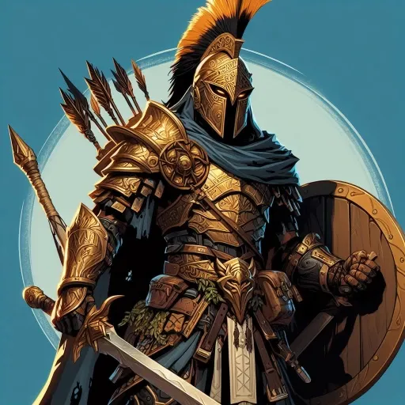
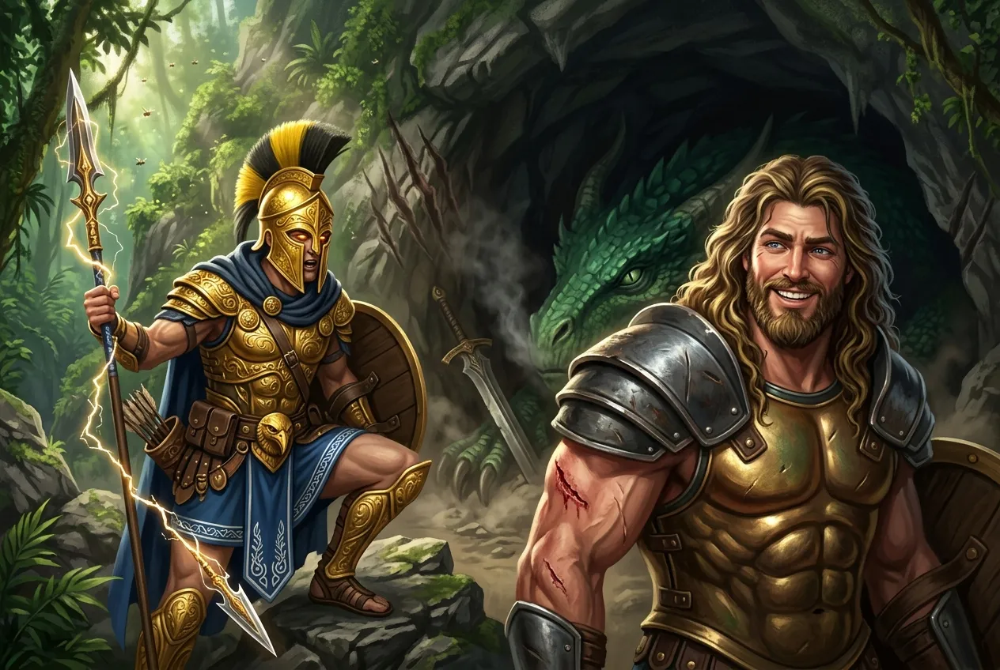
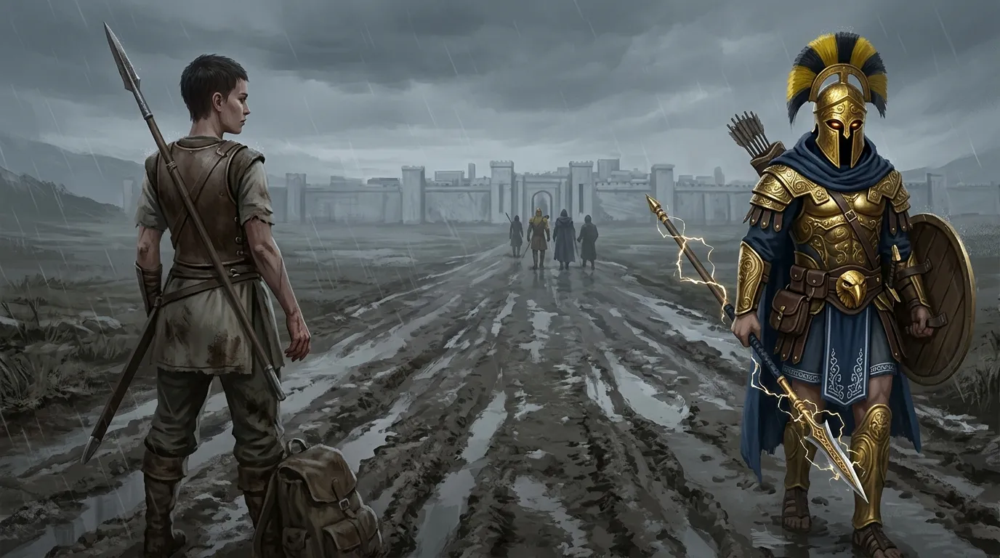

_Half-Elf Fighter, [[Epickie Ścieżki#The Demi-God (Półbóg)|Demigod]]_
_**Półbóg**, który odnalazł własną matkę i dorównał w boskości swojemu ojcu._

## Historia

Orion Xul, pół-elfi wojownik, dorastał w cieniu tajemnicy swojego pochodzenia, czując w żyłach płynącą boską krew. Jako syn jednego z bogów Piątki, zawsze czuł się wyobcowany wśród zwykłych śmiertelników, a jego nadludzka siła i talent do walki były zarówno darem, jak i ciężarem naznaczającym go od urodzenia.

Gdy [[Versi|Wyrocznia]] ogłosiła nadejście końca Pokoju, Orion zrozumiał, że jego przeznaczenie jest nierozerwalnie splecione z losami Thylei. Wyruszył w podróż, by dowieść swojej wartości, odkryć pełnię swojego dziedzictwa i stanąć do walki z Tytanami jako prawdziwy półbóg, gotów wstrząsnąć posadami świata, by chronić to, co kocha.

W [[Sesja 7 - Uratować Księżniczkę]] otrzymał od [[Pythor|Pythora]] [[Młot Pythora|magiczny młot]] i dowiedział się o swoim przeznaczeniu: ma pokonać zieloną smoczycę [[Hexia|Hexię]].

W [[Sesja 11 - Mithralowa Kuźnia]] poległ w walce z młodym cerberem. Został wskrzeszony przez swojego ojca, [[Pythor|Pythora]], w [[Sesja 12 - Furia Boga Bitwy]]. Wspólnie z [[Volkan|Volkanem]] wykuł włócznię [[Odkupienie Pythora]] w [[Sesja 13 - Wezwani przez Króla]].

W [[Sesja 18 - Cienie Mytros]] podszywał się pod agenta [[Orestes|Orestesa]]. W [[Sesja 19 - Pojedynek z Rozpruwaczem]] udał się na zakupy w poszukiwaniu mikstur leczenia i składników, a [[Taran Neurdagon|Taran]] zaproponował mu pozbycie się [[Moxena|Moxeny]]. W [[Sesja 22 - Taniec z Meduzą]] razem z [[Felicjan Janus Twardowski|Felicjanem]] nie był w stanie pokonać kilkunastu marynarzy na statku Varkona.

W [[Sesja 30 - Zakończenie Igrzysk]] został prawie dobity przez [[Hergeron|Hergerona]] w Wielkim Młynie, a w [[Sesja 35 - W Wężowym Uścisku]] padł nieprzytomny po ataku [[Leah|Lei]]. W [[Sesja 36 - Królowa, Dziedzic i Generał]] postanowiono wykorzystać głowę Lei w jego tarczy.

W [[Sesja 37 - Próba Ognia]], kierowany żądzą przygód, był skłonny przyjąć ofertę [[Estor Arkelander|Estora]]. W [[Sesja 38 - Bitwa w Kalderze]] falą uderzeniową zrzucił do lawy króla [[Jankor|Jankora]], królową jaszczuroludzi i jeszcze jednego jaszczuroluda, a potem powalił młodego mosiężnego smoka jednym ciosem. W [[Sesja 40 - Uciechy na Wyspie Skorpiona]] został przygnieciony ciałem fioletowego robaka i z trudem się uwolnił.

W [[Sesja 41 - Wiedźma Lotosu]] pił krew Umbridge i wezwał dzieci, by jej spróbowały; przy Kole Fortuny stracił całe ubranie i ekwipunek, a jako syn [[Pythor|Pythora]] pragnął zemsty na [[Hexia|Hexii]]. W [[Sesja 42 - Plemię Węgorza]] pilnował łodzi, gdy część drużyny schodziła na wyspę z kapliczką, a później, wciąż pozbawiony ekwipunku, zaatakował [[Ventis]] żeliwną patelnią.

W [[Sesja 45 - Tajemnica Wyspy Wygnańców]] razem z [[Orestes|Orestesem]] wyłowił z dna morza fragment meteorytu z gwiezdnego metalu, a w [[Sesja 46 - Morderca z Wyspy Wygnańców]] pomógł obezwładnić i związać [[Keelan|Keelana]].

W [[Sesja 47 - Wyspa Mojr]] zawarł pakt z [[Nona|Noną]], jedną z [[Mojry|Mojr]]. W zamian za spędzenie z nią nocy i spłodzenie potomka, otrzymał ulepszenie swojej włóczni. Był jedynym bohaterem, który zgodził się na indywidualny układ z Paniami Losu; został też zraniony kwasem. W [[Sesja 48 - Pakty z Mojrami i Zew Chimery]] ostateczny głos w głosowaniu przypadł jemu i wskazał na mapie [[Wyspa Forlorn|Wyspę Forlorn]] jako następny cel wyprawy; wzmocnioną włócznią zniszczył dwie płonące czaszki.

W [[Sesja 49 - Wielkie Gęsie Powstanie]] zadał ostateczny cios Chimerze, przebijając jej serce włócznią i ratując przy tym [[Orestes|Orestesa]], który balansował na krawędzi śmierci. Później został przemieniony w gęś przez klątwę [[Althaia|Althai]], ale walczył dzielnie w gęsim powstaniu przeciwko wiedźmie.

W [[Sesja 51 - Desant na Yonder]] wspinał się na górę dzięki potężnym mięśniom i pomocy latających towarzyszy. W [[Sesja 52 - Infiltracja Yonder]] zadał [[Ajax|Ajaxowi]] potężny cios magiczną włócznią i go dobił, a w [[Sesja 53 - Koniec Yonder]] przyjął na siebie impet lodowatego oddechu [[Argyn]] i zasypał smoczycę gradem ciosów.

W [[Sesja 54 - Wyznanie Chondrusa]] stanął twarzą w twarz z ojcem; [[Pythor]] pogratulował mu odwagi i przypomniał o misji pokonania [[Hexia|Hexii]]. Po wysłuchaniu argumentów [[Chondrus|Chondrusa]] Orion powiedział mu: „Dzisiaj cię nie zabiję”. W [[Sesja 56 - Dedal i Ikar]] zadał decydujący cios hydrze, znajdując niebroniony punkt na jej ciele. W [[Sesja 57 - Ogród Heliosa]] [[Helios]] podważał jego misję zgładzenia Hexii, sugerując, że przeznaczenie bywa wymówką dla czynów łamiących serca. W [[Sesja 58 - Wyspa Czasu]] w wizji z teleskopu opłakiwał śmierć towarzyszki, lecz znalazł pocieszenie w jej dziedzictwie.

W [[Sesja 59 - Koniec Imprezy]] jednym pchnięciem powalił Grella, walczył polegając na słuchu i instynkcie, oślepiony pięknem jednej z nimf, a następnie zabił [[Talieus|Talieusa]], wbijając mu włócznię w pierś; ciało tytana rozpadło się w złoty pył. W [[Sesja 60 - Typhon Symfonia Potępienia i Brama do Hadesu]], wzmocniony zaklęciem szybkości, zabił [[Piekielny Dyrygent|Piekielnego Dyrygenta]] włócznią przebijającą hełm. W [[Sesja 61 - Yala, Arezja i Żółw]] w iluzji znalazł legendarną zbroję płytową +2 i dobił ostatniego cienistego upiora. W [[Sesja 63 - Werdykt Arezji]] wziął ze stosu darów [[Narsus|Narsusa]] magiczną, lśniącą zbroję płytową.

W [[Sesja 64 - Pieśń dla Smoczycy]] odbył rozmowę z [[Pythor|Pythorem]] o konieczności zabicia [[Hexia|Hexii]], dostrzegł na plaży skałę z wyrytym symbolem [[Kraken|Krakena]] i przyznał się smoczycy do dziedzictwa Pythora, nie tracąc rezonu. Hexia nakazała mu zabrać matkę, [[Ophea|Opheę]], którą uwolniła.

W [[Sesja 66 - Przebudzenie Bestii i Cienie Otchłani]] uderzył w swoją magiczną tarczę, wyzwalając Thunderwave, który razem z zapachem czerwi obudził [[Tarrasque]]; dostrzegł też na horyzoncie [[Talieus|Talieusa]] brodzącego w czarnych wodach. W [[Sesja 67 - Zguba Estora]] został sparaliżowany strachem przez ryk [[Hezzebal|Hezzebala]] i atakował z dystansu ze słabym skutkiem; dostrzegł nienaturalne poruszenie w górze złota, po czym zaatakował go [[Estor Arkelander|Estor]] z Xiphosem. W [[Sesja 68 - Arena Krzywoprzysięstwa]] wpadł w morderczy szał bojowy i pokonał [[Cerber|Cerbera]] i [[Król Troglodytów|Króla Troglodytów]] gradem ciosów, a [[Rakas Rozpruwacz|Rakasa]] włócznią.

W [[Sesja 69 - Ogród Lutherii]] zabił miedzianą smoczycę [[Ventis]], przebijając jej podbrzusze włócznią. Na pytanie [[Kyrah]] o cel audiencji odpowiedział: „Albo ją przekonać, albo walczyć”. Ulał też nieco wina na pokład dla Pani Domu zgodnie ze starym zwyczajem, a w miejscu upadku kropel wyrosły drapieżne kwiaty. W [[Sesja 70 - Audiencja u Pani Snów]] uległ pokusie trzech driad i poszedł z nimi do łaźni zdjąć zbroję, a [[Lutheria]] zapytała go, jak sprawić, żeby niemowlę raczkowało w kółko.

W [[Sesja 71 - Infiltracja Praxys]] zwiadował rury odpływowe, przyjmując formę wody dzięki mikstury wodnej formy. Wsławił się też aktorsko-złodziejskim popisem w latrynie wieży - chcąc prześlizgnąć się poza cyklopem [[Krok|Krokiem]] zaczął głośno jęczeć i odgrywać uciążliwe problemy żołądkowe, krzycząc do zdezorientowanego cyklopa z zamkniętej kabiny żądania na papier toaletowy. Cyklop w konsternacji zrezygnował z dalszych pytań i zgodnie z jego prośbą, by nie patrzeć na "problemy żołądkowe", odszedł by zjeść wcześniej przygotowaną kanapkę. W dalszej części zadał ostateczny, morderczy cios spętanej [[Królowa Myrmeków|Królowej Myrmeków]].

W [[Sesja 72 - Śniadanie u Tytana Bochenek Przeznaczenia]] uzbroił się w nowe oszczepy ([[Oszczepy Błyskawic]]) i ukryty w bochenku chleba dostał się do wieży [[Praxys]]. W starciu z [[Sydon|Sydonem]] z niemal nadludzką szybkością wyprowadził serię precyzyjnych pchnięć włócznią. W [[Sesja 73 - Praxys - Skarbiec Sydona]] jego Shield Wall parował część ciosów, a pancerz okazał się nie do przebicia dla harpii; narzekającemu więźniowi zagroził z typową bezpośredniością powrotem do klatki.

W [[Sesja 74 - Matka Smoków]] krążył po flankach, rażąc wrogów włócznią. W [[Sesja 75 - Koniec Przysięgi]] jednym zamaszystym cięciem powalił kilku Czadów naraz, nie tracąc zimnej krwi, i awansował na trzynasty poziom doświadczenia.

W [[Sesja 76 - Bitwa o Mytros: Pierwsza Fala]] zmasakrował wrogiego centaura przy [[Świątynia Pięciu|Świątyni Pięciu]], lecz został ranny przez Steel Wind Strike [[Hergeron|Hergerona]]. W [[Sesja 77 - Bitwa o Mytros: Upadek Icarusa]] dobił minotaura w Świątyni Pięciu, a po użyciu Second Wind uderzał w [[Icarus|Icarusa]], trafiając rzutami 23 i 22. W [[Sesja 78 - Bitwa o Mytros: Przebudzenie Kolosa]] zabił [[Tarchon|Tarchona]], wbijając mu z pogardą tępy trzonek włóczni w gardło.

W [[Sesja 79 - Bitwa o Mytros: Gniew Pana Burz]], dosiadając brązowego smoka [[Raspytrion|Raspytriona]], poważnie zranił włócznią jednego z latających minotaurów i oznajmił [[Sydon|Sydonowi]]: „Będziesz następny! Widzę strach w jego oczach!”. W [[Sesja 80 - Bitwa o Mytros: Śmierć Pana Burz]] zabił gigantyczne rekiny rzutami [[Odkupienie Pythora|Odkupienia Pythora]], włóczni wracającej magicznie do jego dłoni, wytrzymał falę pływową i dostrzegł nadpływającego Lewiatana.

W [[Sesja 81 - Bitwa o Mytros: Koszmar na Targu Minotaurów]] walczył z Cerberem i lamią, oparł się ich ukąszeniom i klątwie, poważnie ranił Cerbera, zabił lamię i wielokrotnie trafiał [[Lutheria|Lutherię]]; użył też Shield Wall, wznosząc mur tarcz. W [[Sesja 82 - Bitwa o Mytros: Śmierć Pani Snów]] przez całe starcie raz za razem ciskał włócznią w kolejne odbicia bogini w [[Świat Snów|Świecie Snów]], a broń posłusznie wracała mu do dłoni. Jako jedyny z trójki trafionych psionicznym krzykiem stawił mu najtwardszy opór, a później oparł się też nekromantycznemu więdnięciu Lutherii.

W [[Sesja 83 - Zmierzch Ery Tytanów]] walczył z grzbietu [[Raspytrion|Raspytriona]], ciskając magicznym oszczepem zamieniającym się w locie w kolumnę błyskawicy. Gdy [[Kentimane]] strącił smoka z nieba, spadł razem z nim — od śmierci uratowała go zbroja, która pochłonęła niemal całe uderzenie o ziemię. Z ziemi, tuż u stopy [[Tytani|Tytana]], prowadził uparty ostrzał [[Odkupienie Pythora|Odkupieniem Pythora]], aż setka ramion pochwyciła go i [[Kentimane|Sturęki]] połknął go w całości. Nieprzytomnego ocucił w trzewiach [[Versir]] miksturą leczącą; oślepiony i trawiony sokami [[Orion Xul|Orion]] dźgał dalej na oślep, a nawet krzyczał w ciemność, by [[Kentimane]] zostawił ich w spokoju i wracał do swojego leża. Z wnętrza [[Tytani|Tytana]] wyrwał go dopiero [[Versir]] zaklęciem przejścia.

W [[Sesja 84 - Świt Nowej Ery]] zajął się swoim ojcem. Zadawał [[Pythor|Pythorowi]] pytania, na które ten nie umiał odpowiedzieć — czy jest człowiekiem, półbogiem, czy kryje się w nim coś smoczego — i opowiedział mu o sobie: że był żołnierzem, który zabijał na rozkaz, potem przestał nim być, bo nie chciał już zabijać, a skończył jako najemnik bogów, który zabijał na rozkaz. Zaproponował ojcu wspólną podróż po świecie i namówił go, by po pięciuset latach stanął przed [[Hexia|Hexią]]; sam czekał na zewnątrz jaskini. Dopytywał też o [[Ophea|Opheę]] — po pogodzeniu Pythora z Hexią rozmowa z matką stała się teoretycznie możliwa. Zgodził się na zniszczenie kosy, byle sprawa ruszyła z miejsca, i zaproponował wobec [[Taran Neurdagon|Tarana Neurdagona]] stałą obserwację, informatorów i gotowość do działania.

## Po wojnie

|  |  |
|:---:|:---:|
| Orion i Pythor | Zostawiona na drodze |

Był żołnierzem, który zabijał na rozkaz, potem przestał nim być, a skończył jako najemnik bogów — po wojnie chce wreszcie znaleźć drogę, na której nie chodzi o zabijanie.

- **Ojciec.** Przez kolejne lata wędruje z [[Pythor|Pythorem]] po [[Kontynent Thylea|Thylei]] i spędzają razem coraz więcej czasu. Dla Pythora, który nie odnalazł się w świecie bez wojny, to jedyna rzecz, która naprawdę wyszła. Orion namówił go też, by po pięciuset latach stanął przed [[Hexia|Hexią]]: skończyło się śladem po ugryzieniu i rozejmem, a Hexia zaniechała zemsty.
- **Matka.** Dopytuje o [[Ophea|Opheę]]. Po rozejmie z Hexią rozmowa z matką stała się teoretycznie możliwa, ale [[Pythor]] boi się tłumaczyć, czemu nie ruszył jej na ratunek od razu.
- **Kapliczki.** Własnych kapliczek ani nie zwalcza, ani się z nich nie cieszy — mogą sobie stać.
- **[[Lyra]].** Jednej rzeczy nie naprawił. Lyrę, której lojalność wobec niego nigdy nie miała granic, zostawił bez rozmowy, bez wyjaśnienia i bez zamknięcia — dokładnie tak, jak [[Pythor]] zostawił [[Hexia|Hexię]]. Syn, który przez całą wyprawę pchał ojca do naprawiania dawnych krzywd, popełnił ten sam błąd.
