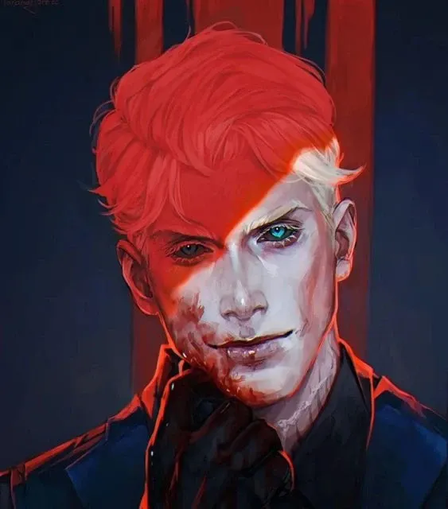
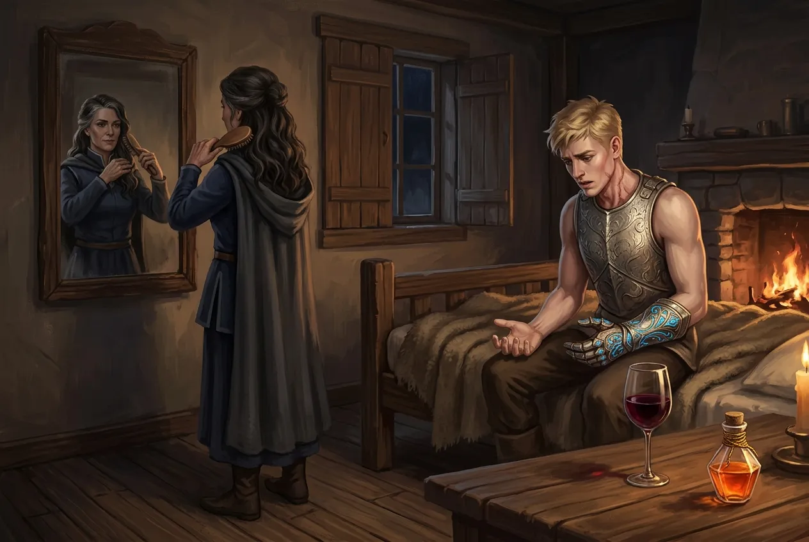
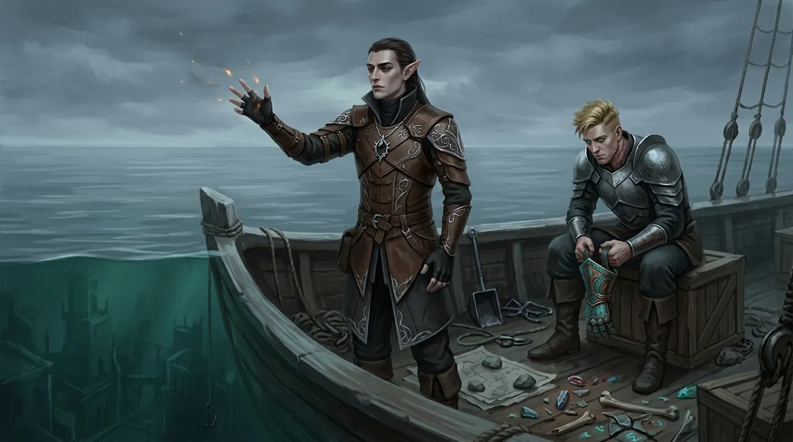

_Aasmiar Paladin/Sorcerer, [[Epickie Ścieżki#The Timeless One (Wieczny)|The Timeless One]]_
_**Wieczny**, który po stuleciach powrócił do [[Thylea|Thylei]] i odkrył los Zaginionych Tytanów._

## Historia

Versir, aasimar o paladyńskim powołaniu, spędził lata na Wyspie Czasu, szkolony przez Sfinksa do wypełnienia swojej misji przeciwko bliźniaczym tytanom, Sydonowi i Lutherii. Powróciwszy do Thylei, ukrył swą tożsamość, sprzymierzając się z Kultem Węża i Panią Monet, co zmusiło go do współpracy z nieufną Astrą. Ich początkowo szorstka relacja, pełna podejrzeń, zmieniła się podczas pułapki na cmentarzu.

Tam, nad grobem brata Astry ofiarowanego tytanom, wspólna nienawiść do Sydona i Lutherii połączyła ich sojuszem. Versir wyjawił swą naturę pół-tytana i cel zemsty, zyskując wierną przyjaciółkę. Od tego czasu budował swą reputację i wpływy w cieniu, cierpliwie czekając na przepowiedziany przez Sfinksa znak od Wyroczni, by ostatecznie uderzyć w swych odwiecznych wrogów.

W [[Sesja 4 - Mroczne sekrety Świątyni]] celem drużyny stała się [[Hand of Kentiname|Rękawica]], przedmiot kluczowy dla Versira. W [[Sesja 7 - Uratować Księżniczkę]] domyślił się magicznej natury amuletu Felicjana, ale zachował to dla siebie, a w [[Sesja 10 - Świątynia Heliosa i Jaskinie Troglodytów]] został prawie zabity przez zauroczonego [[Orestes|Orestesa]]. W [[Sesja 18 - Cienie Mytros]] wyruszył na poszukiwania [[Chondrus|Chondrusa]].

W [[Sesja 19 - Pojedynek z Rozpruwaczem]] odwiedził [[Moxena|Moxenę]], sprzedając jej plany drużyny, i rozglądał się za niejaką [[Astra|Astrą]]. W [[Sesja 21 - Ukryte pragnienia Ismene]] wyszło na jaw, że współpracuje z Moxeną, a [[Astra]] powiedziała mu, że jego sojuszniczka zawarła układ z [[Hexia|Hexią]], sprzedając jej skamieniałych artystów.
W [[Sesja 22 - Taniec z Meduzą]] wyznał, że Moxena wkrótce go dopadnie i ukara za zdradę, i chciał uwolnić Astrę; nie chciał pertraktować i rzucił Vortex Warp, na co [[Rhea]] odpowiedziała Counterspell.
W [[Sesja 23 - Nowe Przymierze]] zgodził się na nowe warunki układu: jeśli Moxena pomoże im ze smokiem Hexią, jest gotów na współpracę. W zamian za pomoc w obaleniu fałszywej królowej [[Themis]] [[Moxena]] zobowiązała się (już w [[Sesja 22 - Taniec z Meduzą]]) zaprzestać porywania artystów.

W [[Sesja 30 - Zakończenie Igrzysk]] zatańczył na uczcie z Astrą, a potem miał sen, w którym [[Lutheria]] wyraziła niezadowolenie z jego zachowania i złożyła mu ofertę, którą wzgardził. W [[Sesja 32 - Kieł]] użył magii Wyroczni, by sprawdzić, czy Moxena spróbuje ich zdradzić; odpowiedź była przecząca. W [[Sesja 33 - W Szponach Bazyliszków]] próbował perswazją i zastraszeniem wpłynąć na [[Iphis]], znalazł grawerunek na ścianie fortecy i przekonał jednego z koźlaków, by został ich przewodnikiem. W [[Sesja 35 - W Wężowym Uścisku]] rzucił Vortex Warp, teleportując rudą Amazonkę z siodła gryfa na ziemię, a potem krótko walczył z [[Leah]].

W [[Sesja 37 - Próba Ognia]], kierując się honorem, był przeciwny paktowaniu z mrocznym duchem, a pod wpływem przeczucia i wizji wskoczył do krateru wulkanu, wprost w płynną lawę, i nie zginął: z jego rękawicy wyłoniła się gigantyczna dłoń, która osłoniła go przed ogniem.
W [[Sesja 38 - Bitwa w Kalderze]] rozmową uspokoił ognistą istotę i rozpoznał w niej swoją ciotkę [[Chalcia Pierwsza|Chalcię]]. Dowiedział się o tragicznych losach swojej rodziny i o zdradzie [[Sydon|Sydona]] i [[Lutheria|Lutherii]]. Osłabiona po długim uwięzieniu Chalcia poprosiła o schronienie w jego rękawicy; zgodził się, a po niej pozostał tajemniczy klejnot.

W [[Sesja 39 - Tajemnice Wyspy Złotego Serca]] ogłosił swoje przybycie na platformie przy [[Drzewo Serca|Drzewie Serca]], co uruchomiło portal i wizję początków Thylei. W [[Sesja 40 - Uciechy na Wyspie Skorpiona]] resztkami sił dobił fioletowego robaka. W [[Sesja 41 - Wiedźma Lotosu]] Umbridge zabrała mu usta za nieposłuszeństwo, ale zranił ją kawałkiem szkła; przy Kole Fortuny otrzymał moc prędkości. Dręczony tęsknotą za matką, zapytał Wiedźmę, jak odzyskać cząstkę jej duszy, i usłyszał, że musi zebrać i wchłonąć odłamki Gwiezdnej Skały.

W [[Sesja 42 - Plemię Węgorza]] wyczuł subtelne emanacje magii przy kapliczce i użył Vortex Warp, teleportując dwie mantikory obok Orestesa i siebie, a potem samego Orestesa na grzbiet [[Ventis]]. W [[Sesja 43 - Kopalnia Żelaza]] wyjaśnił [[Borinn Bystre Oko|Borinnowi]], że drużyna przybyła rozprawić się ze smoczycą. W [[Sesja 44 - Ventis]] teleportował [[Brenna|Brennę]] z leża smoka w objęcia Felicjana i zadał Ventis ostateczny cios zaklęciem Lightning Bolt ze swojego kostura. W [[Sesja 45 - Tajemnica Wyspy Wygnańców]] wyczuł w fragmencie gwiezdnego metalu po Ventis słabą obecność swojej matki. W [[Sesja 46 - Morderca z Wyspy Wygnańców]] porównał zakrwawiony but ze śladami w ogrodzie [[Idylla|Idylli]] i dowiedział się od niej o modus operandi [[Tadd|Tadda]].

W [[Sesja 47 - Wyspa Mojr]] ujrzał w gobelinie wizję swojej śmierci z rąk [[Lutheria|Lutherii]], boskimi zmysłami wyczuł aurę istoty piekielnej od służki Mojr i został obezwładniony aurą szaleństwa Wielookiego stwora. Prowadził negocjacje z [[Mojry|Mojrami]], zarzucając im korupcję i paktowanie z Tytanami oraz oferując im [[Sydon|Sydona]]; Mojry uznały cenę za zbyt niską, a ostatecznie odrzucił propozycję rocznej służby.

W [[Sesja 48 - Pakty z Mojrami i Zew Chimery]] z godnością odrzucił propozycję oddania fragmentu duszy własnej matki, a Mojrom oddał Kostur [[Sydon|Sydona]], który dzierżył, jako część zapłaty za zdjęcie klątwy ze smoczych jaj. Skłaniał się ku subtelnej infiltracji Wyspy Yonder, a w walce z płonącymi czaszkami osłonił towarzyszy swoją mocą.

W [[Sesja 49 - Wielkie Gęsie Powstanie]] został przemieniony w gęś. Leczył towarzyszy w walce z Chimerą, a wobec [[Althaia|Althai]] z wrodzoną dyplomacją odparł, że szukają chwały. Po walce ukradkiem wyjął list z kieszeni ludzi [[Taran Neurdagon|Tarana Neurdagona]], ujawniając jego zlecenie na głowę Althai.
W [[Sesja 50 - Nawałnica Tytanów i Szepty Yonder]] użył zdolności proroczych (odpowiedź o teleportacji na Wyspę Myrmeków była niejednoznaczna: światło i burza na horyzoncie), wynegocjował z syrenami odroczenie wyroku na jeńcach i przesłuchiwał żołnierzy Sydona. W [[Sesja 51 - Desant na Yonder]] opracował alternatywny plan zwabienia [[Argyn]] w zasadzkę na morzu, a w [[Sesja 52 - Infiltracja Yonder]] przyzwał Spirit Guardians. W [[Sesja 53 - Koniec Yonder]] spadł w przepaść, został podniesiony przez Arevona i zabił Argyn piorunem.

W [[Sesja 54 - Wyznanie Chondrusa]] uznał Chondrusa za ślepego fanatyka i sługę potwora odpowiedzialnego za cierpienie jego rodziny, po czym zakuł go w kajdany i zamknął w celi; [[Astra]] przypomniała mu, że stał się symbolem i jednym z filarów przepowiedni. W [[Sesja 55 - Egida Mytros]] odzyskał swój miecz od Arevona, zręcznie odroczył audiencję u króla, żądając najpierw złożyć ofiary w [[Świątynia Pięciu|Świątyni Pięciu]], i z dyplomatyczną precyzją odparł oskarżenia [[Acastus|Acastusa]].

W [[Sesja 57 - Ogród Heliosa]] dotyk gwiezdnej rudy dał mu wizję meteorytu spadającego na jego matkę, [[Versi Pierwsza|Versi]], i rozproszenia jej esencji; ruda wtopiła się w jego duszę. Chwycił ślepego cyklopa i zagroził jego śmiercią, by powstrzymać Heliosa, co tylko rozwścieczyło smoka. W [[Sesja 58 - Wyspa Czasu]] rozpoznał [[Wyspa Czasu|Wyspę Czasu]] po opisie i dzięki swoim wspomnieniom poprowadził drużynę do jej serca; spotkał tam [[Kallisti]], swoją dawną opiekunkę, dyplomacją przekonywał cyklopy o pakcie Heliosa z Sydonem, a w wizji z teleskopu spotkał Astrę. W [[Sesja 59 - Koniec Imprezy]] poszedł z Orestesem do miejsca sądu nad [[Kartos|Kartosem]] i wspierał drużynę z dystansu w walce z Blemysami.

W [[Sesja 60 - Typhon Symfonia Potępienia i Brama do Hadesu]] doznał wizji od matki, w której ujrzał ciotkę [[Yala Pierwsza|Yalę]] jako kamienny posąg nad Styksem i dowiedział się, że brama do Hadesu jest na [[Typhon|Typhonie]]; wybrał ścieżkę prowadzoną echem wizji i zażądał od Typhona wskazania drogi. W [[Sesja 61 - Yala, Arezja i Żółw]] odnalazł w Hadesie swoją ciotkę, błagał ją w walce, by się ocknęła, i uwolnił ją z pęt szaleństwa. Jej esencja dobrowolnie wstąpiła do jego [[Hand of Kentiname|Rękawicy]], wypełniając jedno z pustych wgłębień przezroczystym kryształem.
W [[Sesja 62 - Arezyjska Dyplomacja]] przyzwał skrzydlatego słonia [[Trąba|Trąbę]], by dodać drużynie splendoru, i rzucił wyzwanie w Świątyni Tarczy. W [[Sesja 63 - Werdykt Arezji]] wraz z Arevonem przedstawił Radzie wykradzione plany wojenne Tytanów. W [[Sesja 64 - Pieśń dla Smoczycy]] przemówił do niewidocznej [[Hexia|Hexii]], a ta pojawiła się dopiero po przywołaniu imienia Ochosa; powiedział, że nie pozwoli szpiegowi Lutherii zbliżyć się do Lutherii.

W [[Sesja 65 - Wyprawa w Otchłań]] telepatycznie przekonał [[Kraken|Krakena]], że jego celem także jest śmierć Sydona, i rozpoznał Wyspę Złotego Serca z wizji pokazanej przez Thyleę. Głosy w jego głowie podpowiedziały hasło Thanatos, otwierające właz [[Sześcian Więzienny|Sześcianu Więziennego]]. Tam, wiedziony ciekawością lub brawurą, włożył rękę w Sferę Annihilacji; ręka została ucięta, a ranę zasklepiono magią.
W [[Sesja 66 - Przebudzenie Bestii i Cienie Otchłani]] wciąż cierpiał po utracie dłoni i w walce polegał na defensywnej magii i unikach; nazwał [[Talieus Pierwszy|Talieusa]] wujkiem i wysłał mu magiczną wiadomość, że drużyna przybyła go odbić. W [[Sesja 67 - Zguba Estora]] pod wpływem luster stracił kości i stał się bezwładną masą (problem rozwiązano magicznie), zapytał [[Estor Arkelander|Estora]] o jego pakt z Lutherią i teleportował sojuszników po polu bitwy, ratując ich przed atakami [[Hezzebal|Hezzebala]]; [[Xiphos of Slaughter]] trafił do rąk Versira.

W [[Sesja 68 - Arena Krzywoprzysięstwa]] podał drużynę za inspekcję sprawdzającą legalność areny, Vortex Warpem wrzucił Trellusa i Maximusa w Wall of Fire Felicjana i latał na magicznej Trąbie. W [[Sesja 69 - Ogród Lutherii]] przyzwał Blade Barrier, a w Sali Wróżenia poprosił o ujawnienie miejsca pobytu Chalcii i zobaczył ją w dużym pomieszczeniu z ósemką kochanków; pragnął odzyskać Talieusa i był sceptyczny wobec umów z Lutherią.
W [[Sesja 70 - Audiencja u Pani Snów]] wyczuł w Zbrojowni cząstkę duszy swojej matki, Versi Pierwszej, zaklętą w gwiezdnym metalu, i zachował kamienną twarz. Wygłosił płomienny monolog do Lutherii, oskarżając ją o kradzież iskry życia od Talieusa i hodowanie dzieci na grobach Tytanów, czym zepsuł jej humor. Od [[Volkan|Volkana]] otrzymał [[Zguba Tytanów|Zgubę Tytanów]], miecz kiedyś wykuty przez Talieusa Pierwszego, zawierający cząstkę duszy matki Versira i ukończony przez Volkana, oraz uprząż wydłużającą zasięg broni.

W [[Sesja 71 - Infiltracja Praxys]] przeprowadzając szturm otrzymał od matki rozdwojoną wizję: w jednym oku szczyt wieży pod gwiazdą z zadaniem scalenia karmazynowej kuli z gwiazdą, w drugim podwodną drogę do swojego wuja, Tytana [[Hergeron Pierwszy|Hergerona]], i rozbicie adamantowych kolców; uratowanie Tytana zależało od jednej z tych misji. W samej fortecy samodzielnie zdecydował o zaatakowaniu Myrmeków i [[Królowa Myrmeków|Królowej Myrmeków]], uznając, że ich plaga zagroziłaby całej Thylei: „Żadnego skradania, żadnych przebrań. Bierzemy smoki i robimy statement."
W [[Sesja 72 - Śniadanie u Tytana Bochenek Przeznaczenia]] jako pierwszy doskoczył do Sydona, tnąc go magicznym ostrzem, a ostatni cios w starciu z [[Chalcia|Chalcią]], córką Sydona, należał do niego: „Nie miałaś najmniejszych szans" — wysyczał syn Versi Pierwszej, uwalniając Ognisty Promień.

W [[Sesja 73 - Praxys - Skarbiec Sydona]] walczył Booming Blade'em (57 obrażeń jednym trafieniem), leczył Lay on Hands i widział kontury Cerbera w magicznej ciemności dzięki wyczuwaniu wibracji; zauważył, że znaleziona w skarbcu rękawica wygląda identycznie jak jego własna, lecz ma komplet klinów (okazała się niedziałającą repliką), a pulsującej gwiazdy bezskutecznie próbował wciągnąć do swojej Rękawicy.
W [[Sesja 74 - Matka Smoków]] z kikuta jego dłoni wystrzeliła widmowa ręka z pięcioma płomiennymi palcami (Scorching Ray); użył też Spirit Shroud i mocy rękawicy, by zdominować umysł gygana ochrzczonego [[Zenek|Zenkiem]], i posłał go do basenu astralnego, a sam, ogłuszony psionicznym atakiem [[Goloron|Golorona]], był sparaliżowany przez kilka rund. Rękawica pokazała mu wizję, w której sam wchodzi do basenu z pochodnią w ręku.
W [[Sesja 75 - Koniec Przysięgi]] zapalił pochodnię od srebrnego światła uwięzionej gwiazdy na szczycie Praxys i zanurkował z nią w portalowym basenie do Morza Astralnego, zabezpieczony liną Felicjana, a czerwona gwiazda-rodzic podążyła za nim. Jako siostrzeniec nazwał Hergerona wujkiem, wywołał go z furii, wykrzykując, że miecz jest skończony i że Bliźniaki zapłacą za to, co zrobiły, ale oszalały Hergeron po uwolnieniu schwytał go i dotkliwie ranił. Po tych wydarzeniach awansował na trzynasty poziom doświadczenia.

W [[Sesja 76 - Bitwa o Mytros: Pierwsza Fala]] cieszył się nową dłonią, przywróconą dzięki magii Arevona; założył rękawicę zdobytą u Sydona — niedziałającą replikę własnej — ale jej magia okazała się uśpiona, więc ją zdjął. Pocieszył [[Kyrah]], porównując ją z jej bratem, zaoferował zniszczenie miecza Estora, rzucił Beacon of Hope i lobbował za przeniesieniem [[Corinna|Coriny]] na pozycję dowódcy Egidy Mytros.
W [[Sesja 77 - Bitwa o Mytros: Upadek Icarusa]] zadał dwa uderzenia minotaurom w Świątyni Pięciu, uleczył Arevona z paraliżu Lesser Restoration i dwukrotnie oparł się paraliżowi Icarusa. W [[Sesja 78 - Bitwa o Mytros: Przebudzenie Kolosa]] przekonywał Acastusa, że drużyna potrzebuje berła, by ożywić Kolosa. W [[Sesja 79 - Bitwa o Mytros: Gniew Pana Burz]] teleportował się wraz z Trąbą przed oblicze Sydona, dwukrotnie ciął go swoim ostrzem, nakładając klątwę odcinającą Tytana od uzdrowienia, i zapytał, dlaczego tak bardzo nienawidzi śmiertelników. W [[Sesja 80 - Bitwa o Mytros: Śmierć Pana Burz]] nasycił Zgubę Tytanów ogniem i radiantną mocą, kilkakrotnie przyzywał kolejne inkarnacje Trąby (trzecią wykorzystał do szarży na Sydona) i przeniósł Volkana zaklęciem wypaczającym przestrzeń.
W [[Sesja 81 - Bitwa o Mytros: Koszmar na Targu Minotaurów]] rzucił True Seeing, zabił Chondrusa zaklęciem Toll the Dead, uderzył Lutherię Shining Smite i przełamał przymus tańca; powiedział jej, że właśnie dlatego urządza tę ucztę — by jeszcze raz przez chwilę uwierzyć, że nie została sama.

W [[Sesja 82 - Bitwa o Mytros: Śmierć Pani Snów]] ruszył do zwarcia z [[Lutheria|Lutherią]], tnąc ją [[Zguba Tytanów|Zgubą Tytanów]] dwukrotnie, lecz bogini zaszczepiła w jego umyśle szaleństwo i [[Felicjan Janus Twardowski|Felicjan]] musiał zamknąć go w ochronnej sferze; wcześniej Versir oddał Felicjanowi ostatnie okruchy swojego natchnienia. Uwolniony, rzucił **Aurę Czystości**, która postawiła na nogi sparaliżowanych psionicznym krzykiem towarzyszy. Wygnany przez boginię do wielowymiarowego labiryntu, w którym już raz stracił stulecia, przemówił stamtąd w pustkę: „To nie dlatego mnie nienawidzisz. Nienawidzisz mnie, bo wypowiedziałem na głos to, przed czym uciekałaś przez całą wieczność" oraz „Nie boję się spotkać z matką. Ty od tysięcy lat boisz się samotności". Słyszał tam też pieśń i głos, który nazywał go siostrzeńcem. Jego uderzenie [[Zguba Tytanów|Zgubą Tytanów]] zdławiło zdolność Lutherii do leczenia się cudzymi ranami, a później uderzył tym samym ostrzem w sam grunt [[Świat Snów|Świata Snów]], próbując rozbić domenę bogini od środka.

W [[Sesja 83 - Zmierzch Ery Tytanów]] wraz z towarzyszami sięgnął po łaskę [[Mytros (Bogini)|Mytros]], by odpocząć pełnią przed nadejściem [[Kentimane|Kentimane'a]], po czym ze [[Zguba Tytanów|Zgubą Tytanów]] w dłoni rzucił się na [[Tytani|Tytana]], krzycząc po sylvańsku, że [[Bliźniaczy Tytani|Bliźniacy]] zasłużyli na wszystko, co ich spotkało, i został połknięty w całości. W jego wnętrzu przeniósł się do połkniętego [[Orion Xul|Oriona]] i wlał mu w usta miksturę leczącą, zamiast uciekać samemu. Potem rozdarł przestrzeń zaklęciem przejścia, wyrwał siebie i Oriona na zewnątrz i stanął przed obliczem Kentimane'a ze [[Zlote Owoce|złotym owocem]] w dłoni — nie jako petent, lecz jako krewny. Powiedział mu, że drużyna spełnia wolę samej [[Thylea|Thylei]], że zabili Bliźniaków, by chronić kontynent, i że nie chce już patrzeć na kolejnego członka własnej rodziny pochłoniętego szaleństwem. Pierwsze słowa nie chwyciły; dopiero powtórzone z absolutną pewnością zatrzymały pięść wielkości okrętu o włos nad jego głową, a Tytan odszedł ku morzu.

W [[Sesja 84 - Świt Nowej Ery]] zamknął sprawę swojej rodziny. Uwolnił z okowów przy barce [[Hypnos]] oślepionego wuja, [[Talieus Pierwszy|Talieusa Pierwszego]], Tytana Rzemiosła, włożył mu w dłoń jego ostatnie dzieło i zakończył jego mękę, wchłaniając esencję magiczną rękawicą. Zadeklarował, że zaopiekuje się porzuconym okrętem, a jeśli nikt inny nie zgłosi pretensji, przygarnie też [[Glewia Sydona|Glewię Sydona]]; obiecał też przez najbliższe miesiące, a może i lata, zaglądać do [[Sześcian Więzienny|więziennych Sześcianów]]. Dotrzymał słowa danego [[Hexia|Hexii]]: poleciał na [[Wyspa Smoka|Wyspę Smoka]] i zwrócił jej [[Zguba Tytanów|Zgubę Tytanów]]. Zasugerował, by Acastus oficjalnie uznał Felicjana za prawowitego lidera Zakonu Smoczych Lordów, i zaproponował wypytanie Kyrah o znajomości w Arezji oraz rozwinięcie tam siatki szpiegowskiej, by dowiedzieć się, po co Mistrzowi Cieni relikwie dawnych bogów.

## Po wojnie

|  |  |
|:---:|:---:|
| Versir i Astra | Nad Zatopionym Królestwem |

Śmierci [[Sydon|Sydona]] i [[Lutheria|Lutherii]] nie uznał za koniec swojej historii, lecz za początek kolejnego etapu. Nie chciał zostać królem, bogiem ani przywódcą nowego świata i nigdzie nie osiadł na stałe: podróżuje po [[Kontynent Thylea|Thylei]] i [[Morze Otchłani|Morzu Otchłani]] i zamyka ostatnie rany pozostawione przez Erę [[Tytani|Tytanów]].

- **Rodzina.** Wciąż szuka wuja, [[Goloron Pierwszy|Golorona]], którego ślad prowadzi do zatopionego przez [[Sydon|Sydona]] [[Królestwo Syren|Królestwa Syren]], i pozostałych fragmentów [[Gwiezdny Metal|Gwiezdnej Stali]] z cząstkami duszy matki. Do poszukiwań Królestwa przyłączył się razem z [[Arevon Elorrenthi|Arevonem]]; próbował nawet dosięgnąć wuja magią, ale morze nie oddało sekretu.
- **Dziedzictwo Lutherii.** Pilnuje [[Sześcian Więzienny|Sześcianów Więziennych]], w których [[Lutheria]] trzymała na [[Morze Otchłani|Morzu Otchłani]] swoje „zabawki" — istoty zdolne zniszczyć całe kontynenty. Domeny Śmierci nie chce, ale chce wiedzieć, kto ją obejmie i co to będzie znaczyło dla świata.
- **Nowe Mojry.** Uznał, że świat potrzebuje odpowiedzialniejszych tkaczek losu. Pierwszą jest [[Wiedźma Lotosu]], która wstępnie się zgodziła; padła też kandydatura [[Versi|Versi Wyroczni]]. Inną kandydatkę sam znalazł i zaczął przygotowywać, lecz zbyt szybko potraktował ją jak przyszłą Mojrę i odmówiła — nie chciała poświęcić życia obowiązkowi, którego sama nie wybrała. Uważa to za swoją największą porażkę: nawet jeśli wie, co należy zrobić, nie ma prawa decydować za innych. Trzeciej kandydatki wciąż szuka.
- **[[Edran]].** Wziął pod skrzydła młodego historyka, którego rodzinę wymazano z kronik po Erze Tytanów, i uczy go pracy ze źródłami. Pomagał mu rozwijać archiwum Ery Tytanów, ale nie pozwolił nazwać go swoim imieniem ani zrobić z niego miejsca kultu.
- **Bliscy.** [[Yala|Yalę]] uważa za prawdziwą siostrę — nie łączy ich krew, lecz wszystko, co razem przeszli — i dopilnował, by kronikarze zapisali prawdziwą wersję obrony [[Mytros]], tę z Yalą po stronie miasta. [[Felicjan Janus Twardowski|Felicjan]] też jest dla niego rodziną. To do nich wraca, gdy pozwalają mu podróże.
- **[[Astra]].** Po kilku latach wspólnego, szczęśliwego życia dotarło do niego, że Astra się starzeje, a on nie. Chciałby, żeby dzieliła z nim życie w drodze, ale wie, że zasługuje na spokojny dom i własną rodzinę, i nie zamierza jej zatrzymywać.
- **Kult.** Stanowczo odrzuca własny kult i boski status. Jest jednym z ostatnich potomków [[Tytani|Tytanów]], a ich era się skończyła — czczenie kolejnego Tytana byłoby wypaczeniem zwycięstwa nad Sydonem i Lutherią. Kult pozostałych [[Bohaterowie Przepowiedni|Bohaterów Przepowiedni]] mu nie przeszkadza.
