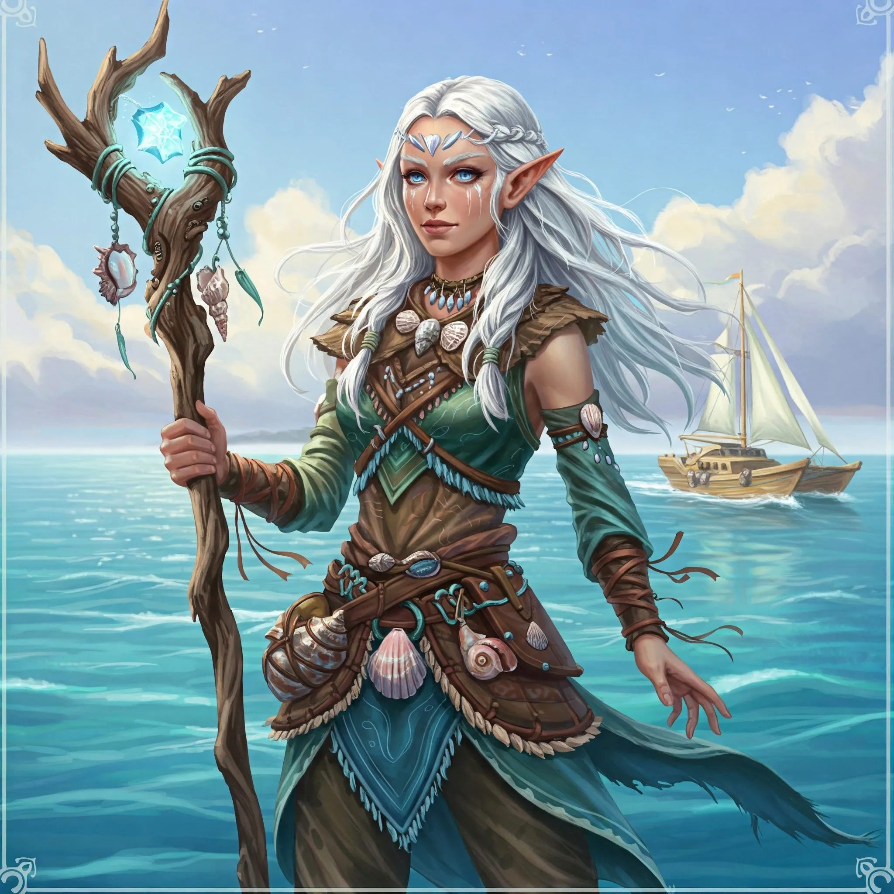

_Elfickie plemię z Wyspy Indygo, ceniące izolację i tradycję; sojusznik bohaterów w wojnie z Tytanami i, po wojnie, jedni z niewielu elfów w całej Thylei._

## Opis
Plemię Delfina składa się z elfów, którzy preferują kontakty z własnym ludem ([[Sesja 42 - Plemię Węgorza]]). Początkowo nieufni, po rozmowie z [[Arevon Elorrenthi|Arevonem]] zawarli sojusz z bohaterami ([[Sesja 43 - Kopalnia Żelaza]]). Po wojnie to niemal jedyne elfy w całej Thylei, sympatyczne i wyluzowane ([[Sesja 84 - Świt Nowej Ery]]).

## Cele
Ochrona własnego terytorium i ludu; nieufność wobec obcych.

## Siedziba
Ich osada znajduje się na [[Wyspa Indygo|Wyspie Indygo]] ([[Sesja 84 - Świt Nowej Ery]]); Ventis dokonała w niej zniszczeń ([[Sesja 43 - Kopalnia Żelaza]]).

## Członkowie
Elfy.
*   **[[Delfin]]**: Dostojna przywódczyni, otoczona szacunkiem pobratymców ([[Sesja 43 - Kopalnia Żelaza]]).

## Relacje
*   **Sojusznicy**: [[Bohaterowie Przepowiedni]], [[Plemię Węgorza]], [[Plemię Wieloryba]].
*   **Dawni wrogowie**: [[Ventis]] (pokonana).

## Historia
W [[Sesja 42 - Plemię Węgorza]] bohaterowie dowiedzieli się o plemionach Wyspy Indygo. W [[Sesja 43 - Kopalnia Żelaza]] elfia delegacja pod wodzą Delfin wysłuchała [[Arevon Elorrenthi|Arevona]] i przyjęła bohaterów z godnością i powagą; przywódczyni opowiedziała o zniszczeniach, jakich smoczyca [[Ventis]] dokonała w ich osadzie. Po pokonaniu Ventis w [[Sesja 44 - Ventis]] plemię Delfina zadeklarowało pomoc i sojusz z bohaterami.

W [[Sesja 84 - Świt Nowej Ery]] [[Arevon Elorrenthi|Arevon]] najbardziej upodobał sobie Wyspę Indygo, gdzie mieszkało Plemię Delfina, i postanowił się z nim zakolegować.
