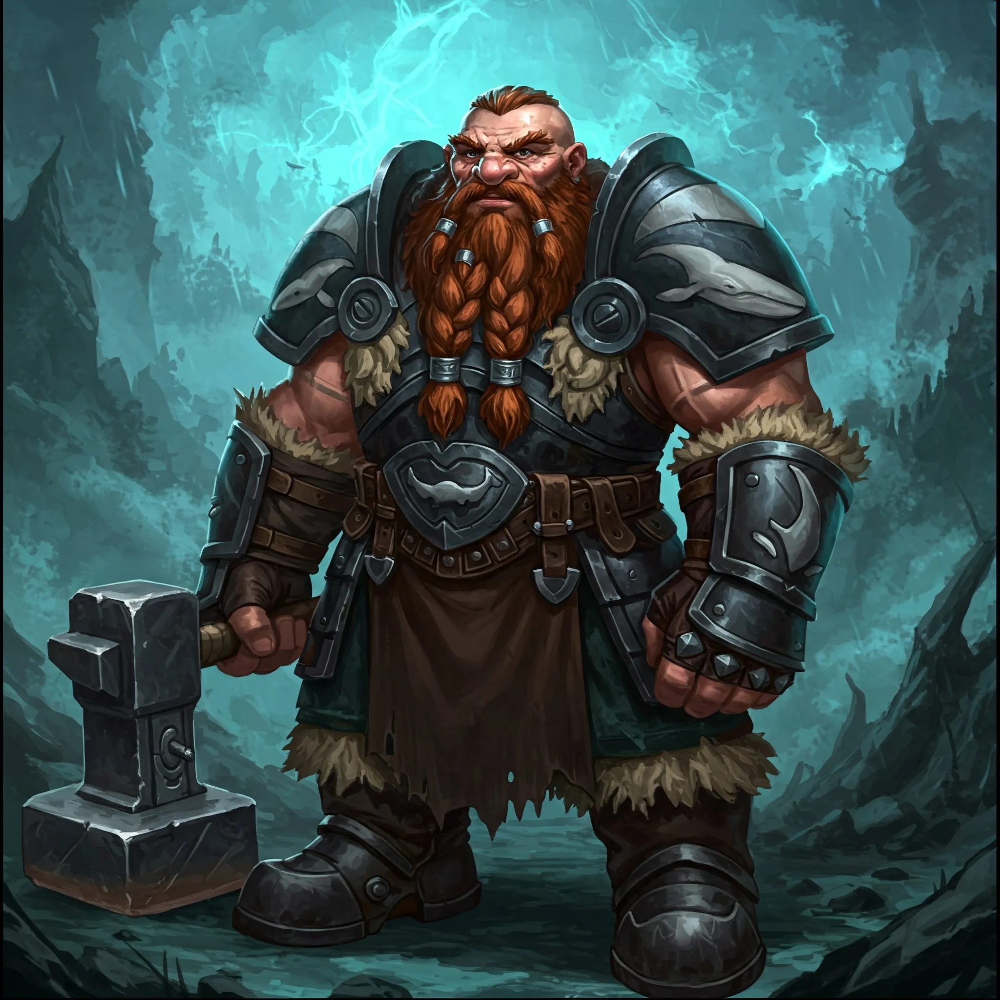

_Krasnoludzkie plemię z Wyspy Indygo, strażnicy Kopalni Żelaza; sojusznik bohaterów po wyzwoleniu spod okupacji Ventis._

## Opis
Plemię składające się z krasnoludów, zamieszkujące góry w głębi wyspy ([[Sesja 42 - Plemię Węgorza]]). Są wyśmienitymi kowalami i górnikami. Charakteryzują się wielką siłą fizyczną, uporem oraz głębokim szacunkiem do żelaza i pracy. <!-- UNSOURCED -->

## Cele
Wydobycie żelaza i ochrona [[Kopalnia Żelaza|Kopalni Żelaza]], jedynego źródła tego surowca w Thylei ([[Sesja 84 - Świt Nowej Ery]]).

## Siedziba
Ich domem są góry oraz tunele [[Kopalnia Żelaza|Kopalni Żelaza]] na [[Wyspa Indygo|Wyspie Indygo]]; po wojnie wciąż trzymają tam straż ([[Sesja 84 - Świt Nowej Ery]]).

## Członkowie
Krasnoludy.
*   **[[Delg]]**: Wódz plemienia ([[Sesja 43 - Kopalnia Żelaza]]).
*   **[[Brenna]]**: Córka wodza.
*   **[[Borinn Bystre Oko]]**: Znany górnik i przewodnik. <!-- UNSOURCED -->

## Relacje
*   **Sojusznicy**: [[Bohaterowie Przepowiedni]], [[Plemię Węgorza]], [[Plemię Delfina]]. <!-- UNSOURCED -->
*   **Dawni wrogowie**: [[Sydon]], [[Ventis]] (pokonana). <!-- UNSOURCED -->

## Historia
W [[Sesja 42 - Plemię Węgorza]] bohaterowie usłyszeli, że plemię Wieloryba od kilku tygodni milczy. W [[Sesja 43 - Kopalnia Żelaza]] okazało się, że smoczyca [[Ventis]] zajęła ich kopalnię żelaza, a wodza Delga zmusiła do posłuszeństwa, porywając jego córkę [[Brenna|Brennę]] jako zakładniczkę; w obozie plemienia widać było ślady walk i zniszczeń spowodowanych smoczym kwasem.

W [[Sesja 44 - Ventis]] bohaterowie uratowali Brennę i zabili Ventis, a plemię Wieloryba zawarło z nimi sojusz i zaoferowało pomoc w nadchodzącej wojnie z Tytanami. Otrzymało też część złota ze smoczego leża.

W [[Sesja 84 - Świt Nowej Ery]] plemię nadal trzymało straż nad jedyną Kopalnią Żelaza w Thylei.
