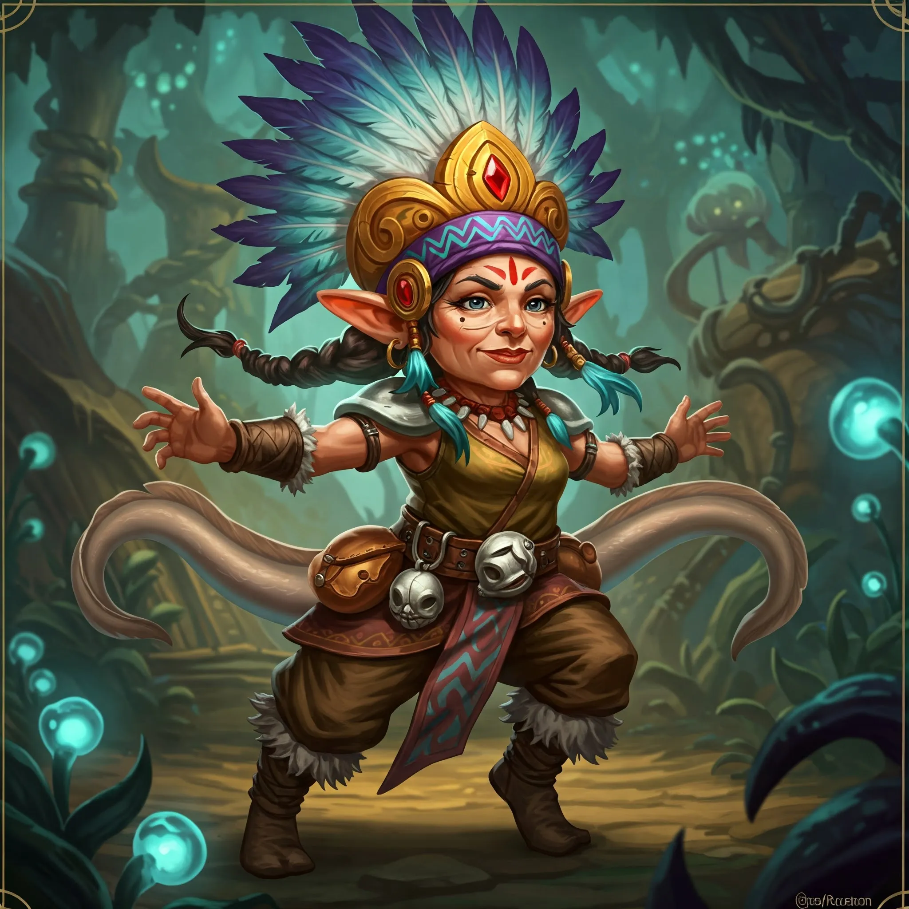

_Jedno z czterech plemion barbarzyńskich z Wyspy Indygo, znane z gościnności i otwartości — sojusznik Bohaterów Przepowiedni od czasu pokonania [[Ventis]]._

## Opis
Plemię Węgorza składa się z gnomów i niziołków, znanych z przyjaznego usposobienia ([[Sesja 42 - Plemię Węgorza]]). Ich strój jest barwny i nosi morskie akcenty — przywódczyni plemienia przypina do pasa wypchane ogony węgorzy.

Wyróżniają się na tle innych plemion przyjaznym nastawieniem do obcych oraz zamiłowaniem do handlu.

## Siedziba
Osada Węgorzy to tętniące życiem miasteczko przy plaży, rozlokowane nad wodą, na [[Wyspa Indygo|Wyspie Indygo]] ([[Sesja 42 - Plemię Węgorza]]).

## Członkowie
Większość członków to niziołki i gnomy.
*   **[[Loopywoopy]]**: Charyzmatyczna i mądra przywódczyni plemienia.

## Relacje
*   **Sojusznicy**: [[Bohaterowie Przepowiedni]], [[Plemię Delfina]], [[Plemię Wieloryba]] (sojusz zawarty w [[Sesja 44 - Ventis]]; [[Plemię Rekina]] do niego nie przystąpiło).
*   **Wrogowie**: [[Ventis]] (pokonana).

## Historia
W [[Sesja 42 - Plemię Węgorza]] Węgorze przyjęli gości gościnnie i wyprawili na ich cześć ucztę, podczas której [[Loopywoopy]] opowiedziała o sytuacji na wyspie. Pod koniec uczty nad osadą pojawiła się miedziana smoczyca [[Ventis]], siejąc panikę i przerażenie, i rozpoczęła się walka; smoczyca została przepędzona z osady ([[Sesja 43 - Kopalnia Żelaza]]).

Po pokonaniu Ventis bohaterowie obeszli plemiona wyspy. W [[Sesja 44 - Ventis]] Węgorze przyjęli ich z entuzjazmem i świętowali z nimi; zawarto sojusz, a [[Orestes]] siłował się na rękę z przywódczynią plemienia. Do współpracy nie dał się przekonać jedynie [[Plemię Rekina]].

Po pokonaniu [[Ventis]] plemię zawarło sojusz z bohaterami ([[Sesja 44 - Ventis]]).
