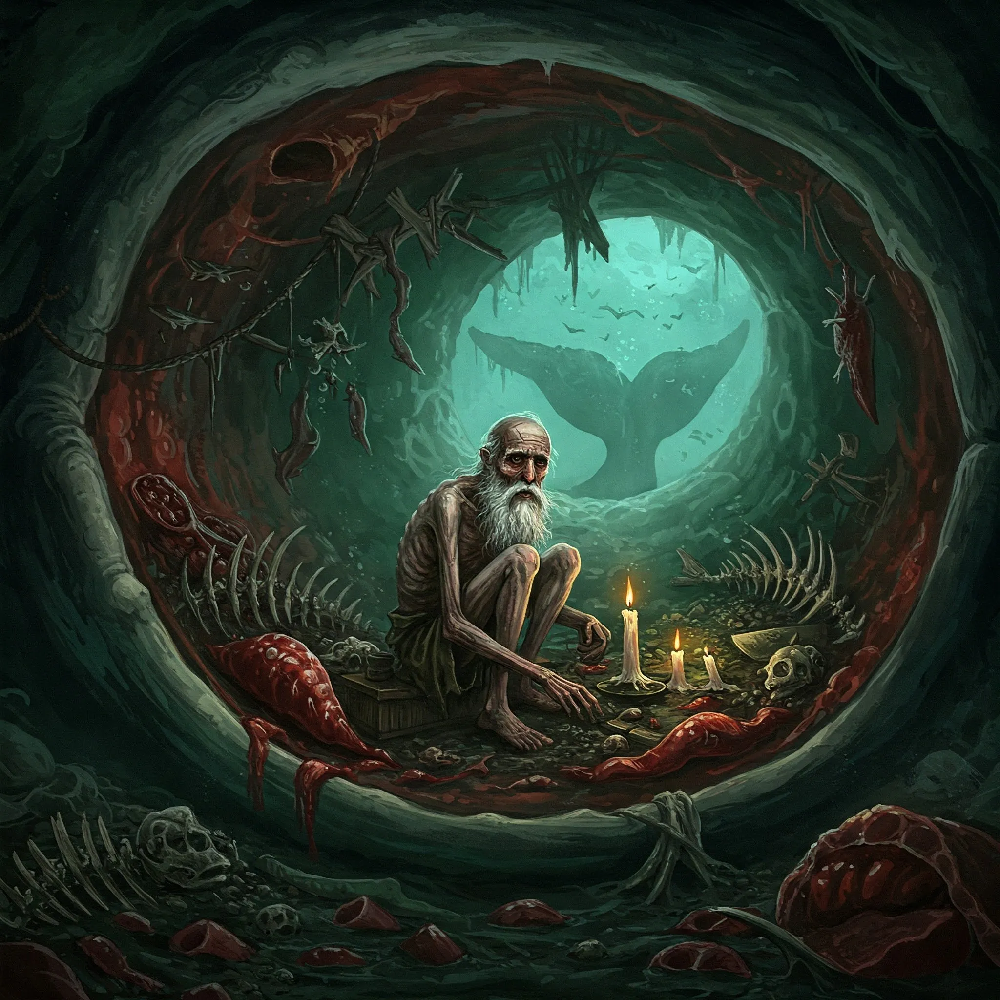

_Tajemniczy starzec znaleziony w brzuchu martwego wieloryba. Po [[Sesja 39 - Tajemnice Wyspy Złotego Serca]] jego dalsze losy pozostają nieznane._

## Opis
Dziwaczny starzec, niezwykle zwinny jak na swój wiek — wszedł na statek zwinnymi ruchami. Znaleziony wewnątrz gnijącego wieloryba.

## Osobowość
Opowiadał niestworzone historie o swoich wyczynach, takich jak walka z krakenem czy siłowanie się z [[Pythor|Pythorem]]. Twierdził, że mieszkał w żołądku wieloryba.

## Historia
Odkryty przez [[Orestes|Orestesa]] w ciele martwego wieloryba na Morzu Zapomnianym w [[Sesja 39 - Tajemnice Wyspy Złotego Serca]]. Wszedł na statek [[Ultros|Ultrosa]], uciekł i zamknął się w kajucie Orestesa, ale po krótkiej szarpaninie Orestes obezwładnił go i z pomocą załogi uwięził. Nazywany Aegis.
