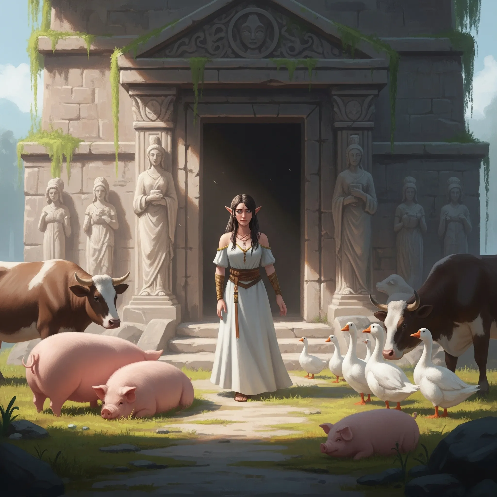

_Przeklęta kobieta, która mieszkała na Wyspie Forlorn, znana też jako Gęguza. Zabita w [[Sesja 49 - Wielkie Gęsie Powstanie]]._

## Opis
Początkowo jawiła się jako młoda, urodziwa kobieta o lekko skośnych uszach, co sugerowało półelfie pochodzenie, mieszkająca samotnie w świątyni na [[Wyspa Forlorn|Wyspie Forlorn]]. W rzeczywistości była potworem ukrytym za iluzją — jej „włosy" składały się z dziesiątek małych, gęgających gęsich głów, które rzucały czary, a ona sama ciskała przekleństwa na wrogów, w tym na [[Taran Neurdagon|Tarana]] i [[Lutheria|Lutherię]].

Była melancholijna i samotna; ostatnie wpisy w jej pamiętniku są chaotyczne i pełne rozpaczy.

## Historia
Althaia przybyła na [[Wyspa Forlorn]] z ojcem. Pokochała Kyrosa, syna miejscowego rolnika. Zafascynował się nią jednak [[Taran Neurdagon]], potomek Smoczych Lordów, i publicznie ogłosił, że zostanie ona jego żoną. Gdy odrzuciła jego zaloty, krzyknęła w gniewie, że wolałaby spędzić życie z jedną z gęsi Kyrosa niż z nim — i te słowa stały się, według jej pamiętnika, przyczyną jej nieszczęścia; najprawdopodobniej klątwę spowodował jednak mściwy Taran. Zmieniła się w potwora zamieniającego ludzi w zwierzęta.

W [[Sesja 49 - Wielkie Gęsie Powstanie]] Althaia powitała bohaterów jako samotna mieszkanka świątyni, twierdząc, że mieszkańcy opuścili wyspę blisko pięćdziesiąt lat temu, uciekając przed bestią z góry, a ona jedna została w towarzystwie zwierząt. [[Felicjan Janus Twardowski|Felicjan]] wykrył czarem wykrywania magii otaczającą ją iluzję. Bohaterowie, a także kapitan [[Nersus]] z załogą, zostali przemienieni w gęsi — według ich wyjaśnień klątwą Althai. Zjednoczeni z ludźmi Tarana, którzy zdjęli z niej iluzję, ukazując prawdziwą postać — Gęguzę — pokonali ją; Althaia padła martwa, a ludzie Tarana odcięli jej głowę. W jej świątyni znaleziono pamiętnik, złoty symbol [[Lutheria|Lutherii]] w drewnianym pudełku, portret młodej pary (prawdopodobnie jej rodziców), klucz do piwnicy i duże zasłonięte lustro.
