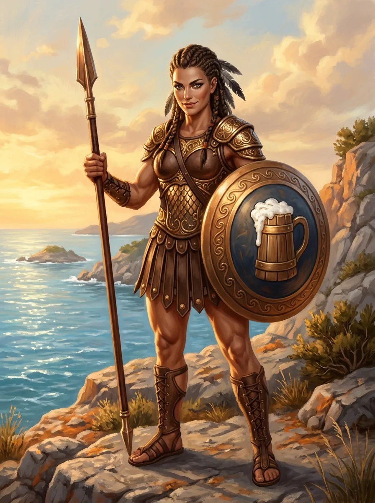

_[[Amazonki|Amazonka]], matka [[Zythion|Zythiona]], syna [[Orestes|Orestesa]]; prowadzi [[Super Bar]] na [[Themis]]._

## Opis
Wysportowana wojowniczka o długich ciemnych warkoczach przetykanych piórami, w brązowym pancerzu, z włócznią i okrągłą tarczą. Na tarczy wymalowany jest pienisty kufel piwa.

## Historia
Z [[Orestes|Orestesem]] zeszła się podczas walk o [[Mytros]], gdy minotaur pomagał [[Amazonki|Amazonkom]]; owocem tego związku jest ich nieślubny syn [[Zythion]]. Po wykarmieniu syna wróciła na [[Themis]], gdzie prowadzi tamtejszy [[Super Bar]], a chłopca wychowuje Orestes w browarze w [[Orestessos Zythikē]]. Z Orestesem utrzymuje przyjazny kontakt listowny ([[Sesja 85 - Cienie nad Arezją]]).
