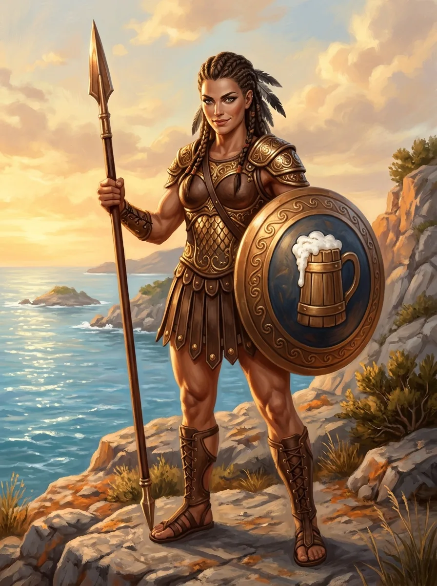

_[[Amazonki|Amazonka]], matka [[Zythion|Zythiona]], syna [[Orestes|Orestesa]]._

## Opis
Wysportowana wojowniczka o długich ciemnych warkoczach przetykanych piórami, w brązowym pancerzu, z włócznią i okrągłą tarczą. Na tarczy wymalowany jest pienisty kufel piwa.

## Historia
Po wojnie z [[Tytani|Tytanami]] wdała się w romans z [[Orestes|Orestesem]]; owocem tego związku jest ich nieślubny syn [[Zythion]]. Nie zamieszkała w mieście — jak to Amazonka, poszła swoją drogą — więc chłopca wychowuje sam Orestes, w browarze w [[Orestessos Zythikē]].
