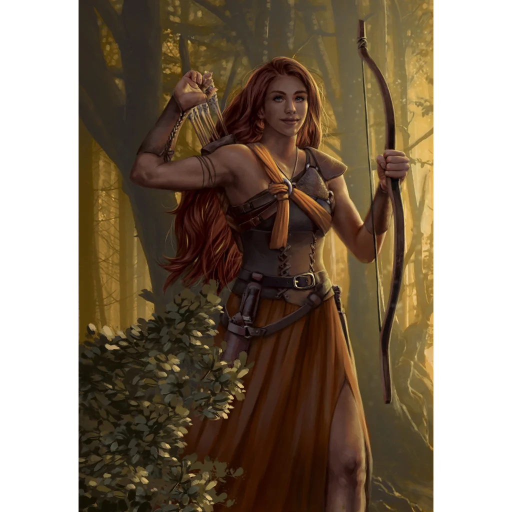

_Młoda córka [[Hippolyta|Hippolyty]]._

## Opis
Córka [[Hippolyta|Hippolyty]], przywódczyni plemienia Lwicy ([[Sesja 36 - Królowa, Dziedzic i Generał]]).

Młoda Amazonka.

## Historia
Spotkana w [[Sesja 36 - Królowa, Dziedzic i Generał]] przed pałacem Amazonek: poinformowała drużynę o trwających wewnątrz walkach.
