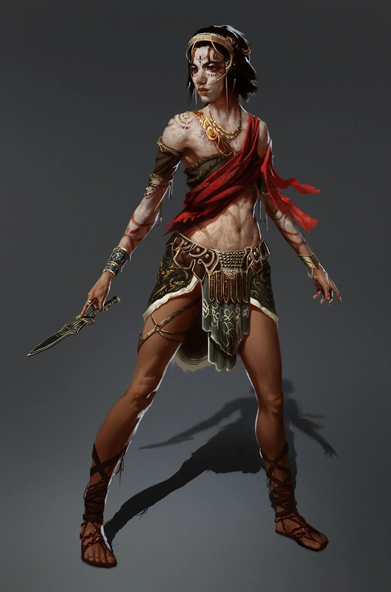

_Prawowita dziedziczka tronu Amazonek, więziona przez lata w Kłach. Królowa [[Themis]] po rewolucji — poległa w obronie [[Mytros]]._

## Opis
Długotrwale więziona, osłabiona psychicznie i fizycznie ([[Sesja 32 - Kieł]]): po uwolnieniu była w stanie wypowiadać tylko pojedyncze słowa i niezgrabnie się poruszała.

Przez 13 lat była zamknięta w celi zaklętej czarem *Silence*, przez co nie mogła mówić. <!-- UNSOURCED -->

## Osobowość
*   **Pełna ducha:** Mimo uwięzienia, pragnie przygód i zemsty. <!-- UNSOURCED -->
*   **Nieśmiała:** Ma braki w umiejętnościach społecznych. Czuje się niezręcznie. <!-- UNSOURCED -->

Zniszczona przez lata niewoli, miała problemy z komunikacją, ale powoli odzyskiwała siły i sprawczość jako władczyni. <!-- UNSOURCED -->

## Historia
Darien jest córką prawdziwej królowej Amazonek, [[Thessilea|Thessilei]], która została zamordowana kilkanaście lat temu podczas przewrotu dokonanego przez jej doradczynie (siostry): [[Moxena|Moxenę]], [[Leah|Leę]] i [[Nastura|Nasturę]], które zmieniły się w meduzy. Podczas gdy Nastura przybrała postać zmarłej królowej i przejęła jej imię, Darien została wtrącona do lochów w fortecy [[Więzienie Kieł|Kieł]] — dawnej twierdzy Smoczych Lordów. Matka wymusiła na zabójczyniach przysięgę, że nie skrzywdzą Darien aż do jej pełnoletności. <!-- UNSOURCED -->

W [[Sesja 31 - Wyprawa na Themis]] bohaterowie dowiedzieli się, że amazonki przetrzymują księżniczkę Darien. W [[Sesja 32 - Kieł]] drużyna uwolniła ją z więzienia Kieł — jej cela znajdowała się obok narzędzi tortur — a w [[Sesja 33 - W Szponach Bazyliszków]] została ona bezpiecznie odstawiona na [[Ultros|Ultrosa]] jako dziedziczka tronu. W więzieniu spędziła około trzynastu lat ([[Sesja 33 - W Szponach Bazyliszków]]).

Po udanej rewolucji w [[Sesja 36 - Królowa, Dziedzic i Generał]], wspieranej przez skruszoną Moxenę i bohaterów, zasiadła na tronie jako prawowita spadkobierczyni, a Nastura — uzurpatorka — została pokonana. Wygłosiła w sali tronowej płomienne przemówienie i ogłosiła liczne reformy mające na celu uzdrowienie społeczeństwa [[Themis]].

## Reformy
Przemówienie tronowe wygłoszone tuż po rewolucji ([[Sesja 36 - Królowa, Dziedzic i Generał]]) zerwało z fundamentami dotychczasowego porządku:

*   **Zniesienie niewolnictwa mężczyzn** na [[Themis]].
*   **Wygnanie zamiast zabijania** dorosłych synów rodzonych przez Amazonki.
*   **Odbudowa relacji z barbarzyńskimi plemionami** z [[Wyspa Indygo|Wyspy Indygo]].
*   **Deklaracja udziału Amazonek w wojnie z Tytanami** po stronie [[Mytros]].

Na swoją doradczynię przyjęła [[Moxena|Moxenę]] — meduzę, która zamordowała jej matkę i pilnowała jej celi — zwolnioną z przysięgi wobec bohaterów za ich zgodą ([[Sesja 36 - Królowa, Dziedzic i Generał]]).

## Śmierć
Darien dotrzymała słowa danego w sali tronowej. Gdy [[Sydon]] uderzył na [[Mytros]], Amazonki przypłynęły na wojnę, a Darien i [[Hippolyta]] objęły dowodzenie nad swoimi siłami; Amazonki obroniły się przy Dokach ([[Sesja 76 - Bitwa o Mytros: Pierwsza Fala]]).

W [[Sesja 83 - Zmierzch Ery Tytanów]] Darien, prawowita królowa Amazonek, która przypłynęła ze swoimi Lwicami bronić cudzego miasta, poległa na płonącym nabrzeżu doków, prowadząc łuczniczki, jeszcze zanim zapadł zmierzch pierwszego i jedynego dnia tej wojny. Panowała ledwie kilka miesięcy.

Po jej śmierci tron [[Themis]] pozostał pusty na długie lata; największą częścią wyspy zarządzała jako regentka [[Hippolyta]], twardo stojąc na straży dziedzictwa poprzedniczki, a mniejsza frakcja kwestionowała reformy wprowadzone przez Darien, nie zdobywając jednak znaczącej przewagi ([[Sesja 84 - Świt Nowej Ery]]).
