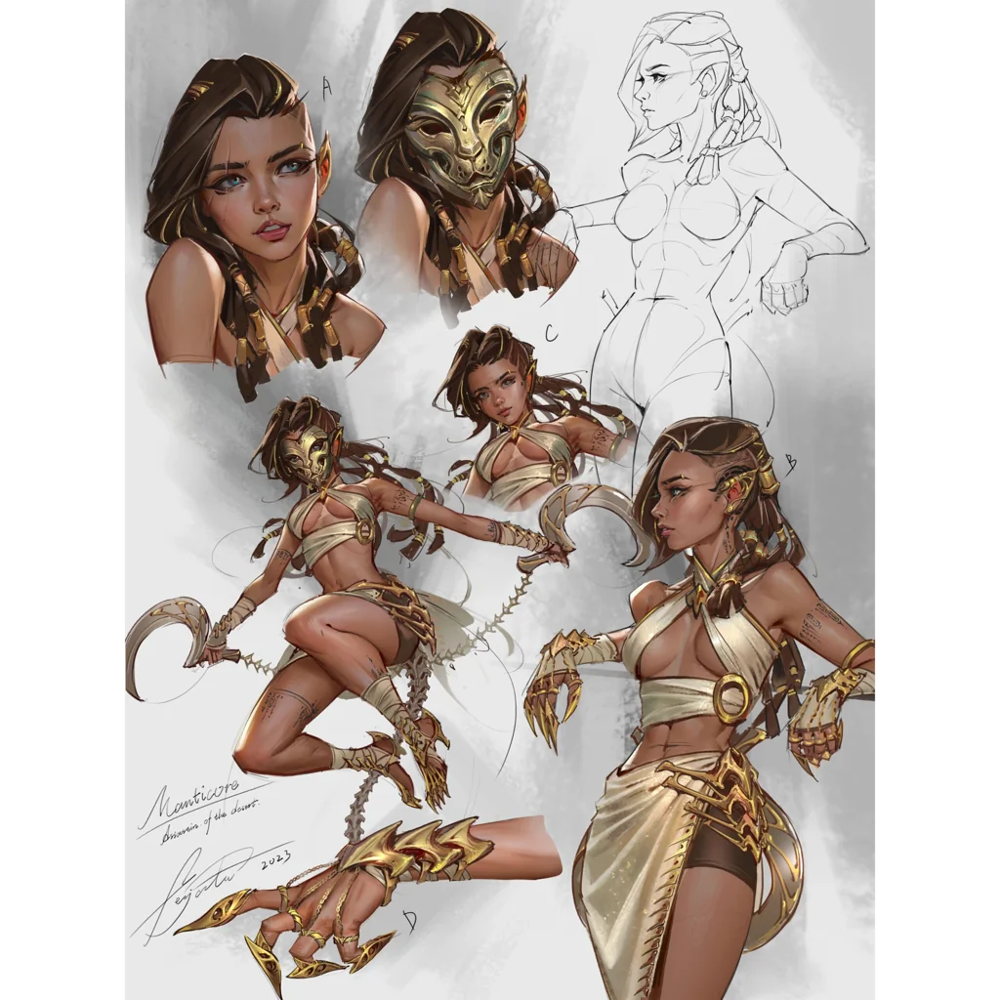

_Amazonka z plemienia Lwicy._

## Opis
Amazonka z plemienia Lwicy, która poprowadziła drużynę do ukrytego obozu ([[Sesja 34 - Ivello i Drapaczka do Pleców]]).

Lojalna, znająca doskonale ścieżki prowadzące do obozu. Skuteczna i małomówna wojowniczka, profesjonalnie podchodząca do zadań zwiadowcy i przewodniczki.

## Historia
W [[Sesja 34 - Ivello i Drapaczka do Pleców]] spotkała drużynę na wschodzie wyspy i zaprowadziła ją do [[Obóz Lwicy|obozu plemienia Lwicy]]. W [[Sesja 36 - Królowa, Dziedzic i Generał]] wyszła z pałacu razem z [[Hippolyta|Hippolytą]] i [[Darien]] po rewolucji.
