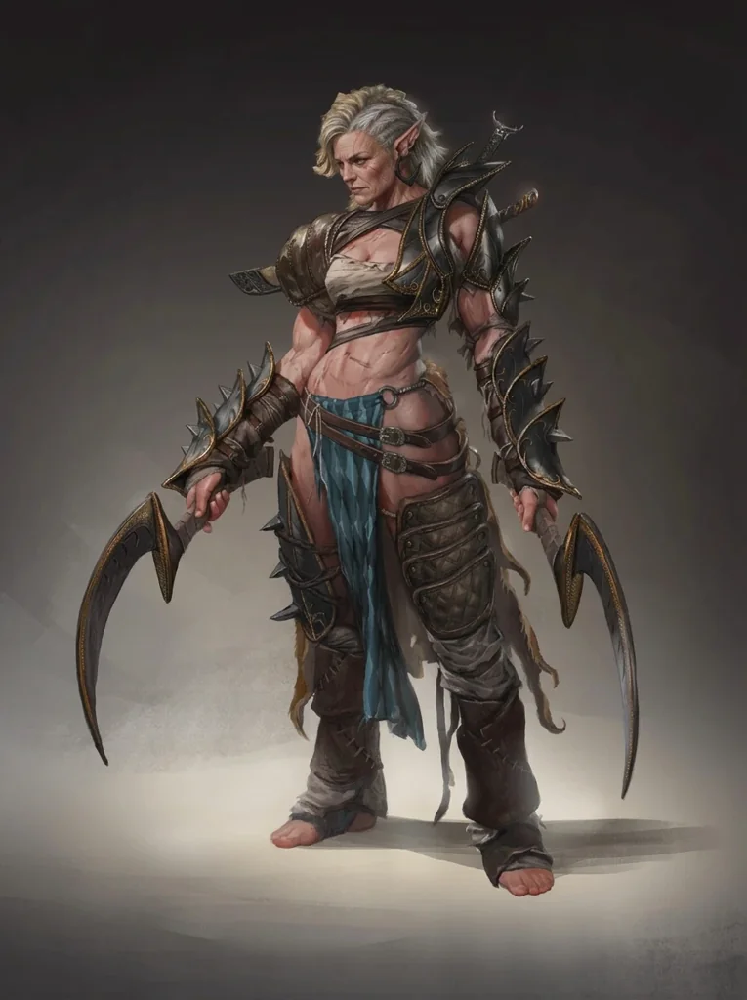

_Przywódczyni plemienia Lwicy, po śmierci [[Darien]] regentka [[Themis]]._

## Opis
Przywódczyni plemienia Lwicy — odłamu Amazonek sprzeciwiającego się rządom uzurpatorki [[Nastura|Nastury]] ([[Sesja 34 - Ivello i Drapaczka do Pleców]], [[Sesja 36 - Królowa, Dziedzic i Generał]]). Po śmierci [[Darien]] zarządzała jako regentka największą częścią [[Themis]], choć sama nie paliła się do zasiadania na tronie, który pozostał pusty na długie lata ([[Sesja 84 - Świt Nowej Ery]]).

Przywódczyni plemienia Lwicy.

## Osobowość
Początkowo nieufna wobec drużyny ([[Sesja 32 - Kieł]]), ale po udowodnieniu jej intencji stała się lojalną sojuszniczką.

Nieufna wobec mężczyzn z drużyny ze względu na prawo wyspy.

## Historia
Wzmiankowana w [[Sesja 31 - Wyprawa na Themis]].

W [[Sesja 32 - Kieł]] wystąpiła jako wysłanniczka plemienia Lwicy; zgodziła się pomóc drużynie w infiltracji więzienia [[Więzienie Kieł|Kieł]], gdy dowiedziała się o uwięzionej księżniczce [[Darien]]. W [[Sesja 34 - Ivello i Drapaczka do Pleców]] poinformowała bohaterów o sytuacji w pałacu i poprosiła o pomoc w obaleniu fałszywej królowej — Amazonki same musiały ją zdetronizować, ale przydałaby się dywersja; poprosiła też, by to bohaterowie zwrócili się do [[Yala|Yali]].

W [[Sesja 36 - Królowa, Dziedzic i Generał]] wyszła z pałacu z [[Darien]] po rewolucji, podziękowała drużynie za pomoc i zaprosiła ją na posiłek; jej córką jest [[Antiope]].

W [[Sesja 76 - Bitwa o Mytros: Pierwsza Fala]] wraz z [[Darien]] dowodziła Amazonkami w obronie [[Mytros]]; Amazonki obroniły się przy Dokach. Po śmierci Darien w [[Sesja 83 - Zmierzch Ery Tytanów]] została regentką [[Themis]]: wyspa podzieliła się na dwie frakcje — większą, wierną regentce, i mniejszą, kwestionującą reformy Darien, która nigdy nie zdobyła znaczącej przewagi, bo Hippolyta twardo stała na straży dziedzictwa poprzedniczki ([[Sesja 84 - Świt Nowej Ery]]).
