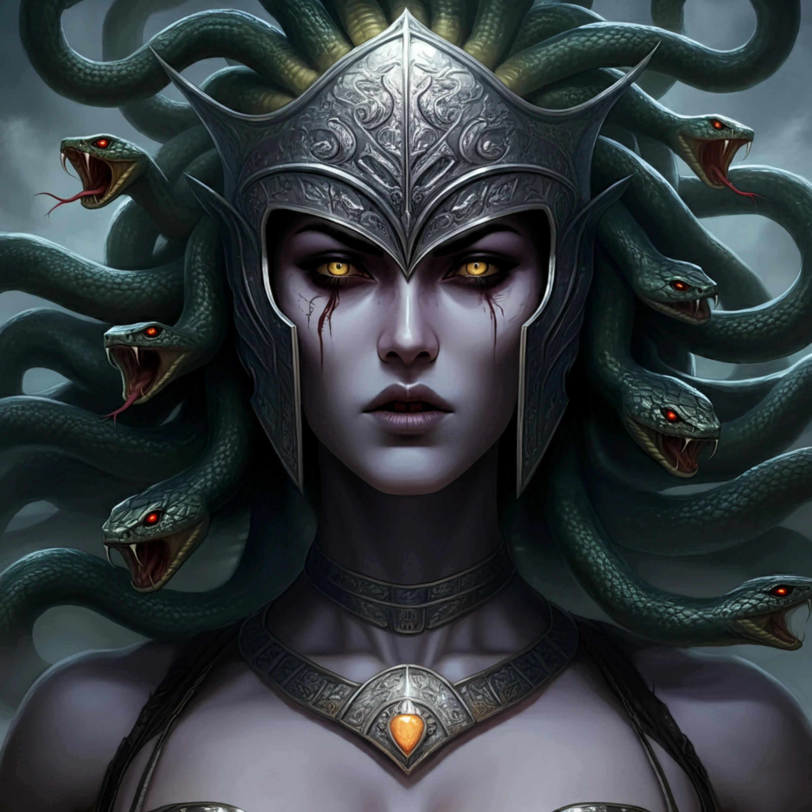

_Siostra Moxeny, Meduza i Amazonka — zabita w [[Sesja 36 - Królowa, Dziedzic i Generał]]._

## Opis
Siostra [[Moxena|Moxeny]] o zdolnościach petryfikujących, potrafiąca przemienić się w przerażającą meduzę ([[Sesja 35 - W Wężowym Uścisku]]). Jedna z sióstr Meduz, które zinfiltrowały Amazonki.

## Historia
Kilkanaście lat temu, wraz z [[Moxena|Moxeną]] i [[Nastura|Nasturą]], brała udział w zamordowaniu prawdziwej królowej Amazonek, [[Thessilea|Thessilei]], i przejęciu władzy na [[Themis]]. Nastura przejęła postać zabitej królowej i jej imię, a jej córkę i dziedziczkę, [[Darien]], uwięziono w Kłach.

W [[Sesja 33 - W Szponach Bazyliszków]] wzmiankowana jako siostra Moxeny, która opuściła fortecę Kieł, zanim dotarła tam drużyna; bohaterowie się z nią minęli.

W [[Sesja 35 - W Wężowym Uścisku]] poprowadziła grupę Amazonek z nosorożcami i bazyliszkami, która wyszła z pałacu, przeciwko drużynie w obronie uzurpacji. Atakiem powaliła nieprzytomnego [[Orion Xul|Oriona]], a sama została pokonana przez drużynę (cios [[Felicjan Janus Twardowski|Felicjana]]).

W [[Sesja 36 - Królowa, Dziedzic i Generał]] zginęła: [[Orestes]] za przyzwoleniem [[Moxena|Moxeny]] odciął jej głowę, by wykorzystać ją w tarczy [[Orion Xul|Oriona]]; głowa Meduzy trafiła do worka jako makabryczne trofeum.

W [[Sesja 69 - Ogród Lutherii]] Meduza Leah wróciła jako dawny wróg i walczyła na arenie w ostatniej fali przeciwników bohaterów.
