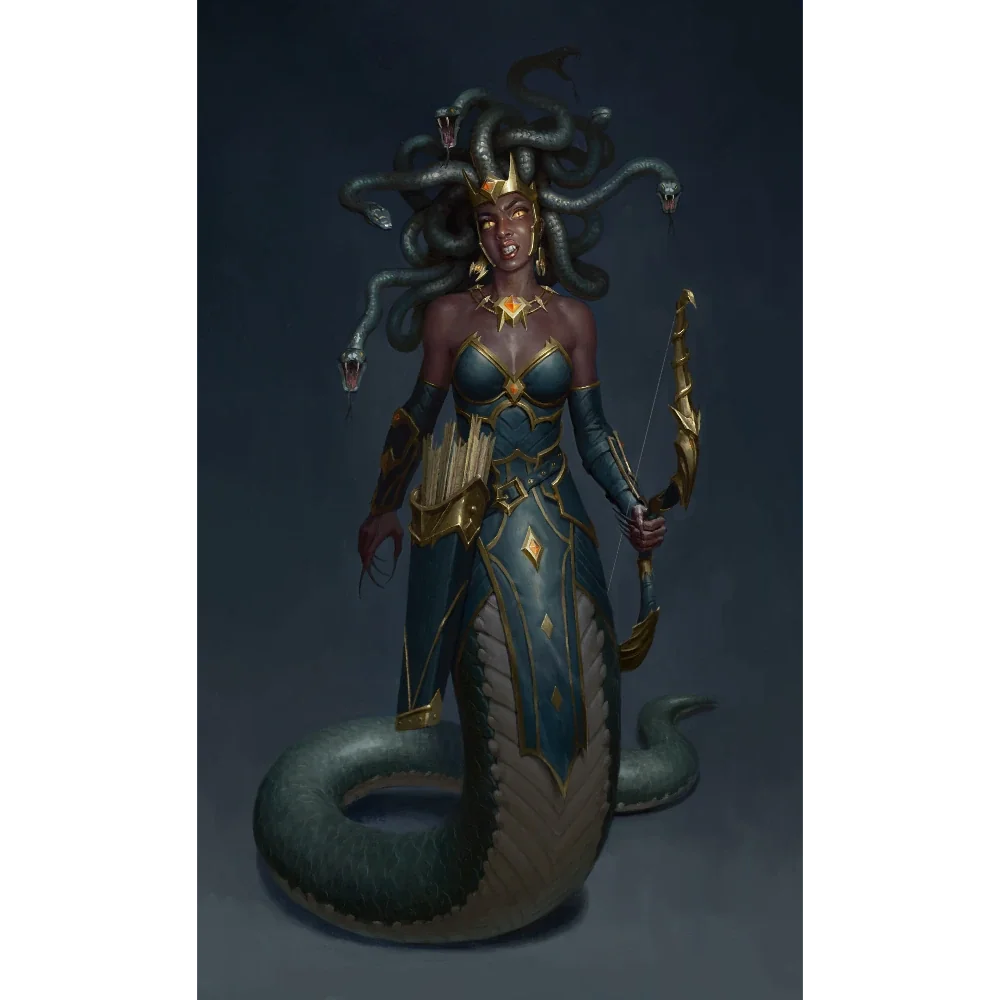

_Uzurpatorka tronu Amazonek na Themis, Meduza posługująca się imieniem i wizerunkiem [[Thessilea|Thessilei]]. Pokonana podczas rewolucji Amazonek w [[Sesja 36 - Królowa, Dziedzic i Generał]]._

## Opis
Fałszywa królowa Amazonek, nazywana Meduzą ([[Sesja 36 - Królowa, Dziedzic i Generał]]).

Przez lata udawała królową [[Thessilea|Thessileę]], utrzymując władzę dzięki podstępowi i magii.

## Historia
Kilkanaście lat temu, wspólnie z [[Moxena|Moxeną]] i [[Leah|Leą]], dokonała krwawego przewrotu, podczas którego zamordowała prawdziwą królową, [[Thessilea|Thessileę]]. Nastura zajęła jej miejsce, posługując się jej imieniem, natomiast córkę królowej, [[Darien]], kazała uwięzić w fortecy [[Więzienie Kieł|Kieł]].

W [[Sesja 36 - Królowa, Dziedzic i Generał]] w czasie rewolucji Amazonek wspieranej przez drużynę i skruszoną Moxenę uzurpatorka poniosła klęskę, a władzę objęła [[Darien]].

Zginęła podczas rewolucji.
