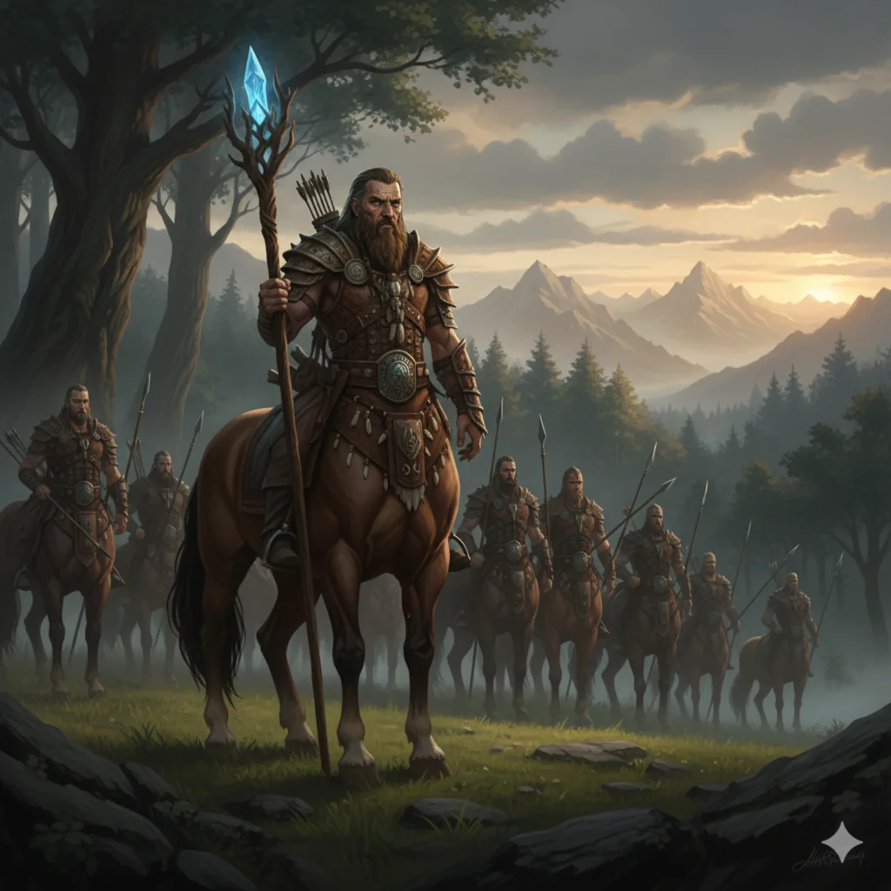

_Król druidów centaurów, który podobno posiada sekret idealnej oliwki._

## Opis
Agrius jest królem druidów [[Centaur z Thylei|centaurów]]. Według plotek posiada nasiona perfekcyjnego drzewa oliwnego i sekret uprawy idealnej oliwki.

## Historia
- [[Sesja 62 - Arezyjska Dyplomacja]]: w [[Arezja|Arezji]] bohaterowie dowiedzieli się od sprzedawcy oliwek, że sekret „idealnej oliwki”, której poszukuje Mistrz [[Laertes]], posiadają druidzi centaurów pod wodzą króla Agriusa. Sprzedawca nie miał takich nasion, ale oferował prawie idealne oliwki.
- [[Sesja 63 - Werdykt Arezji]]: akolici w [[Świątynia Spokoju|Świątyni Spokoju]] narzekali, że ich zadaniem jest znalezienie „idealnej oliwki” dla swojego mistrza, [[Laertes|Laertesa]].
