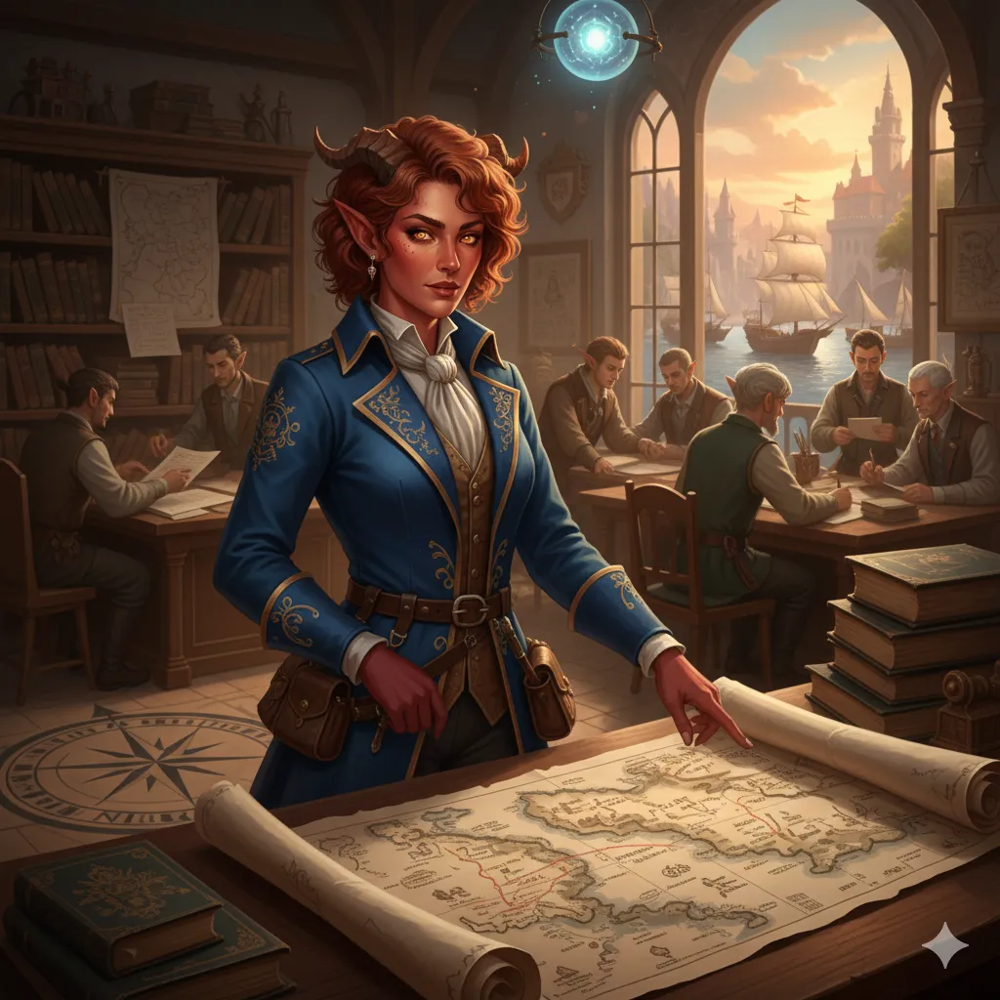

_Szefowa Koalicji Kupców w Arezji, wpływowa i konkretna bizneswoman._

## Opis
Wpływowa tiefling, szefowa Koalicji Kupców, mówiąca z mytrosjańskim akcentem ([[Sesja 62 - Arezyjska Dyplomacja]]).

## Osobowość
Konkretna i rzeczowa ([[Sesja 62 - Arezyjska Dyplomacja]]).

Skupiona na interesach; dba o stabilność handlu między Arezją a Mytros mimo wojen. Obsesyjnie poszukuje zaginionego Królestwa Syren. <!-- UNSOURCED -->

## Historia
W [[Sesja 62 - Arezyjska Dyplomacja]] na czele komitetu powitała bohaterów na nabrzeżu w porcie rzecznym. [[Orestes]] próbował nawiązać z nią relacje handlowe, promując piwo ze swojego rodzinnego browaru, co spotkało się ze szczerym zainteresowaniem.
