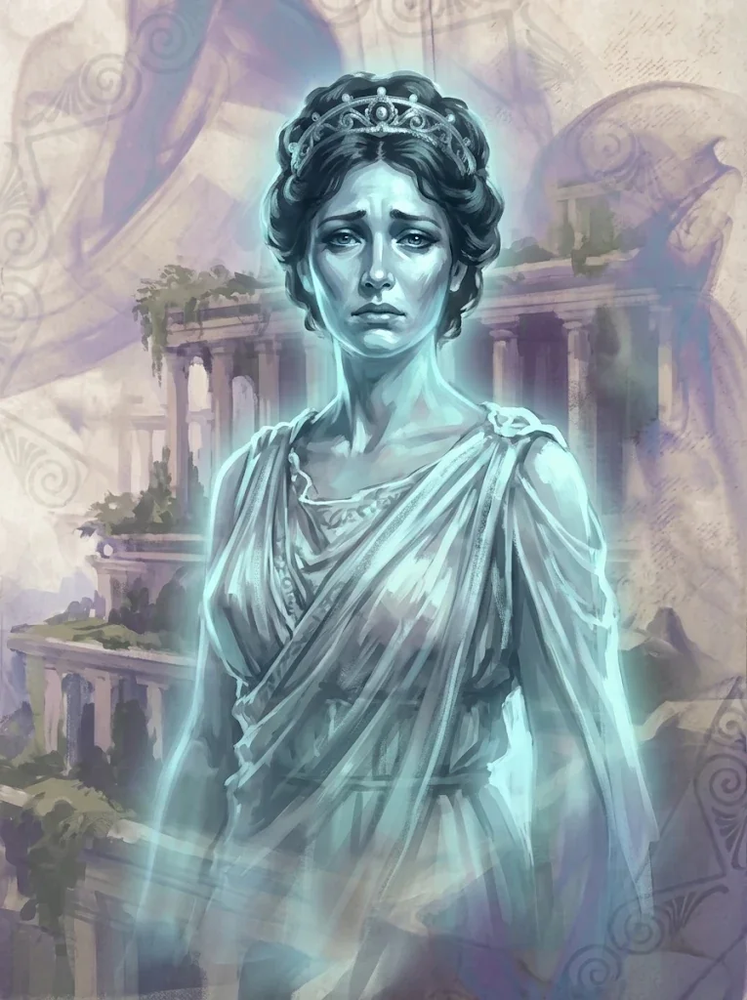

_Królowa Arezji, córka [[Karpathos|Karpathosa]], która zapieczętowała ojca w [[Kurhany Karpathosa|kurhanach]]._

Jedna z królowych [[Arezja|Arezji]], darzona szacunkiem przez autorkę [[Xanderiada|Xanderiady]] za swą odwagę i wolę.

## Historia
Kiedy klątwa lub szaleństwo dotknęło jej rodzinę (potomków [[Karpathos|Karpathosa]]), Calliope wykazała się niezwykłą siłą woli. Zamknęła swoją "przeklętą rodzinę" w grobowcach, aby ocalić swoje miasto i kontrolować Boga Piękna, [[Narsus|Narsusa]]. Mimo że mieszkańcy [[Mytros]] gardzą imionami królowych Arezji, Calliope zapisała się w historii jako ta, która poświęciła swoich bliskich dla wyższego dobra.

W [[Sesja 86 - Trzy Klucze Teogenezy]] [[Królowa Helena]] opowiedziała, że gdy [[Lutheria]] przeklęła Karpathosa wampiryzmem, a on zaczął przemieniać rodzinę i strażników w swoje sługi, Calliope zwabiła ojca do [[Kurhany Karpathosa|kurhanów]] i zapieczętowała jedyne wejście magicznymi runami.
