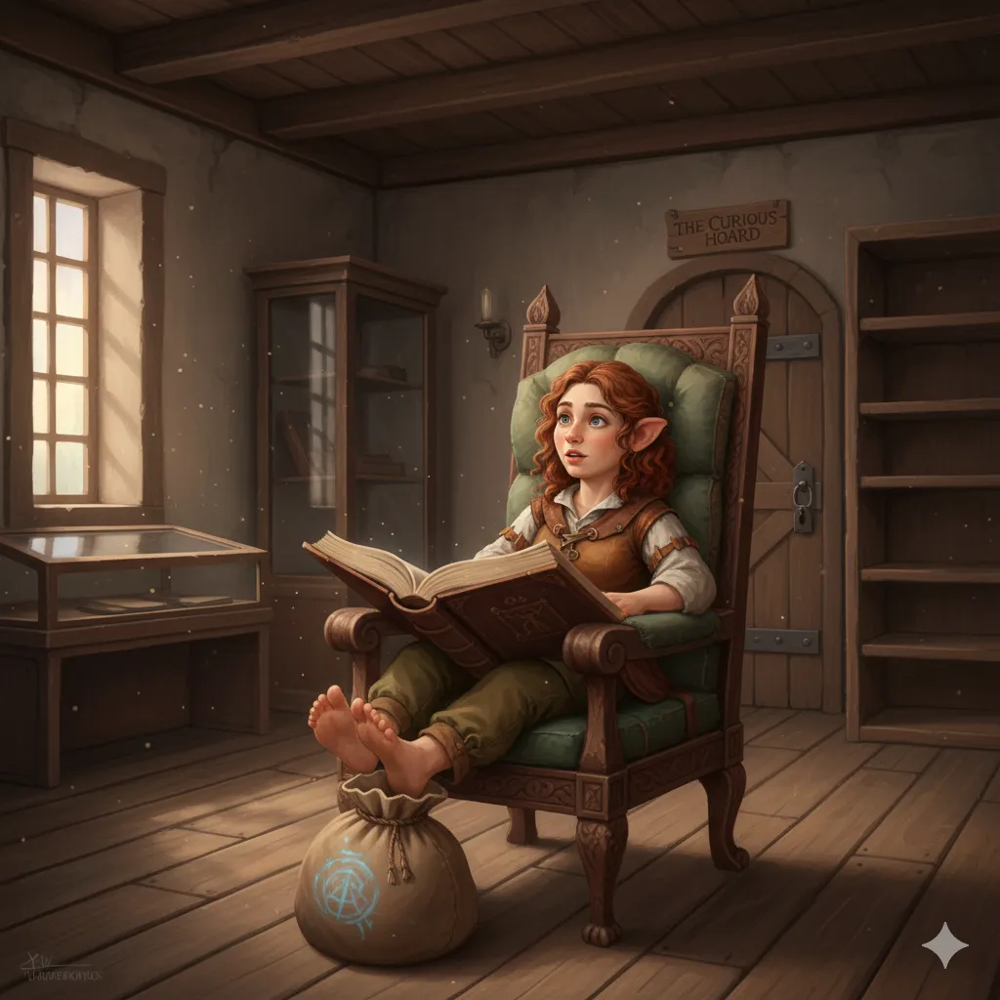

_Niziołka prowadząca sklep z magicznymi osobliwościami w Arezji._

## Opis
Niziołka prowadząca sklep z magicznymi przedmiotami w Arezji ([[Sesja 62 - Arezyjska Dyplomacja]]).

Drobna, absolwentka Akademii w Mytros. Przybyła do Arezji zwabiona legendami o pięknie Narsusa.

## Osobowość
Entuzjastyczna, ale pragmatyczna.

## Historia
W [[Sesja 62 - Arezyjska Dyplomacja]] bohaterowie wpadli w szał zakupów i wykupili większość asortymentu jej sklepu. Zachwycona Haidee natychmiast zamknęła sklep i udała się na długie wakacje, wracając dopiero za miesiąc ([[Sesja 63 - Werdykt Arezji]]).
