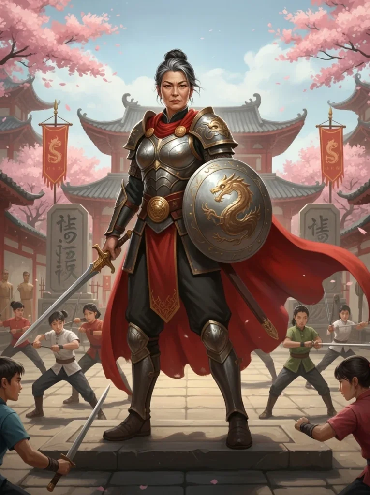
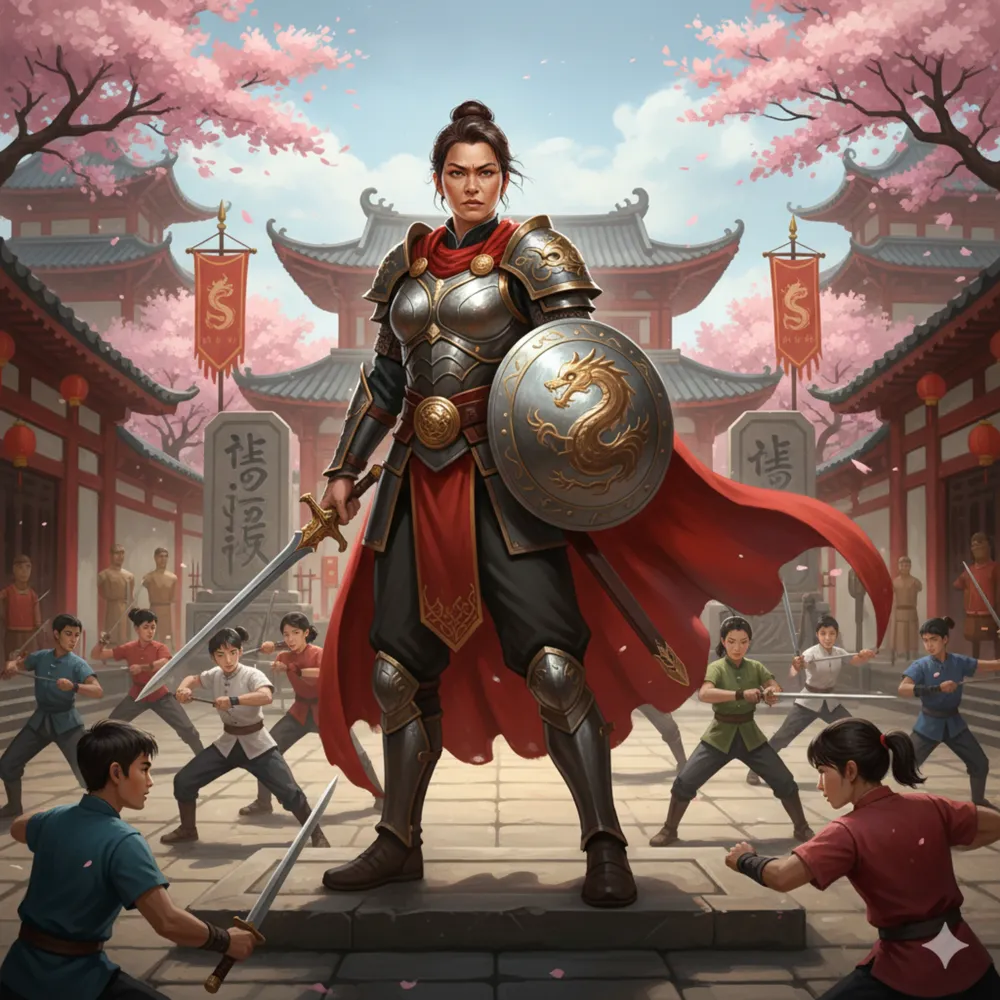

|  |  |
|:---:|:---:|
| Piętnaście lat po wojnie | W czasie wojny |

_Wielka Mistrzyni Tarczy w Arezji, pani Świątyni Tarczy i jedna z pięciu Wielkich Mistrzów Arezji._

## Opis
Mistrzyni Tarczy, pani [[Świątynia Tarczy|Świątyni Tarczy]] w Arezji, wśród ćwiczących hoplitów w czerwonych płaszczach ([[Sesja 62 - Arezyjska Dyplomacja]]).

Kobieta u szczytu sił fizycznych. Jej postawa emanuje siłą i dyscypliną; nosi symbol Mistrzyni Tarczy i jest zawsze gotowa do walki.

## Osobowość
Hiper-kompetytywna i surowa. Oczekuje absolutnej perfekcji. Wychowała wielu synów i córki na elitarnych wojowników, często kosztem ciepłych relacji rodzinnych. Jest dumna, ale honorowa.

## Historia
Halcyon zdobyła tytuł Wielkiej Mistrzyni pokonując wielu rywali. Jej świątynia dominuje w turniejach od lat. Jej wojownicy strzegą komnaty Narsusa pod wzgórzem świątynnym.

W [[Sesja 62 - Arezyjska Dyplomacja]] [[Versir]] rzucił wyzwanie, proponując próby siły; Halcyon wystawiła swojego czempiona, [[Keteus|Keteusa]], do walki zapaśniczej z [[Orestes|Orestesem]]. Gdy Orestes powalił przeciwnika i cisnął nim pod jej nogi, Halcyon, widząc siłę i honor bohaterów, obiecała zwrócić się do królowej w ich imieniu i poparła ich sprawę.

W [[Sesja 63 - Werdykt Arezji]] na Radzie u [[Królowa Helena|Królowej Heleny]] głosowała za uderzeniem wyprzedzającym na armię centaurów, pragnąc walki — tak samo jak [[Taureus]].

W [[Sesja 85 - Cienie nad Arezją]] towarzyszyła [[Królowa Helena|Królowej Helenie]] przy posiłku z bohaterami w [[Pałac Królewski w Arezji|pałacu]]. Helena umówiła drużynę z [[Narsus|Narsusem]] pod jej świątynią.
