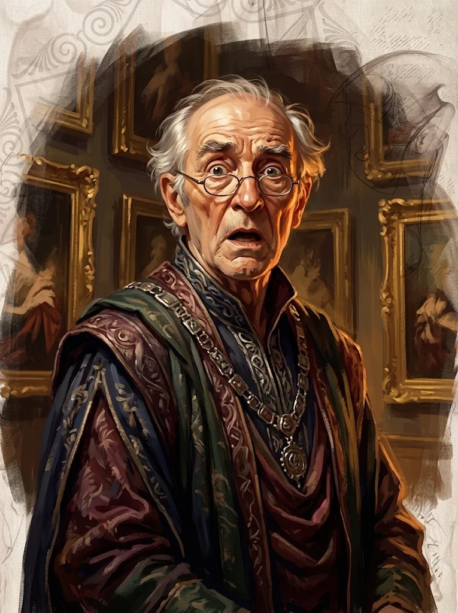

_Kustosz Galerii Sztuki w Arezji._

## Historia
W [[Sesja 63 - Werdykt Arezji]] bohaterowie, obawiając się pozostawić w galerii [[Portret Karpathosa]] — filakterium z uwięzioną esencją potężnego nieumarłego — zaoferowali oszołomionemu kustoszowi Haliusowi 50 000 sztuk złota. Transakcja została dobita, a obraz miał zostać dostarczony na statek pod osłoną nocy.
