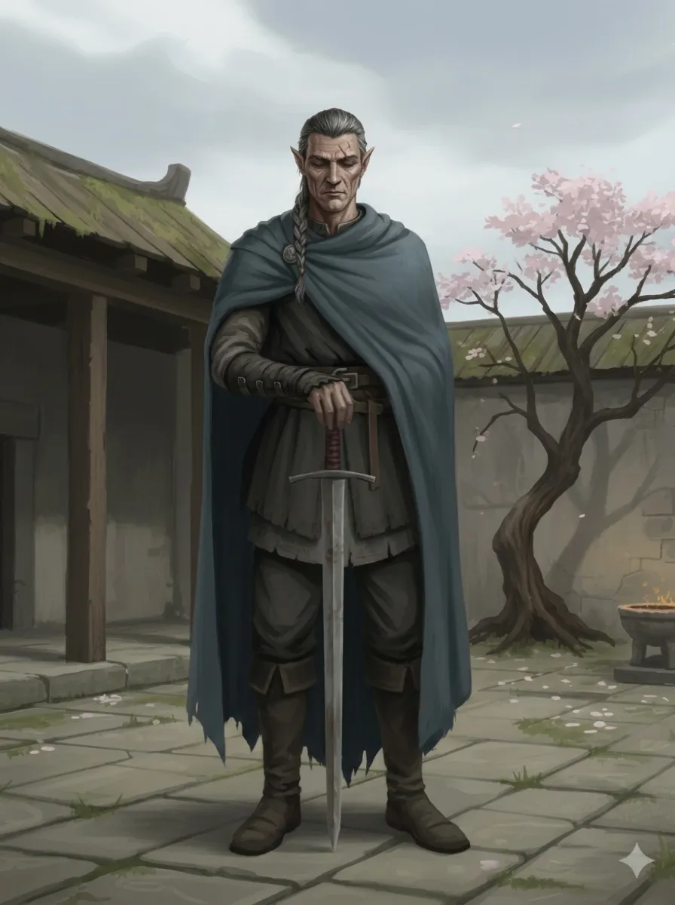
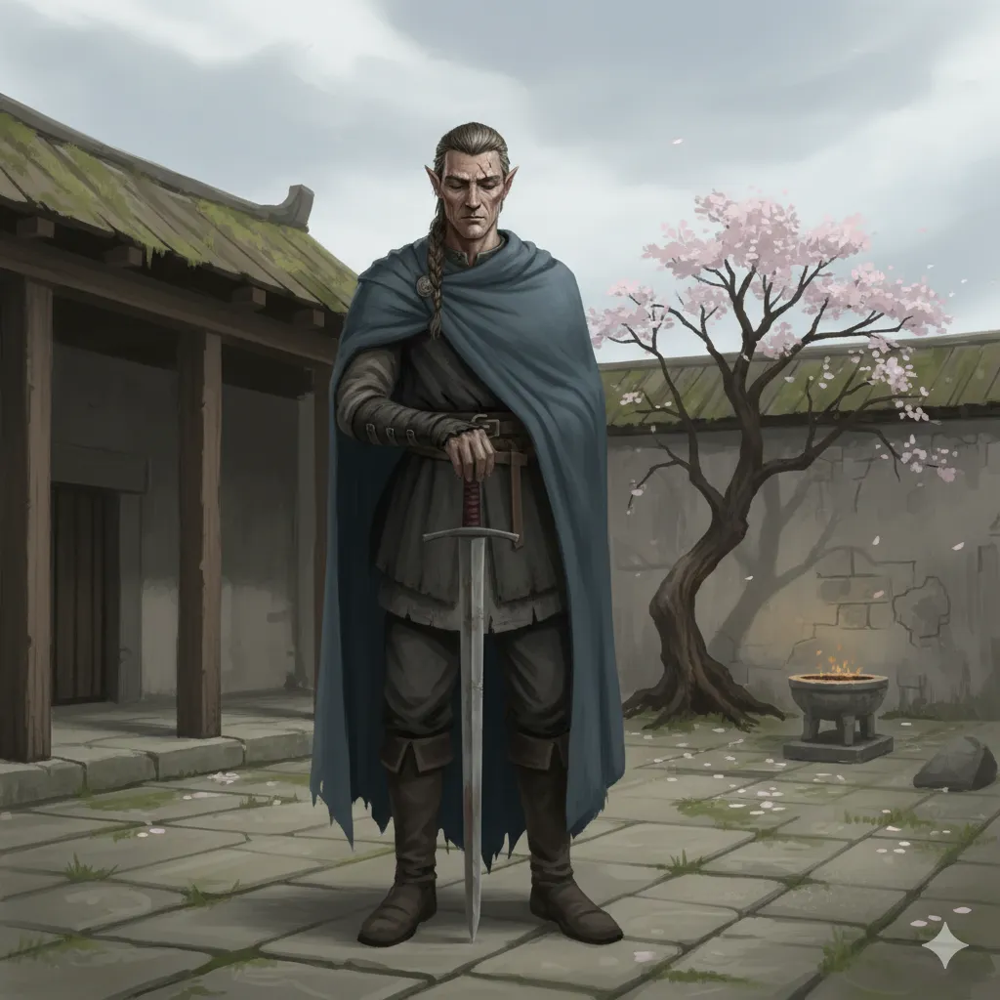

|  |  |
|:---:|:---:|
| Piętnaście lat po wojnie | W czasie wojny |

_Wielki Mistrz Miecza, stoicki wojownik o nienagannej reputacji._

## Opis
Półelf o stoickim spokoju, rezydujący w skromnej [[Świątynia Miecza|Świątyni Miecza]] ([[Sesja 62 - Arezyjska Dyplomacja]]).

Spokojne oblicze, proste szaty.

## Osobowość
Stoik wierzący w czyny, nie słowa: „Słowa są jak liście na wietrze" ([[Sesja 62 - Arezyjska Dyplomacja]]).

Ceni pokorę i dyscyplinę.

## Historia
Hiero dowodził w wielu bitwach przeciwko Mytros.

W [[Sesja 62 - Arezyjska Dyplomacja]] zażądał dowodu czynów; bohaterowie opowiedzieli o pokonaniu [[Gaius|Gaiusa]], dowódcy Zakonu Sydona, i jego smoka, a także o innych przygodach, w których na szali było ich własne życie. Uznając wagę ich dokonań, zgodził się poprzeć ich sprawę przed królową. W [[Sesja 63 - Werdykt Arezji]] na Radzie głosował za, doceniwszy siłę argumentów przedstawionych przez [[Versir|Versira]] i [[Arevon Elorrenthi|Arevona]].

Po wojnie zmierzył się w bezpośrednim starciu z minotaurem [[Zakroth|Zakrothem]] na północy [[Półwysep Arezyjski|Półwyspu Arezyjskiego]]. Zakroth ciężko go ranił i odebrał mu jego słynny miecz, a rannego ewakuowano z pola bitwy ([[Sesja 85 - Cienie nad Arezją]]).

W [[Sesja 86 - Trzy Klucze Teogenezy]] opowiedział bohaterom o starciu z [[Zakroth|Zakrothem]], w którym stracił swoją lepszą rękę: natknął się z niewielkim oddziałem na zastęp minotaurów i centaurów, a Zakroth szarżował rogami, a jego ryk pobudzał pobratymców i paraliżował strachem żołnierzy Arezji. Skradziony miecz był bardzo ciężki i ostry, jednym cięciem roztrzaskiwał zwykłą tarczę, a magiczną wytrącał z dłoni. Następnego ranka w [[Świątynia Miecza|Świątyni Miecza]] [[Arevon Elorrenthi|Arevon]] przywrócił mu rękę zaklęciem *Regenerate*. Hiero skłonił się głęboko, od razu wypróbował chwyt na mieczu treningowym i obiecał, że jeśli bohaterowie będą czegoś potrzebować, wystarczy słowo.
