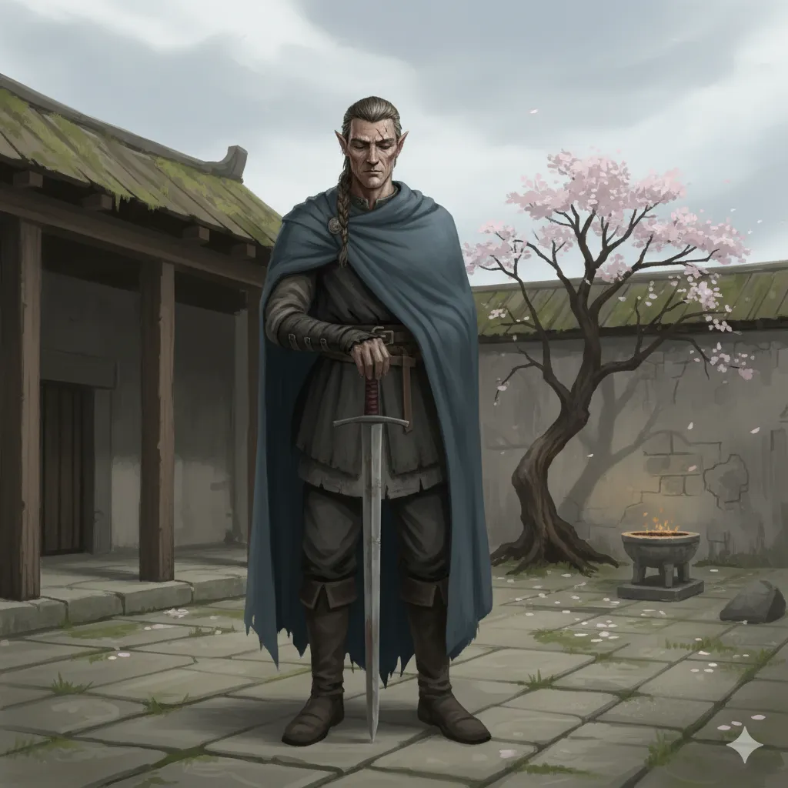

_Wielki Mistrz Miecza, stoicki wojownik o nienagannej reputacji._

## Opis
Półelf o stoickim spokoju, rezydujący w skromnej [[Świątynia Miecza|Świątyni Miecza]] ([[Sesja 62 - Arezyjska Dyplomacja]]).

Spokojne oblicze, proste szaty. <!-- UNSOURCED -->

## Osobowość
Stoik wierzący w czyny, nie słowa: „Słowa są jak liście na wietrze" ([[Sesja 62 - Arezyjska Dyplomacja]]).

Ceni pokorę i dyscyplinę. <!-- UNSOURCED -->

## Historia
Hiero dowodził w wielu bitwach przeciwko Mytros. <!-- UNSOURCED -->

W [[Sesja 62 - Arezyjska Dyplomacja]] zażądał dowodu czynów; bohaterowie opowiedzieli o pokonaniu [[Gaius|Gaiusa]], dowódcy Zakonu Sydona, i jego smoka, a także o innych przygodach, w których na szali było ich własne życie. Uznając wagę ich dokonań, zgodził się poprzeć ich sprawę przed królową. W [[Sesja 63 - Werdykt Arezji]] na Radzie głosował za, doceniwszy siłę argumentów przedstawionych przez [[Versir|Versira]] i [[Arevon Elorrenthi|Arevona]].
