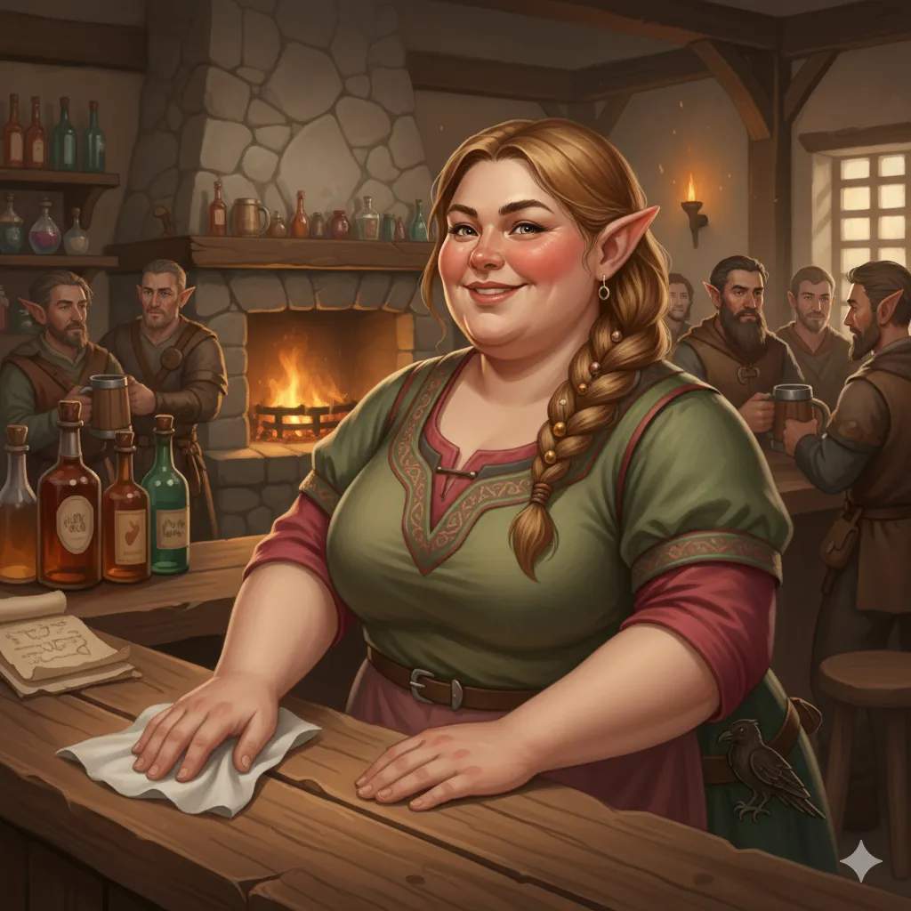

_Karczmarka w Czerwonym Lotosie._

## Opis
Barmanka z gospody [[Czerwony Lotos]] ([[Sesja 62 - Arezyjska Dyplomacja]]).

Puszysta elfka o jowialnym usposobieniu, prowadząca najpopularniejszą karczmę w mieście.

## Historia
W [[Sesja 62 - Arezyjska Dyplomacja]] przybliżyła bohaterom sylwetki Mistrzów Arezji: [[Halcyon]] (Mistrzyni Tarczy), [[Taureus|Taureusa]] (Mistrza Żywiołów), [[Hiero]] (Mistrza Miecza), [[Laertes|Laertesa]] (Mistrza Spokoju) oraz [[Mistrz Cieni|Mistrza Cieni]].

W [[Sesja 85 - Cienie nad Arezją]] bohaterowie przenocowali w jej gospodzie przed spotkaniem z [[Narsus|Narsusem]].
