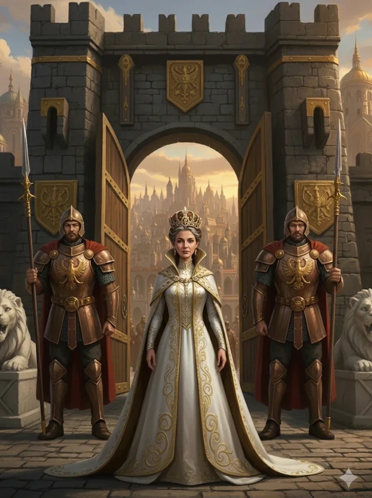
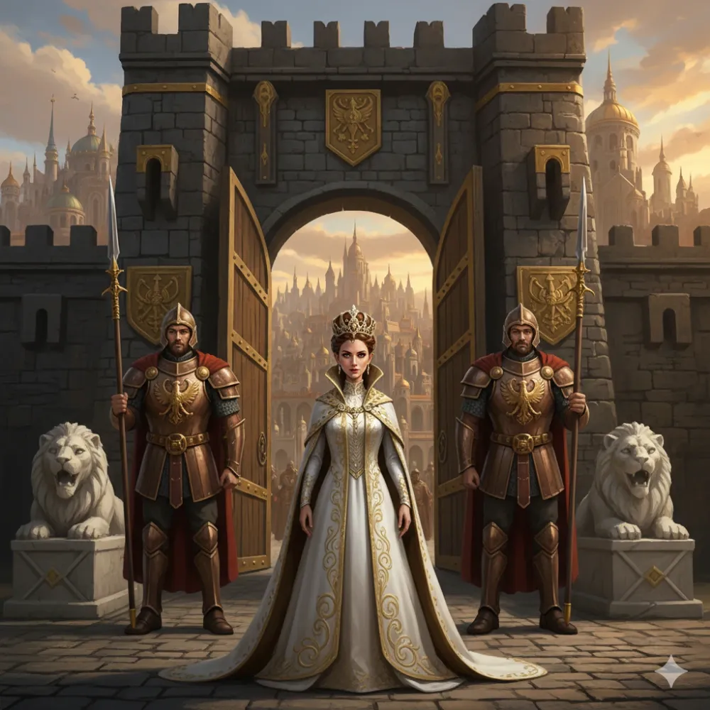

|  |  |
|:---:|:---:|
| Piętnaście lat po wojnie | W czasie wojny |

_Królowa Arezji, władczyni miasta rządzonego przez radę Wielkich Mistrzów świątyń-szkół walki; po wojnie wciąż na tronie._

## Opis
Władczyni [[Arezja|Arezji]], o specyficznych upodobaniach: otacza się wyłącznie męską służbą i gwardią, której rekrutacja — jak z przekąsem zasugerowała [[Kyrah]] — nie opiera się wyłącznie na umiejętnościach bojowych. Gardzi kłamstwem i pochlebstwami, ceniąc jedynie siłę i konkretne korzyści dla swojego miasta. Jest oschła i niewzruszona. Wspiera ją bóg [[Narsus]]. Po wojnie z Tytanami nadal rządzi Arezją, mierząc się z niezadowoleniem poddanych i wojną handlową o żelazo.

## Historia
Wspomniana w [[Sesja 56 - Dedal i Ikar]] jako królowa Helen z [[Arezja|Arezji]], wspierana przez boga [[Narsus|Narsusa]].

W [[Sesja 61 - Yala, Arezja i Żółw]] [[Pythor]] i [[Kyrah]] opowiedzieli bohaterom o ustroju Arezji i o obecnej władczyni, [[Królowa Helena|Królowej Helenie]].

W [[Sesja 62 - Arezyjska Dyplomacja]] bohaterowie spotkali ją po raz pierwszy pod bramami [[Arezja|Arezji]]: obserwowała przybyszów ze szczytu murów i nie zwracała się do nich bezpośrednio — jej głosem był [[Leandros]], dowódca gwardii. Argumenty o nadciągającej wojnie z Tytanami zbyła stwierdzeniem, że mury Arezji i [[Talos]] są wystarczającą ochroną, lecz nie zamknęła przed bohaterami bram. Postawiła ultimatum: audiencję i wsparcie uzyskają dopiero po przekonaniu Wielkich Mistrzów świątyń; jeśli Mistrzowie uznają, że sojusz leży w interesie Arezji, rozważy ich prośbę.

W [[Sesja 63 - Werdykt Arezji]] zasiadła przy okrągłym stole w sali tronowej wraz z bohaterami i pięcioma Wielkimi Mistrzami. Rada zagłosowała za uderzeniem wyprzedzającym na armię centaurów maszerującą z północy, a Helena, związana wolą Rady, ogłosiła, że legiony Arezji wymaszerują, by przeciąć drogę wrogowi.

W [[Sesja 84 - Świt Nowej Ery]] przyjęła podziękowania bohaterów z zadowoleniem i mówiła z dumą o ofierze tysiąca dwustu żołnierzy, którzy zatrzymali plemiona centaurów idące na [[Estoria|Estorię]], dzięki czemu Estoria mogła wesprzeć [[Mytros]]. W kolejnych latach [[Arezja]] miała być nękana przez plemiona centaurów, a wielu mieszkańców kwestionowało zasadność wysłania wojsk i głośno bolało nad stratą poległych w cudzej sprawie. Helena łagodziła emocje z cierpliwością, na jaką ją było stać, ale nie pomagała jej narastająca — początkowo lekka, z czasem coraz ostrzejsza — wojna handlowa o żelazo. [[Arevon Elorrenthi|Arevon]] rozważał misję dyplomatyczną, lecz zrozumiał, że nie ma nic konkretnego do zaoferowania; uznał też, że gdyby [[Arezja]] poprosiła o pomoc, [[Mytros]] powinno jej udzielić — problem w tym, że Arezyjczycy prędzej daliby się wybić, niż o taką pomoc poprosili.

W [[Sesja 85 - Cienie nad Arezją]] wiedziała o przybyciu drużyny, zanim ta zapukała do bramy, i przyjęła bohaterów przy posiłku w bocznej sali [[Pałac Królewski w Arezji|pałacu]], w towarzystwie [[Halcyon]]. Przypomniała, że piętnaście lat wcześniej w obronie interesów [[Mytros]] zginęło tysiąc dwustu jej ludzi, że po wojnie półwysep nękały centaury z minotaurami i że obca armia pod murami budzi niezadowolenie mieszkańców. Usłyszawszy, że część żołnierzy [[Taran Neurdagon|Tarana]] odesłano na północ, posłała [[Leandros|Leandrosa]] z rozkazami, bo stacjonują tam arezyjscy żołnierze. Wskazała spór o żelazo jako źródło napięć i opowiedziała, jak minotaur [[Zakroth]] zbudował fort na północy i ciężko ranił [[Hiero]]. Zaprzeczyła, by żelazna broń bandytów pochodziła z [[Arezja|Arezji]]. Po chwili wahania przyznała, że Zakroth ma [[Amfora Zakrotha|amforę]], i wyjawiła, że [[Narsus]] doznał objawienia, a amfora jest jednym z elementów potrzebnych do zaczerpnięcia mocy z pustych boskich domen. Zgodziła się, że monopol na boskość nie przyniósłby niczego dobrego, zaproponowała współpracę przy przywróceniu boskości [[Kontynent Thylea|Thylei]] i umówiła bohaterów na spotkanie z Narsusem pod [[Świątynia Tarczy|Świątynią Tarczy]]. Drużyna przyjęła od niej zlecenie na Zakrotha.
