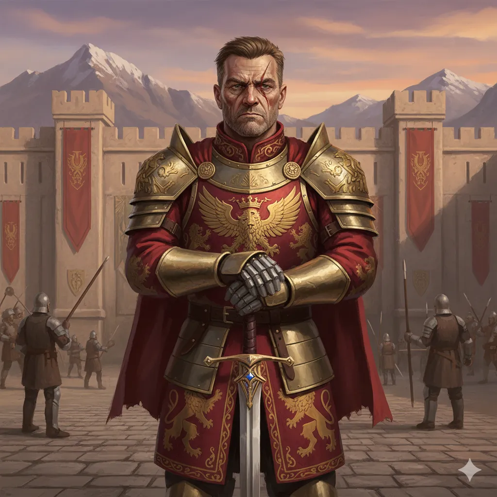

_Dowódca gwardii królowej Heleny._

## Opis
Mężczyzna w średnim wieku, starszy o 20 lat od swoich podwładnych. Posiada długą bliznę biegnącą od brwi do szczęki. Nosi bogato zdobiony pancerz.

## Osobowość
Poważny i lojalny. Krążą plotki, że jego oddanie [[Królowa Helena|Królowej Helenie]] wykracza poza obowiązek.

## Historia
Nigdy nie przegrał turniejowego pojedynku.

W [[Sesja 62 - Arezyjska Dyplomacja]] był głosem królowej podczas pierwszego spotkania z bohaterami pod murami miasta: [[Królowa Helena|Helena]] nie zwracała się do przybyszów bezpośrednio, a rozmowę prowadził w jej imieniu on, jako dowódca jej gwardii.
