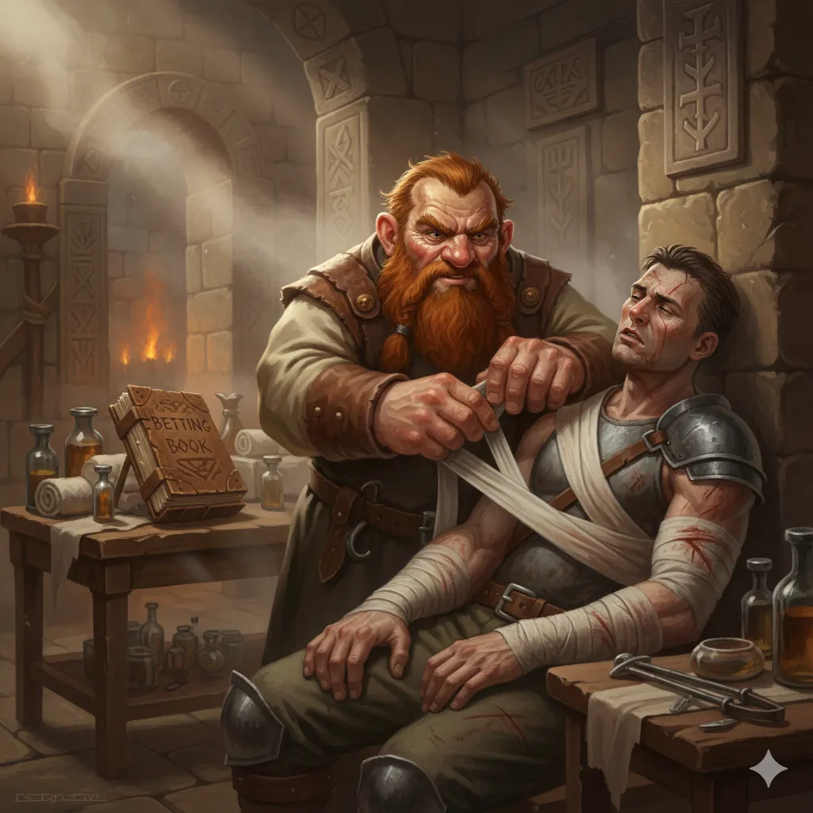

_Krasnolud opatrujący rannych w Sanktuarium (łaźniach i szpitalu) w Arezji._

## Opis
Znany jako "Lenny". Krasnolud-pragmatyk, kapłan zarządzający Sanktuarium przy arezyjskim gimnazjum.

## Osobowość
Traktuje leczenie wojowników czysto biznesowo - chce ich jak najszybciej postawić na nogi, by wrócili do walki. Jest hazardzistą, przyjmuje zakłady na wyniki walk.

## Historia
W [[Sesja 62 - Arezyjska Dyplomacja]] bohaterowie spotkali go w [[Sanktuarium]], pełniącym rolę łaźni, szpitala i świątyni. Opatrywał tam rannych i jednocześnie przyjmował zakłady na walki. [[Arevon Elorrenthi|Arevon]] zaimponował mu, magicznie lecząc rannego gladiatora.
