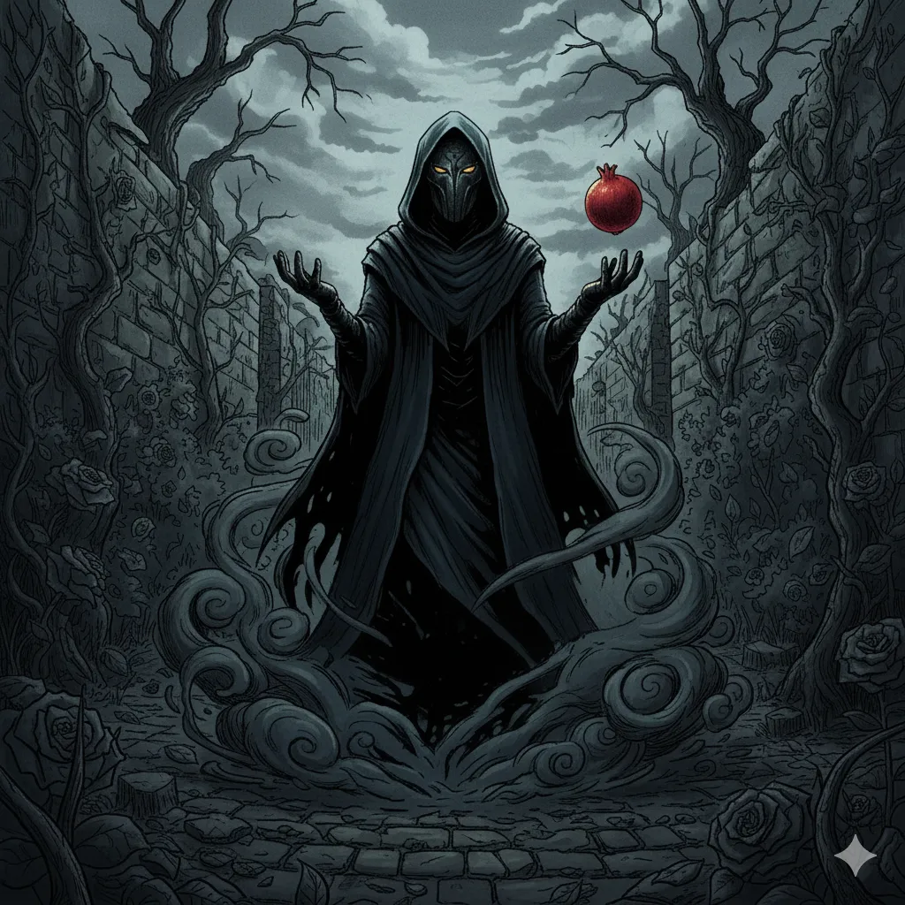

_Tajemniczy Mistrz Arezji, pan Świątyni Cieni i jej szpiegów; po wojnie przywrócił Orestesa do życia w zamian za odłamki Kryształowej Kosy Lutherii._

## Opis
Nikt nie zna prawdziwej tożsamości Mistrza Cieni.<!-- UNSOURCED -->

Postać zawsze skryta za maską i kapturem: zakapturzona postać w masce, a w [[Sesja 83 - Zmierzch Ery Tytanów|Sesji 83]] — w ciemnym kapturze i z osłoną, która uniemożliwia wybadanie go magią.

## Osobowość
Pragmatyczny i niezwykle skuteczny.<!-- UNSOURCED -->

Nieuchwytny i cyniczny — z cynicznym komentarzem odnosi się do kaprysów [[Narsus|Narsusa]]. Nie przyjmuje nieproszonych gości. Jego ludzie są równie dobrzy w szpiegowaniu, co w niedopuszczaniu do siebie szpiegów.

## Historia
Zarządza [[Świątynia Cieni|Świątynią Cieni]], jednym z Mistrzów Arezji.

W [[Sesja 62 - Arezyjska Dyplomacja]] bohaterowie usłyszeli o nim jako o tajemniczym Mistrzu Cieni.

W [[Sesja 63 - Werdykt Arezji]] bohaterowie na próżno próbowali odwiedzić [[Świątynia Cieni|Świątynię Cieni]] — jej bramy były zamknięte na głucho, a magiczny kruk [[Arevon Elorrenthi|Arevona]] meldował jedynie o uczuciu bycia obserwowanym. Mistrz Cieni sam ujawnił się im tuż za bramą [[Wiszące Ogrody|Wiszących Ogrodów]], żonglując owocem poszukiwanym przez [[Narsus|Narsusa]]. Zaoferował im [[Słoneczny Granat]], by oszczędzić im czasu i ryzyka, ale w zamian zażądał, by w przyszłości, gdy trafią do wieży [[Praxys]], wykradli dla niego pewną księgę, nie zadając pytań. Drużyna przystała na pakt, a Mistrz zniknął w kłębach dymu, rzucając do [[Felicjan Janus Twardowski|Felicjana]]: „Pozdrów [[Despina|Despinę]]". Na Radzie Pięciu Mistrzów bez zbędnego przeciągania oddał głos na tak — za uderzeniem wyprzedzającym na armię centaurów.

W [[Sesja 83 - Zmierzch Ery Tytanów]] przyszedł po swój dług. Wszedł w ciemnym kapturze do prowizorycznego [[Super Bar|Super Baru]] sklecionego w ruinach [[Mytros]] i odebrał od [[Arevon Elorrenthi|Arevona]] [[Traktat o Prawach i Zobowiązaniach Krwi]] ze skarbca [[Praxys]] — zgodnie z umową zawartą przed bramą [[Wiszące Ogrody|Wiszących Ogrodów]]: jedna księga i zero pytań. Nie wyjaśnił, co czyni ją tak cenną, a wszelkie próby wybadania go rozbiły się o osłonę, którą nosił. Przy okazji złożył [[Orestes|Orestesowi]] ofertę: powrót do świata żywych w zamian za [[Kryształowa Kosa Lutherii|Kryształową Kosę Lutherii]], dostarczoną do [[Arezja|Arezji]]. Zapytany, przystał, by artefakt był w odłamkach — byle komplet. Oferta miała pozostać ważna przez rok. Nikt z drużyny nie wiedział, po co mu kosa, i nikt mu nie ufał.

W [[Sesja 84 - Świt Nowej Ery]] dostał to, czego żądał. [[Orestes]] przekonywał, że skoro Mistrz Cieni potrafi przeprowadzić odpowiedni rytuał, warto oddać mu odłamki. [[Felicjan Janus Twardowski|Felicjan]] widział w nim kogoś, kto w Arezji systematycznie zbiera relikwie po dawnych bogach, i obawiał się, że opuszczone domeny znajdą nowego pretendenta; ustalono więc, że najpierw kosa zostanie roztrzaskana, a dopiero potem drużyna zdecyduje, co zrobić z odłamkami. Drużyna roztrzaskała [[Kryształowa Kosa Lutherii|Kryształową Kosę Lutherii]] na wysepce [[Morze Otchłani|Morza Otchłani]], pozbierała wszystkie odłamki co do jednego i dostarczyła je do [[Arezja|Arezji]]. [[Orestes]] wymógł jeszcze przed progiem [[Świątynia Cieni|Świątyni Cieni]] przysięgę, że rytuał zadziała aż do śmierci; gospodarze poszli mu na rękę. Do środka wpuszczono wyłącznie minotaura — towarzyszy nie. Próby podejrzenia rytuału magią odrzucono jako beznadziejne: ludzie Mistrza Cieni są równie dobrzy w szpiegowaniu, co w niedopuszczaniu do siebie szpiegów. Rytuał trwał dziewięć godzin i przywrócił Orestesa do życia. Nikt do dziś nie wie, po co były mu odłamki — [[Orestes]] żartował, że to może banda nadzianych kolekcjonerów — a [[Versir]] zaproponował, by wypytać [[Kyrah]] o znajomości w [[Arezja|Arezji]] i po cichu rozwinąć tam siatkę szpiegowską, która z czasem odpowie na to pytanie.
