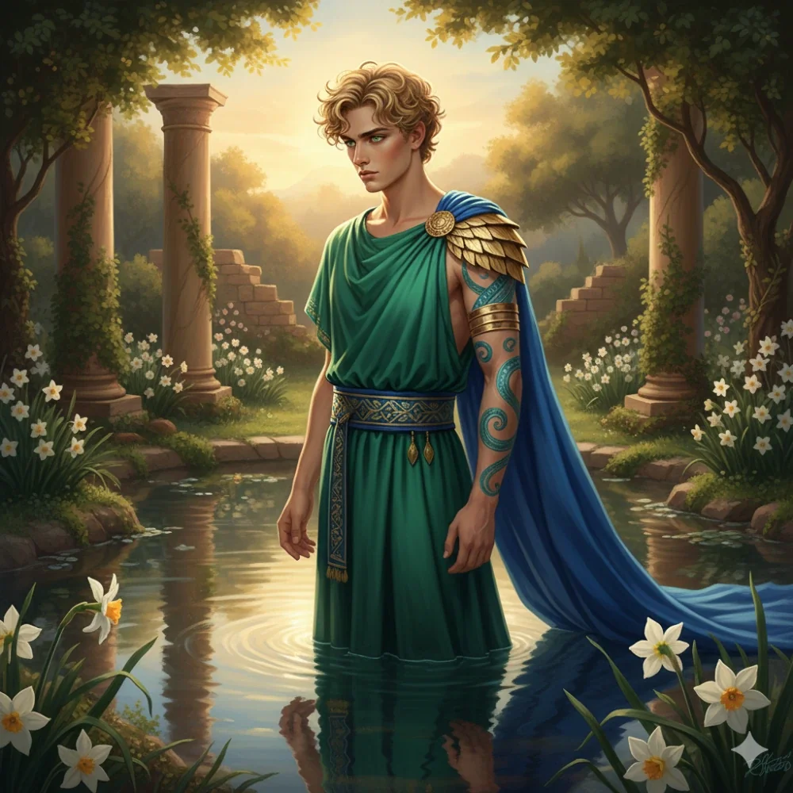

_Bóg Piękna, więzień Arezji; brat Pythora, Kyrah i Vallus_

## Opis
Znany ze swojej nieskazitelnej urody, ale także z arogancji i lenistwa.

Bóg piękna, czczony w Arezji. Jego posąg nad bramą miejską przedstawia go jako mężczyznę o nieludzkim pięknie, a w Sanktuarium stoi zadbany złoty posąg. Jest ucieleśnieniem próżności, wpatrzonym we własne odbicie. Brat [[Pythor|Pythora]], [[Kyrah]] i [[Vallus]] — wszyscy czworo są dziećmi [[Balmytria|Balmytrii]], którym przypadła moc zabrana tytanom. Do dziś pozostaje w Arezji, w złotej klatce.

## Historia
Pierwsza królowa, Calliope, uwiodła go i podstępem sprowadziła do miasta. W „złotej klatce" jest czczony i rozpieszczany, co w pełni mu odpowiada.

Według opowieści Mistrza Gry w [[Sesja 61 - Yala, Arezja i Żółw]]: po pewnym czasie w Mytros Narsusa porwała królowa Kalliope, córka [[Karpathos|Karpathosa]], i zamknęła w swojej złotej klatce w [[Arezja|Arezji]], gdzie siedzi do dziś; Mytros ruszyło go odbić, co zapoczątkowało pierwszą wojnę z Arezją.

W [[Sesja 49 - Wielkie Gęsie Powstanie]] bohaterowie trafili na świątynię poświęconą Narsusowi, bogu piękna czczonemu w Arezji, w opuszczonym miasteczku na Wyspie Forlorn.

W [[Sesja 56 - Dedal i Ikar]] marynarze z Arezji wspomnieli o nim jako o Bogu Piękna, który wspiera królową Helen ([[Królowa Helena]]).

W [[Sesja 61 - Yala, Arezja i Żółw]] [[Pythor]] i [[Kyrah]] opowiedzieli o zdradzie ich brata: Narsus sprzymierzył się ze Smoczym Lordem [[Karpathos|Karpathosem]], dowódcą smoczych jeźdźców, i pomógł mu w ucieczce po zabójstwie [[Xander|Xandera]].

W [[Sesja 62 - Arezyjska Dyplomacja]] bohaterowie widzieli jego posąg nad bramą miejską oraz złocony posąg w [[Sanktuarium]]. Aby zyskać przychylność [[Królowa Helena|Heleny]], mieli przekonać Radę Pięciu Mistrzów oraz samego boga Narsusa.

W [[Sesja 63 - Werdykt Arezji]] przyjął bohaterów w [[Wiszące Ogrody|Wiszących Ogrodach]]. Spoczywał nad onyksowym basenem w towarzystwie syreny, wpatrzony we własne odbicie, znużony i zirytowany „kolejnymi petentami", dopóki nie wspomniał o swoim pragnieniu — rzadkim [[Słoneczny Granat|Słonecznym Granacie]]. Obiecał wstawić się za bohaterami u królowej, jeśli przyniosą mu ten owoc. Otrzymawszy go, wpadł w ekstazę, planując kąpiel w podgrzanej przez owoc wodzie, i w geście łaskawości pozwolił im zabrać dowolny przedmiot ze stosu darów, które inni petenci składali mu przez lata — [[Orion Xul|Orion]] wziął stamtąd zbroję płytową.

W [[Sesja 75 - Koniec Przysięgi]] okazało się, że Narsus jest jednym z dzieci [[Balmytria|Balmytrii]], którym przypadła moc wykradziona tytanom — razem z [[Vallus]], [[Pythor|Pythorem]], [[Kyrah]] i [[Volkan|Volkanem]], mężem Balmytrii, stanowił Piątkę.

W [[Sesja 76 - Bitwa o Mytros: Pierwsza Fala]] [[Versir]] nazwał go największym głupcem, który patrzy w lustro, widzi swoją piękną mordę i się uśmiecha — w porównaniu z [[Kyrah]], której błędy były większe, lecz która próbuje się na nich uczyć.
