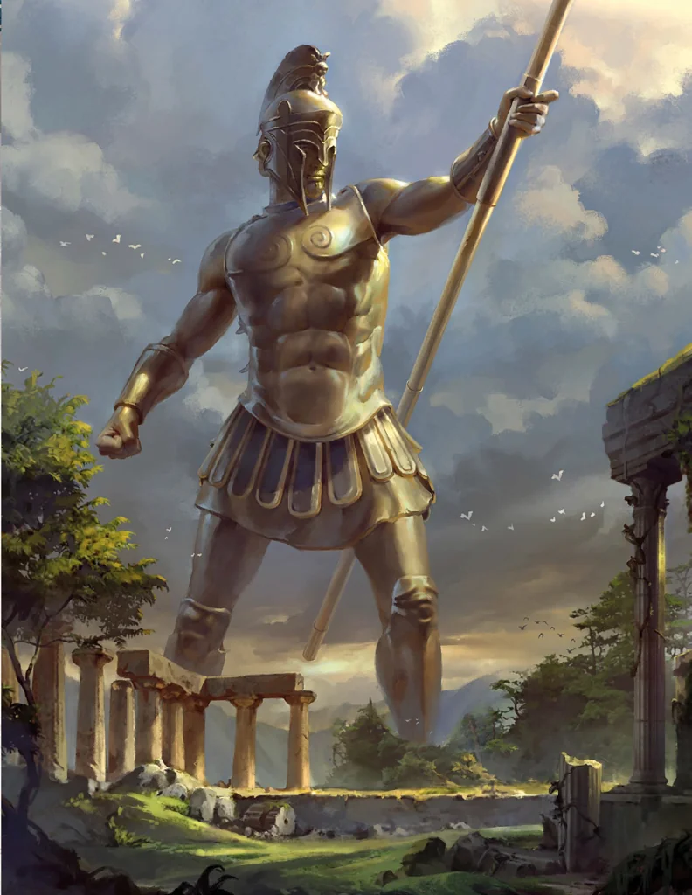

_Legendarny konstrukt, strażnik Arezji._

## Opis
Gigantyczny konstrukt wykonany z brązu.

## Historia
Mówi się, że Talos strzeże lasów wokół Arezji przed najeźdźcami.

W [[Sesja 62 - Arezyjska Dyplomacja]] [[Arevon Elorrenthi|Arevon]] i [[Felicjan Janus Twardowski|Felicjan]] dostrzegli w lesie koło [[Arezja|Arezji]] gigantyczne ślady stóp, sugerujące obecność potężnego konstruktu — legendarnego Talosa, strażnika miasta, o którym krążyły legendy. Przy bramach [[Królowa Helena]] zbyła argumenty o nadciągającej wojnie z Tytanami stwierdzeniem, że mury Arezji i Talos są wystarczającą ochroną.
