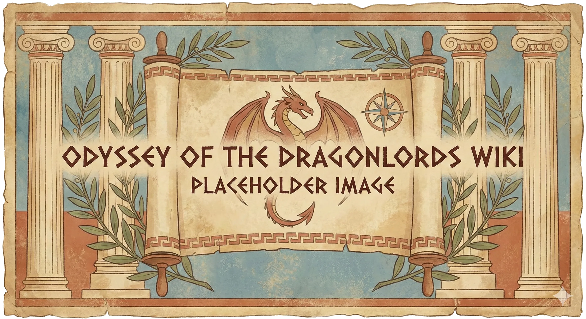

_Krasnoludzki zwiadowca [[Arezja|Arezji]], jedyny żywy spośród ukrzyżowanych przed [[Fort Zakrotha|Fortem Zakrotha]]._

## Historia
Jego oddział wpadł podczas patrolu w zasadzkę ludzi [[Zakroth|Zakrotha]], a jeńców przybito do krzyży przed bramą fortu. Z sześciu ukrzyżowanych przeżył tylko on.

W [[Sesja 87 - Upadek Zakrotha]] [[Versir]] podleciał do niego na [[Trąba|Trąbie]], uleczył go, wyciągnął gwoździe i pomógł mu zejść z krzyża. Ugulat rozpoznał bohaterów i ostrzegł ich, że w okolicznym lesie zwykle krąży wielu zwiadowców wroga, a w forcie przebywa najwyżej dwudziestu obrońców, w tym [[Gigantes]]. Osłabiony i bez zapasów, wszedł do fortu razem z drużyną.
