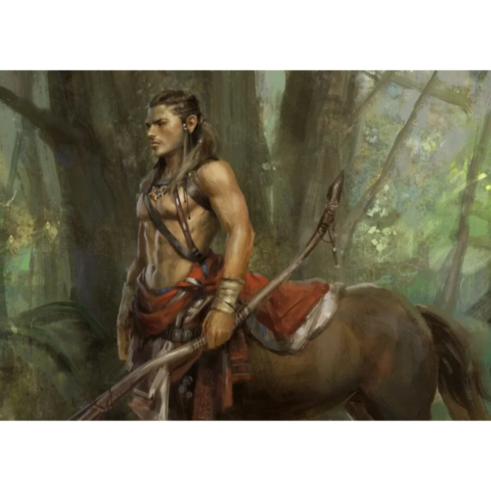

_Wódz centaurów z Mithralowej Kuźni, dowódca centaurów w Bitwie o Mytros._

## Opis
Potężny centaur w brązowym hełmie, wódz centaurów.

Wyróżnia się spośród innych znamieniem na czole, które przypomina oko [[Sydon|Sydona]]. Przewodzi grupie dwunastu centaurów.

## Osobowość
Honorowy, dotrzymuje słowa. Jest wyznawcą Sydona ("Pana Burz i Ojca Oceanów"), wierząc w jego mądrość, mimo że bohaterowie mogą być przeciwko niemu.

## Historia
Hukar i jego oddział spotkali bohaterów w drodze do Mithralowej Kuźni i ostrzegli ich przed troglodytami z Wielkich Wodospadów Arkelon.

W [[Sesja 10 - Świątynia Heliosa i Jaskinie Troglodytów]] bohaterowie spotkali po drodze do [[Mithralowa Kuźnia|mithralowej kuźni]] dwunastu centaurów na czele z Hukarem. Ostrzegł ich przed troglodytami, którzy pojmali dwójkę jego centaurów. Bohaterowie weszli do [[Jaskinie Troglodytów|jaskiń]], pokonali troglodytów i uratowali centaury.

W [[Sesja 76 - Bitwa o Mytros: Pierwsza Fala]] dowodził centaurami z [[Mithralowa Kuźnia|Kopalni Mithralu]] wśród zjednoczonych sił broniących [[Mytros]] przed Tytanami.
