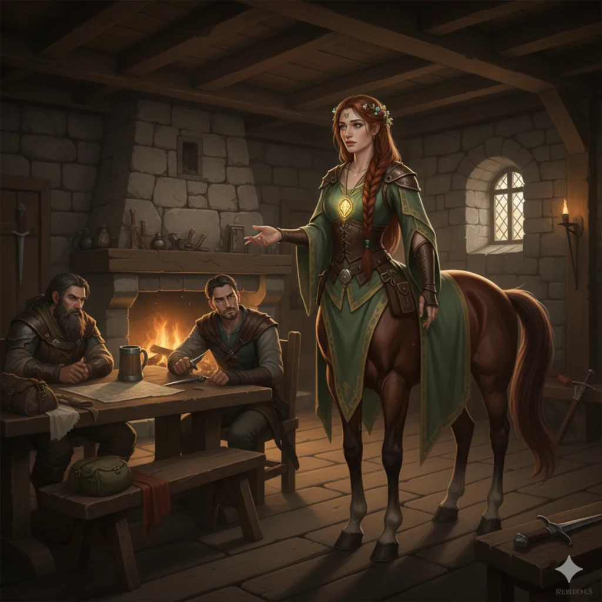

_[[Centaur z Thylei|Centaurzyca]], córka lorda [[Agrius|Agriusa]] i wysłanniczka jego plemienia, więziona przez [[Zakroth|Zakrotha]]._

## Opis
Rudowłosa centaurzyca z długim warkoczem przetykanym kwiatami, w zielonej szacie i skórzanym kaftanie. Jej braćmi są [[Perimedes]] i [[Cheironis]].

## Historia
Przybyła do [[Fort Zakrotha|Fortu Zakrotha]] jako posłanka swojego plemienia na rozmowy z Zakrothem i nie opuściła go: minotaur zamknął ją w izbie gościnnej na drugim piętrze.

W [[Sesja 88 - Krwawe Schody Fortu]] [[Arevon Elorrenthi|Arevon]] otworzył jej izbę kluczami zabranymi Zakrothowi. Na widok zakrwawionych [[Bohaterowie Przepowiedni|Bohaterów Przepowiedni]] cofnęła się w kąt, lecz po rozmowie z [[Versir|Versirem]] zgodziła się wystąpić przed ojcem. Przyznała, że oskarżenia Perimedesa pasują do brata. Versir przeniósł ją magią przez barierę na schodach wprost do Agriusa, a Lesia opowiedziała ojcu o swoim uwięzieniu i oceniła, że przybysze nie wydają się żądni krwi. Odeszła z fortu razem z centaurami ojca.
