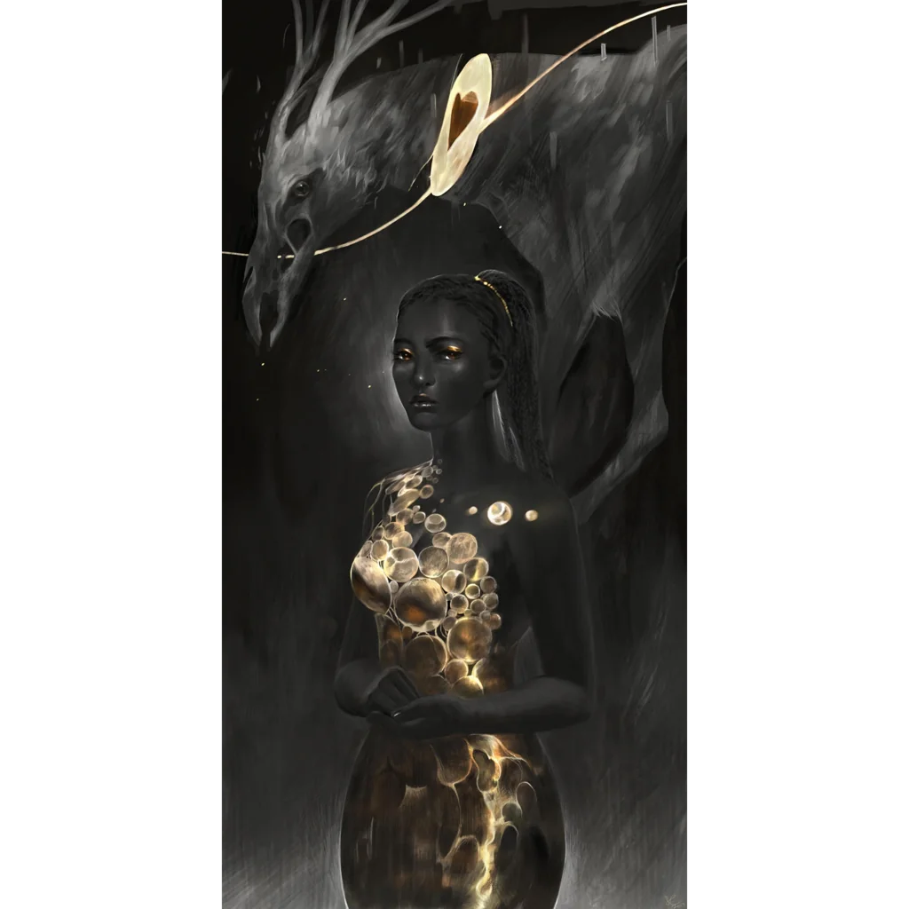

_Nimfa, Jesienny Wiatr, wyznawczyni Heliosa; zabita przez drużynę_

## Opis
Nimfa urodzona w górach nieopodal Starego Lasu.

## Osobowość
Zafascynowana [[Helios|Heliosem]] ([[Sesja 10 - Świątynia Heliosa i Jaskinie Troglodytów]]).

## Historia
Opuściła swoją górę, by dołączyć do [[Kyrah]] i zobaczyć świat. Rozczarowała się brzydotą i niedoskonałością Thylei (Starego Lasu, minotaurów, Arezji). Jej śpiew w Arezji został odrzucony. Po rozstaniu z wiatrami odnalazła świątynię ze złotym posągiem mężczyzny i oddała się kultowi Heliosa, uważając go za jedyne prawdziwe bóstwo.

W [[Sesja 10 - Świątynia Heliosa i Jaskinie Troglodytów]] bohaterowie spotkali nimfę Eurię w [[Świątynia Heliosa|świątyni Heliosa]], która opowiedziała im o swoim życiu i fascynacji bogiem słońca, [[Helios|Heliosem]]. Doszło do walki, w której zauroczony jej głosem [[Orestes]] zaatakował [[Versir|Versira]] i prawie go zabił. Aby go uratować, drużyna była zmuszona zabić Eurię.
