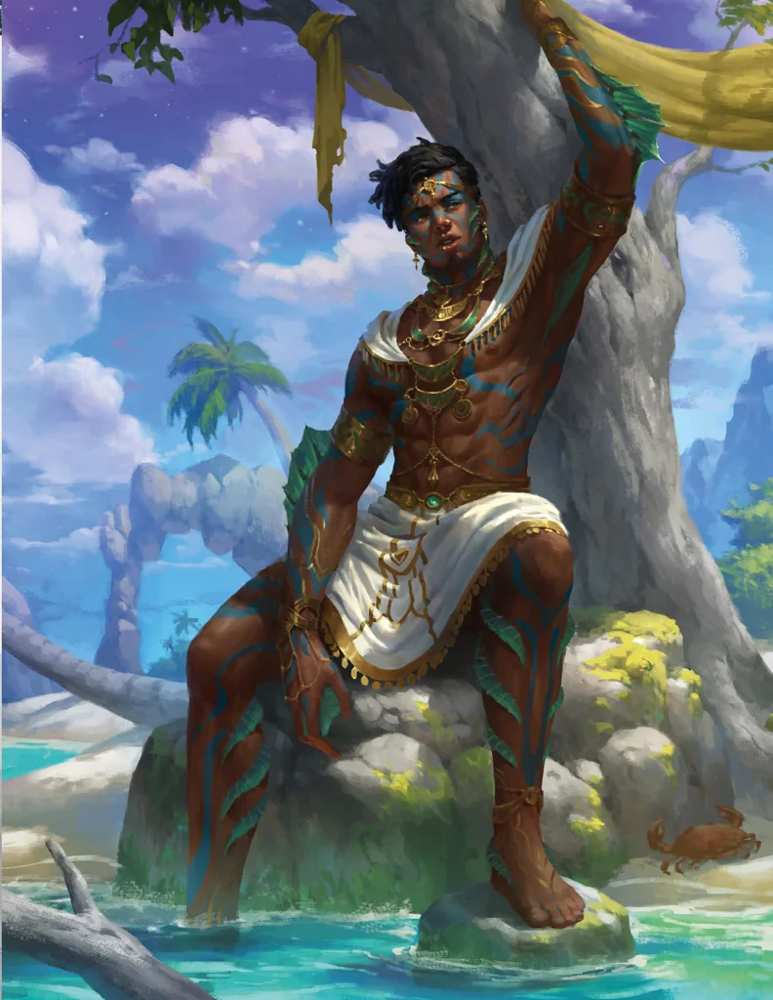

_Oceanid, Wiosenny Wiatr, były Kyrah; zabity przez drużynę_

## Opis
Oceanid mieszkający w Zatoce Cerulańskiej.

## Osobowość
Kocha śmiertelników. Żywi głęboką miłość i oddanie do Kyrah, która była jego muzą i partnerką.

## Historia
Zakochał się w głosie Kyrah śpiewającej w Mytros. Dla niej opuścił morze i spędził z nią 150 lat. Dołączył do Czterech Wiatrów, by szerzyć pokój na wyspach zachodnich (Złotego Serca i Indygo), ale poniósł porażkę, natrafiając na opór driad i barbarzyńców. Po rozpadzie Wiatrów i odrzuceniu przez Kyrah, popadł w rozpacz. Postanowił jednak nie poddawać się i odzyskać boginię, łącząc siły z Boreasem.

W [[Sesja 12 - Furia Boga Bitwy]] drużyna w drodze powrotnej z [[Mithralowa Kuźnia|mithralowej kuźni]] napotkała Zephyrusa, byłego [[Kyrah]], który nie mógł pogodzić się z utratą ukochanej. Bohaterowie musieli go zabić.
