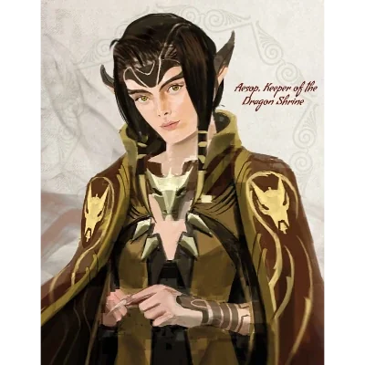

_Główny kapłan [[Smocza Kaplica|Smoczej Kaplicy]], strażnik legend o Smoczych Lordach._

## Opis
Starszy elf, Strażnik Smoczej Kaplicy w Estorii, powszechnie uważany za jednego z najmądrzejszych śmiertelników.

## Osobowość
*   **Cierpliwy:** Ma wysokie oczekiwania wobec bohaterów, ale rozumie ich wady. Był świadkiem błędów oryginalnych Smoczych Lordów.
*   **Skupiony:** Jego celem jest przywrócenie Zakonu Smoczych Lordów i odnalezienie zaginionych smoków.
Pobożny, wierzący w powrót smoków do Thylei. Jest sceptyczny wobec ambicji króla Acastusa z Mytros i uważa, że to Wybrańcy Wyroczni powinni wskrzesić zakon.

Wierzy, że smoki będą służyć Wybrańcom Wyroczni, o ile ci będą trzymać się ideałów ich dawnych panów.

## Historia
Aesop od lat strzeże [[Smocza Kaplica|Smoczej Kaplicy]] i jej najcenniejszej relikwii, [[Róg Balmytrii]]. Kiedy róg został skradziony, Aesop był zrozpaczony, ale pokładał nadzieję w bohaterach przepowiedni. Wierzy, że smoki są kluczem do ochrony śmiertelników i prosi bohaterów, by po odzyskaniu rogu dostarczyli go królowej [[Vallus]] w Mytros, zamiast oddawać go w ręce Acastusa.

W [[Sesja 38 - Bitwa w Kalderze]] przesłał bohaterom przez syrenę list, w którym jako Strażnik Smoczej Kaplicy prosił o odnalezienie i uratowanie czterech smoków z potomstwa [[Balmytria|Balmytrii]]. Wielu wierzyło, że wszystkie jej smoki zginęły wraz z nią podczas Pierwszej Wojny pięćset lat wcześniej, ale jego badania wskazywały, że pozostałe cztery mogły zostać schwytane przez Tytanów.
