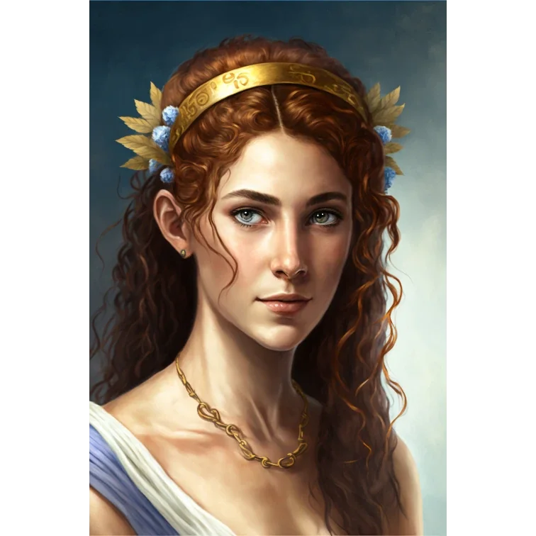
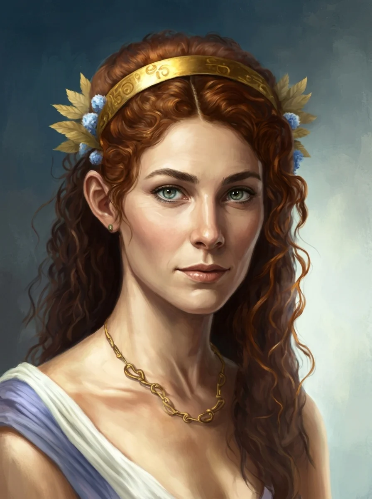

_Władczyni Estorii, córka [[Pythor|Pythora]], która przejęła tron po ojcu._

## Opis
Uważana za dumę Estorii, Anora jest jedynym dzieckiem Pythora z jego ostatnią śmiertelną żoną, którą darzył wielką miłością.

## Osobowość
Odważna, lojalna i gotowa do najwyższych poświęceń dla dobra swojego ludu. Mimo młodego wieku, mieszkańcy Estorii uważają, że byłaby lepszym i bardziej odpowiedzialnym władcą niż jej ojciec.

## Historia
Po utracie matki, która została uprowadzona przez smoczycę [[Hexia|Hexię]], Anora pozostała jedyną pociechą podupadającego na duchu ojca.

W [[Sesja 3 - Skradziony Róg]] bohaterowie dowiedzieli się w [[Estoria|Estorii]] o suszy i żądaniu złożenia w ofierze Anory, córki króla Pythora.

[[Zakon Sydona]] zażądał jej złożenia w ofierze na [[Skała Estora|Skale Estora]], by powstrzymać suszę i armię centaurów; Anora z pokorą zgodziła się na swój los, chcąc oszczędzić miastu zagłady.

W [[Sesja 5 - Skała Estora]] bohaterowie dowiedzieli się o planowanej ofierze z Anory i postanowili ją uratować, rozpoczynając przygotowania do walki z bazyliszkiem strzegącym wejścia do jaskini. W [[Sesja 6 - Problemy w Woodhike]] kontynuowali tę misję.

W [[Sesja 7 - Uratować Księżniczkę]] [[Bohaterowie Przepowiedni|Bohaterowie Przepowiedni]] zabili [[Skała Estora|bazyliszki]] i uratowali Anorę.

[[Hergeron Pierwszy|Hergeron]] planował wysłać centaury, aby oblężyły jej miasto i odciągnęły ją od pomocy dla [[Mytros]].

W [[Sesja 84 - Świt Nowej Ery]] wyszło na jaw, że tron [[Estoria|Estorii]] [[Pythor]] zostawił jej jeszcze zanim [[Ultros]] wypłynął w Wielką Odyseję — po wojnie bóg bitwy nigdzie nie osiadł i nie miał już ani korony, ani wojny, ani pomysłu na siebie.

## Po wojnie

Od piętnastu lat rządzi [[Estoria|Estorią]] i nikt już nie nazywa jej młodą królową. Jej ojciec, [[Pythor]], wędruje po [[Kontynent Thylea|Thylei]] z [[Orion Xul|Orionem]], jej przyrodnim bratem.
