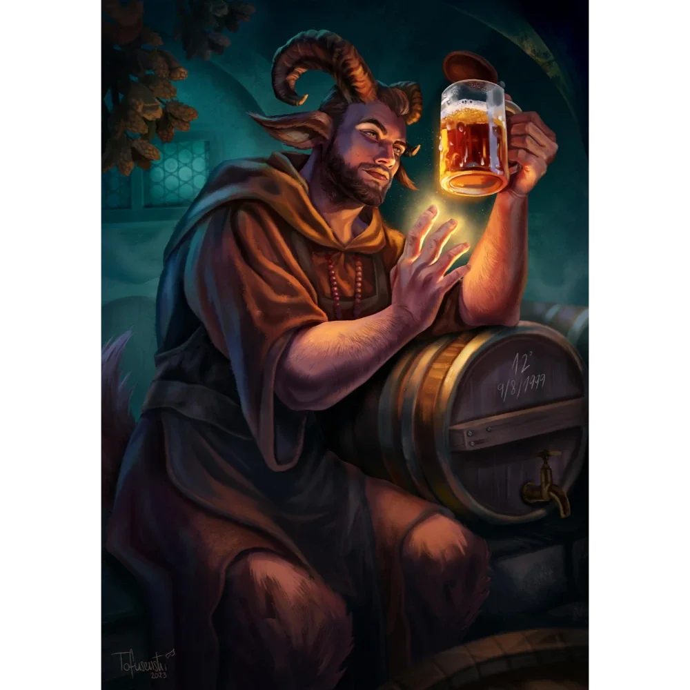
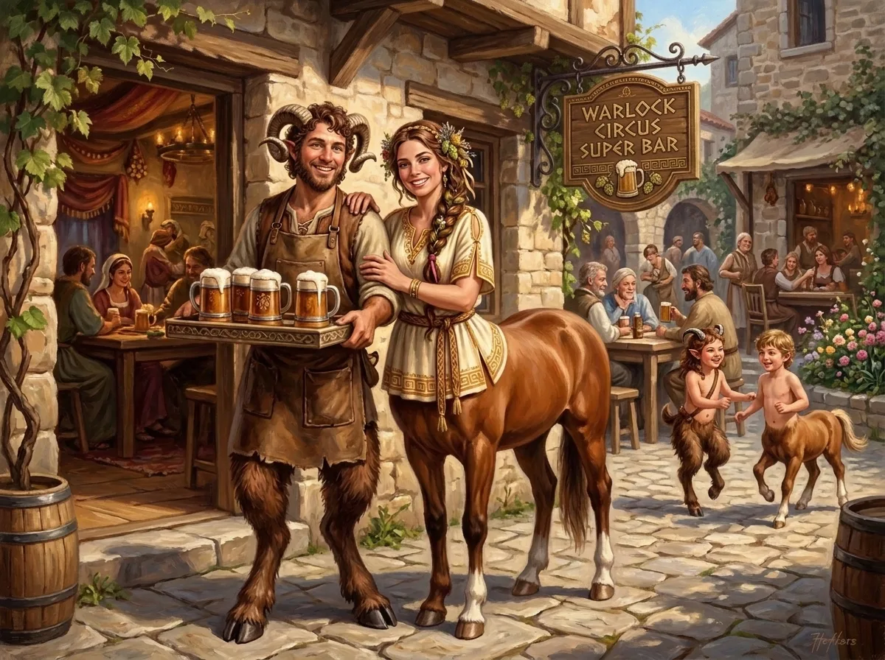

_Właściciel [[Super Bar|Super Baru]] i kuzyn [[Orestes|Orestesa]]; po Bitwie o Mytros prowadzi prowizoryczny Super Bar w ruinach miasta_

## Opis
Radosny satyr o kędzierzawych włosach i niewielkich rogach. Zawsze uśmiechnięty, o ile nikt nie marnuje dobrego piwa.

## Osobowość
Towarzyski, gadatliwy i dumny ze swoich trunków. Jako członek rodziny satyrów, która przygarnęła [[Orestes|Orestesa]], darzy minotaura dużą sympatią.

## Historia
Brax prowadzi [[Super Bar]] w [[Estoria|Estorii]], gdzie serwuje piwo z rodzinnego browaru. Jest kuzynem [[Orestes|Orestesa]] i wspiera go w jego dążeniu do przełamania pecha, choć sam uważa, że życie jest zbyt krótkie, by martwić się klątwami, gdy pod ręką jest pełny kufel.

W [[Sesja 40 - Uciechy na Wyspie Skorpiona]] Orestes pchnął ku swojemu kuzynowi Braxowi centaurzycę [[Nessa|Nessę]], kuzynkę [[Pholon|Pholona]], a Brax wydawał się zainteresowany związkiem z nią.

W [[Sesja 81 - Bitwa o Mytros: Koszmar na Targu Minotaurów]], gdy po śmierci [[Sydon|Sydona]] drużyna przejęła koordynację obrońców [[Mytros]], Brax zastąpił [[Boreas|Boreasa]] na stanowisku dowódczym.

W [[Sesja 83 - Zmierzch Ery Tytanów]] przedarł się przez ruiny [[Mytros]] na grzbiecie [[Nessa|Nessy]] wprost do [[Orestes|Orestesa]], by rozgorączkowany opowiedzieć mu zasłyszaną — już mocno podkoloryzowaną — historię o tym, jak minotaur zabił [[Lutheria|Panią Snów]]. Później wraz z pomocnikami sklecił w ruinach prowizoryczny [[Super Bar]], do którego [[Orestes]] zaglądał niemal co wieczór, choć jako nieumarły nie czuł już smaku piwa. To tam [[Mistrz Cieni]] odebrał od [[Arevon Elorrenthi|Arevona]] swój dług.

## Po wojnie

Związał się z [[Nessa|Nessą]] i doczekali się dzieci. Prowadzą własny lokal sieci Warlock Circus Super Bar w [[Mytros]], gdzie chętnie zagląda „wujek" [[Orestes]].
