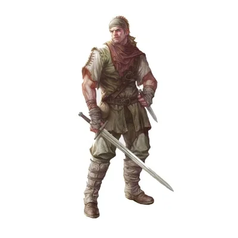

_Przeklęty rabuś grobów_

## Opis
Wynędzniały mężczyzna o chorobliwym wyglądzie, ubrany w łachmany. Wygląda na skrajnie niedożywionego.

## Osobowość
Zdesperowany i przerażony. Za wszelką cenę próbuje pozbyć się skradzionego przedmiotu, który sprowadził na niego klątwę.

## Historia
Claus zdołał wkraść się do [[Nekropolia w Telamok|Nekropolii w Telamok]], omijając jej strażnika, i ukradł szmaragdowy naszyjnik z jednego z grobowców. Od tego czasu spoczywa na nim klątwa bogów – nie jest w stanie nic przełknąć, a naszyjnik zawsze wraca do niego, jeśli spróbuje go wyrzucić lub skłamać przy próbie sprzedaży. Można go spotkać na [[Agora w Estorii|Agorze]], gdzie próbuje sprzedać artefakt za symboliczną monetę. Podczas wizyty drużyny w Estorii, niemal udało mu się namówić nieświadomego lokalnych praw [[Arevon Elorrenthi|Arevona]] na zakup przeklętego przedmiotu.
