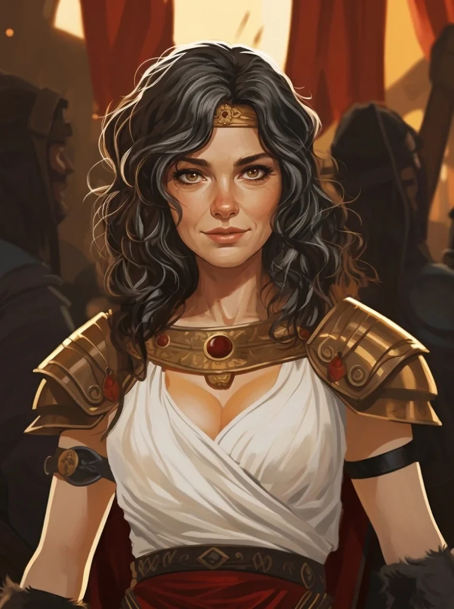
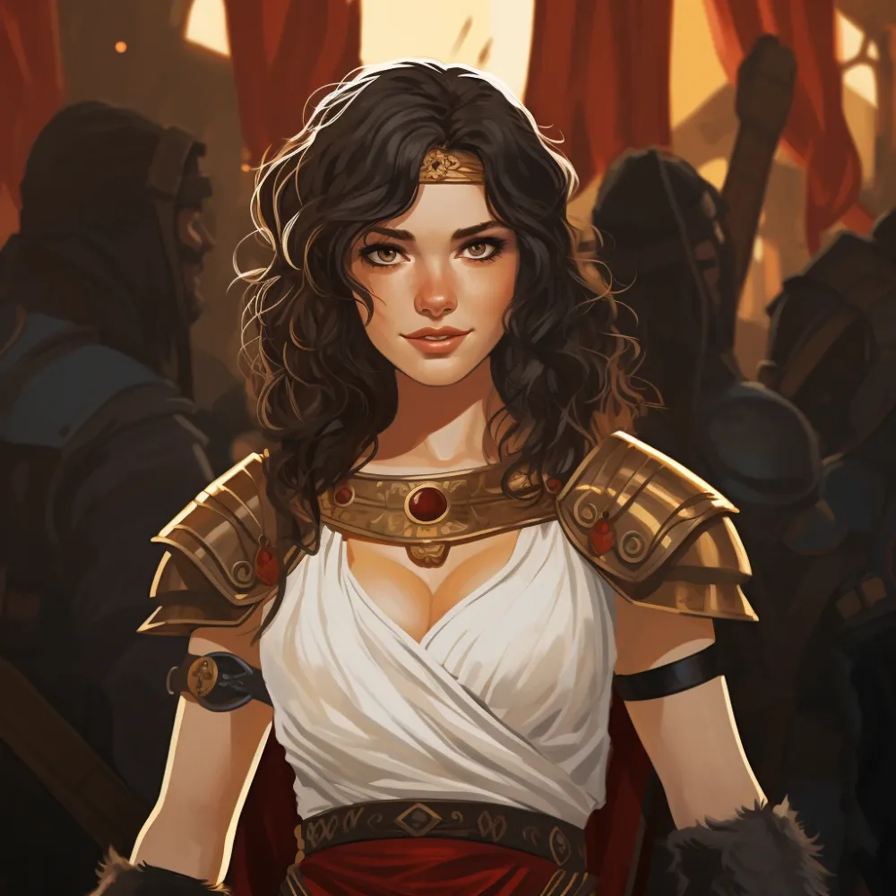

|  |  |
|:---:|:---:|
| Piętnaście lat po wojnie | W czasie wojny |

_Córka Thericlesa z [[Estoria]], towarzyszka drużyny i dowódczyni legionu w Bitwie o Mytros_

## Opis
Młoda kobieta, mieszkanka okolic [[Estoria]].

## Osobowość
Odważna, choć przerażona wydarzeniami w [[Stary Las|Starym Lesie]].

## Historia
Corinna jest córką Thericlesa, który prowadzi winnicę w [[Estoria]]. Ona i jej przyjaciele zostali zwabieni do [[Świątynia w Starym Lesie|Świątyni w Starym Lesie]] przez [[Demetria|Demetrię]], która obiecywała im bogactwo i sławę. Została ostrzeżona przez satyra o imieniu [[Loreus]], że czeka ich los gorszy niż śmierć, i zdołała uciec, choć była ścigana przez goatlingi. Pomogła bohaterom odnaleźć drogę do świątyni, by ratować swoich przyjaciół.

W [[Sesja 4 - Mroczne sekrety Świątyni]] bohaterowie uratowali porwanych nastolatków, wśród nich Corinnę.

W [[Sesja 31 - Wyprawa na Themis]] dołączyła do drużyny przed wyprawą na [[Themis|Wyspę Themis]].

W [[Sesja 47 - Wyspa Mojr]] weszła w skład drużyny desantowej na Wyspę Mojr, razem z [[Astra|Astrą]] i Versi.

W [[Sesja 76 - Bitwa o Mytros: Pierwsza Fala]] po poległym w pierwszej fali [[Steros|Sterosie]] [[Versir]] zabiegał o przeniesienie Corinny na pozycję dowódcy [[Egida Mytros|Egidy Mytros]] i to ona objęła po nim dowodzenie. W [[Sesja 77 - Bitwa o Mytros: Upadek Icarusa]] stanęła na czele jednego z legionów.

W [[Sesja 84 - Świt Nowej Ery]], gdy po piętnastu latach nowo wykluta smoczyca dorosła do roli wierzchowca, padła propozycja, by jeźdźcem została właśnie ona — jako ta z drugiego szeregu towarzyszy, która niejedną dobrą radą zdążyła się już drużynie przysłużyć. Jako potomkini dawnych [[Smoczy Lordowie|Smoczych Lordów]] została jeźdźczynią brązowej smoczycy [[Ataraksja|Ataraksji]] w [[Zakon Smoczych Lordów|Zakonie Smoczych Lordów]] na [[Wyspa Yonder|Yonder]].
