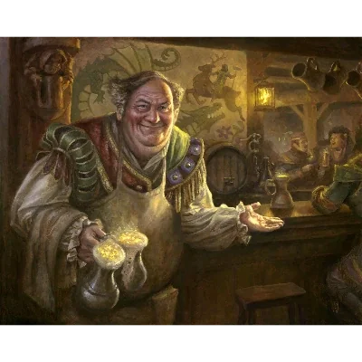

_Karczmarz [[Karczma Smoczy Ząb|Karczmy "Smoczy Ząb"]]_

## Opis
Szczupły, starszy mężczyzna o siwych włosach. Mimo wieku zachował sprawność dawnego żołnierza.

## Osobowość
Przyjazny i dobrze poinformowany, ale pozbawiony cierpliwości do czczych pogaduszek czy przesądów. Jest osobą twardo stąpającą po ziemi.

## Historia
Były weteran, który osiadł w [[Estoria|Estorii]] i prowadzi jedną z najpopularniejszych gospód w mieście. Zna niemal wszystkich mieszkańców i jest świetnym źródłem plotek oraz informacji.
