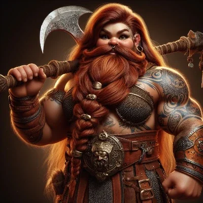

_Przywódczyni krasnoludów_

## Opis
Krasnoludka dowodząca krasnoludami z [[Estoria|Estorii]] ([[Sesja 76 - Bitwa o Mytros: Pierwsza Fala]]).

## Osobowość
TBD

## Historia
W [[Sesja 76 - Bitwa o Mytros: Pierwsza Fala]] dowodziła krasnoludami z [[Estoria|Estorii]], które w obronie [[Mytros]] wchodziły w skład zjednoczonych sił obrońców; w pierwszych starciach krasnoludy zmiażdżyły Gyganów dzięki przewadze w fazach manewru i szarży. W [[Sesja 77 - Bitwa o Mytros: Upadek Icarusa]] drużyna zmieniła dowódcę krasnoludów, a jego miejsce zajęła Falana.
