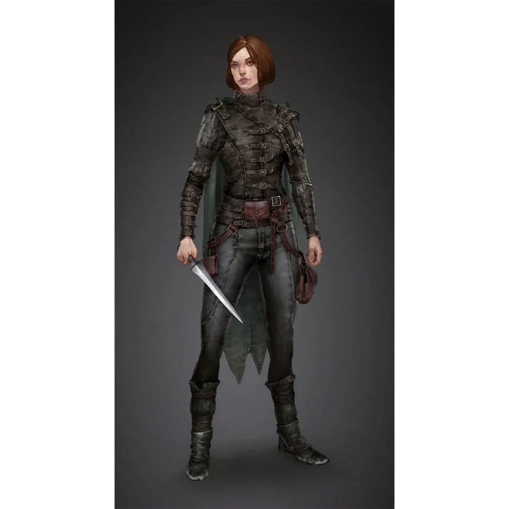

_Przywódczyni bandytów działających w okolicach [[Woodhike]]; członkini [[Kult Węża|Kultu Węża]]._

## Opis
Korteva to twarda kobieta, która przewodzi grupie kłusowników i bandytów. Jej znakiem rozpoznawczym jest brak litości i umiejętność podporządkowania sobie innych, w tym nawet istot znacznie silniejszych od niej.

## Osobowość
Okrutna, manipulacyjna i chciwa. Nie cofa się przed niczym, by osiągnąć swoje cele, w tym przed porywaniem zwierząt mieszkańcom [[Woodhike]] i niszczeniem lasów.

## Historia
W [[Sesja 6 - Problemy w Woodhike]] bohaterowie dowiedzieli się w [[Woodhike]] o zaginionych zwierzętach i ściętych drzewach, po czym starli się z grupą bandytów dowodzonych przez Kortevę. Po zaciętej walce pokonali bandytów, odkrywszy, że w grupie był również przyjazny cyklop, którego postanowili oszczędzić.

Korteva zdołała przekonać (lub zmusić) do współpracy łagodnego cyklopa, wmawiając mu, że duszki z lasu są jego wrogami. [[Versir]] uwolnił ją w nocy, ukrywając to przed resztą [[Bohaterowie Przepowiedni|Bohaterów Przepowiedni]].

W [[Sesja 7 - Uratować Księżniczkę]] bohaterowie dowiedzieli się o jej przynależności do [[Kult Węża|Kultu Węża]] i o misji odbicia minotaurów.
